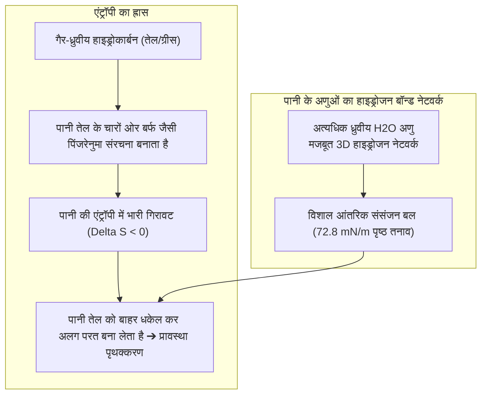
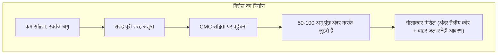

जमी हुई चिकनाई से सनी थाली या मैल व पसीने से सने कपड़ों को केवल सादे पानी से धोना असंभव है। पानी की बूंदें चिकनाई पर से फिसल कर गिर जाती हैं और मैल कपड़ों के रेशों से चिपका रहता है।

परंतु साबुन का झाग या डिटर्जेंट की कुछ बूंदें डालते ही एक चमत्कार घटित होता है: पानी और तेल दूधिया इमल्शन में घुल जाते हैं, तेल की परत सिकुड़ कर गोल बूंदों में बदल जाती है और पानी के बहाव के साथ आसानी से बह जाती है।

2500 ईसा पूर्व प्राचीन बेबीलोन में जानवरों की चर्बी और राख को उबालकर पहला साबुन बनाने से लेकर आज के बायो-एंजाइम डिटर्जेंट तक, साबुन ने एंटीबायोटिक दवाओं से भी अधिक मानव जीवन की रक्षा की है।

परंतु आणविक भौतिकी के नजरिए से देखें तो कई सवाल उठते हैं:
"पानी और तेल आपस में क्यों नहीं मिलते?"
"साबुन का अणु इन दोनों के बीच मध्यस्थता कैसे करता है?"
"क्या साबुन का घना झाग वास्तव में कपड़े साफ करता है?"
"कठोर (खारे) पानी में साधारण साबुन झाग क्यों नहीं देता और सफेद मैल क्यों छोड़ता है?"

सफाई केवल एक घर्षण प्रक्रिया नहीं है। यह <strong>«हाइड्रोफोबिक प्रभाव की एंट्रॉपी ऊष्मागतिकी, गिब्स अधिशोषण द्वारा पृष्ठ तनाव में गिरावट, नैनो-मिसेल का स्वतः निर्माण और स्थिरवैद्युत प्रतिकर्षण की एक अत्यंत परिष्कृत कोलाइडल रासायनिक प्रक्रिया है»</strong>।

---

## 1. हाइड्रोफोबिक प्रभाव: पानी तेल से नफरत नहीं करता

पानी और तेल के अणुओं के बीच भी वैन डेर वाल्स आकर्षण बल होता है। इनके अलग रहने का कारण यह नहीं है कि तेल पानी से दूर भागता है, बल्कि <strong>पानी के अणुओं के बीच हाइड्रोजन बंधन इतने मजबूत होते हैं कि वे गैर-ध्रुवीय तेल के अणुओं को बाहर धकेल देते हैं</strong>।

पानी का प्रत्येक हाइड्रोजन बंध लगभग $20\text{ kJ/mol}$ ऊर्जा रखता है। तेल के अणु के आसपास पानी को बर्फ जैसे पिंजरे बनाने पड़ते हैं, जिससे एंट्रॉपी घट जाती है ($\Delta S < 0$)। अपनी एंट्रॉपी बढ़ाने और मुक्त ऊर्जा घटाने के लिए पानी तेल को पूरी तरह बाहर धकेल देता है।

---

## 2. सर्फेक्टेंट की संरचना और गिब्स का नियम

सर्फेक्टेंट (पृष्ठ संक्रियक) अणु <strong>उभयधर्मी (Amphiphilic)</strong> होते हैं:
- <strong>हाइड्रोफिलिक हेड (जल-स्नेही सिर)</strong>: ध्रुवीय या आवेशित समूह ($-\text{COO}^-$, $-\text{SO}_3^-$) जो पानी में घुलनशील है।
- <strong>हाइड्रोफोबिक टेल (जल-विरोधी पूंछ)</strong>: गैर-ध्रुवीय हाइड्रोकार्बन श्रृंखला ($C_{12} \sim C_{18}$) जो तेल में घुलती है।

पानी की सतह पर एकत्रित होकर ये अणु पानी के पृष्ठ तनाव को <strong>$72.8\text{ mN/m}$ से घटाकर $25 \sim 30\text{ mN/m}$</strong> कर देते हैं, जिससे पानी कपड़ों के रेशों में गहराई तक समा जाता है।

---

## 3. क्रांतिक मिसेल सांद्रता (CMC) और मिसेल निर्माण

जब सतह पूरी तरह भर जाती है, तो पानी के अंदर मौजूद अतिरिक्त सर्फेक्टेंट अणु <strong>क्रांतिक मिसेल सांद्रता (CMC)</strong> पर स्वतः जुड़कर 3 से 5 नैनोमीटर व्यास के गोलाकार <strong>मिसेल (Micelles)</strong> बनाते हैं:

मिसेल के आंतरिक हाइड्रोकार्बन कोर में अघुलनशील तेल और ग्रीस समा जाते हैं (घुलनशीलता/सॉल्युबलाइजेशन)।

---

## 4. रोलिंग-अप (Rolling-up) और सफाई प्रक्रिया

सर्फेक्टेंट के प्रभाव से तेल का संपर्क कोण $0^\circ$ से बढ़कर लगभग $180^\circ$ हो जाता है (यंग का समीकरण)।
तेल की परत <strong>सिकुड़कर गोल बूंदों में बदल जाती है (रोलिंग-अप)</strong>, जिससे कपड़े से उसका संपर्क 90 % तक घट जाता है। पानी के हल्के बहाव से बूंदें टूटकर अलग हो जाती हैं, मिसेल उन्हें कैद कर लेते हैं और ऋणात्मक <strong>जीटा विभव ($\zeta \approx -40\text{ mV}$)</strong> के कारण वे दोबारा कपड़े पर नहीं चिपकतीं।

---

## 5. कठोर जल और जियोलाइट की भूमिका

कठोर पानी में मौजूद कैल्शियम आयनों के साथ मिलकर साधारण साबुन अघुलनशील <strong>धात्विक साबुन (स्कम/सफेद मैल)</strong> बनाता है:
$$2\text{C}_{17}\text{H}_{35}\text{COO}^- + \text{Ca}^{2+} \longrightarrow (\text{C}_{17}\text{H}_{35}\text{COO})_2\text{Ca} \downarrow$$
आधुनिक डिटर्जेंट में <strong>जियोलाइट 4A (Zeolite)</strong> मिलाया जाता है, जो कैल्शियम आयनों को सोखकर पानी को तुरंत मीठा (मृदु) बना देता है।

---

## 6. बायो-एंजाइम और झाग का मारंगोनी प्रभाव

- <strong>एंजाइम</strong>: प्रोटीएज प्रोटीन के दाग हटाते हैं; लाइपेस वसा तोड़ते हैं; और <strong>सेल्युलेज</strong> सूती धागों के मुड़े हुए सूक्ष्म रेशों को तराश कर फंसे हुए मैल को बाहर निकालते हैं और कपड़ों का रंग निखारते हैं।
- <strong>मारंगोनी प्रभाव</strong>: झाग की झिल्ली पतली होने पर पृष्ठ तनाव के अंतर से स्वतः ठीक हो जाती है। झाग मैल को तैरने में मदद करता है और त्वचा को रगड़ से बचाता है।

---

## 7. निष्कर्ष

साबुन केवल मैल हटाने का साधन नहीं है, बल्कि यह आणविक ऊष्मागतिकी और कोलाइडल रसायन विज्ञान का एक उत्कृष्ट चमत्कार है जिसने मानव सभ्यता को स्वच्छता और स्वास्थ्य का वरदान दिया है।
