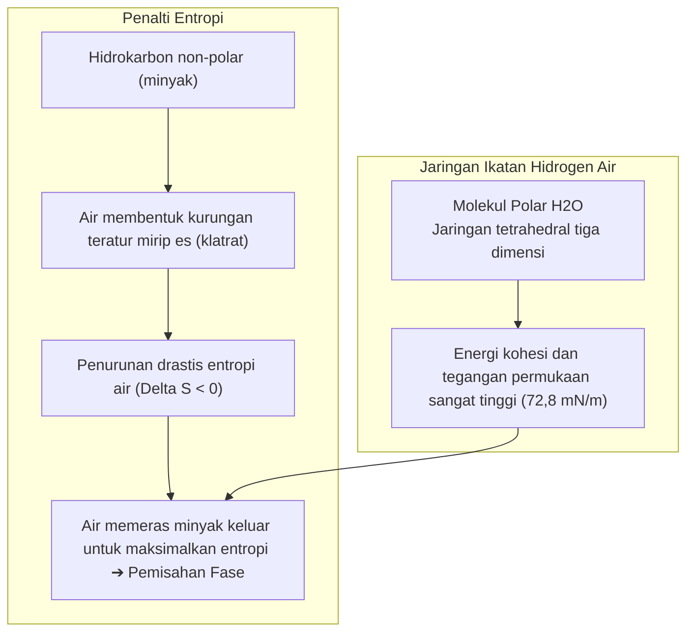
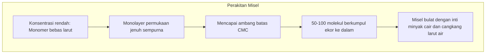

Piring yang berlumuran minyak masakan membeku atau pakaian kotor penuh sebum tubuh tidak akan pernah bisa bersih jika hanya dibilas dengan air biasa. Air menggumpal dan meluncur jatuh tanpa mampu melarutkan lapisan lemak yang menempel kuat.

Namun, cukup teteskan sedikit sabun cuci piring atau busa sabun mandi, sebuah keajaiban fisikakimia langsung terjadi: air dan minyak yang bermusuhan seketika teremulsi menjadi cairan keruh, lapisan minyak menggulung menjadi tetesan bulat kecil, dan hanyut terbawa air bilasan.

Dari bangsa Babilonia kuno pada 2500 SM yang merebus lemak hewani dengan abu kayu, hingga detergen modern berenzim rekayasa genetika, sabun adalah penemuan ilmiah yang menyelamatkan jutaan nyawa melebihi antibiotik.

Dari kacamata fisikakimia molekuler:
"Mengapa air dan minyak pada dasarnya tidak mau bercampur?"
"Trik molekuler apa yang digunakan sabun untuk mendamaikan keduanya?"
"Apakah busa melimpah benar-benar mencuci kotoran atau hanya ilusi?"
"Mengapa sabun gagal berbusa dan meninggalkan kerak lengket di air sadah?"

Mencuci pakaian bukan sekadar gesekan mekanis: ini adalah <strong>«koreografi termodinamika yang digerakkan oleh penolakan hidrofobik entropis, penurunan drastis tegangan antarmuka Gibbs, perakitan mandiri misel supramolekuler, dan tolakan elektrostatik lapisan ganda.»</strong>

---

## 1. Termodinamika Efek Hidrofobik: Air Tidak Membenci Minyak

Air dan minyak sebenarnya saling tarik-menarik melalui gaya dispersi Van der Waals yang lemah. Pemisahan fase terjadi karena <strong>ikatan hidrogen antarmolekul air begitu kuat dan rapat sehingga molekul minyak non-polar terdesak keluar secara paksa</strong>.

Setiap ikatan hidrogen melepaskan energi sekitar $20\text{ kJ/mol}$. Untuk menampung molekul minyak, air terpaksa membentuk sangkar klatrat kaku yang menurunkan entropi sistem ($\Delta S < 0$). Untuk meminimalkan energi bebas Gibbs ($\Delta G = \Delta H - T\Delta S$), air memeras minyak keluar ke fase terpisah.

---

## 2. Anatomi Surfaktan dan Isoterm Gibbs

Surfaktan memiliki sifat <strong>amfifilik</strong>:
- <strong>Kepala Hidrofilik</strong>: Gugus polar atau bermuatan ($-\text{COO}^-$, $-\text{SO}_3^-$), sangat larut dalam air.
- <strong>Ekor Hidrofobik</strong>: Rantai hidrokarbon alifatik non-polar ($C_{12} \sim C_{18}$).

Di antarmuka air-udara, surfaktan membentuk lapisan tunggal yang memangkas tegangan permukaan air dari <strong>$72,8\text{ mN/m}$ menjadi $25 \sim 30\text{ mN/m}$</strong>, membuat air mampu membasahi pori-pori mikroskopis serat kain.

---

## 3. Konsentrasi Misel Kritis (CMC) dan Perakitan Mandiri

Ketika permukaan telah jenuh, surfaktan mulai berkerumun di dalam air membentuk <strong>misel</strong> bulat berukuran 3 hingga 5 nm di atas ambang <strong>CMC (Critical Micelle Concentration)</strong>:

Inti hidrokarbon cair di dalam misel melarutkan dan mengurung kotoran minyak yang tidak larut dalam air (solubilisasi).

---

## 4. Mekanisme Penggulungan (Rolling-up)

Dengan mengubah tegangan antarmuka, sudut kontak minyak berubah dari $0^\circ$ menjadi mendekati $180^\circ$ (persamaan Young).
Lapisan lemak <strong>menggulung menjadi tetesan bola (rolling-up)</strong>, memangkas area kontak dengan kain hingga lebih dari 90 %. Aliran air melepaskan tetesan ini, misel mengurungnya, dan <strong>potensial zeta negatif ($\zeta \approx -40\text{ mV}$)</strong> menolak kotoran secara elektrostatik agar tidak menempel kembali.

---

## 5. Masalah Air Sadah dan Zeolit

Sabun tradisional bereaksi dengan ion kalsium pada air sadah membentuk <strong>endapan sabun logam tak larut (kerak sabun)</strong>:
$$2\text{C}_{17}\text{H}_{35}\text{COO}^- + \text{Ca}^{2+} \longrightarrow (\text{C}_{17}\text{H}_{35}\text{COO})_2\text{Ca} \downarrow$$
Detergen modern menyertakan <strong>zeolit 4A</strong>, penukar ion yang mengurung kalsium dan melunakkan air secara instan.

---

## 6. Enzim dan Efek Busa Marangoni

- <strong>Enzim Pembersih</strong>: Protease memecah noda darah; lipase memecah lemak; dan <strong>selulase</strong> mencukur serabut mikro kain katun yang rusak untuk melepaskan kotoran terjebak dan mencerahkan warna baju.
- <strong>Efek Marangoni</strong>: Busa memperbaiki dirinya sendiri saat lapisan cairan menipis melalui aliran balik cairan akibat gradien tegangan permukaan, membantu mengapungkan kotoran ke permukaan air.

---

## 7. Kesimpulan

Sabun adalah pencapaian luar biasa kimia koloid yang memanfaatkan termodinamika molekuler untuk menjaga kesehatan dan sanitasi peradaban manusia.
