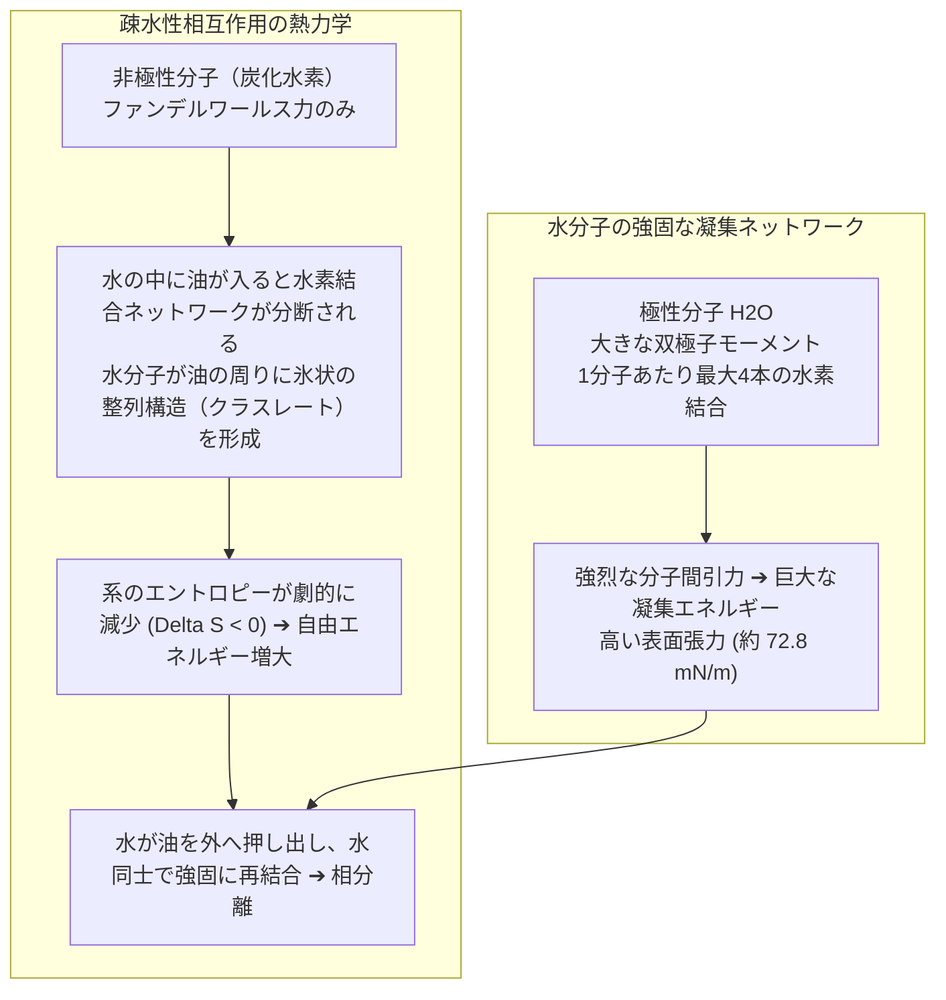
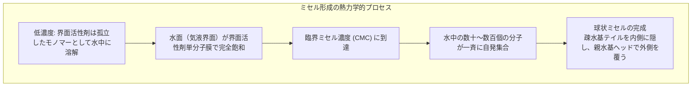
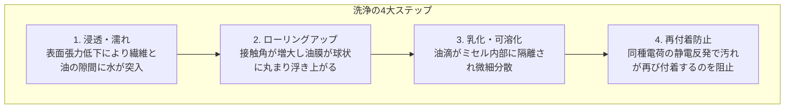
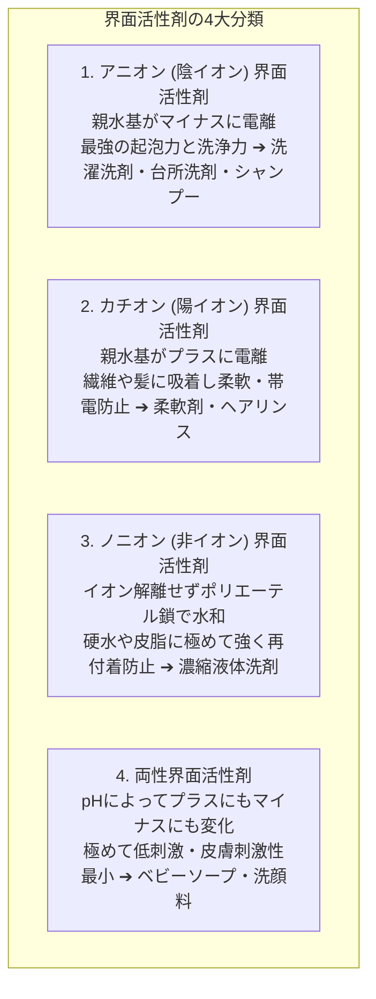
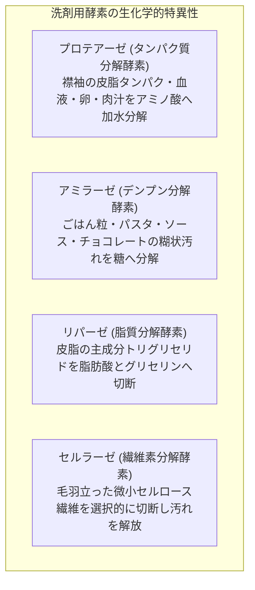
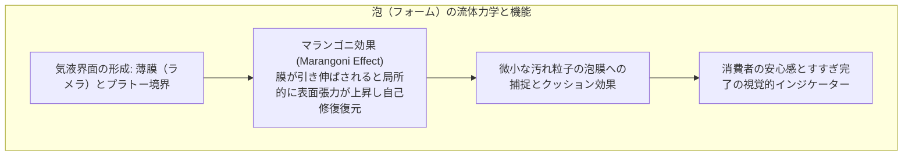
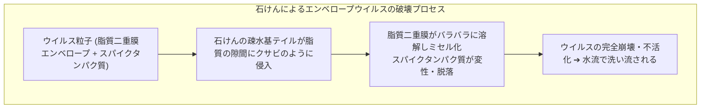

油でギトギトに汚れた中華鍋や、泥まみれになった子供の靴下。水だけでいくら擦っても、油は水を弾き、汚れは布地の繊維にしがみついてビクともしません。

ところが、そこにほんの数滴の洗剤や石けん泡を垂らした瞬間、魔法のような光景が広がります。激しく反発し合っていた水と油が白く濁りながら溶け合い、あれほど頑固だった油膜がサラサラと水に流されて、皿や布地はピカピカに洗い上がります。

古代メソポタミアの粘土板（紀元前2500年頃）に、動物の脂と木灰を煮詰めて石けんを作った最古の記録が刻まれて以来、人類は4500年以上にわたって石けんの恩恵を受け続けてきました。中世ヨーロッパにおけるペスト（黒死病）やコレラの猛威を鎮め、人類の平均寿命を劇的に倍増させた最大の功労者は、抗生物質でも先端医療でもなく、「石けんによる手洗いと衛生の確立」であったと言われています。

しかし、冷静に分子の視点から考えてみてください。
「水と油はなぜ絶対に混ざり合わないのか？」
「石けんは、一体どのような物理的・化学的トリックを使って水と油を和解させているのか？」
「洗剤を泡立てるとモコモコと立つ『泡』は、本当に汚れを落としているのか？」
「なぜヨーロッパなどの硬水地域では、日本の石けんが全く泡立たず役に立たないのか？」

石けんの洗浄とは、単に汚れを擦り落とす機械的作業ではありません。それは、<strong>「水分子の強烈な自己凝集力（水素結合）を制御し、界面自由エネルギーを劇的に引き下げ、熱力学的な自己組織化によって油分子を分子のカプセル（ミセル）に閉じ込めて水中に連れ去る、極めてエレガントなコロイド界面化学のドラマ」</strong>です。

本稿では、水と油の熱力学的対立から、界面活性剤の分子構造、臨界ミセル濃度（CMC）と可溶化、油汚れを引き剥がす「ローリングアップ現象」、硬水と石けんカスの沈殿化学、最新合成洗剤の進化、汚れを標的分解する酵素バイオテクノロジー、そして泡の流体力学（マランゴニ効果）までを徹底的に解き明かします。

---

## 1. 水と油の永遠の対立：なぜ混ざらないのか？

「水と油は仲が悪い（反発し合っている）」とよく言われますが、これは物理化学的には<strong>正確ではありません</strong>。

実は、油（炭化水素）分子と水分子の間にも、微弱なファンデルワールス力（分散力）による引力が確実に働いています。水と油が混ざり合わない真の理由は、「油が水を嫌っている」からではなく、<strong>「水分子同士の引き合う力が強大すぎて、油分子が仲間外れにされているから」</strong>です。



### 1.1 水素結合とエントロピー的疎水性効果
水分子（$\text{H}_2\text{O}$）は、酸素原子が共有電子対を強く引き付けるため、酸素側が負（$\delta^-$）、水素側が正（$\delta^+$）に強く分極した「極性分子」です。水分子同士は、<strong>水素結合（結合エネルギー約 $20\text{ kJ/mol}$）</strong>という強固なネットワークを三次元的に張り巡らせています。水の表面張力が <strong>$72.8\text{ mN/m}$（$20^\circ\text{C}$）</strong>という、水銀を除くあらゆる液体の中で異常に高い値を示すのはこのためです。

一方、油（長鎖アルカンやトログリセリドなどの脂質）は、電気的な偏りのない「非極性分子」であり、微弱なファンデルワールス力（数 $\text{kJ/mol}$）しか持っていません。

水の中に油分子が入り込むと、水分子は自らの水素結合を断ち切らなければならず、さらに油分子の周りを取り囲む水分子が自由な熱運動を奪われてカゴ状に整列（クラスレートケージを形成）します。これにより系の乱雑さ（エントロピー $S$）が著しく低下し、ギブズ自由エネルギー変化 $\Delta G = \Delta H - T\Delta S$ が正となって熱力学的に不利になります。

その結果、水分子は自らのエントロピー利得を最大化するため、油分子を互いに押し付け合わせて排除し、水相と油相という2つの層へと綺麗に相分離します。これが<strong>「疎水性効果（Hydrophobic Effect）」</strong>の正体です。

---

## 2. 界面活性剤の分子構造：二重人格のナノ粒子

水と油という相容れない二者を強引に握手させるために生み出された化学物質こそが、<strong>「界面活性剤（Surfactant / Surface Active Agent）」</strong>です。石けんも界面活性剤の代表的な一角を占めています。

界面活性剤の最大の特徴は、たった1つの分子の中に相反する2つの性質が同居している<strong>「両親媒性（Amphiphilic）」</strong>にあります。

```
界面活性剤分子の構造モデル：

      親水基ヘッド（水になじむ親水部）
         ┌───┐
         │ ○ │ ── 極性基（イオン基、カルボキシ基、硫酸基など）
         └───┘
           │
           │ ─── 疎水基テイル（油になじむ親油部）
           │     長鎖アルキル基（炭素数 12〜18 の炭化水素鎖）
           │
```

1. <strong>親水基（Hydrophilic Head）</strong>：
   水分子と水素結合や静電相互作用を形成できる極性部分。イオン解離するアニオン基（$-\text{COO}^-$, $-\text{SO}_4^-$）や、オキシエチレン鎖などが担当します。
2. <strong>疎水基 / 親油基（Hydrophobic/Lipophilic Tail）</strong>：
   水から嫌われ、油と親和性の高い非極性の長い炭化水素鎖（通常炭素数 $12 \sim 18$、例えばラウリル基 $\text{C}_{12}\text{H}_{25}-$ やオレイル基など）。

### 2.1 ギブズの吸着等温式と表面張力の劇的低下
水に界面活性剤を溶かすと、疎水基テイルは水分子の水素結合ネットワークから激しく嫌われて外へ押し出されます。その結果、界面活性剤分子は水と空気の境界（気液界面）や、水と容器の壁面の境界へと自発的に殺到し、親水基を水中に突っ込み、疎水基を空気側へと突き出した<strong>単分子膜（Monolayer）</strong>を形成して整列します。

気液界面に界面活性剤がびっしりと並ぶと、表面で水分子同士が強く引き合っていた水素結合が遮断され、水の表面張力は $72.8\text{ mN/m}$ から一気に <strong>$25 \sim 30\text{ mN/m}$</strong> へと半分以下にまで激減します。

この現象は、界面熱力学における<strong>「ギブズの吸着等温式（Gibbs Adsorption Isotherm）」</strong>によって厳密に記述されます。

$$\Gamma = -\frac{1}{RT} \frac{d\gamma}{d\ln C}$$

- $\Gamma$：界面過剰量（表面に吸着した界面活性剤の密度）
- $\gamma$：表面張力
- $C$：界面活性剤の濃度
- $R$：気体定数、$T$：絶対温度

濃度 $C$ を増やすほど、表面張力 $\gamma$ が急激に低下（$d\gamma/d\ln C < 0$）し、界面吸着量 $\Gamma$ が増大します。
表面張力が下がった水は、毛細管現象によって繊維の細い隙間や衣類の繊維の奥深くまで瞬時に濡れ広がる（浸透する）ことができるようになります。

---

## 3. ミセルの自己組織化と熱力学：臨界ミセル濃度（CMC）

水溶液中の界面活性剤濃度を徐々に高めていくと、水面（気液界面）は界面活性剤分子で完全に埋め尽くされ、もはや入る隙間がなくなります。

「水面からあふれた余分な疎水基テイルは、水中でどこへ行くべきなのか？」

ここで自然界の熱力学が引き起こす驚異的な現象が、<strong>「ミセル（Micelle）の自己組織化」</strong>です。



水中の界面活性剤分子たちは、互いの疎水基テイル同士を内側に集めて寄せ合い、水になじむ親水基ヘッドを外側の球表面に向けて整列させた、直径 $3 \sim 5\text{ nm}$ 程度の球状集合体（ミセル）を自発的に形成します。

このミセルが形成され始める境界濃度を<strong>「臨界ミセル濃度（CMC: Critical Micelle Concentration）」</strong>と呼びます。

```
濃度に対する物性変化の劇的変曲点 (CMCの物理):
  物性値
   ^
   |  表面張力 gamma ───┐
   |                    \
   |                     \___________ 一定（これ以上下がらない）
   |
   |                                 / 浸透圧
   |                     ___________/
   |                    /
   |  可溶化能 (洗浄力) /
   |  ─────────────────┴────────────────────────> 界面活性剤濃度 C
                      CMC (臨界ミセル濃度)
```

1. <strong>CMC未満</strong>：表面張力は濃度とともに急激に低下しますが、水中にはまだミセルが存在しないため、油を包み込む「洗浄力」はほとんど発揮されません。
2. <strong>CMC以上</strong>：表面張力は下限値に達して一定となり、それ以上界面活性剤をいくら追加しても表面張力は下がりません。代わりに、追加された分子はすべて新しいミセルを形成するために使われ、<strong>油汚れを溶かし込む「洗浄力（可溶化能）」が爆発的に急上昇</strong>します。

したがって、洗濯や食器洗いで洗剤を使う際、「CMC以上の濃度」を確保することが物理化学的に絶対条件となります。

---

## 4. 洗浄のダイナミクス：油汚れはどうやって落ちるのか

衣服につく皮脂汚れや、食器につく油汚れの多くは、常温では粘度の高いドロドロした液体、または半固体の油膜として表面に固着しています。
洗剤液の中で、この油汚れが引き剥がされて水中に分散するプロセスは、以下の<strong>「4つの素過程」</strong>を経て進行します。



### 4.1 接触角の逆転：ローリングアップ現象（Rolling-up）
固体（布地や皿）の上にべったりと広がった油膜に洗剤水溶液が接触すると、ヤングの式のバランスが劇的に変化します。

洗剤分子が「水と固体表面の界面」および「水と油の界面」に猛烈な勢いで吸着し、それぞれの界面張力 $\gamma_{\text{SW}}$（固体-水）および $\gamma_{\text{OW}}$（油-水）を極限まで引き下げます。

すると、油と固体の接触角 $\theta$ が $0^\circ$（べったり広がった状態）から、$90^\circ$、そして $180^\circ$ へと押し広げられていきます。
油膜は自ら身を縮めるように<strong>丸い水滴状（球状の油滴）へと変形し、固体表面との接触面積を急速に縮小させていきます</strong>。これを<strong>「ローリングアップ（Rolling-up）現象」</strong>と呼びます。

球状に丸まった油滴は、もはや固体にしがみつく力を失っており、洗濯機の水流によるわずかな水力学的せん断力（対流や擦れ合い）を受けるだけで、ポロリと表面から千切れて水中に剥離・脱落します。

### 4.2 可溶化（Solubilization）と乳化（Emulsification）
水中に浮遊した油滴をそのまま放置すれば、時間とともに再び合体して大きな油膜に戻り、再び布地に再付着してしまいます。

ここで活躍するのが<strong>ミセル</strong>です。
ミセルの中心部（コア）は、疎水基テイルが密集した「純粋な有機液体（油）」と同じ環境になっています。水中に剥離した油分子は、水中にいるよりもミセルの内部に潜り込んだほうが熱力学的に圧倒的に安定するため、ミセルのコアの中へと喜んで吸い込まれていきます。
本来は水に一滴も溶けない油が、ミセルの中に閉じ込められることで、あたかも水に透明に溶けたように見えるこの現象を<strong>「可溶化（Solubilization）」</strong>と呼びます。

可溶化しきれない大きな油滴も、表面を無数の界面活性剤分子が外側を親水基で覆うように取り囲むことで、微細なエマルション粒子（水中油型：O/Wエマルション）として安定化されます（<strong>乳化：Emulsification</strong>）。

### 4.3 ゼータ電位による再付着防止
水中に分散した汚れ粒子や油滴の表面には、アニオン界面活性剤の負電荷（$-\text{COO}^-$ や $-\text{SO}_4^-$）が外側を向いて密集しています。
一方、木綿やポリエステルなどの繊維の表面も、水溶液中では負（マイナス）の電荷（<strong>ゼータ電位：$\zeta$</strong>）を帯びています。

マイナスとマイナスは強烈に反発し合う（クーロン静電反発力）ため、水中に浮かんだ汚れ粒子は繊維に二度と近づくことができず、すすぎの水とともに下水へと一網打尽に洗い流されます。

---

## 5. 硬水と石けんの宿命：石けんカスの化学

石けんは素晴らしい生分解性と安全性を誇る天然由来の界面活性剤ですが、数千年にわたって人類を悩ませてきた唯一最大の弱点が存在します。
それが<strong>「硬水（Hard Water）」</strong>との相性の悪さです。

```mermaid
flowchart TD
    subgraph HardWaterReaction ["石けんと硬水成分の沈殿反応"]
        Soap["脂肪酸ナトリウム (水溶性石けん)<br>2 C17H35COONa"]
        HardIons["硬水中のカルシウム・マグネシウムイオン<br>Ca2+ / Mg2+"]
        Scum["不溶性金属石けん (石けんカス)<br>(C17H35COO)2Ca ↓ 白色沈殿"]
        
        Soap + HardIons --> Scum
    end
```

### 5.1 金属石けん（スカム）の生成メカニズム
石けんの化学的実体は、牛脂やパーム油などの動植物油脂を水酸化ナトリウム（カセイソーダ）でケン化して作られる<strong>「脂肪酸ナトリウム（例：ステアリン酸ナトリウム $\text{C}_{17}\text{H}_{35}\text{COONa}$）」</strong>です。

日本のような火山灰地質の国では、河川水に含まれるミネラルが少ない「軟水」が多いため、石けんは豊かに泡立ちます。しかし、ヨーロッパや北米、中国などの大陸部では、石灰岩層を通った地下水が多く、水中に大量の<strong>カルシウムイオン（$\text{Ca}^{2+}$）</strong>や<strong>マグネシウムイオン（$\text{Mg}^{2+}$）</strong>が溶け込んだ「硬水」が一般的です。

硬水の中に石けんを投入すると、カルボキシ基（$-\text{COO}^-$）は水分子よりもはるかに強く二価のカルシウムイオンと結びつき、水に全く溶けない白色の不溶性塩――<strong>「金属石けん（カルシウム石けん / 石けんカス）」</strong>となって瞬時に沈殿してしまいます。

$$2\text{C}_{17}\text{H}_{35}\text{COO}^- + \text{Ca}^{2+} \longrightarrow (\text{C}_{17}\text{H}_{35}\text{COO})_2\text{Ca} \downarrow$$

硬水中のカルシウムイオンをすべて消費し尽くすまで、石けんは泡立つことも油を落とすこともできず、泥棒のように洗浄成分を無駄に奪われてしまいます。さらに、生成した石けんカスは粘着性が高く、浴槽や洗濯槽、衣類の繊維にこびりついて黒カビのエサや黄ばみの原因となります。

### 5.2 合成洗剤とビルダー（助剤）の革命
この硬水問題を克服するために20世紀前半に開発されたのが、石油由来の<strong>「合成洗剤」</strong>と<strong>「ビルダー（洗剤助剤）」</strong>です。

1. <strong>耐硬水性界面活性剤の開発</strong>：
   スルホン酸基（$-\text{SO}_3^-$）や硫酸エステル基（$-\text{OSO}_3^-$）を持つ界面活性剤（LASやAES）は、カルシウムイオンと結合しても水溶性を保つため、硬水でも洗浄力を失いません。
2. <strong>ゼオライト（Zeolite）とキレート剤</strong>：
   現代の粉末洗剤や液体洗剤には、水中のカルシウムやマグネシウムを「身代わり」となって捕獲する<strong>ゼオライト（アルミノケイ酸塩）</strong>や<strong>クエン酸塩、EDTA（キレート剤）</strong>が大量に配合されています。ゼオライトの微細な孔がカルシウムイオンを瞬時に吸着・交換（イオン交換）し、水を瞬時に「人工的な軟水」に変えることで、主成分の界面活性剤が100%の洗浄力を発揮できるように舞台を整えています。

---

## 6. 合成洗剤の進化：4大界面活性剤の体系

現代の洗浄剤には、用途に応じて性質の異なる4種類の界面活性剤が使い分けられています。



1. <strong>アニオン（陰イオン）界面活性剤</strong>：
   - 代表例：直鎖アルキルベンゼンスルホン酸塩（LAS）、アルキルエーテル硫酸エステル塩（AES）。
   - 特徴：水中で親水基がマイナスのイオンに電離。豊かな泡立ちと強力な油汚れ洗浄力を持ち、衣料用洗剤や食器用洗剤の主力。
2. <strong>カチオン（陽イオン）界面活性剤</strong>：
   - 代表例：アルキルトリメチルアンモニウム塩、塩化ジアルキルジメチルアンモニウム。
   - 特徴：親水基がプラスに電離。衣類や毛髪（水中でマイナスに帯電している）に電気的に吸着し、油の膜を作って滑りを良くします。洗浄用ではなく、<strong>柔軟剤やヘアトリートメント、殺菌剤</strong>として使用されます。
3. <strong>ノニオン（非イオン）界面活性剤</strong>：
   - 代表例：ポリオキシエチレンアルキルエーテル（AE）。
   - 特徴：水中でイオンに解離せず、親水基の酸素原子と水分子との水素結合によって水に溶解。カルシウムイオンの影響を一切受けず、低温の水でも油汚れを強力に溶かし込みます。現代の<strong>「濃縮液体洗濯洗剤」</strong>の主役です。
4. <strong>両性（両性イオン）界面活性剤</strong>：
   - 代表例：アルキルベタイン、アルキルアミンオキシド。
   - 特徴：同一分子内にプラスとマイナスの両方の電荷を持ち、皮膚に対する刺激性が極めてマイルド。高級シャンプーやベビーソープに配合されます。

---

## 7. バイオテクノロジーの融合：酵素（Enzyme）配合洗剤の奇跡

界面活性剤がいかに優れた物理的リフトオフ能力を持っていても、分子量が数万〜数百万に達する生体高分子（タンパク質やデンプン）が繊維の奥深くに乾いてこびりつくと、界面活性剤の浸透力だけでは引き剥がすことが困難になります。

この限界を打ち破ったのが、生物の消化作用を洗濯機の中に応用した<strong>「酵素（Enzyme）配合洗剤」</strong>です。



### セルラーゼの驚くべきメカニズム：繊維を剃って白くする
数ある洗剤用酵素の中で、最も独創的なのが<strong>「セルラーゼ」</strong>です。
セルラーゼは汚れそのものを分解するのではなく、<strong>綿（コットン）の衣服の繊維そのもの</strong>に作用します。

綿の服を何度も着用して洗濯していると、摩擦によって繊維の表面に目に見えない微細な「毛羽立ち（ミクロフィブリル）」が無数に発生します。この毛羽立ちの隙間に泥粒子や皮脂汚れが物理的にガッチリと挟まり込むことで、服全体が薄汚れた灰色や黄ばみとなって定着します。

セルラーゼは、健全な主繊維には手を付けず、<strong>汚れを抱え込んだ微細な毛羽立ちだけをハサミのように選択的に切断・分解</strong>します。
毛羽立ちが切り落とされると、挟まっていた汚れは自動的に水中に解放され、繊維の表面が新品時のように平滑に蘇るため、<strong>「色あせた服の鮮やかさが復活し、白さが際立つ」</strong>という驚異的なリフレッシュ効果をもたらすのです。

---

## 8. 泡の物理学：モコモコの泡は本当に汚れを落としているのか？

多くの人々は、「泡立ちが良い洗剤ほど、汚れがよく落ちる」と信じています。しかし、界面化学の厳密な答えは<strong>「No」</strong>です。

事実、工業用の大型洗浄機やドラム式全自動洗濯機、食器洗い乾燥機では、泡が立ちすぎるとクッションになって水流の機械的衝撃力を奪ってしまうため、<strong>「あえて全く泡立たないように設計された特殊な洗剤」</strong>が使われています。

では、なぜ家庭用洗剤はこれほど豊かに泡立つように作られているのでしょうか？ そして泡は洗浄において何の役に立っているのでしょうか？



### 8.1 泡の膜を安定化させる「マランゴニ効果」
純粋な水の中に空気を吹き込んでも、水面で一瞬にして気泡が弾けて消えてしまいます。界面活性剤が入っていると泡が消えない理由は、流体力学における<strong>「ギブズ-マランゴニ効果（Gibbs-Marangoni Effect）」</strong>にあります。

泡の薄い膜（ラメラ）が外力によって引き伸ばされて局所的に薄くなると、その部分の界面活性剤の密度が瞬間的に低下します。
すると、その部分の表面張力が急激に高くなります。液体は「表面張力の低いところから高いところへ向かって流れる」という性質があるため、周囲から界面活性剤を含んだ水が薄くなった部分へと一気に逆流して補給され、膜の破断を自動修復します。この自己修復機構によって、石けんの泡は数十分間も安定して存在し続けることができるのです。

### 8.2 洗浄における泡の真の役割
泡そのものが油を溶かすわけではありませんが、泡には以下の重要な物理的補助機能があります：
1. <strong>汚れの吸着と浮上（キャリーアップ）</strong>：
   泡の表面（気液界面）は広大な面積を持っています。水中で剥離した泥の微粒子や不溶性の汚れは、泡の表面に吸着され、泡とともに液面に押し上げられることで、沈降して底の布地に再付着するのを防ぎます。
2. <strong>垂直面への保持（滞留時間の延長）</strong>：
   壁面や換気扇、斜めの食器などに洗剤液を吹き付ける際、サラサラの液体では重力で一瞬で流れ落ちてしまいます。モコモコの濃密泡にすることで、洗剤成分を汚れの表面に数分〜数十分間とどまらせ、浸透と化学分解のための時間を稼ぐことができます。
3. <strong>摩擦のクッション（手肌と布地の保護）</strong>：
   洗顔時やシャンプー時、きめ細かい弾力のある泡が「クッション」となって指と肌の直接の強い摩擦を防ぎ、皮膚の角質層を傷つけることなく汚れだけを取り去ります。

---

---

## 9. 温度と相平衡の科学：クラフト点と曇点

「お湯で洗うと、なぜ水よりも圧倒的に汚れが落ちるのか？」
単に油が温まって柔らかくなるだけでなく、界面活性剤の溶解度とミセル形成には、熱力学的な厳密な温度境界が存在します。

### 9.1 イオン性界面活性剤の「クラフト点（Krafft Point）」
石けんやアニオン界面活性剤の水に対する溶解度は、ある特定の温度に達した瞬間に、垂直に近い角度で爆発的に急上昇します。この臨界温度を<strong>「クラフト点（Krafft Point: $T_k$）」</strong>と呼びます。

クラフト点未満の冷水では、界面活性剤分子同士が強く結晶化して固体のまま沈殿し、水中にミセルを形成することができません。そのため、冬の冷たい水道水では石けんの洗浄力はほぼゼロに近くなります。
液体の温度がクラフト点を超えると、溶解度が臨界ミセル濃度（CMC）と交差し、水中で一斉に無数のミセルが形成され、爆発的な洗浄力と泡立ちが発現します。

### 9.2 非イオン性界面活性剤の「曇点（Cloud Point）」
逆に、現代の液体洗剤に使われるノニオン界面活性剤（ポリオキシエチレンアルキルエーテル）には、温度を上げすぎると性能が激変する上限温度――<strong>「曇点（Cloud Point: $T_c$）」</strong>が存在します。

ノニオン界面活性剤は、親水基のエーテル酸素（-O-）と水分子との間の「水素結合」によって水に溶けています。温度が上昇すると、熱運動によって水素結合が引きちぎられ、親水基が急激に疎水化（脱水和）します。曇点に達すると界面活性剤同士が凝集して白濁し、水と分離してしまいます。
しかし、この<strong>曇点の直前の温度領域</strong>では、界面活性剤が水にも油にも極めて馴染みやすい「超活性状態」となり、頑固な油汚れに対する洗浄効率が極大化します。

---

## 10. ウイルスを破壊する石けん：生化学的殺菌メカニズム

2020年の世界的な新型コロナウイルス感染症（COVID-19）パンデミックにおいて、世界保健機関（WHO）や世界各国の感染症専門家が一貫して推奨した最強の防衛策は、高価な消毒薬ではなく<strong>「石けんによる20秒以上の流水手洗い」</strong>でした。

なぜ石けんは、アルコール消毒液に匹敵する、あるいはそれ以上のウイルス不活化能力を持つのでしょうか？



インフルエンザウイルスやコロナウイルスは、遺伝子（RNA）とタンパク質のコアが<strong>「エンベロープ（Envelope）」と呼ばれる脂質二重膜（油の膜）</strong>に包まれています。この脂質膜の表面に突き出た「スパイクタンパク質」が、人間の細胞の受容体（ACE2など）に結合することで感染が成立します。

石けん水で手を洗うと：
1. 石けん分子の疎水基テイルが、ウイルス表面の脂質二重膜にまるでクサビのように突き刺さります。
2. 膜を構成している脂質分子が石けん分子によって引き抜かれ、エンベロープが瞬時にズタズタに引き裂かれて溶解（ミセル化）します。
3. 膜を失った内部の遺伝物質は露出し、スパイクタンパク質は立体構造を破壊（変性）されて細胞に結合する能力を永久に失います。

単にウイルスを「殺す」だけでなく、皮膚の表面に吸着していたウイルス破片をミセルの中に丸ごと閉じ込め、流水とともに下水へと完全に排除する――これほど安全で、安価で、かつ耐性菌を生み出すことのない完璧な殺菌システムは、近代薬学の歴史を通じても他に存在しません。

## 11. 結論：目に見えぬ「界面の調和者」

水という極性の王者と、油という非極性の孤独者。

本来であれば永遠に交わるはずのなかった二つの物質の間に立ち、自らの分子の頭と尾をそれぞれの世界へと差し出して平和をもたらす界面活性剤。

それは、古代の木灰から最新のバイオエンジニアリング酵素に至るまで、人類が自然界の物理化学の法則を深く理解し、自らの生活と衛生を向上させるために磨き上げてきた最も偉大な化学技術の一つです。

日常の何気ない手洗いや食器洗いの瞬間、手の中で弾ける無数の虹色の泡の一粒一粒の向こう側には、熱力学のエントロピーの法則と、数千億個のナノミセルたちが繰り広げる壮麗な物理化学の小宇宙が息づいているのです。
