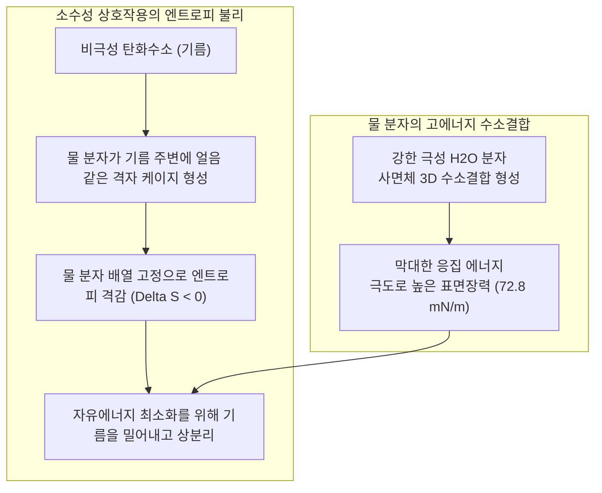

기름기가 번들거리는 프라이팬이나 땀과 피지로 찌든 옷을 물로만 헹구면 기름은 물방울을 튕겨내며 섬유에 들러붙어 떨어지지 않습니다.

하지만 여기에 비누 거품이나 주방세제를 단 몇 방울 떨어뜨리는 순간 기적이 일어납니다. 철천지원수 같던 물과 기름이 우윳빛 에멀션으로 섞여 들어가며 기름때가 동그랗게 말려 올라가 물과 함께 씻겨 내려갑니다.

기원전 2500년경 고대 바빌로니아 점토판에 동물 기름과 나무 재를 끓여 비누를 만들었다는 기록이 등장한 이래 비누는 인류 위생의 수호신이었습니다. 페스트와 콜레라를 잠재우고 인류의 평균 수명을 비약적으로 늘린 일등공신은 항생제보다 비누를 통한 손 씻기였습니다.

하지만 분자물리학의 관점에서 보면 깊은 의문이 생깁니다:
"물과 기름은 왜 애초에 절대 섞이지 않는가?"
"비누 분자는 어떤 물리화학적 마법으로 둘을 결합시키는가?"
"풍성하게 일어나는 거품은 정말로 때를 빼는 역할을 하는가?"
"유럽 같은 석회질 센물 지역에서는 왜 비누 거품이 일지 않고 찌꺼기가 남는가?"

세척은 단순한 물리적 마찰이 아닙니다. 그것은 <strong>「물 분자의 강력한 수소결합 엔트로피 제어, 깁스 흡착에 따른 표면장력 강하, 초분자 미셀(Micelle)의 자발적 자기조립, 롤링업(Rolling-up) 접촉각 역학 및 제타전위 정전기 반발이 어우러진 정밀 계면화학의 극치」</strong>입니다.

---

## 1. 소수성 효과의 열역학: 물은 기름을 '미워'하지 않는다

흔히 물과 기름이 서로를 밀어낸다고 생각하지만, 탄화수소와 물 분자 사이에도 미약한 반데르발스 인력은 분명히 존재합니다. 기름이 물과 섞이지 않는 진짜 이유는 기름이 물을 밀어내서가 아니라, <strong>물 분자끼리 끌어당기는 힘(수소결합)이 너무나 압도적이어서 비극성 기름 분자가 쫓겨나기 때문</strong>입니다.

물 분자의 수소결합 에너지는 약 $20\text{ kJ/mol}$입니다. 기름 분자가 물속에 들어가면 물 분자는 기름 주변에 얼음과 같은 정연한 바구니 구조(클래스레이트 케이지)를 형성해야 하므로 계의 엔트로피가 급감($\Delta S < 0$)하여 깁스 자유에너지($\Delta G > 0$)가 불리해집니다. 따라서 물 분자는 엔트로피를 최대화하기 위해 기름 분자를 밖으로 강하게 밀어내 상분리를 일으킵니다.

---

## 2. 계면활성제의 분자 해부학: 양친매성의 중재자

이 대립을 해결하기 위해 탄생한 물질이 <strong>계면활성제(Surfactant)</strong>입니다.
- <strong>친수기 헤드 (Hydrophilic Head)</strong>: 물과 강한 수소결합이나 이온 수화층을 형성하는 극성 기 ($-\text{COO}^-$, $-\text{SO}_3^-$ 등).
- <strong>소수기 테일 (Hydrophobic Tail)</strong>: 물을 기피하고 기름과 결합하는 긴 탄화수소 사슬 (탄소수 12~18).

### 깁스 흡착 등온식과 표면장력 강하
물에 계면활성제를 넣으면 소수성 꼬리는 물속에서 밀려나 공기-물 계면으로 쇄도합니다. 친수기 머리는 물에, 소수기 꼬리는 공기로 향하는 단분자막을 형성하면서 물 분자 간 수소결합을 방해하여 표면장력을 <strong>$72.8\text{ mN/m}$에서 $25 \sim 30\text{ mN/m}$로 수직 낙하시킵니다</strong>. 표면장력이 떨어진 세탁수는 섬유 속 미세 틈새로 순식간에 침투합니다.

---

## 3. 임계 미셀 농도(CMC)와 자기조립

계면이 단분자막으로 가득 차면 물속의 잉여 소수기 꼬리들이 <strong>임계 미셀 농도(CMC: Critical Micelle Concentration)</strong>에서 스스로 뭉쳐 지름 3~5nm의 구형 <strong>미셀(Micelle)</strong>을 형성합니다.

미셀의 내부는 순수한 액체 기름과 같은 탄화수소 코어를 형성하고, 외부는 물과 친한 머리가 둘러쌉니다. CMC 이상에서 세제의 <strong>기름때 용해(가용화) 능력이 비약적으로 상승</strong>합니다.

---

## 4. 세척의 4단계: 롤링업(Rolling-up) 현상

기름때가 섬유에서 떨어져 나가는 핵심은 <strong>롤링업(Rolling-up) 현상</strong>입니다.
세제 분자가 기름-물, 섬유-물 계면에 흡착되면서 영의 접촉각 방정식에 의해 기름막의 접촉각 $\theta$가 $0^\circ$에서 $180^\circ$로 역전됩니다. 기름막은 스스로 수축하여 동그란 구형 방울로 말려 올라가 섬유와의 접촉 면적이 90% 이상 사라집니다. 세탁기 물살의 가벼운 전단력만으로 기름방울이 떨어져 나와 미셀 내부로 갇히며(가용화), 음전하의 <strong>제타전위($\zeta \approx -40\text{ mV}$) 반발력</strong>에 의해 때가 섬유에 다시 들러붙는 것이 영구 차단됩니다.

---

## 5. 센물(경수)과 금속비누 침전, 그리고 제올라이트

전통 비누(지방산 나트륨)는 칼슘($\text{Ca}^{2+}$)이나 마그네슘 이온이 많은 센물에서 녹지 않는 <strong>금속비누(석회 비누カス)</strong>로 침전하여 세척력을 잃습니다:
$$2\text{C}_{17}\text{H}_{35}\text{COO}^- + \text{Ca}^{2+} \longrightarrow (\text{C}_{17}\text{H}_{35}\text{COO})_2\text{Ca} \downarrow$$
이를 극복하기 위해 합성세제에는 칼슘 이온을 흡착하여 연수로 바꾸어주는 <strong>4A 제올라이트(Zeolite)</strong> 및 킬레이트제가 필수적으로 배합됩니다.

---

## 6. 효소 바이오테크와 거품의 마랑고니 효과

- <strong>효소 세제</strong>: 단백질 분해효소(프로테아제)와 지질분해효소(리파아제)뿐만 아니라, <strong>셀룰라아제(Cellulase)</strong>는 면 섬유 표면의 미세한 보풀을 선택적으로 잘라내어 그 사이에 낀 미세 오염을 방출하고 옷의 원래 색상을 되살립니다.
- <strong>마랑고니 효과(Marangoni Effect)</strong>: 거품 막이 외력에 의해 얇아지면 국소적으로 계면활성제 밀도가 떨어져 표면장력이 급상승하고, 주변 세탁수가 그곳으로 역류하여 막을 자동 복원합니다. 거품은 때를 직접 녹이기보다는 미세 오염을 액면으로 띄워 올리는(부선) 보조 역할을 수행합니다.

---

## 7. 결론

비누는 단순한 생활용품이 아니라 자연의 소수성 열역학 법칙을 거슬러 물과 기름을 평화롭게 화해시키는 인류 최고의 분자 계면과학 기술입니다.
