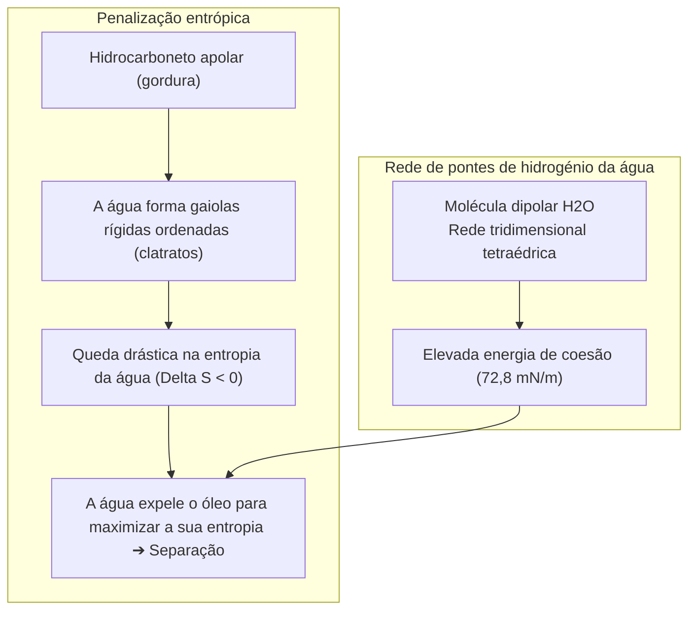
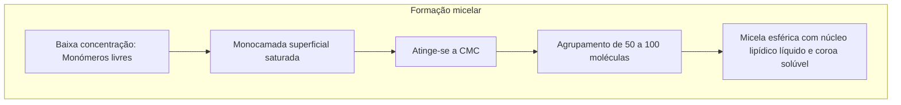

Um prato coberto de gordura resfriada ou um tecido impregnado de sebo e lama resiste a qualquer tentativa de lavagem com água pura. A água forma gotas isoladas que deslizam sem dissolver a película oleosa agarrada às fibras.

Contudo, bastam umas gotas de detergente ou espuma de sabão para desencadear uma transformação prodigiosa: a água e a gordura emulsionam-se instantaneamente num líquido leitoso, o filme oleoso enrola-se em esferas minúsculas e solta-se suavemente na água de enxaguamento.

Desde as tábuas de argila da Babilónia em 2500 a.C. até aos detergentes com enzimas bioengenheiradas, o sabão tem sido um dos pilares mais vitais da saúde pública mundial, salvando mais vidas do que os antibióticos.

Sob a perspetiva da físico-química molecular:
"Por que razão a água e o óleo recusam misturar-se?"
"Que artifício molecular utiliza o sabão para atuar como mediador?"
"A espuma abundante limpa realmente a roupa ou é uma ilusão visual?"
"Por que falha o sabão tradicional em águas duras calcárias?"

Lavar não é uma abrasão mecânica: é <strong>«uma coreografia termodinâmica orquestrada pela exclusão hidrofóbica entrópica, a queda abrupta da tensão superficial de Gibbs, a automontagem de micelas e a repulsão eletrostática de dupla camada.»</strong>

---

## 1. O efeito hidrofóbico: A água não repele o óleo

A água e os hidrocarbonetos atraem-se por fracas forças de dispersão de Van der Waals. A separação de fases ocorre porque <strong>as ligações de hidrogénio entre as moléculas de água são tão fortes que excluem forçosamente qualquer molécula apolar</strong>.

Cada ligação de hidrogénio liberta cerca de $20\text{ kJ/mol}$. Para rodear o óleo, a água organiza-se em gaiolas de clatrato ordenadas, sofrendo uma severa perda de entropia ($\Delta S < 0$). Para minimizar a energia livre ($\Delta G = \Delta H - T\Delta S$), a água repele o óleo para uma fase separada.

---

## 2. Anatomia do tensioativo e Isoterma de Gibbs

Os tensioativos apresentam natureza <strong>anfifílica</strong>:
- <strong>Cabeça hidrofílica</strong>: Grupo polar ou iónico ($-\text{COO}^-$, $-\text{SO}_3^-$), solúvel em água.
- <strong>Cauda hidrofóbica</strong>: Cadeia alifática apolar ($C_{12} \sim C_{18}$).

Ao adsorverem-se na interface ar-água, reduzem a tensão superficial da água de <strong>$72,8\text{ mN/m}$ para $25 \sim 30\text{ mN/m}$</strong>, permitindo a infiltração rápida nos poros têxteis.

---

## 3. Concentração Micelar Crítica (CMC) e automontagem

Ao saturar a superfície, os tensioativos associam-se a partir da <strong>CMC (Concentração Micelar Crítica)</strong>, gerando <strong>micelas</strong> esféricas de 3 a 5 nm:

O núcleo hidrocarboneto das micelas dissolve e aprisiona as gorduras insolúveis (solubilização).

---

## 4. O mecanismo de enrolamento (Rolling-up)

Modificando as tensões interfaciais, o ângulo de contacto da gordura passa de $0^\circ$ para quase $180^\circ$ (equação de Young).
A gordura <strong>enrola-se em gotas esféricas (rolling-up)</strong>, diminuindo o contacto com o tecido. A agitação mecânica solta as gotas, as micelas sequestram-nas e os <strong>potenciais zeta negativos ($\zeta \approx -40\text{ mV}$)</strong> repelem a sujidade para evitar a sua redeposição.

---

## 5. Água dura e os zeólitos

O sabão tradicional precipita com os iões de cálcio da água dura formando <strong>sais insolúveis (sarro de sabão)</strong>:
$$2\text{C}_{17}\text{H}_{35}\text{COO}^- + \text{Ca}^{2+} \longrightarrow (\text{C}_{17}\text{H}_{35}\text{COO})_2\text{Ca} \downarrow$$
Os detergentes modernos utilizam <strong>zeólito 4A</strong>, um permutador iónico que captura o cálcio e amacia a água instantaneamente.

---

## 6. Enzimas e o efeito Marangoni da espuma

- <strong>Enzimas bioativas</strong>: As proteases dissolvem manchas proteicas; as lipases decompõem lípidos; e as <strong>celulases</strong> aparam as microfibrilhas danificadas do algodão para libertar a sujidade entranhada e restaurar as cores.
- <strong>Efeito Marangoni</strong>: A espuma autorrepara-se quando a película se adelgaça, restabelecendo o líquido por gradiente de tensão superficial, ajudando a suspender as partículas de sujidade.

---

## 7. Conclusão

O sabão representa um dos maiores triunfos da físico-química dos coloides, mobilizando as leis da termodinâmica para salvaguardar a saúde e a higiene da humanidade.
