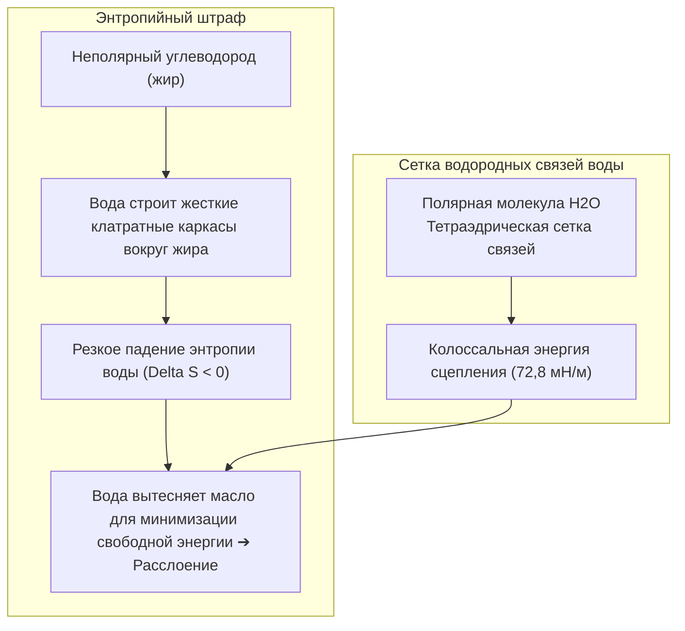
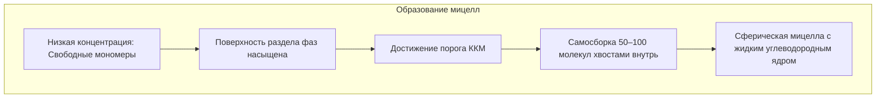

Тарелка, покрытая застывшим жиром, или воротник рубашки, пропитанный кожным салом, абсолютно не поддаются смыванию чистой водой. Капли воды собираются в сферы и стекают, оставляя грязь нетронутой.

Однако пара капель мыла кардинально меняет ситуацию: вода и жир мгновенно превращаются в молочно-белую эмульсию, пленка жира сворачивается в микрокапли и уносится прочь с промывной водой.

От вавилонских глиняных табличек 2500 года до н.э. до современных стиральных порошков с биоинженерными энзимами, мыло остается фундаментальным изобретением, спасшим миллионы человеческих жизней.

С точки зрения молекулярной физики:
«Почему вода и масло упорно не смешиваются?»
«С помощью каких физических трюков мыло объединяет их?»
«Действительно ли пена отстирывает белье или это просто иллюзия?»
«Почему обычное мыло теряет пену и образует осадок в жесткой воде?»

Очищение — это не механическое истирание: это <strong>«энтропийное термодинамическое явление, управляемое гидрофобным эффектом, резким падением поверхностного натяжения по Гиббсу, самосборкой мицелл и электростатическим отталкиванием двойного слоя.»</strong>

---

## 1. Термодинамика гидрофобного эффекта

Вода и масло не отталкиваются; между ними действуют силы Ван-дер-Ваальса. Фазовое разделение возникает из-за того, что <strong>водородные связи между молекулами воды настолько прочны, что неполярные молекулы буквально выталкиваются наружу</strong>.

Каждая водородная связь несет около $20\text{ кДж/моль}$. Окружая неполярную молекулу, вода вынуждена выстраиваться в упорядоченные льдоподобные каркасы (клатраты), теряя энтропию ($\Delta S < 0$). Вода изгоняет жир, минимизируя свободную энергию.

---

## 2. Архитектура ПАВ и изотерма Гиббса

Поверхностно-активные вещества (ПАВ) обладают <strong>дифильной (амфифильной)</strong> природой:
- <strong>Гидрофильная голова</strong>: Полярная группа ($-\text{COO}^-$, $-\text{SO}_3^-$), растворимая в воде.
- <strong>Гидрофобный хвост</strong>: Неполярная углеводородная цепь ($C_{12} \sim C_{18}$).

Адсорбируясь на поверхности воды, ПАВ ослабляют взаимное притяжение молекул воды, снижая поверхностное натяжение с <strong>$72,8\text{ мН/м}$ до $25 \sim 30\text{ мН/м}$</strong>, что позволяет моющему раствору проникать вглубь волокон.

---

## 3. Критическая концентрация мицеллообразования (ККМ)

После насыщения поверхности ПАВ спонтанно объединяются при достижении <strong>ККМ (Критической Концентрации Мицеллообразования)</strong> в сферические <strong>мицеллы</strong> диаметром 3–5 нм:

Жидкое углеводородное ядро мицелл поглощает и растворяет неполярные частицы жира (солюбилизация).

---

## 4. Механизм скатывания капель (Rolling-up)

ПАВ меняют межфазные натяжения, заставляя краевой угол смачивания жира вырасти с $0^\circ$ почти до $180^\circ$ (уравнение Юнга).
Жировая пленка <strong>скатывается в сферы (rolling-up)</strong>, контакт с тканью снижается на 90 %, и капли отрываются током воды. Отрицательный <strong>дзета-потенциал ($\zeta \approx -40\text{ мВ}$)</strong> отталкивает частицы грязи, не давая им осесть обратно.

---

## 5. Жесткая вода и цеолиты

В жесткой воде мыло связывается с кальцием, выпадая в виде липких нерастворимых <strong>солей кальция (мыльный осадок)</strong>:
$$2\text{C}_{17}\text{H}_{35}\text{COO}^- + \text{Ca}^{2+} \longrightarrow (\text{C}_{17}\text{H}_{35}\text{COO})_2\text{Ca} \downarrow$$
Современные порошки содержат <strong>цеолит А</strong>, улавливающий ионы кальция и мгновенно умягчающий воду.

---

## 6. Ферменты и эффект Марангони в пене

- <strong>Энзимы</strong>: Протеазы расщепляют белки; липазы расщепляют жиры; а <strong>целлюлазы</strong> состригают микроворсинки поврежденного хлопка, освобождая застрявшие микрочастицы грязи и возвращая ткани белизну.
- <strong>Эффект Марангони</strong>: Предотвращает разрыв пузырьков пены за счет обратного притока жидкости при локальном утонении пленки, удерживая поднятые загрязнения на поверхности.

---

## 7. Заключение

Мыло и ПАВ — это шедевр коллоидной физикохимии, использующий фундаментальные законы молекулярного взаимодействия для защиты здоровья человечества.
