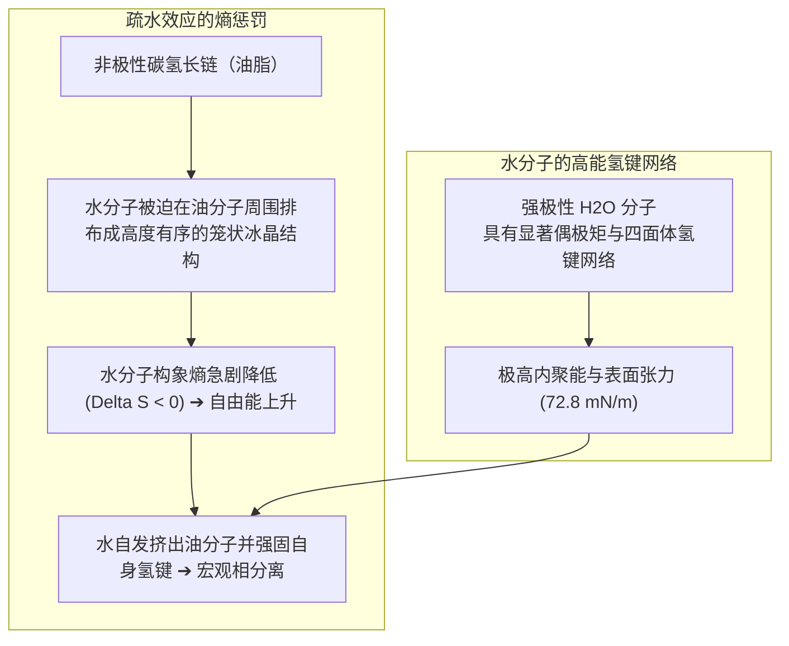
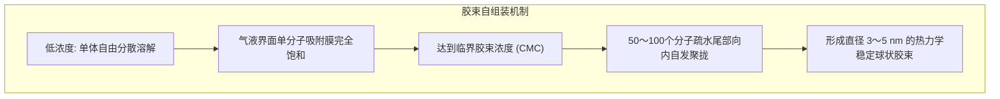
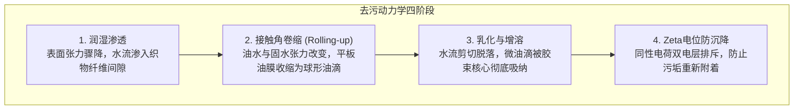

满是凝固牛油的油腻餐盘或沾满顽固皮脂与泥土的衣物，单用水冲洗无论如何也洗不干净——水分子在油脂表面迅速收缩滚落，污垢岿然不动。

然而，一旦滴入几滴洗洁精或揉搓出肥皂泡沫，原本水火不容的水和油瞬间乳化为乳白色液体。油膜仿佛失去吸附力一般蜷缩成球、脱离盘面，随水流轻松冲走，盘子立刻洁净如新。

公元前 2500 年古巴比伦人熬煮动植物油脂与草木灰制成人类历史上最早的肥皂至今，这项看似朴素的日化技术拯救了无数生命。流行病学公认，肥皂洗手建立的现代卫生体系，对延长人类平均寿命的贡献甚至超越了抗生素与疫苗的总和。

然而从分子物理学视角审视，这一过程蕴含着极其精妙的微观机制：
「水与油究竟为何绝不相溶？」
「肥皂分子究竟使用了怎样的物理手段充当两者的调解人？」
「洗衣服时产生的丰富泡沫，真的具有去污能力吗？」
「为什么在欧洲等硬水地区，传统肥皂几乎无法起泡且会留下洗不掉的油腻白垢？」

去污绝非简单的机械摩擦。它是<strong>「水分子强电负性氢键网络的熵驱动重构、吉布斯吸附导致的界面张力骤降、超分子胶束（Micelle）的自发自组装、接触角卷缩动力学以及双电层静电排斥的胶体物理化学交响乐」</strong>。

---

## 1. 疏水效应的热力学本质：水并非“讨厌”油

通常人们认为“油水相斥”，但物理化学证明，烷烃油分子与水分子之间同样存在微弱的范德华引力。油水分离的根本原因不是油讨厌水，而是<strong>水分子之间的氢键结合力过于强大，以至于非极性油分子被强行排斥出局</strong>。

水分子（$\text{H}_2\text{O}$）每摩尔氢键结合能高达约 $20\text{ kJ/mol}$。当非极性油分子插入水中时，水分子无法与其形成氢键，反而被迫在油分子周围排列成高度有序的笼状晶体结构（笼形水合物）。这种构象导致系统的熵值大幅降低（$\Delta S < 0$），系统的吉布斯自由能剧增（$\Delta G = \Delta H - T\Delta S > 0$）。为了实现熵增与能量极小化，水分子自发将油分子紧密推挤在一起，迫使其宏观分层相分离。

---

## 2. 表面活性剂的分子解剖学：两亲性调解者

为了弥合水与油的永恒对立，化学家合成了<strong>表面活性剂（Surfactant）</strong>。其核心特质在于单个分子内融合了两种截然相反的物理化学属性：
- <strong>亲水基头部（Hydrophilic Head）</strong>：高度极性或带电基团（如 $-\text{COO}^-$, $-\text{SO}_3^-$ 或聚氧乙烯醚），能与水分子形成强氢键或库仑水化层。
- <strong>疏水基尾部（Hydrophobic Tail）</strong>：长链脂肪族碳氢骨架（通常为 12 至 18 个碳原子的烷基链），与油脂具有完全相同的非极性特性。

### 2.1 吉布斯吸附等温线与界面张力雪崩
当表面活性剂溶解在水中时，其疏水尾部被水网络排斥，驱动分子自发富集在气-液或液-固界面上，亲水头朝向水中，疏水尾伸向空气或基底。
这种单分子膜极大削弱了表面水分子向内的氢键拉力，使纯水的表面张力从 <strong>$72.8\text{ mN/m}$ 锐降至 $25 \sim 30\text{ mN/m}$</strong>。表面张力降低后的洗涤液能瞬间渗入织物微孔，启动浸润清洗。

---

## 3. 临界胶束浓度（CMC）与超分子自组装

当界面被表面活性剂分子彻底占满后，水中过剩的疏水尾部必须寻找新的低能量平衡。

在<strong>临界胶束浓度（CMC: Critical Micelle Concentration）</strong>点：
数十至上百个表面活性剂分子在水中瞬时自发聚拢，疏水尾部全部向内卷曲形成内部液态微油滴核心，亲水头部朝外包覆形成带电外壳，构成稳定的纳米球状<strong>胶束（Micelle）</strong>。
在 CMC 浓度以上，新增的表面活性剂全数用于构建新胶束，洗涤液<strong>包裹溶解油污的“增溶能力”呈现爆发式线性增长</strong>。

---

## 4. 去污四部曲：卷缩机制与防再沉积

油垢脱离纤维的过程历经四个核心胶体物理阶段：

根据杨氏接触角润湿方程：
$$\cos \theta_{\text{oil}} = \frac{\gamma_{\text{WS}} - \gamma_{\text{OS}}}{\gamma_{\text{WO}}}$$
表面活性剂强力拉低 $\gamma_{\text{WS}}$ 与 $\gamma_{\text{WO}}$，迫使原本紧贴织物的扁平油污接触角增大至接近 $180^\circ$。油污剧烈<strong>卷缩成球状油珠（Rolling-up 现象）</strong>，与织物的微观接触面积剧减 90% 以上。水流轻轻一刷，油滴便脱落悬浮。
随后，胶束将油脂分子吸纳进内部碳氢核心（增溶作用），且织物与污垢表面均吸附负电荷，产生强烈的<strong>Zeta电位（$\zeta \approx -40\text{ mV}$）静电排斥</strong>，彻底阻止污垢在漂洗过程中回落返黄。

---

## 5. 硬水死穴与沸石助剂革命

传统肥皂由天然动植物油脂经碱液皂化而成的脂肪酸钠（如十八酸钠 $\text{C}_{17}\text{H}_{35}\text{COONa}$）构成。
在欧洲大陆等富含高浓度钙镁离子（$\text{Ca}^{2+}, \text{Mg}^{2+}$）的硬水区域，羧酸根（$-\text{COO}^-$）与二价钙离子会发生沉淀反应，生成顽固不溶于水的<strong>金属皂（钙皂/肥皂垢）</strong>：
$$2\text{C}_{17}\text{H}_{35}\text{COO}^- + \text{Ca}^{2+} \longrightarrow (\text{C}_{17}\text{H}_{35}\text{COO})_2\text{Ca} \downarrow$$
在钙离子耗尽前，肥皂无法起泡去污，残存皂垢更会板结织物。现代合成洗涤剂通过加入<strong>4A沸石（Zeolite A）</strong>和柠檬酸盐等助洗剂，通过晶格微孔瞬时离子交换将硬水软化，彻底瓦解了硬水对洗涤的封锁。

---

## 6. 酶制剂生物催化与泡沫的马兰戈尼物理学

- <strong>多酶生物催化体系</strong>：蛋白酶剪切血渍与领口皮脂蛋白；淀粉酶降解酱汁；脂肪酶水解甘油三酯；而<strong>纤维素酶（Cellulase）</strong>则精准剪除棉纤维表面磨损形成的微观毛羽，将困在毛羽深处的微尘彻底释放，令褪色旧衣焕然一新。
- <strong>泡沫与马兰戈尼自修复效应</strong>：泡沫本身并不直接去污，但在液体薄膜受拉变薄处，局部表面活性剂浓度降低引发表面张力瞬时升高，促使周围液体反向回流补平薄膜（<strong>马兰戈尼效应</strong>），赋予泡沫托起悬浮污物、防止其下沉沉降的独特物理功能。

---

## 7. 结语

从美索不达米亚的草木灰脂膏到现代超浓缩生物酶洗涤液，表面活性剂是人类利用物理化学热力学规律战胜熵增阻碍、筑起公共卫生屏障的崇高科学杰作。
