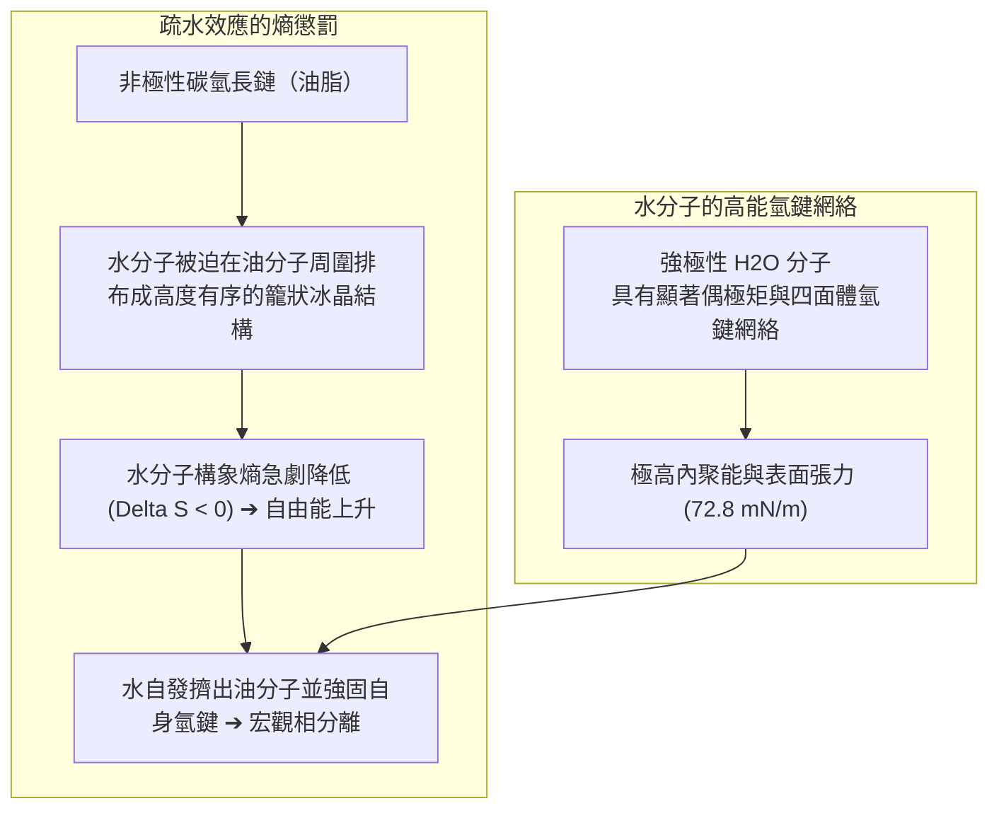
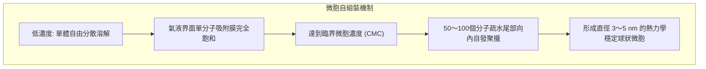
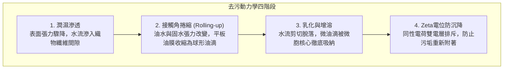

滿是凝固牛油的油膩餐盤或沾滿頑固皮脂與泥土的衣物，單用水沖洗無論如何也洗不乾淨——水分子在油脂表面迅速收縮滾落，污垢巋然不動。

然而，一旦滴入幾滴洗潔精或揉搓出肥皂泡沫，原本水火不容的水和油瞬間乳化為乳白色液體。油膜彷彿失去吸附力一般蜷縮成球、脫離盤面，隨水流輕鬆衝走，盤子立刻潔淨如新。

公元前 2500 年古巴比倫人熬煮動植物油脂與草木灰製成人類歷史上最早的肥皂至今，這項看似樸素的日化技術拯救了無數生命。流行病學公認，肥皂洗手建立的現代衛生體系，對延長人類平均壽命的貢獻甚至超越了抗生素與疫苗的總和。

然而從分子物理學視角審視，這一過程蘊含著極其精妙的微觀機制：
「水與油究竟為何絕不相溶？」
「肥皂分子究竟使用了怎樣的物理手段充當兩者的調解人？」
「洗衣服時產生的豐富泡沫，真的具有去污能力嗎？」
「為什麼在歐洲等硬水地區，傳統肥皂幾乎無法起泡且會留下洗不掉的油膩白垢？」

去污絕非簡單的機械摩擦。它是<strong>「水分子強電負度氫鍵網絡的熵驅動重構、吉布斯吸附導致的界面張力驟降、超分子微胞（Micelle）的自發自組裝、接觸角捲縮動力學以及雙電層靜電排斥的膠體物理化學交響樂」</strong>。

---

## 1. 疏水效應的熱力學本質：水並非“討厭”油

通常人們認為“油水相斥”，但物理化學證明，烷烴油分子與水分子之間同樣存在微弱的凡德瓦引力。油水分離的根本原因不是油討厭水，而是<strong>水分子之間的氫鍵結合力過於強大，以至於非極性油分子被強行排斥出局</strong>。

水分子（$\text{H}_2\text{O}$）每莫耳氫鍵結合能高達約 $20\text{ kJ/mol}$。當非極性油分子插入水中時，水分子無法與其形成氫鍵，反而被迫在油分子周圍排列成高度有序的籠狀晶體結構（籠形水合物）。這種構象導致系統的熵值大幅降低（$\Delta S < 0$），系統的吉布斯自由能劇增（$\Delta G = \Delta H - T\Delta S > 0$）。為了實現熵增與能量極小化，水分子自發將油分子緊密推擠在一起，迫使其宏觀分層相分離。

---

## 2. 界面活性劑的分子解剖學：兩親性調解者

為了彌合水與油的永恆對立，化學家合成了<strong>界面活性劑（Surfactant）</strong>。其核心特質在於單個分子內融合了兩種截然相反的物理化學屬性：
- <strong>親水基頭部（Hydrophilic Head）</strong>：高度極性或帶電基團（如 $-\text{COO}^-$, $-\text{SO}_3^-$ 或聚氧乙烯醚），能與水分子形成強氫鍵或庫侖水化層。
- <strong>疏水基尾部（Hydrophobic Tail）</strong>：長鏈脂肪族碳氫骨架（通常為 12 至 18 個碳原子的烷基鏈），與油脂具有完全相同的非極性特性。

### 2.1 吉布斯吸附等溫線與界面張力雪崩
當界面活性劑溶解在水中時，其疏水尾部被水網絡排斥，驅動分子自發富集在氣-液或液-固界面上，親水頭朝向水中，疏水尾伸向空氣或基底。
這種單分子膜極大削弱了表面水分子向內的氫鍵拉力，使純水的表面張力從 <strong>$72.8\text{ mN/m}$ 銳降至 $25 \sim 30\text{ mN/m}$</strong>。表面張力降低後的洗滌液能瞬間滲入織物微孔，啟動浸潤清洗。

---

## 3. 臨界微胞濃度（CMC）與超分子自組裝

當界面被界面活性劑分子徹底占滿後，水中過剩的疏水尾部必須尋找新的低能量平衡。

在<strong>臨界微胞濃度（CMC: Critical Micelle Concentration）</strong>點：
數十至上百個界面活性劑分子在水中瞬時自發聚攏，疏水尾部全部向內捲曲形成內部液態微油滴核心，親水頭部朝外包覆形成帶電外殼，構成穩定的奈米球狀<strong>微胞（Micelle）</strong>。
在 CMC 濃度以上，新增的界面活性劑全數用於構建新微胞，洗滌液<strong>包裹溶解油污的“增溶能力”呈現爆發式線性增長</strong>。

---

## 4. 去污四部曲：捲縮機制與防再沉積

油垢脫離纖維的過程歷經四個核心膠體物理階段：

根據楊氏接觸角潤濕方程式：
$$\cos \theta_{\text{oil}} = \frac{\gamma_{\text{WS}} - \gamma_{\text{OS}}}{\gamma_{\text{WO}}}$$
界面活性劑強力拉低 $\gamma_{\text{WS}}$ 與 $\gamma_{\text{WO}}$，迫使原本緊貼織物的扁平油污接觸角增大至接近 $180^\circ$。油污劇烈<strong>捲縮成球狀油珠（Rolling-up 現象）</strong>，與織物的微觀接觸面積劇減 90% 以上。水流輕輕一刷，油滴便脫落懸浮。
隨後，微胞將油脂分子吸納進內部碳氫核心（增溶作用），且織物與污垢表面均吸附負電荷，產生強烈的<strong>Zeta電位（$\zeta \approx -40\text{ mV}$）靜電排斥</strong>，徹底阻止污垢在漂洗過程中回落返黃。

---

## 5. 硬水死穴與沸石助劑革命

傳統肥皂由天然動植物油脂經鹼液皂化而成的脂肪酸鈉（如十八酸鈉 $\text{C}_{17}\text{H}_{35}\text{COONa}$）構成。
在歐洲大陸等富含高濃度鈣鎂離子（$\text{Ca}^{2+}, \text{Mg}^{2+}$）的硬水區域，羧酸根（$-\text{COO}^-$）與二價鈣離子會發生沉澱反應，生成頑固不溶於水的<strong>金屬皂（鈣皂/肥皂垢）</strong>：
$$2\text{C}_{17}\text{H}_{35}\text{COO}^- + \text{Ca}^{2+} \longrightarrow (\text{C}_{17}\text{H}_{35}\text{COO})_2\text{Ca} \downarrow$$
在鈣離子耗盡前，肥皂無法起泡去污，殘存皂垢更會板結織物。現代合成洗潔劑透過加入<strong>4A沸石（Zeolite A）</strong>和檸檬酸鹽等助洗劑，透過晶格微孔瞬時離子交換將硬水軟化，徹底瓦解了硬水對洗滌的封鎖。

---

## 6. 酵素製劑生物催化與泡沫的馬蘭戈尼物理學

- <strong>多酶生物催化體系</strong>：蛋白酶剪切血漬與領口皮脂蛋白；澱粉酶降解醬汁；脂肪酶水解三酸甘油酯；而<strong>纖維素酶（Cellulase）</strong>則精準剪除棉纖維表面磨損形成的微觀毛羽，將困在毛羽深處的微塵徹底釋放，令褪色舊衣煥然一新。
- <strong>泡沫與馬蘭戈尼自修復效應</strong>：泡沫本身並不直接去污，但在液體薄膜受拉變薄處，局部界面活性劑濃度降低引發表面張力瞬時升高，促使周圍液體反向回流補平薄膜（<strong>馬蘭戈尼效應</strong>），賦予泡沫托起懸浮污物、防止其下沉沉降的獨特物理功能。

---

## 7. 結語

從美索不達米亞的草木灰脂膏到現代超濃縮生物酶洗滌液，界面活性劑是人類利用物理化學熱力學規律戰勝熵增阻礙、築起公共衛生屏障的崇高科學傑作。
