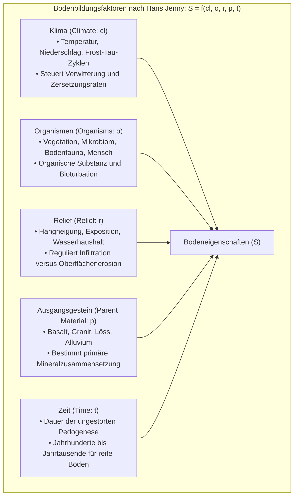
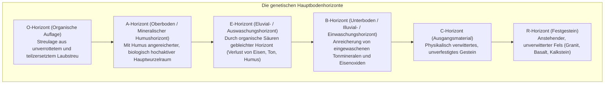
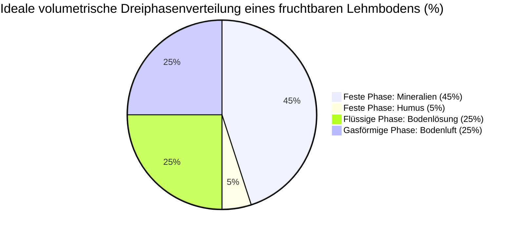
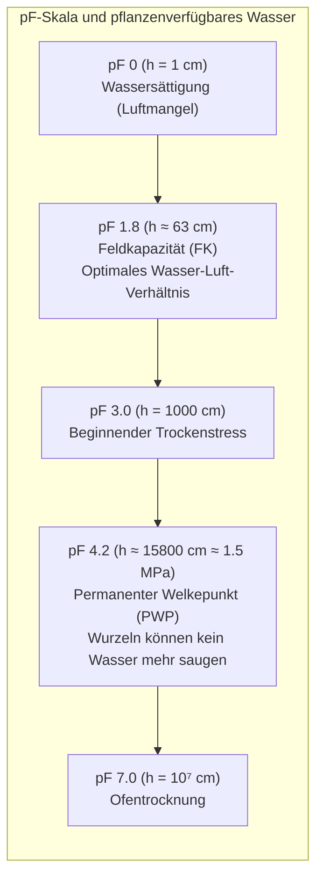
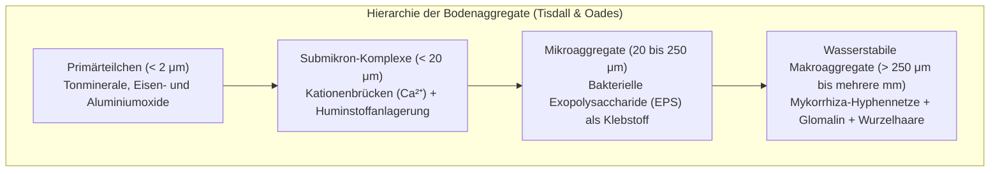
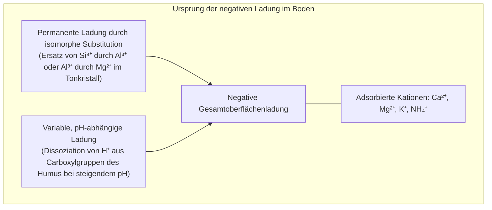

Unter unseren Schritten erstreckt sich eine nur wenige Dezimeter mächtige, lebendige Haut der Erde: der <strong>Oberboden (Topsoil)</strong>. Diese als <strong>Pedosphäre</strong> bezeichnete Grenzschicht trägt die terrestrischen Ökosysteme und bringt über 95 % aller Nahrungsmittel für die Menschheit hervor.

Boden ist keineswegs bloß zerriebenes Mineralgestein. Würde man sterilen Mondstaub oder Mars-Regolith befeuchten, könnten darauf keine Kulturpflanzen gedeihen. Erst wenn Urgestein über Jahrtausende verwittert, sich mit Pflanzenresten verbindet und durch die kollektive Aktivität von <strong>über 10 Milliarden Bakterien, Pilzen, Actinobakterien und Einzellern in einem einzigen Gramm Erde</strong> biochemisch umgearbeitet wird, entsteht ein lebendiger, fruchtbarer Boden.

In den letzten Jahren hat die Bodenkunde (Pedologie) einen epochalen Paradigmenwechsel vollzogen: Das jahrhundertealte Modell der alkaliextrahierbaren „Huminsäuren“ wurde durch hochauflösende Synchrotron-Spektroskopie zugunsten des <strong>Boden-Kontinuum-Modells (Soil Continuum Model: SCM)</strong> abgelöst. Es zeigte sich, dass nicht pflanzliches Lignin, sondern <strong>mikrobielle Nekromasse</strong> den Hauptbestandteil des stabilen Bodenkohlenstoffs bildet. Die Entdeckung von <strong>Glomalin</strong> – einem von Mykorrhizapilzen ausgeschiedenen Proteinkleber – entschlüsselte die Stabilität von Krümelstrukturen, während globale Initiativen wie „4 pro 1000“ die Kohlenstoffbindung im Boden in das Zentrum des Klimaschutzes gerückt haben.

Dieser wissenschaftliche Leitfaden analysiert die Bodenbildungsfaktoren nach Hans Jenny, die Horizontabfolge, die Dreiphasenverteilung und pF-Werte, die hierarchische Aggregatbildung, die Humuschemie, Kationenaustauschkapazität (KAK) und Aluminiumtoxizität, das C/N-Verhältnis, das Rhizosphären-Mikrobiom sowie regenerative Agrarsysteme.

---

### 1. Bodenbildungslehre: Die Zustandsfaktorengleichung nach Hans Jenny

Boden entsteht nicht zufällig, sondern folgt strikten physikalisch-chemischen Gesetzmäßigkeiten. 1941 formulierte der Bodenkundler Hans Jenny die fundamentale <strong>Zustandsgleichung der Bodenbildung</strong>:

$$S = f(cl, o, r, p, t, \dots)$$

Unter natürlichen Bedingungen dauert es <strong>100 bis 1.000 Jahre, um einen einzigen Zentimeter fruchtbaren Oberbodens</strong> aufzubauen.

#### Das Bodenprofil: Die genetischen Bodenhorizonte
Ein vertikaler Schnitt durch einen reifen Boden offenbart charakteristische Schichten:

---

### 2. Bodenphysik: Dreiphasenverteilung und das pF-Wertespektrum

Ob Pflanzenwurzeln atmen, Wasser aufnehmen und wachsen können, hängt vom <strong>Dreiphasensystem</strong> des Bodens ab:

Der ideale Kulturzustand besteht aus <strong>50 % Festsubstanz</strong> und <strong>50 % Porenvolumen</strong>, wobei die Poren zu gleichen Teilen mit Wasser (25 %) und Luft (25 %) gefüllt sind.

#### Porengrößen und Wasserhaushalt
- <strong>Grobporen (Durchmesser > 30~50 μm)</strong>: Können Wasser nicht gegen die Schwerkraft halten. Nach Regenfällen fließt das Sickerwasser ab, und Luft strömt nach – dies sichert die <strong>Sauerstoffversorgung der Wurzeln</strong>.
- <strong>Mittel- und Feinporen (Durchmesser < 30 μm)</strong>: Halten das Wasser durch Kapillarkräfte fest und bilden den lebensnotwendigen <strong>Wasserspeicher</strong>.

#### Das pF-Wertespektrum
Die Saugspannung des Bodens wird als dekadischer Logarithmus der Wassersäule in Zentimetern (pF-Wert) angegeben:

$$\text{pF} = \log_{10} |h| \quad (h \text{ in cm H}_2\text{O})$$

Das Wasser zwischen <strong>pF 1,8 (Feldkapazität)</strong> und <strong>pF 4,2 (permanenter Welkepunkt)</strong> ist das pflanzenverfügbare Wasser. Oberhalb von pF 4,2 ist das Wasser so stark adsorbiert, dass die Wurzeln die Bindekräfte nicht überwinden können und die Pflanze unwiderruflich abstirbt.

---

### 3. Bodenkrümelstruktur: Die biologische Mikroarchitektur

In strukturlosem Boden (Einzelkornstruktur) verkleben feine Tonteilchen bei Regen und bilden dichte Krusten, die zu massiver Erosion führen; bei Trockenheit backt die Erde betonhart zusammen.

Fruchtbare Böden zeichnen sich hingegen durch eine <strong>Krümelstruktur (Aggregatstruktur)</strong> aus:

#### Das Glomalin der Mykorrhizapilze
1996 entdeckte Sara Wright das Glykoprotein <strong>Glomalin</strong>, das von arbuskulären Mykorrhizapilzen (AMF) gebildet wird. Es wirkt wie ein biologischer Lack: Es ist wasserunlöslich, schützt Aggregate vor dem Zerfallen bei Starkregen und speichert bis zu einem Drittel des gesamten Bodenkohlenstoffs.

---

### 4. Humuschemie: Das Boden-Kontinuum-Modell (SCM)

Jahrzehntelang glaubte man, Humus bestehe aus schwer abbaubaren Makromolekülen (Huminsäuren). Neuere Forschungen (Lehmann & Kleber, *Nature* 2015) widerlegten dies:
1. Bodenorganische Substanz (SOM) besteht aus einem <strong>Kontinuum biogener Fragmente</strong> aller Molekülgrößen.
2. Kohlenstoff bleibt nicht wegen chemischer Unangreifbarkeit Jahrhunderte im Boden, sondern durch <strong>physikalischen Schutz in Mineral-Nanoporen</strong> und chemische Bindung an Tonminerale (Mineral-Associated Organic Matter: MAOM).
3. <strong>Mikrobielle Nekromasse</strong>: 50 bis über 80 % des stabilen Humuskohlenstoffs stammen nicht direkt von Pflanzen, sondern aus den <strong>Zellwandresten toter Bakterien und Pilze</strong>.

---

### 5. Kationenaustauschkapazität (KAK) und Bodenversauerung

Die <strong>Kationenaustauschkapazität (KAK)</strong> misst die Fähigkeit des Bodens, positiv geladene Nährstoffkationen ($\text{Ca}^{2+}, \text{Mg}^{2+}, \text{K}^{+}, \text{NH}_4^+$) reversibel an negativ geladene Kolloidoberflächen zu binden:

- <strong>Aluminiumtoxizität</strong>: Sinkt der Boden-pH unter 5,0, lösen sich toxische dreiwertige Aluminiumionen ($\text{Al}^{3+}$), die das Wurzelwachstum blockieren. Die Ausbringung von kohlensaurem Kalk ($\text{CaCO}_3$) neutralisiert Säuren und fällt Aluminium als unschädliches Hydroxid aus.

---

### 6. Das C/N-Verhältnis und der Stickstoffhaushalt

Bodenmikroben besitzen ein zelluläres Kohlenstoff-zu-Stickstoff-Verhältnis von ca. <strong>8:1</strong>. Bei der Zersetzung organischer Substanz veratmen sie rund zwei Drittel des Kohlenstoffs als $\text{CO}_2$:
- <strong>C/N < 20 (z. B. Leguminosen, Mist)</strong>: Stickstoffüberschuss; Stickstoff wird mineralisiert und als Ammonium ($\text{NH}_4^+$) freigesetzt (<strong>Düngewirkung</strong>).
- <strong>C/N > 30 (z. B. Stroh, Sägemehl)</strong>: Stickstoffmangel; Mikroben entziehen dem Boden sämtlichen mineralischen Stickstoff (<strong>Stickstoffsperre / Stickstoffhunger der Pflanzen</strong>).

---

### 7. Das Rhizosphären-Mikrobiom

Pflanzen scheiden bis zu 40 % ihrer photosynthetisch fixierten Kohlenhydrate über die Wurzeln als <strong>Wurzelexsudate</strong> aus:
- <strong>Mykorrhizapilze</strong>: Erschließen schwer lösliches Phosphat im Austausch gegen pflanzliche Zucker;
- <strong>Knöllchenbakterien (Rhizobien)</strong>: Fixieren mit dem Enzym Nitrogenase elementaren Luftstickstoff ($\text{N}_2$);
- <strong>Wachstumsfördernde Rhizobakterien (PGPR)</strong>: Bilden Siderophore zur Eisenaufnahme und wehren bodenbürtige Krankheitserreger ab.

---

### 8. Regenerative Landwirtschaft und die „4 pro 1000“-Initiative

Intensive Pflugwirtschaft zerstört Aggregate und beschleunigt die CO₂-Freisetzung. Die <strong>regenerative Landwirtschaft</strong> setzt auf:
1. Minimale Bodenstörung (Direktsaat / No-till);
2. Dauerhafte Bodenbedeckung;
3. Ganzjährig lebende Wurzeln;
4. Hohe Biodiversität durch Fruchtfolgen;
5. Integration von Weidetieren.

Die internationale <strong>„4 pro 1000“-Initiative</strong> belegt: Steigt der Kohlenstoffgehalt der weltweiten Böden jährlich um nur 0,4 %, könnten die gesamten anthropogenen Treibhausgasemissionen der Erde im Boden gebunden werden.

---

### 9. Fazit

Boden ist ein lebendiger Mikrokosmos. In einer einzigen Handvoll Erde pulsiert mehr Leben als Menschen auf der Erde wandeln. Die Regeneration des Bodens ist das Fundament für die Ernährung und den Klimaschutz der Zukunft.
