Beneath our footsteps lies a dynamic biological membrane barely a few tens of centimeters thick: the <strong>topsoil</strong>. Far from an inert geological substrate of crushed rocks, this thin mantle—the <strong>pedosphere</strong>—sustains more than 95% of human caloric consumption and serves as the primary terrestrial biogeochemical junction uniting the lithosphere, atmosphere, hydrosphere, and biosphere.

If one were to pulverize sterile moon rock or Martian regolith into powder and add water, crops would rapidly perish. Soil becomes true soil only when primary mineral grains, weather-beaten over millennia, unite with decaying plant litter and undergo synthesis through the collective metabolic activity of an astronomical underground ecosystem: <strong>a single gram of healthy topsoil harbors over 10 billion bacterial cells, alongside kilometers of fungal hyphae, protozoa, nematodes, and microarthropods</strong>.

In recent years, soil science has undergone a profound conceptual revolution. Classical 19th-century models of alkali-extractable "humic acids" have been overturned by high-resolution synchrotron spectroscopy in favor of the <strong>Soil Continuum Model (SCM)</strong>, revealing that long-term carbon stabilization is governed by mineral-organic interactions and <strong>microbial necromass</strong> rather than recalcitrant chemical macromolecules. Simultaneously, the discovery of <strong>glomalin</strong>—a hydrophobic glycoprotein glue secreted by mycorrhizal fungi—has revolutionized our understanding of water-stable aggregate architecture, while initiatives such as "4 per 1000" position soil carbon sequestration at the center of global climate change mitigation.

This definitive technical guide provides an exhaustive analysis of soil genesis equations, profile horizonation, three-phase physical mechanics, soil water potential (pF curves), aggregate hierarchy, modern humus chemistry, cation exchange capacity (CEC), rhizosphere mutualisms, and the restorative principles of regenerative agriculture.

---

### 1. Pedogenesis: The Hans Jenny State Factor Equation and Soil Profile Horizonation

Soil is not an accidental accumulation of sediment; it is an organized, dynamic natural body synthesized under rigorous physicochemical laws. In 1941, Swiss-American soil scientist Hans Jenny formalized the fundamental state factor equation of pedology:

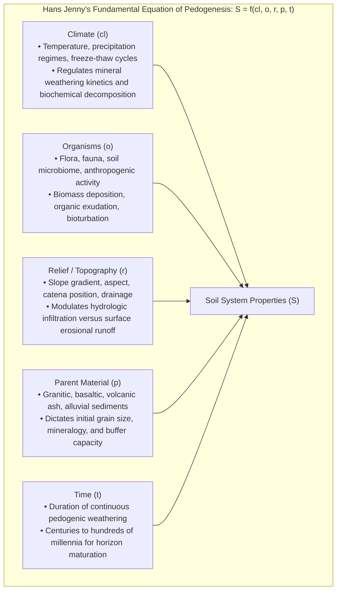

$$S = f(cl, o, r, p, t, \dots)$$

Where $S$ denotes any specific soil property or soil type, emerging as a joint function of climate ($cl$), organisms ($o$), relief ($r$), parent material ($p$), and time ($t$). Under pristine conditions, <strong>the natural creation of a single centimeter of fertile topsoil requires between 100 and 1,000 years</strong> of continuous biogeochemical weathering.

#### Soil Profile Morphology: The Primary Horizons
When a vertical trench is excavated through a mature soil profile, a sequential stratification of distinct morphological layers—<strong>soil horizons</strong>—is revealed:

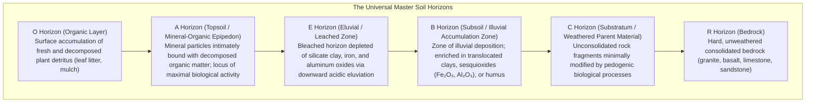

1. <strong>O Horizon (Organic)</strong>: Present in forested and undisturbed grassland ecosystems; sub-divided into fibric (undecomposed litter, $Oi$), hemic (partially decomposed, $Oe$), and sapric (highly decomposed muck, $Oa$) layers.
2. <strong>A Horizon (Topsoil)</strong>: The critical agricultural bio-engine. Mineral particles (sand, silt, clay) are structurally cemented with humified organic carbon, exhibiting dark coloration, low bulk density, and dense crumb aggregation.
3. <strong>E Horizon (Eluvial)</strong>: Common in acidic forest soils (e.g., Podzols/Spodosols). Organic acids strip iron and aluminum sesquioxides and clays, leaching them downward and leaving behind a pale, bleached layer composed primarily of resistant quartz grains.
4. <strong>B Horizon (Subsoil / Illuviation)</strong>: The illuvial zone where clays, humic complexes, and iron oxides accumulate. Often displays pronounced blocky or prismatic pedality.
5. <strong>C & R Horizons (Parent Material & Bedrock)</strong>: The weathered mineral substrate transitioning downward into solid lithic basement rock.

---

### 2. Soil Physics: The Three-Phase System and the pF Water Potential Spectrum

The capacity of plant roots to breathe oxygen, absorb water, and physically penetrate the subterranean matrix is strictly governed by the soil's <strong>three-phase volumetric distribution</strong>:

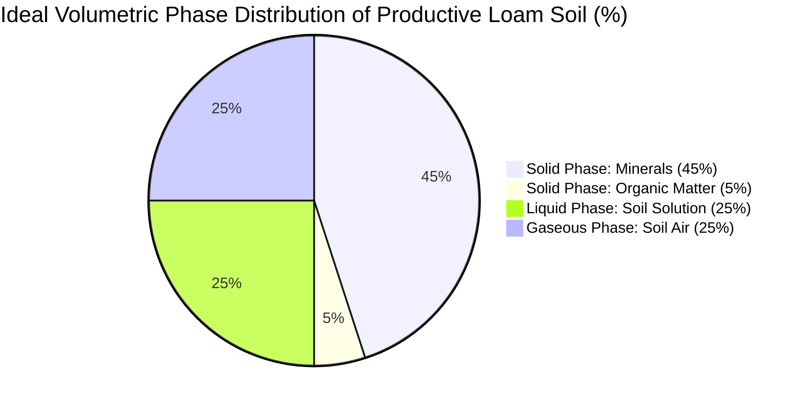

In a structurally balanced agricultural loam, the total volume is evenly partitioned: <strong>50% solid phase</strong> (45% mineral particles + 5% organic matter by volume) and <strong>50% pore space (porosity: $\Phi$)</strong>, with the pore volume ideally split into 25% water and 25% air.

#### Pore Size Hierarchy: Macropores versus Micropores
Soil pores are functionally bifurcated based on their capillary radius:
- <strong>Macropores (Non-capillary pores: Equivalent diameter $> 30 \dots 50\,\mu\text{m}$)</strong>: Unable to hold water against gravitational drainage. Following heavy precipitation, water percolates through macropores within hours, allowing atmospheric air to diffuse inward to replenish <strong>dissolved oxygen ($O_2$)</strong> for root and aerobic microbial respiration.
- <strong>Micropores (Capillary pores: Equivalent diameter $< 30\,\mu\text{m}$)</strong>: Possess sufficient capillary suction to hold water molecules against gravity via surface tension and adhesion, forming the vital <strong>moisture reservoir</strong> accessible to root hairs.

#### Soil Water Potential and the pF Scale
Soil water is subjected to matric, osmotic, and gravitational force fields. The energy state of soil moisture is quantified via the matric suction head ($h$, in cm of water column), classically transformed by R. K. Schofield into the logarithmic <strong>pF scale</strong>:

$$\text{pF} = \log_{10} |h| \quad (h \text{ in cm H}_2\text{O})$$

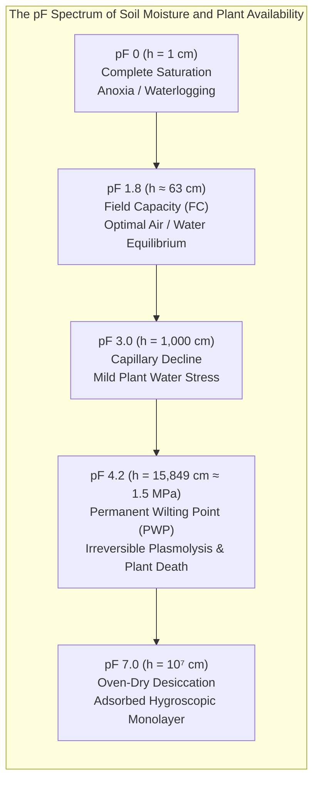

- <strong>pF 0 to 1.8 (Gravitational Water)</strong>: Rapidly drains under gravity; if maintained persistently, it causes hypoxia, root suffocation, and denitrification.
- <strong>pF 1.8 (Field Capacity: FC)</strong>: The maximum amount of water held by capillary tension once free gravitational drainage has ceased. Represents the physiological optimum for transpiration and nutrient mass-flow.
- <strong>pF 1.8 to 4.2 (Available Water Capacity: AWC)</strong>: The fraction of soil moisture that plant root suction can overcome.
- <strong>pF 4.2 (Permanent Wilting Point: PWP $\approx 1.5\,\text{MPa}$)</strong>: Soil particles bind the remaining water film with tension exceeding the maximum osmotic suction of plant root cells. Leaves lose turgor irreversibly and die.

---

### 3. Soil Aggregate Hierarchy: Architecture of the Underground Metropolis

When mineral particles remain dispersed as individual, unbonded grains, the soil exhibits a <strong>single-grain structure</strong> (loose beach sand) or <strong>massive structure</strong> (compacted, uncracked clay). Such soils suffer catastrophic degradation: raindrops shatter the surface, dispersing clays that form an impermeable crust, followed by massive erosion during downpours and rock-hard baking during droughts.

In contrast, productive soils feature a <strong>crumb or granular aggregate structure</strong>:

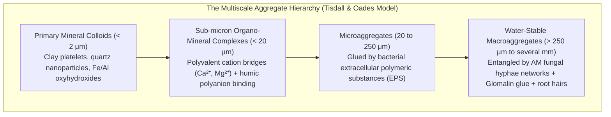

#### Dual Physics: Reconciling Infiltration and Water Retention
The multiscale architecture of soil aggregates resolves an apparent physical paradox:
1. <strong>Inter-aggregate Pores (Between Macroaggregates)</strong>: Provide wide, unobstructed vertical percolation channels for torrential rains, completely preventing surface pooling and runoff while ensuring rapid oxygen diffusion.
2. <strong>Intra-aggregate Pores (Within Microaggregates)</strong>: Act as micro-sponges, pulling water deep inside through capillary suction and sheltering organic carbon molecules from microbial enzymatic attack.

#### The Discovery of Glomalin: Nature's Superglue
For decades, soil scientists attributed aggregate stability purely to bacterial polysaccharides and humic substances. In 1996, Sara F. Wright discovered <strong>glomalin</strong> (quantified as Glomalin-Related Soil Protein: GRSP), a hydrophobic, recalcitrant glycoprotein produced in copious amounts by the hyphae of <strong>arbuscular mycorrhizal fungi (AMF)</strong>:
- Glomalin contains 30–50% carbon, incorporates chelated iron, and forms an insoluble, hydrophobic coating over mineral surfaces.
- It acts like biological lacquer, protecting macroaggregates from slaking (explosive bursting caused by entrapped air compression during rapid wetting).
- Glomalin accounts for up to 5% of total soil organic carbon and possesses a biological half-life of 7 to 42 years, serving as a primary structural pillar of soil carbon sequestration.

---

### 4. Humus Chemistry: The Paradigm Shift to the Soil Continuum Model

For over two centuries, textbooks taught that humus consisted of massive, dark, chemically recalcitrant macromolecular polymers synthesized via spontaneous non-enzymatic secondary condensation—categorized by classic alkaline extraction into <strong>humic acid, fulvic acid, and humin</strong>.

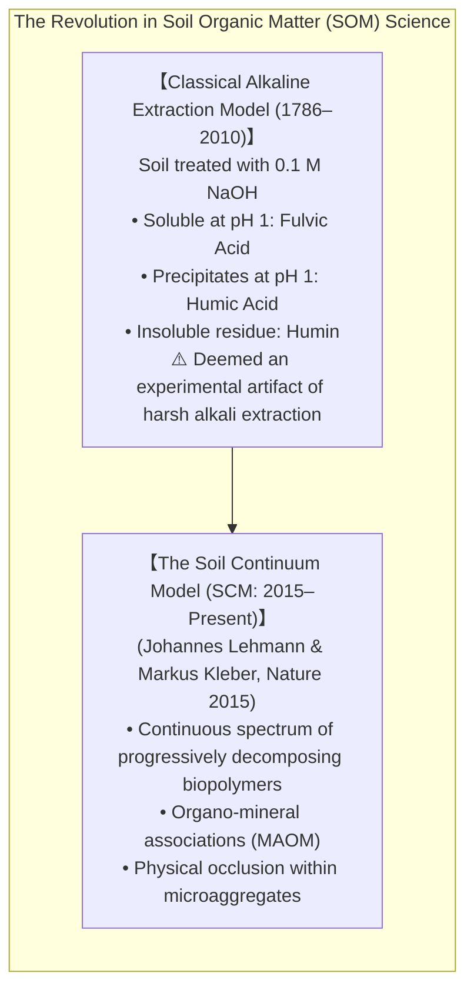

#### The Soil Continuum Model (SCM)
Pioneered by Johannes Lehmann and Markus Kleber (2015), advanced non-destructive analytical techniques—including solid-state $^{13}\text{C}$ Cross-Polarization Magic-Angle Spinning Nuclear Magnetic Resonance ($^{13}\text{C}\text{-CP/MAS-NMR}$) and Synchrotron-based Scanning Transmission X-ray Microscopy (STXM)—demonstrated that <strong>inherently recalcitrant humic macromolecules do not exist in native soil</strong>. 

Instead:
1. Soil Organic Matter (SOM) exists as a <strong>continuum of biogenic organic fragments</strong> spanning full molecular size spectra: intact biopolymers (cellulose, lignin, proteins), oligomers, and low-molecular-weight organic acids.
2. The persistence of carbon in soil for decades or millennia is not an intrinsic molecular property ("recalcitrance"), but an <strong>ecosystem property</strong>. Organic molecules survive because they are <strong>physically inaccessible</strong> to extracellular enzymes, either occluded within sub-micron mineral pores or chemically chemisorbed to charged mineral faces.

#### Microbial Necromass: The Secret Core of Humus
Quantitative biomarker analyses (such as amino sugars: muramic acid for bacteria and glucosamine for fungi) have revealed an even more startling paradigm shift: <strong>50% to over 80% of stable soil organic carbon is not composed of unaltered plant matter, but consists of microbial necromass—the dead bodies, cell wall fragments, and extracellular envelopes of bacteria and fungi</strong>.

Plants feed microbes through root exudates; the microbes assimilate this carbon into peptidoglycan, chitin, and cellular proteins. Upon microbial cell death, these cellular fragments adhere via electrostatic and hydrophobic interactions to clay platelets, forming ultra-stable <strong>Mineral-Associated Organic Matter (MAOM)</strong> with turnover times extending to thousands of years.

---

### 5. Cation Exchange Capacity (CEC) and Clay Mineralogy

Often termed the "nutrient reservoir" of soil, <strong>Cation Exchange Capacity (CEC)</strong> measures the total quantity of exchangeable cations that a soil can electrostatically hold on its negatively charged colloidal surfaces (expressed in $\text{cmol}_c/\text{kg}$ or $\text{meq}/100\,\text{g}$).

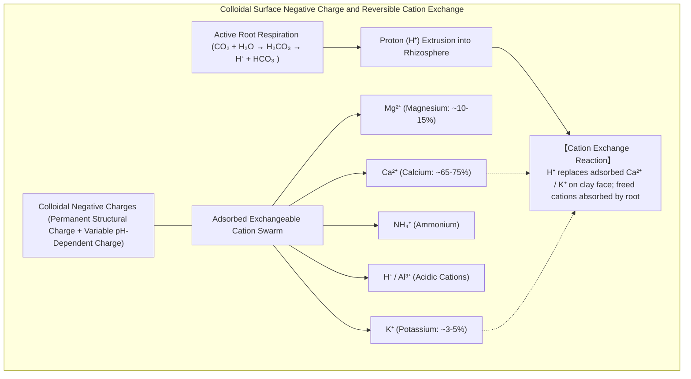

#### Clay Mineral Crystallography and Isomorphous Substitution
Soil clays ($< 2\,\mu\text{m}$) are crystalline layered phyllosilicates constructed of tetrahedral silicon sheets ($\text{SiO}_4^{4-}$) and octahedral aluminum/magnesium sheets ($\text{Al(OH)}_6^{3-}$).

During crystal genesis, ions of similar ionic radius substitute into the crystal lattice without disrupting its geometry—a phenomenon known as <strong>isomorphous substitution</strong>:
- In tetrahedral sheets, $\text{Al}^{3+}$ substitutes for $\text{Si}^{4+}$.
- In octahedral sheets, $\text{Mg}^{2+}$ or $\text{Fe}^{2+}$ substitutes for $\text{Al}^{3+}$.

Because a lower-valent cation replaces a higher-valent cation, a permanent net negative deficit is locked within the mineral lattice, creating <strong>permanent structural negative charge</strong> independent of soil pH.

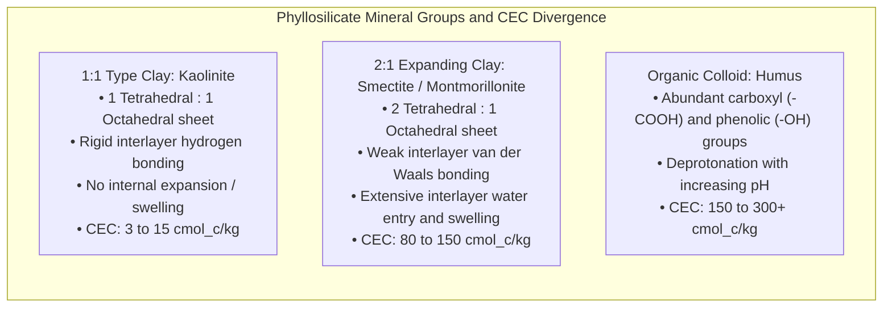

#### Soil Acidification and the Menace of Aluminum Toxicity
In high-rainfall climates, basic exchangeable cations ($\text{Ca}^{2+}, \text{Mg}^{2+}, \text{K}^{+}$) are progressively leached down the profile by carbonic and organic acids, reducing <strong>base saturation</strong> and driving soil pH downward.

When soil pH drops below <strong>5.0</strong>, the silicate lattice dissolves, releasing trivalent <strong>monomeric aluminum ($\text{Al}^{3+}$)</strong> into the soil solution:

$$\text{Al}^{3+} + \text{H}_2\text{O} \rightleftharpoons \text{Al(OH)}^{2+} + \text{H}^+ \rightleftharpoons \text{Al(OH)}_2^+ + 2\text{H}^+ \rightleftharpoons \text{Al(OH)}_3^0 \downarrow + 3\text{H}^+$$

Monomeric $\text{Al}^{3+}$ is intensely cytotoxic to plant roots: it binds covalently to pectins in cell walls, cross-links DNA in root apical meristems, inhibits calmodulin-mediated calcium signaling, and completely halts root elongation, causing stunting and drought sensitivity. The application of agricultural lime ($\text{CaCO}_3$) or dolomite ($\text{CaMg(CO}_3)_2$) neutralizes $\text{H}^+$, forcing $\text{Al}^{3+}$ to precipitate as harmless gibbsite ($\text{Al(OH)}_3$).

---

### 6. Soil Organic Matter Dynamics: The Carbon-to-Nitrogen (C/N) Ratio

In soil microbial ecology, the stoichiometry of organic residues governs nutrient cycling through the <strong>Carbon-to-Nitrogen (C/N) ratio</strong>.

Microbial biomass maintains a remarkably stable cellular stoichiometry of approximately <strong>8:1</strong>. When heterotrophic microorganisms consume organic matter for energy, roughly two-thirds of the ingested carbon is respired as $\text{CO}_2$ during ATP generation, while one-third is incorporated into cellular biomass. Consequently, microbes require 1 part of nitrogen for every 24 parts of metabolized organic carbon.

```mermaid
flowchart TD
    subgraph CNRatioImpact ["The Divergence of Mineralization versus Immobilization"]
        ResidueInput["Organic Residue Ingestion by Soil Microbes"] --> RatioEvaluation{"Substrate C/N Ratio Threshold"}
        RatioEvaluation -->|C/N < 20:1 (Legumes, Manure, Compost, Blood Meal)| Mineralization["【Net Mineralization】<br/>Substrate has excess nitrogen relative to microbial demand<br/>Surplus N released into soil solution as Ammonium (NH₄⁺) and Nitrate (NO₃⁻)<br/>🌱 Immediate plant-available fertility boost"]
        RatioEvaluation -->|C/N > 30:1 (Wheat Straw, Sawdust, Woodchips)| Immobilization["【Net Immobilization】<br/>Substrate is carbon-rich but nitrogen-starved<br/>Microbes scavenge all available NH₄⁺ and NO₃⁻ from soil solution<br/>⚠️ Severe 'Nitrogen Starvation' induces crop chlorosis and stunted growth"]
    end
```

Incorporating high-C/N residues (such as raw sawdust with $\text{C/N} \approx 400:1$) into agricultural fields induces acute <strong>nitrogen immobilization</strong>: microbes rapidly deplete all ambient ammonium and nitrate to synthesize their own enzymes and structural proteins, starving cash crop roots until the microbial population crashes and undergoes turnover.

---

### 7. The Soil Microbiome and Rhizosphere Ecology: The Underground Web

Plants do not live in isolation; they invest between <strong>20% and 40% of their total photosynthetically fixed carbon</strong> into pumping chemical secretions—<strong>root exudates</strong>—out into the surrounding soil cylinder known as the <strong>rhizosphere</strong>.

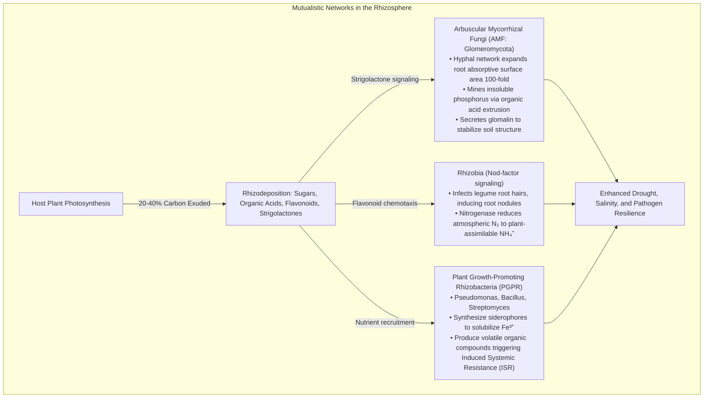

#### Arbuscular Mycorrhizal Networks (The "Wood Wide Web")
Over 80% of terrestrial plant families form obligatory symbioses with <strong>Arbuscular Mycorrhizal Fungi (AMF)</strong>:
1. Soil orthophosphate ($\text{H}_2\text{PO}_4^-$) is exceptionally immobile due to rapid fixation onto iron, aluminum, or calcium minerals. A root's depletion zone forms within millimeters.
2. AMF hyphae (only 2 to 5 $\mu\text{m}$ in diameter) penetrate soil micropores inaccessible to root hairs, mining phosphorus through the excretion of phosphatases and organic acids, and translocating it directly into root cortical arbuscules.
3. In exchange, the host plant transfers hexoses and fatty acids to the fungus, cementing an ancient partnership dating back 450 million years to the initial colonization of land by early bryophyte-like plants.

#### Biological Nitrogen Fixation: The Nitrogenase Marvel
Atmospheric dinitrogen ($\text{N}_2$) comprises 78% of the air, but its covalent triple bond ($\text{N}\equiv\text{N}$, dissociation energy of $945\,\text{kJ/mol}$) renders it inert to plants. Symbiotic <strong>rhizobia</strong> bacteria solve this through the metalloenzyme <strong>nitrogenase</strong>:

$$\text{N}_2 + 8\text{H}^+ + 8e^- + 16\text{ATP} \xrightarrow{\text{Fe-Mo Nitrogenase}} 2\text{NH}_3 + \text{H}_2 + 16\text{ADP} + 16\text{P}_i$$

Because nitrogenase is irreversibly deactivated by free oxygen, legume nodules produce <strong>leghemoglobin</strong>—a specialized heme-protein with an oxygen affinity ten times higher than human hemoglobin. It maintains sub-nanomolar free $O_2$ concentrations to protect the enzyme while sustaining high oxygen flux for bacteroid oxidative phosphorylation.

---

### 8. Anthropogenic Soil Degradation versus Regenerative Agriculture

The mid-20th-century Green Revolution exponentially increased grain yields through synthetic fertilizers (Haber-Bosch nitrogen), pesticides, and intensive mechanical tillage. However, this industrial paradigm has exacted a catastrophic ecological toll: global topsoil is eroding at rates <strong>10 to 40 times faster than its natural replenishment rate</strong>.

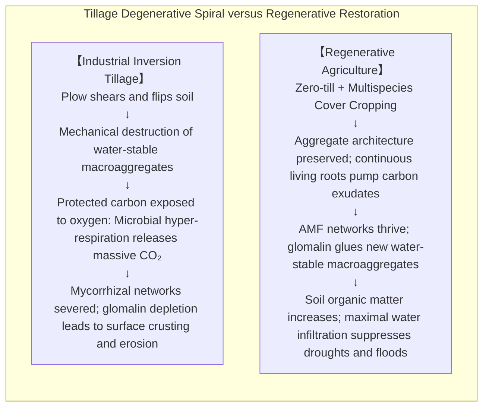

#### Why Does Deep Tillage Destroy Soil?
Tillage appears to loosen soil, but this effect is brief and counterproductive:
1. <strong>Mechanical Shattering</strong>: The shear forces of steel moldboard plows rip macroaggregates apart, pulverizing the soil into fine dust.
2. <strong>Carbon Oxidation and Burnout</strong>: Occluded organic carbon is exposed to sudden influxes of atmospheric oxygen, triggering an explosive burst of microbial respiration that vents centuries of sequestered carbon as $\text{CO}_2$.
3. <strong>Plow Pan Compaction</strong>: Beneath the plow depth (typically 20–30 cm), the immense axle weight of tractors compacts clay into a concrete-like, impenetrable barrier (plow sole), preventing deep root penetration and causing perched water tables.

#### The Five Core Principles of Regenerative Agriculture
To reverse desertification and restore pedospheric health, regenerative agriculture implements five foundational bio-principles:

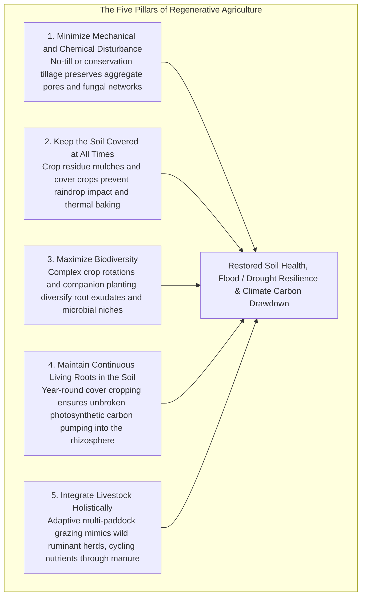

#### The "4 per 1000" Global Initiative
Launched by France during COP21 in Paris, the international <strong>"4 per 1000" (4‰) Initiative</strong> demonstrated a staggering mathematical reality: <strong>an annual increase of just 0.4% (4‰) in global soil organic carbon stocks in the top 40 cm of soil would sequester carbon equivalent to all global anthropogenic greenhouse gas emissions annually</strong>.

Soil contains approximately 2,500 gigatons of carbon—more than three times the carbon in the entire atmosphere and four times that in all living terrestrial vegetation. Restoring degraded agricultural soils through regenerative pedology is humanity's most scalable, cost-effective, and ecologically restorative technology for planetary carbon drawdown.

---

### 9. Conclusion: The Final Frontier Beneath Our Feet

Soil is not dirt; it is a self-organizing, living biogeochemical matrix. It is the crucible where geology meets biology, where death is enzymatically dismantled and converted into the foundation of new life.

Within a single handful of rich loam resides an interconnected biosphere whose complexity rivals that of rainforests or coral reefs. To degrade soil is to unravel the terrestrial life-support system that feeds humanity; to regenerate soil is to restore the living skin of the Earth. Understanding and stewarding this microscopic universe is the defining scientific mandate for sustainable life on our planet.
