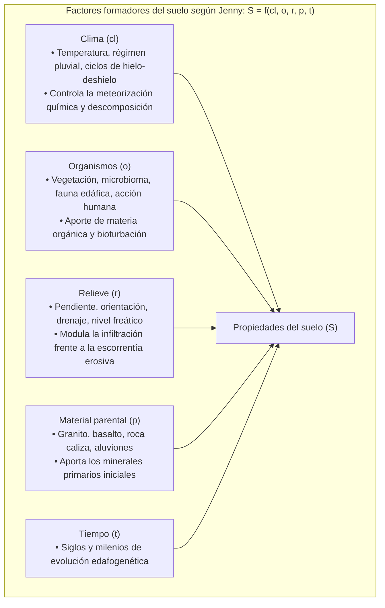

Bajo nuestros pies descansa una piel viva de apenas unas decenas de centímetros de espesor: la <strong>tierra fértil (topsoil)</strong>. Esta capa superficial, denominada <strong>pedosfera</strong>, sustenta los ecosistemas terrestres y proporciona más del 95 % de los alimentos consumidos por la humanidad.

El suelo no es simple roca triturada. Si regáramos regolito estéril de la Luna o Marte, ningún cultivo sobreviviría. Solo cuando los minerales meteorizados durante milenios se combinan con restos vegetales y son sintetizados por la actividad metabólica de <strong>más de 10.000 millones de bacterias, hongos, actinomicetos y nemátodos en un solo gramo de tierra</strong>, nace un suelo fértil y vivo.

La edafología ha experimentado un cambio de paradigma histórico: la teoría bicentenaria de los «ácidos húmicos» macromoleculares ha sido refutada mediante espectroscopía de sincrotrón en favor del <strong>Modelo del Continuo del Suelo (Soil Continuum Model: SCM)</strong>, demostrando que la <strong>necromasa microbiana</strong> es el componente fundamental del carbono orgánico estable. Al mismo tiempo, el descubrimiento de la <strong>glomalina</strong> secretada por hongos micorrícicos ha descifrado la estabilidad de los agregados, mientras que iniciativas globales como «4 por 1000» sitúan al suelo como sumidero clave contra el cambio climático.

Este manual analiza los factores de Jenny, la estratificación en horizontes, la física del sistema trifásico, las curvas pF, la jerarquía de agregados, la CIC, la dinámica C/N, la rizosfera y los principios de la agricultura regenerativa.

---

### 1. Génesis del suelo: La ecuación de Hans Jenny y los horizontes edáficos

El suelo evoluciona según la ecuación de factores de estado formulada por Hans Jenny en 1941:

Se requieren entre <strong>100 y 1.000 años para formar 1 cm de suelo fértil</strong>.

#### Horizontes del perfil de suelo
- <strong>Horizonte O</strong>: Materia orgánica fresca y hojarasca en superficie;
- <strong>Horizonte A</strong>: Capa arable rica en humus y minerales, de máxima actividad biológica;
- <strong>Horizonte E</strong>: Horizonte de lavado eluvial blanquecino (pérdida de hierro, arcillas y materia orgánica);
- <strong>Horizonte B</strong>: Horizonte iluvial de acumulación de arcillas y sesquióxidos de hierro;
- <strong>Horizonte C y R</strong>: Roca madre meteorizada sobre el lecho rocoso consolidado.

---

### 2. Física del suelo: Sistema trifásico y curvas de potencial hídrico (pF)

El volumen de un suelo agrícola equilibrado se distribuye en: <strong>50 % de fase sólida</strong> (45 % minerales + 5 % materia orgánica) y <strong>50 % de espacio poroso</strong> (25 % agua + 25 % aire).

#### Escala pF de succión del agua
La tensión matricial se mide mediante la escala logarítmica pF:
- <strong>pF 1,8 (Capacidad de campo)</strong>: Agua retenida tras cesar el drenaje por gravedad; equilibrio óptimo aire/agua;
- <strong>pF 1,8 a 4,2 (Agua disponible para las plantas)</strong>: Rango absorbible por la succión radicular;
- <strong>pF 4,2 (Punto de marchitez permanente)</strong>: La fuerza de succión del suelo supera la presión osmótica de las raíces (1,5 MPa); la planta se seca de forma irreversible.

---

### 3. Estructura granular: Jerarquía de agregados y glomalina

En suelos sin estructura, las partículas arcillosas dispersas forman costras impermeables y sufren erosión. En suelos fértiles, las partículas se cementan en <strong>agregados estables al agua</strong>:
- Los <strong>macroporos</strong> inter-agregados facilitan la infiltración rápida del agua y la oxigenación;
- Los <strong>microporos</strong> intra-agregados almacenan humedad y protegen el carbono del ataque enzimático.
- La <strong>glomalina</strong>, glicoproteína insoluble secretada por hongos micorrícicos arbusculares (AMF), actúa como pegamento hidrófobo que impide que los agregados colapsen con las lluvias torrenciales.

---

### 4. Química del humus: El Modelo del Continuo del Suelo (SCM)

Las técnicas analíticas modernas han desmentido la existencia de macropolímeros húmicos artificiales:
1. La materia orgánica es un continuum de fragmentos biogénicos en degradación continua.
2. Su estabilidad radica en la protección física en nanoporos de arcillas (MAOM).
3. <strong>Entre el 50 % y más del 80 % del carbono estable procede de necromasa microbiana</strong> (restos celulares de bacterias y hongos).

---

### 5. Capacidad de Intercambio Catiónico (CIC) y acidez del suelo

La CIC mide los cationes nutrientes retenidos electrostáticamente en superficies coloidales ($\text{Ca}^{2+}, \text{Mg}^{2+}, \text{K}^{+}, \text{NH}_4^+$):
- Las arcillas 2:1 (esmectitas) aportan alta CIC ($80 \dots 150\,\text{cmol}_c/\text{kg}$) por sustitución isomórfica;
- El <strong>humus</strong> aporta la mayor CIC ($150 \dots 300\,\text{cmol}_c/\text{kg}$) por desprotonación de carboxilos.
- <strong>Toxicidad por aluminio</strong>: A pH inferior a 5,0 se disuelve $\text{Al}^{3+}$, que detiene la división celular radicular. El encalado con carbonato cálcico precipita el aluminio neutralizando su toxicidad.

---

### 6. Relación Carbono/Nitrógeno (C/N)

El microbioma mantiene una estequiometría de 8:1 en sus células:
- <strong>C/N < 20 (Estiércol, leguminosas)</strong>: Mineralización neta; liberación de amonio y nitrato fertilizante;
- <strong>C/N > 30 (Paja seca, serrín)</strong>: Inmovilización microbiana de todo el nitrógeno soluble, causando <strong>hambre de nitrógeno</strong> en los cultivos.

---

### 7. El microbioma rizosférico

Las plantas bombean entre el 20 % y el 40 % de su carbono fotosintético a la rizosfera:
- Los <strong>hongos micorrícicos (AMF)</strong> solubilizan y transportan fósforo inaccesible;
- Las bacterias <strong>rizobios</strong> fijan nitrógeno atmosférico mediante la enzima nitrogenasa protegida por leghemoglobina;
- Las <strong>rizobacterias PGPR</strong> quelan hierro con sideróforos y suprimen patógenos edáficos.

---

### 8. Agricultura regenerativa y la iniciativa «4 por 1000»

El arado intensivo tritura agregados y oxida el carbono a CO₂. La agricultura regenerativa restaura el suelo mediante:
1. Cero labranza (siembra directa);
2. Cobertura vegetal continua;
3. Raíces vivas durante todo el año;
4. Diversidad biológica de cultivos;
5. Integración ganadera planificada.

La iniciativa internacional <strong>«4 por 1000»</strong> establece que un aumento anual del 0,4 % en el carbono de los suelos mundiales neutralizaría todas las emisiones antropogénicas de gases de efecto invernadero del planeta.

---

### 9. Conclusión

El suelo no es tierra inerte; es un macroorganismo biofísico entrelazado. Proteger la vida del suelo es la mayor garantía de fertilidad y estabilidad climática para las generaciones venideras.
