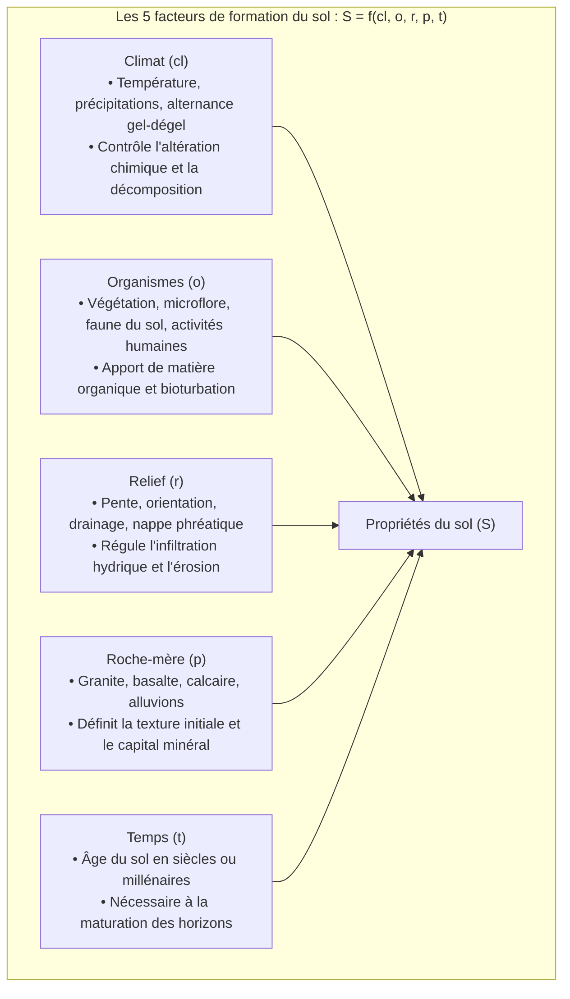

Sous nos pas s'étend une membrane vivante d'à peine quelques dizaines de centimètres d'épaisseur : la <strong>terre arable (topsoil)</strong>. Cette couche, appelée <strong>pédosphère</strong>, constitue l'épiderme vivant de notre planète et nourrit plus de 95 % de l'humanité.

Le sol n'est en rien une simple poussière minérale stérile issue du broyage des roches. Si l'on arrosait du régolithe lunaire ou martien, aucune plante ne pourrait y pousser. Ce n'est que lorsque la roche altérée s'associe à la matière organique végétale et fermente sous l'action métabolique de <strong>plus de 10 milliards de bactéries, champignons, actinobactéries et nématodes dans un seul gramme de terre</strong> que naît un sol fertile.

La science des sols (pédologie) a récemment connu une révolution majeure : l'abandon de l'ancienne théorie des « acides humiques » au profit du <strong>modèle du continuum du sol (Soil Continuum Model : SCM)</strong>, confirmant que la <strong>nécromasse microbienne</strong> est le pilier central du stockage durable du carbone. Parallèlement, la mise en évidence de la <strong>glomaline</strong> – colle sécrétée par les champignons mycorhiziens – a expliqué la cohésion des agrégats, tandis que l'initiative « 4 pour 1000 » place la séquestration du carbone dans le sol au cœur de la lutte climatique.

Ce guide examine les facteurs de formation de Jenny, les horizons pédologiques, la physique des trois phases et les courbes pF, la hiérarchie des agrégats, la CEC, le ratio C/N, la rhizosphère et les principes de l'agriculture régénératrice.

---

### 1. Pédogenèse : L'équation d'état de Hans Jenny et les horizons du sol

Le sol est le fruit de processus biogéochimiques rigoureux régis par l'<strong>équation de Hans Jenny (1941)</strong> :

Il faut entre <strong>100 et 1 000 ans à la nature pour former 1 cm de sol fertile</strong>.

#### Morphologie du profil de sol
Un profil vertical fait apparaître des horizons successifs :
- <strong>Horizon O</strong> : Litière organique de surface ;
- <strong>Horizon A</strong> : Terre arable sombre, riche en humus et biologiquement active ;
- <strong>Horizon E</strong> : Horizon de lessivage (éluviation) blanchi par la perte de fer et d'argile ;
- <strong>Horizon B</strong> : Horizon d'accumulation (illuviation) de matière argileuse et d'oxydes métalliques ;
- <strong>Horizon C & R</strong> : Roche-mère altérée reposant sur le substrat rocheux dur.

---

### 2. Physique du sol : Triphasage et spectre énergétique pF

L'enracinement et la nutrition hydrique reposent sur l'équilibre des trois phases : <strong>50 % de solide</strong> (45 % minéraux, 5 % matière organique) et <strong>50 % de porosité</strong> (25 % eau, 25 % air).

#### Tension de l'eau et échelle pF
La force de rétention de l'eau s'exprime par le pF (logarithme de la succion en cm d'eau) :
- <strong>pF 1,8 (Capacité au champ)</strong> : Eau résiduelle après drainage gravitaire, équilibre optimal eau/air ;
- <strong>pF 1,8 à 4,2 (Eau utile ou utilisable)</strong> : Fraction accessible aux racines ;
- <strong>pF 4,2 (Point de flétrissement permanent)</strong> : La succion capillaire dépasse la force d'absorption osmotique des racines (1,5 MPa) ; la plante se dessèche définitivement.

---

### 3. La structure grumeleuse : Architecture des agrégats

Les particules minérales se lient grâce aux exopolysaccharides bactériens et à la <strong>glomaline</strong> produite par les champignons mycorhiziens (AMF) pour former des <strong>agrégats stables à l'eau</strong> :
- Les <strong>macropores</strong> inter-agrégats assurent l'infiltration rapide de l'eau et l'aération racinaire ;
- Les <strong>micropores</strong> intra-agrégats retiennent l'eau et protègent la matière organique de la digestion enzymatique.

---

### 4. Chimie de l'humus : Le modèle du continuum (SCM)

L'abandon des anciens concepts de « polymères d'acides humiques » a débouché sur le <strong>Soil Continuum Model</strong> :
1. La matière organique est un continuum de biomolécules en dégradation progressive.
2. Sa persistance dépend de son association physique aux nanopores des argiles (MAOM).
3. <strong>50 à 80 % du carbone organique stable provient de la nécromasse microbienne</strong> (débris de parois cellulaires de bactéries et champignons morts).

---

### 5. Capacité d'échange cationique (CEC) et acidification

La CEC représente la capacité du complexe argilo-humique à retenir des cations échangeables ($\text{Ca}^{2+}, \text{Mg}^{2+}, \text{K}^{+}, \text{NH}_4^+$) :
- L'<strong>argile smectite (2:1)</strong> offre une forte CEC ($80 \dots 150\,\text{cmol}_c/\text{kg}$) grâce à la substitution isomorphe ;
- L'<strong>humus</strong> possède la CEC la plus élevée ($150 \dots 300\,\text{cmol}_c/\text{kg}$) par ionisation de ses groupements carboxyles.
- <strong>Toxicité aluminique</strong> : En dessous de pH 5,0, l'aluminium toxique ($\text{Al}^{3+}$) est libéré, bloquant l'élongation des racines. Le chaulage au carbonate de calcium rétablit le pH et neutralise l'aluminium.

---

### 6. Rapport Carbone/Azote (C/N)

Le microbiome a un ratio C/N cellulaire stable de 8:1 :
- <strong>C/N < 20 (Fumier, légumineuses)</strong> : Minéralisation nette d'azote sous forme d'ammonium assimilable ;
- <strong>C/N > 30 (Paille, sciure)</strong> : Les microbes captent tout l'azote minéral disponible, provoquant la <strong>faim d'azote</strong> des cultures.

---

### 7. Le microbiome rhizosphérique

Les racines exsudent de 20 à 40 % du carbone photosynthétique pour nourrir la rhizosphère :
- Les <strong>mycorhizes</strong> prospectent le phosphore insoluble ;
- Les <strong>rhizobiums</strong> fixent l'azote gazeux ($\text{N}_2$) grâce à la nitrogénase protégée par la leghémoglobine ;
- Les <strong>bactéries PGPR</strong> produisent des sidérophores pour chélater le fer et suppriment les pathogènes telluriques.

---

### 8. L'agriculture régénératrice et l'initiative « 4 pour 1000 »

Le labour profond détruit les agrégats et oxyde le carbone en CO₂. L'agriculture régénératrice repose sur :
1. L'arrêt du labour (semis direct) ;
2. La couverture végétale permanente ;
3. Le maintien de racines vivantes continues ;
4. La diversification des cultures ;
5. L'intégration de l'élevage au pâturage tournant.

L'initiative internationale <strong>« 4 pour 1000 »</strong> démontre qu'une augmentation de 0,4 % par an du stock de carbone des sols mondiaux suffirait à neutraliser l'ensemble des émissions humaines annuelles de gaz à effet de serre.

---

### 9. Conclusion

Le sol est le creuset vivant de la planète. En préserver la biologie, c'est garantir la pérennité de notre civilisation.
