私たちが日常的に足を踏みしめている大地——その足元に広がるわずか数十センチメートルの表土（Topsoil）こそが、陸上生態系を支え、全人類の食料の95％以上を育む「地球の皮膚（Pedosphere）」です。

土壌は、単なる「岩石が砕けた鉱物の粉末（砂や粘土）」ではありません。もし月や火星の砂をプランターに入れて水をやっても、作物は健全には育ちません。岩石の微小な破片が、気の遠くなるような時間をかけて雨風に風化され、植物の遺体と出会い、そして<strong>わずか1グラムの土の中に100億匹を超える細菌・放線菌・真菌・原生動物・線虫が織りなす超高密度の生命活動</strong>によって醸成されて初めて、それは「生きた土壌」へと変貌を遂げます。

近年、土壌科学（ペドロジー: Pedology）は長年の古典的パラダイムを塗り替える革命的な知見を次々と発表しています。有機物の分解産物と信じられてきた「腐植（フミン酸）」の分子実態に関する土壌連続体モデルへの転換、アーバスキュラー菌根菌が分泌する強力な生体接着剤<strong>「グロマリン」</strong>による団粒構造の形成力学、根圏における植物と土壌微生物叢の化学シグナル伝達、さらには地球温暖化を食い止める土壌炭素隔離（4パーミル・イニシアチブ）に至るまで、土壌は今や21世紀の地球生命科学の最前線として注目されています。

本稿では、土壌生成の基本方程式から、土壌三相分布と水分張力（pF値）、団粒構造のナノ・マイクロ階層構造、腐植の化学構造と微生物壊死体（ネクロマス）、陽イオン交換容量（CEC）と土壌酸性化の物理化学、C/N比の生化学動態、根圏マイクロバイオームの共生機構、そして再生型農業（Regenerative Agriculture）の科学まで、土壌の全貌を徹底的に掘り下げて解説します。

---

### 1. 土壌生成論（ペドロジー）：ハンス・ジェニーの方程式と層位発達

土壌は地球上のどのような法則に従って生まれ、時間をかけて発達していくのでしょうか。20世紀の偉大な土壌学者ハンス・ジェニー（Hans Jenny, 1899–1992）は、1941年に土壌生成を支配する<strong>5大因子の基礎方程式</strong>を提唱しました。

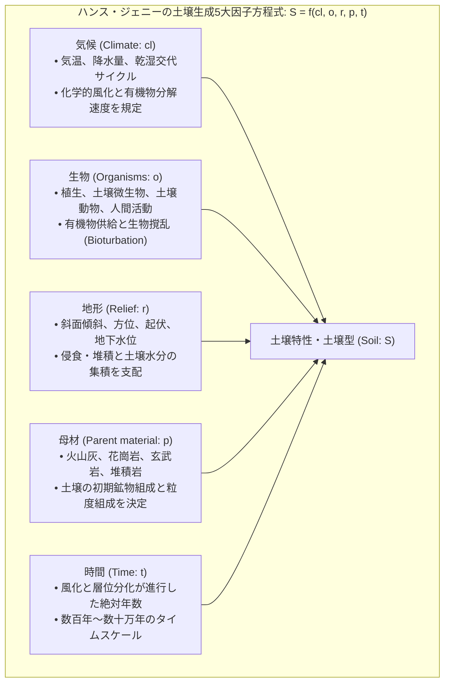

$$S = f(cl, o, r, p, t, \dots)$$

母岩（Parent rock）が物理的・化学的に破砕された母材（Parent material）に、気候（$cl$）の熱と雨が作用し、そこに植物や土壌生物（$o$）が定着して有機物を供給し、地形（$r$）による浸透や侵食を受けながら、時間（$t$）の経過とともに分化していきます。わずか<strong>1センチメートルの肥沃な表土が自然に形成されるまでには、およそ100年から1000年もの歳月</strong>が必要です。

#### 土壌断面形態学：土壌層位（Soil Horizons）の発達
発達した土壌を垂直に深く掘り下げると、地表から下層に向かって特徴的な縞模様の層——<strong>土壌層位（Horizons）</strong>が観察されます。

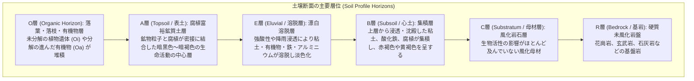

1. <strong>O層（有機物層）</strong>：森林の地表などを覆うリター層（落ち葉・枯れ枝）。菌類やトビムシ、ミミズによって破砕・初期分解が行われます。
2. <strong>A層（表土）</strong>：農業においてもっとも決定的な層。鉱物粒子（砂・シルト・粘土）と高度に分解された有機物（腐植）が均一に混ざり合い、ミミズの腸内通過や微生物活動によって団粒構造が発達した暗色の肥沃層です。
3. <strong>E層（溶脱層）</strong>：冷温帯のタイガ林（ポドゾル土壌など）で顕著に見られる層。有機酸を帯びた酸性水が浸透することで、鉄やアルミニウム、粘土粒子が下層へ洗い流され、石英砂が白く露出します。
4. <strong>B層（心土・集積層）</strong>：上層から溶脱したコロイド粘土や鉄酸化物（針鉄鉱や赤鉄鉱）が物理的・化学的に沈殿・集積する層。根系が深く侵入し、構造が発達します。
5. <strong>C層・R層（母材・基岩）</strong>：風化しつつある未固結の母岩片（C層）と、その最下部に横たわる硬質な原岩盤（R層）です。

---

### 2. 土壌三相分布と物理性：水と空気のミクロ迷宮

植物の根が呼吸し、水を吸い上げ、物理的に伸長できるかどうかは、土壌の<strong>物理構造（三相分布と孔隙構造）</strong>によって決まります。

土壌の見かけの全体積は、固相（鉱物粒子と有機物）、液相（土壌溶液・水分）、気相（土壌空気）の3つの相から構成されています。

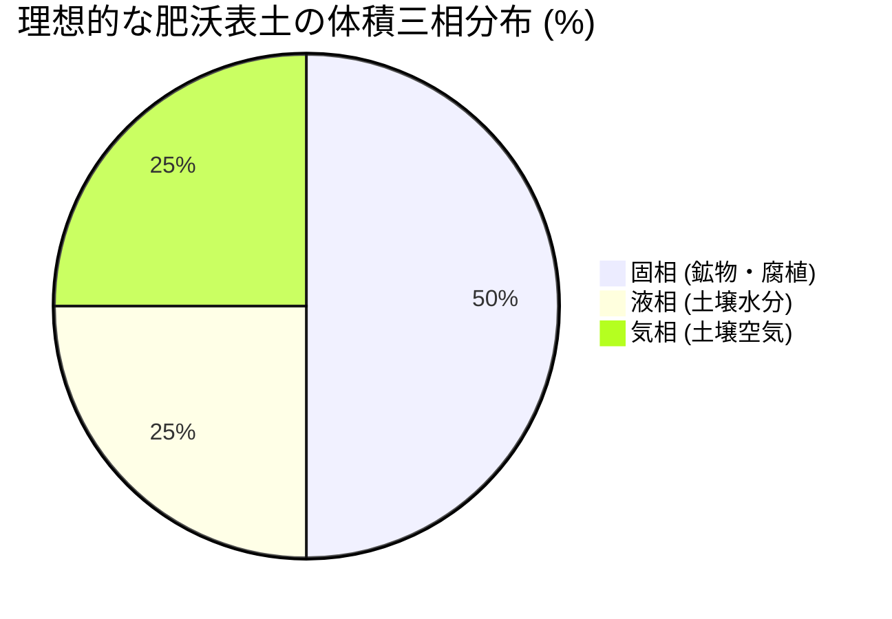

健全で透水性と保水性を兼ね備えた土壌の理想的な三相バランスは、<strong>「固相50％、液相25％、気相25％」</strong>（孔隙率50％、水分と空気が半々）とされます。

#### 孔隙の階層構造：粗孔隙と細孔隙
土壌の孔隙（隙間）は、そのサイズと毛管現象の物理によって2つに機能分化します。
- <strong>粗孔隙（非毛管孔隙: 直径 > 30〜50 μm）</strong>：重力に対して水を保持できず、雨が降った後に水が速やかに流れ落ちる空間。雨水が抜けた後は空気が満ち、<strong>根や好気性微生物へ酸素を供給する通気経路</strong>となります。
- <strong>細孔隙（毛管孔隙: 直径 < 30 μm）</strong>：水分子の表面張力と毛管力によって、重力に逆らって水を保持する空間。降雨後も水が留まり、<strong>植物の根が吸い上げる保水リザーバー</strong>となります。

#### 土壌水分のエネルギー状態：pF値と土壌水ポテンシャル
土壌に水が含まれていても、土壌粒子が水を吸着する力（水分張力）が強すぎると、植物の根はその水を吸い上げることができません。土壌物理学では、この吸着力を水柱の高さ（cm）の常用対数で表した<strong>pF値（potential Force）</strong>を用います。

$$\text{pF} = \log_{10} |h| \quad (h: \text{水柱高さ } \text{cm})$$

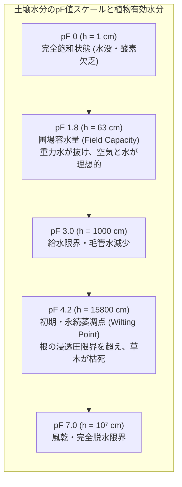

- <strong>pF 0 〜 1.8（重力水）</strong>：大雨の直後、孔隙が水で満たされた状態。重力によって下方へ浸透排出される余剰水。
- <strong>pF 1.8 〜 4.2（有効水分: Available Water）</strong>：毛管張力で保持され、植物の根が吸水可能な命の水。特にpF 1.8〜3.0はもっとも吸いやすく、作物がもっとも旺盛に成長します。
- <strong>pF 4.2以上（無効水分・吸着水）</strong>：粘土鉱物や腐植の表面に分子間力（水素結合や静電気力）で強固に張り付いた薄い水膜。植物の根の浸透圧（最大約1.5 MPa $\approx$ pF 4.2）を上回る張力で結合しているため、根は水を吸うことができず、植物は不可逆的に萎れて枯死（永続萎凋）します。

---

### 3. 団粒構造（Soil Aggregates）：生命が編み上げる奇跡の建築工学

土壌の物理性を語る上で、もっとも核心となる概念が<strong>団粒構造（Aggregate Structure / Crumb Structure）</strong>です。

砂浜の砂や干からびた粘土のように、土壌粒子が一つひとつバラバラに固まっている状態を「単粒構造（Single-grain）」または「無構造」と呼びます。単粒状態の土に雨が降ると、微細な粘土が目詰まりを起こして水が染み込まず表面を泥流となって流失（土壌侵食）し、乾けばコンクリートのようにカチカチにひび割れて根を窒息させます。

これに対し、優れた肥沃土壌では、砂・シルト・粘土の鉱物微粒子が有機物や微生物の分泌物によって接着され、直径数マイクロメートルから数ミリメートルの柔らかい球状の塊——<strong>「団粒（団子状の集合体）」</strong>を形成しています。

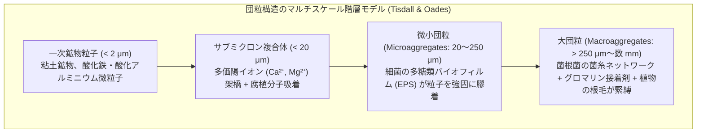

#### 団粒構造がもたらす「相反する性質の共存」
団粒構造の驚異的な物理的利点は、<strong>「水はけ（排水性・通気性）」と「水もち（保水性）」という、本来なら矛盾する物理特性を同一の土壌内で完璧に両立させる点</strong>にあります。
1. <strong>団粒と団粒の「間」（大孔隙・粗孔隙）</strong>：雨が降っても水は団粒同士の広い隙間を瞬く間に流れ落ち、排水されます。水が引いた後は新鮮な空気がスムーズに循環し、根の呼吸を支えます。
2. <strong>団粒の「内部」（小孔隙・微細孔隙）</strong>：団粒の内部には微細な毛管孔隙がスポンジのように張り巡らされており、毛管力で水分と溶存養分をがっちりと蓄え込みます。

#### 生体接着剤「グロマリン（Glomalin）」の発見
土壌粒子を強固に接着している糊の正体は何でしょうか。長年、微生物が分泌する多糖類（EPS）やフミン酸が主役と考えられていましたが、1996年、米国農務省（USDA）のサラ・ライト（Sara Wright）博士によって、決定的な生体高分子が発見されました。それが<strong>アーバスキュラー菌根菌（AM菌）の菌糸から分泌される不溶性糖タンパク質「グロマリン（Glomalin）」</strong>です。

グロマリンは、鉄やアルミニウムなどの金属イオンをキレート化して抱え込んだ疎水性の極めて頑丈な高分子であり、雨水に浸かっても容易には溶け出さず、土壌中で数十年から数百年もの間分解されずに残存します。菌根菌が土中に張り巡らせる広大な菌糸ネットワークが網袋のように土壌粒子を包み込み、グロマリンを塗りたくることで、水に浸けても崩れない<strong>耐水性大団粒（Water-stable aggregates）</strong>が完成するのです。

---

### 4. 腐植（Humus）の化学：土壌有機物研究のパラダイムシフト

「腐植（Humus）」とは、動植物の遺体が土壌生物によって分解・代謝・重合されて生成する、複雑かつ暗色の高分子有機化合物の総称です。

土壌有機物（Soil Organic Matter: SOM）は、土壌重量のわずか数％に過ぎない場合でも、その保水力、保肥力（CEC）、団粒形成力、土壌生態系の維持において主導的な役割を果たします。

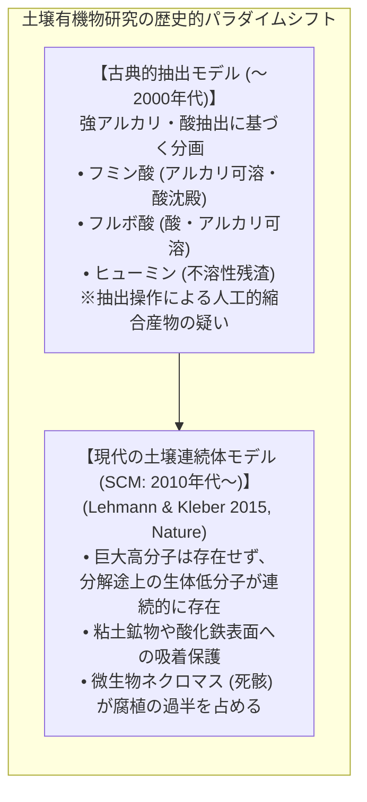

#### 古典的腐植酸モデルの終焉
200年以上にわたり、土壌化学の教科書には「リグニンなどが土壌中で非酵素的に自己縮合重合し、芳香族環を無数に持った分解されにくい超巨大高分子（フミン酸・フルボ酸）が誕生する」というモデルが記載されてきました。

しかし、2010年代以降、固体高分解能NMR（核磁気共鳴）や高分解能シンクロトロンX線分光法（STXM）の発展により、この古典的理論は根底から覆されました。実験室で強アルカリ（0.1 M NaOH）を用いて土壌から抽出する過程そのものが、小さな有機分子同士を人工的に化学重合させて巨大ポリマーを捏造していたことが暴かれたのです。

#### 現代の土壌連続体モデル（Soil Continuum Model: SCM）
コーネル大学のヨハネス・レーマン（Johannes Lehmann）とマルクス・クレーバー（Markus Kleber）らが提唱したSCM理論では：
1. 土壌有機物は、植物遺体の高分子ポリマー（セルロース、リグニン、タンパク質）から、微生物酵素によって切断されたオリゴマー、単量体、低分子有機酸に至る<strong>連続的なサイズスペクトラム</strong>として存在します。
2. 有機物が土壌中で数百年も分解されずに残る理由は、「分子自体が分解不能な超巨大構造だから」ではなく、<strong>「粘土鉱物や酸化鉄ナノ粒子の微細孔に入り込んで物理的に酵素から遮断されているから（物理的保護・化学的吸着）」</strong>です。

#### 微生物ネクロマス（Necromass）：腐植の真の正体
近年のアミノ糖分析（グルコサミン、ムラミン酸など）やバイオマーカー研究によって、さらに衝撃的な事実が明らかになりました。<strong>長期的に土壌に安定して固定されている有機炭素（腐植）の50％〜80％以上は、植物の遺体そのものではなく、「植物を食べて増殖した細菌や真菌の死骸（ネクロマス: Necromass）」およびその細胞壁断片に由来している</strong>ということです。

微生物は植物炭素を取り込んで自らの細胞体（ペプチドグリカン、キチン、タンパク質）を構築し、死後にその破片が粘土粒子表面に強固にコーティング吸着されることで、半永久的な土壌炭素プール（土壌炭素隔離）を形成するのです。

---

### 5. 陽イオン交換容量（CEC）と土壌酸性化の物理化学

農業において「土の胃袋」と形容されるのが、<strong>陽イオン交換容量（Cation Exchange Capacity: CEC）</strong>です。CECとは、土壌がアンモニア、カリウム、カルシウム、マグネシウムなどの正電荷を持つ必須養分イオン（カチオン）をどれだけ電気的に保持し、植物の根に供給できるかを表す指標です（単位: $\text{cmol}_c/\text{kg}$ または $\text{meq}/100\,\text{g}$）。

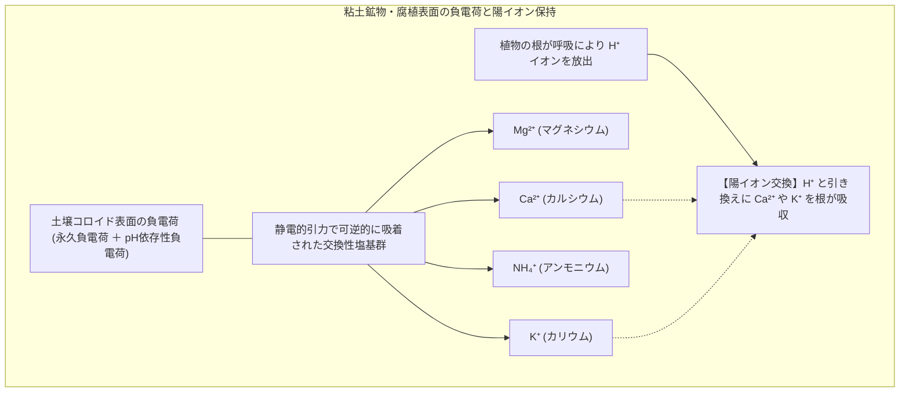

#### 粘土鉱物の結晶構造と同形置換（永久負電荷）
土壌中の粘土粒子（粒径 < 2 μm）は、ケイ酸四面体シート（$\text{SiO}_4$）とアルミナ八面体シート（$\text{Al(OH)}_6$）が積み重なった層状ケイ酸塩鉱物です。
結晶が形成される際、ケイ酸四面体の中心にある4価のケイ素イオン（$\text{Si}^{4+}$）がサイズの近い3価のアルミニウムイオン（$\text{Al}^{3+}$）に置き換わったり、アルミナ八面体の3価の $\text{Al}^{3+}$ が2価のマグネシウムイオン（$\text{Mg}^{2+}$）に置き換わる現象が起きます。これを<strong>同形置換（Isomorphous Substitution）</strong>と呼びます。

同形置換が起きると、結晶格子の内部で正電荷が不足するため、<strong>結晶表面全体に永久的なマイナスの静電電荷（永久負電荷）</strong>が発生します。

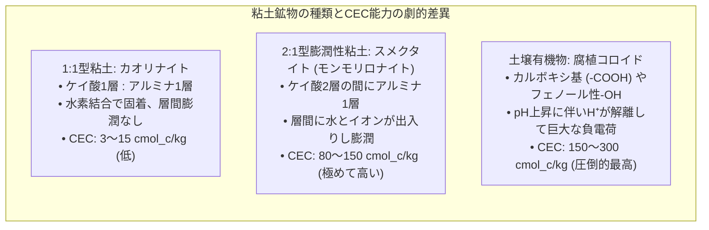

日本の火山灰土壌（黒ボク土）に多く含まれる非晶質のアロフェンや、腐植コロイドは、pHが上がるとカルボキシ基（$-\text{COOH} \rightarrow -\text{COO}^- + \text{H}^+$）の解離が進んで負電荷が増大する<strong>変異電荷（pH依存性負電荷）</strong>を持ちます。腐植のCECは粘土鉱物を遥かに凌駕する $200 \sim 300\,\text{cmol}_c/\text{kg}$ に達し、堆肥施用が「土の保肥力を高める」最大の科学的根拠となっています。

#### 土壌酸性化のメカニズムとアルミニウム毒性
降雨量が多い地域（日本など）では、雨水に含まれる炭酸や有機酸から生じる水素イオン（$\text{H}^+$）によって、粘土表面に吸着されていた塩基イオン（$\text{Ca}^{2+}, \text{Mg}^{2+}, \text{K}^+$）が洗い流され（溶脱）、土壌が徐々に酸性化（pH低下）します。
土壌pHが 5.0 以下に低下すると、粘土鉱物の結晶構造そのものが破壊され、有毒な<strong>活性アルミニウムイオン（$\text{Al}^{3+}$）</strong>が土壌溶液中に溶け出します。

$$\text{Al}^{3+} + \text{H}_2\text{O} \rightleftharpoons \text{Al(OH)}^{2+} + \text{H}^+ \rightleftharpoons \dots \rightleftharpoons \text{Al(OH)}_3 \downarrow + 3\text{H}^+$$

$\text{Al}^{3+}$ イオンは植物の根端分裂組織に侵入し、細胞壁のペクチンと架橋して細胞伸長を停止させ、カルシウム情報伝達タンパク質（カルモジュリン）を阻害して根を褐色に萎縮させます。これが農業現場で最も警戒される<strong>「アルミニウム毒性」</strong>であり、消石灰や炭酸カルシウム（苦土石灰）を施用して土壌pHを適正域（6.0〜6.5）に中和維持する最大の生化学的理由です。

---

### 6. C/N比（炭素窒素比）の生化学動態と窒素飢餓

土壌微生物と有機物の相互作用において、肥料設計や堆肥作りの指標として決定的な役割を果たすのが<strong>C/N比（炭素・窒素比: Carbon-to-Nitrogen Ratio）</strong>です。

微生物の細胞体の平均的なC/N比はおよそ <strong>8:1</strong>（炭素8に対して窒素1）です。微生物が有機物を摂取してエネルギーを得る際、取り込んだ炭素の約3分の2は呼吸によって二酸化炭素（$\text{CO}_2$）として放散され、残りの約3分の1が新たな自身の細胞体を合成するために同化されます。

```mermaid
flowchart TD
    subgraph CNRationDynamics ["C/N比による無機化と固定化の分岐"]
        Input["土壌への有機物投入"] --> RatioCheck{"有機物の C/N 比"}
        RatioCheck -->|C/N < 20 (米ぬか、油かす、鶏糞、マメ科)| Mineralization["【無機化 (Mineralization)】<br/>窒素が過剰なため、余剰窒素がアンモニウムイオン (NH₄⁺)<br/>や硝酸イオン (NO₃⁻) として放出され、作物の肥料となる"]
        RatioCheck -->|C/N > 25〜30 (生わら、おがくず、木くず)| Immobilization["【有機化・微生物固定 (Immobilization)】<br/>炭素過剰・窒素不足のため、微生物が土壌中の可給態窒素を奪い尽くす<br/>↓<br/>【窒素飢餓 (Nitrogen Starvation)】作物が窒素欠乏で黄化・生育停止"]
    end
```

- <strong>C/N比が 20 未満の有機物（易分解性・高窒素）</strong>：微生物が有機物を分解する過程で窒素が余剰となるため、アンモニア態窒素（$\text{NH}_4^+$）として土壌中に放出されます（<strong>窒素の無機化</strong>）。作物の生育を旺盛にする「肥料効果」を持ちます。
- <strong>C/N比が 30 以上の有機物（難分解性・高炭素）</strong>：生の稲わら（C/N比 約60）や木くず（C/N比 200〜500）を未完熟のまま土壌にすき込むと、莫大な炭素をエサにして微生物が爆発的に増殖します。その際、微生物自身が細胞体を組み立てるために必要な窒素が足りなくなり、<strong>土壌溶液中の貴重な硝酸態・アンモニア態窒素をすべて独占して奪い尽くしてしまいます（窒素の有機化・固定化）</strong>。結果として作物の根が窒素を一切吸えなくなり、葉が真っ黄色に枯れ上がる<strong>「窒素飢餓」</strong>という農業事故が発生します。

---

### 7. 土壌マイクロバイオームと根圏生態学：地下のハイパーネットワーク

植物は、光合成によって大気中の二酸化炭素から合成した貴重な光合成産物（糖、有機酸、アミノ酸）の<strong>20％〜40％を、自ら根から周囲の土壌へと滲出（分泌）</strong>させています。これを<strong>根圏分泌物（Root Exudates）</strong>と呼びます。

植物が莫大なエネルギーを費やしてまで土壌に有機物を垂れ流す理由——それこそが、自らの生存を委ねる有益な微生物軍団を根の周囲（根圏: Rhizosphere）に呼び寄せ、養い、組織化するためです。

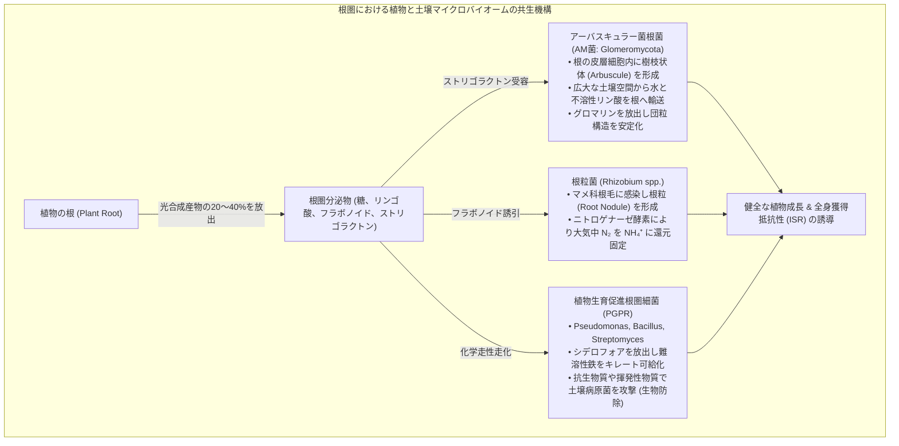

#### アーバスキュラー菌根菌（AM菌）の地下インターネット
陸上植物の80％以上と共生する<strong>アーバスキュラー菌根菌（Arbuscular Mycorrhizal Fungi: AMF）</strong>は、土壌生態系の真の主役です。
1. 植物の根毛が届く範囲は根の表面からわずか1〜2ミリメートルですが、AM菌の菌糸は根の細胞内から土壌の奥深くまで数十センチメートルも縦横無尽にネットワークを広げます。
2. 土壌中でカルシウムや鉄・アルミニウムと結合してガチガチに不溶化している<strong>リン酸（$\text{PO}_4^{3-}$）</strong>を、菌糸が有機酸を放出してキレート溶解し、植物の根へと直接パイプライン輸送します。
3. その見返りとして、植物は菌根菌にヘキソース（ブドウ糖や果糖）や脂質を独占的に供給します。

#### 根粒菌による大気中窒素固定
大気中の約78％を占める窒素ガス（$\text{N}_2$）は、三重結合（$\text{N}\equiv\text{N}$）という極めて強固な化学結合を持つため、植物は直接利用できません。マメ科植物と共生する<strong>根粒菌（Rhizobia）</strong>は、酸素に極めて脆弱な金属酵素<strong>ニトロゲナーゼ（Nitrogenase）</strong>を用い、莫大なATPエネルギーを消費して大気中の窒素を植物が同化可能なアンモニアへと変換します。

$$\text{N}_2 + 8\text{H}^+ + 8e^- + 16\text{ATP} \xrightarrow{\text{Nitrogenase}} 2\text{NH}_3 + \text{H}_2 + 16\text{ADP} + 16\text{P}_i$$

根粒内部では、酸素分圧を低く保ちつつ呼吸用酸素を運搬するため、ヘモグロビンと酷似した赤色タンパク質<strong>レグヘモグロビン（Leghemoglobin）</strong>が充満しており、切断すると動物の筋肉のように鮮やかな赤色を呈します。

---

### 8. 近代農業の土壌危機と再生型農業（Regenerative Agriculture）

20世紀後半の「緑の革命」は、化学肥料（ハーバー・ボッシュ法による窒素肥料）と化学農薬、そして大型トラクターによる徹底的な深耕（プラウ耕起）によって、世界の穀物収量を飛躍的に増大させました。しかし、その代償として地球規模の<strong>土壌の劇的な劣化と砂漠化</strong>が進行しています。

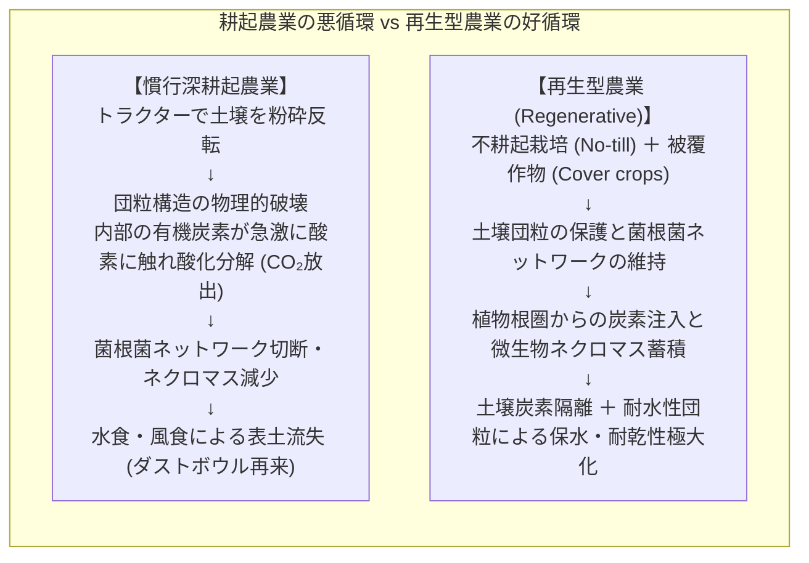

#### なぜ過剰な耕起は土壌を殺すのか？
土を深く掘り返して耕す（プラウ耕起）ことは、一見すると土を柔らかくして空気を入れる良い行為のように思えます。しかし、科学的には以下の致命的破綻をもたらします：
1. <strong>団粒の物理的破砕</strong>：長年かけて微生物と菌糸が作り上げた大団粒が機械的に粉砕され、単粒化します。
2. <strong>有機炭素の急速なガス化</strong>：団粒の内部に物理的に隔離・保護されていた有機物が空気に晒され、土壌微生物による好気的分解が爆発的に促進され、莫大な炭素が二酸化炭素（$\text{CO}_2$）として大気中へ放散されます。
3. <strong>菌糸ネットワークの断絶</strong>：土壌中に網の目のように張り巡らされていた菌根菌の菌糸がズタズタに引き裂かれ、グロマリンの供給が断たれます。

#### 再生型農業の5大原則
国連食糧農業機関（FAO）の警告によれば、現在のペースで土壌侵食と劣化が続けば、あと60回の収穫で世界の表土は危機に瀕すると言われています。この危機を打開すべく世界中で急速に広まっているのが<strong>再生型農業（Regenerative Agriculture）</strong>です。

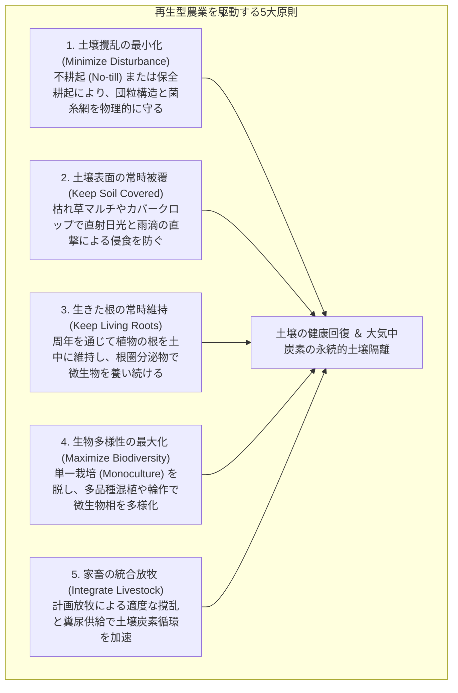

#### 4パーミル・イニシアチブ（4 per 1000 Initiative）
2015年のCOP21（パリ協定）でフランス政府が提唱した「4パーミル・イニシアチブ」は、<strong>「世界中の土壌（深さ40cmまで）に含まれる炭素量を毎年わずか0.4％（4‰）ずつ増加させることができれば、人類が年間に排出するすべての温室効果ガス（CO₂）を土壌中に相殺・吸収できる」</strong>という衝撃的な科学的試算に基づいています。

土壌は、大気中の約3倍、全陸上植物の約4倍もの炭素を貯留できる地球最大の動的炭素貯蔵庫です。不耕起栽培と菌根菌の保護によって植物光合成産物を微生物ネクロマスへと変換し、耐水性団粒の中に炭素を閉じ込めることこそが、気候変動緩和と食料安全保障を同時に達成する人類最大の処方箋なのです。

---

### 9. 結び：足元の宇宙を巡る科学の旅

土壌とは、単なる死んだ鉱物の粉末ではありません。それは太陽の光エネルギー、大気中の二酸化炭素、風化した岩石のミネラル、そして数千億の微生物の生命活動が交差する、<strong>地球上でもっとも高密度で複雑な「生命と物質の循環結節点」</strong>です。

1握りの土壌の中には、天の川銀河の全恒星の数よりも多い微生物が蠢き、互いにシグナルを交わし、粘土と腐植のナノ迷宮を築き上げています。

土壌を破壊することは文明の土台を掘り崩すことであり、土壌を再生することは地球の生命維持装置を蘇らせることに他なりません。足元に広がるこの豊穣なミクロの宇宙に目を向けること——それこそが、持続可能な未来へと踏み出す科学の第一歩なのです。
