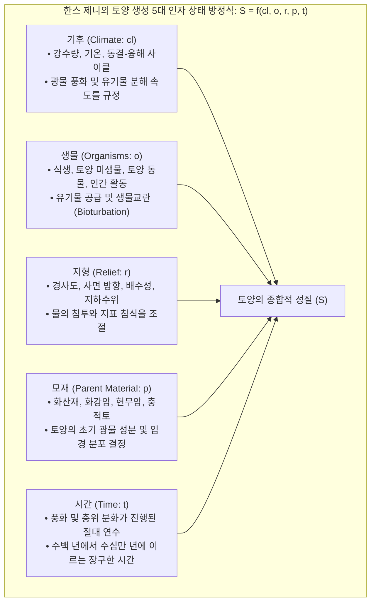
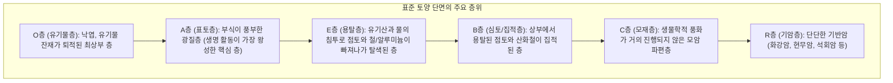
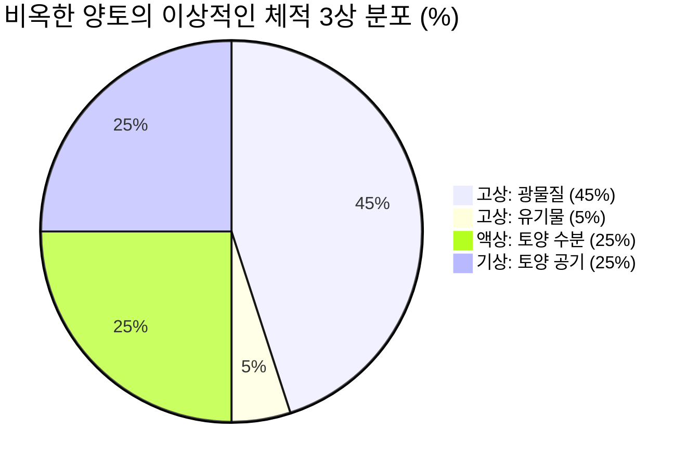
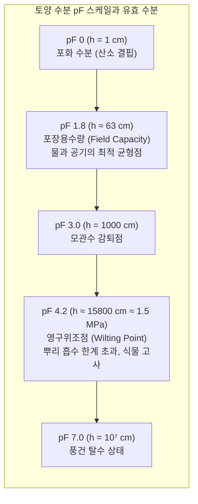
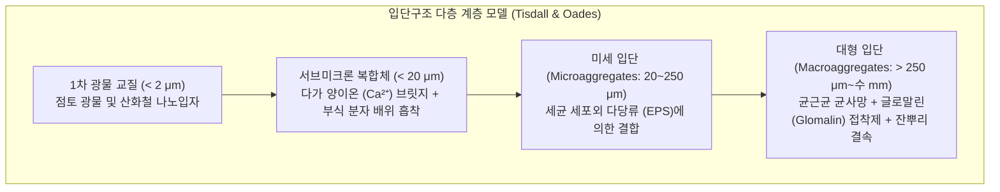
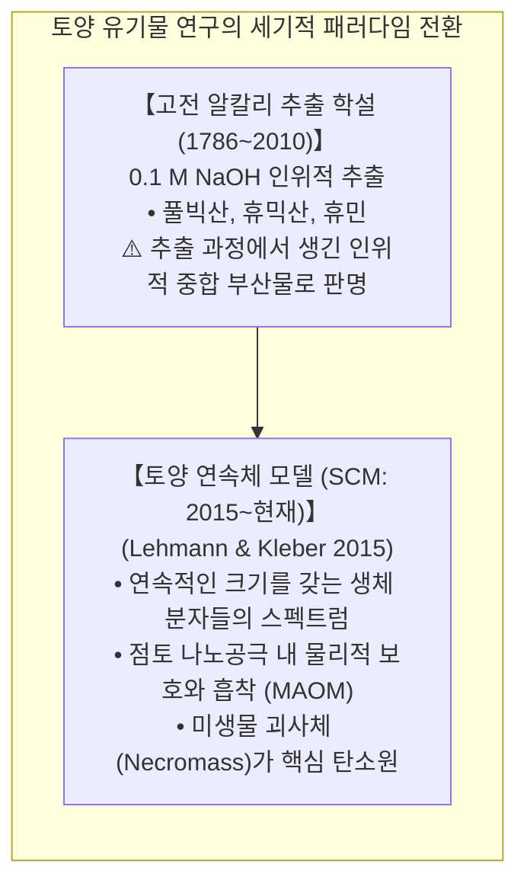
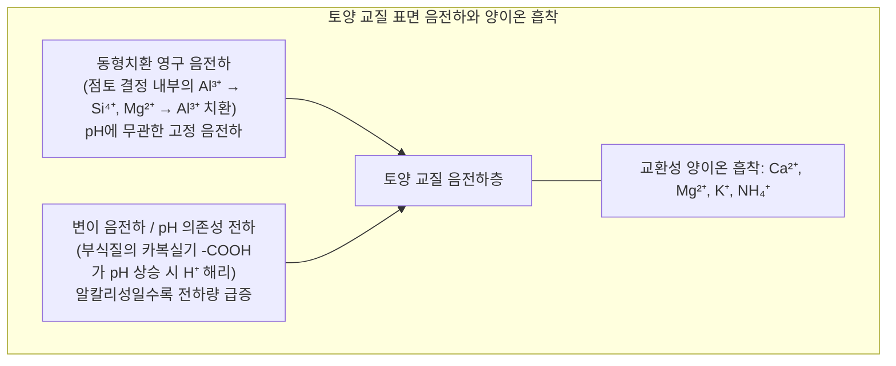
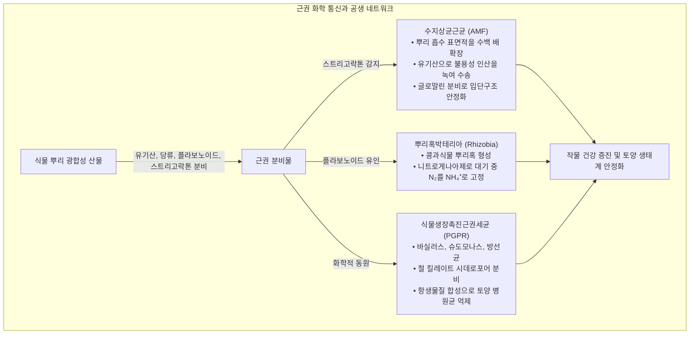
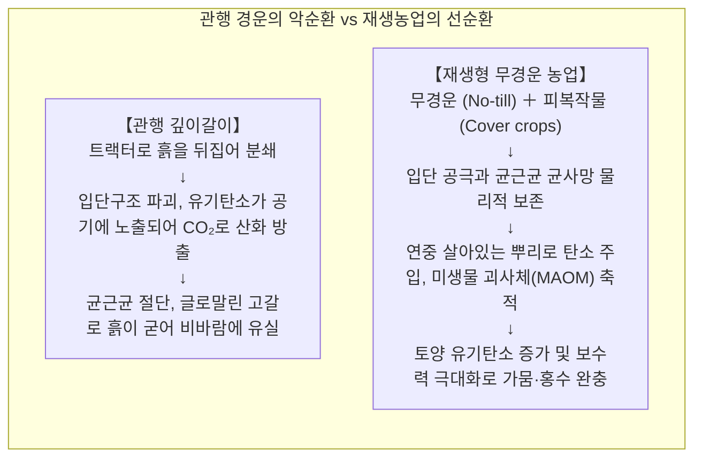

우리가 매일 딛고 서 있는 대지 표면의 불과 수십 센티미터 두께의 표토(Topsoil)——이른바 <strong>토양권(Pedosphere)</strong>은 육상 생태계의 물질 순환을 지탱하고 전 인류 식량의 95% 이상을 생산하는 '지구의 살아있는 피부'입니다.

토양은 결코 단순한 '바위가 부서진 광물 가루'가 아닙니다. 달이나 화성의 멸균된 모래 먼지를 화분에 담고 물을 주어도 식물은 자라지 못합니다. 1차 광물 파편이 수천 년의 비바람 속에 풍화되고, 식물 잔재와 만나며, <strong>단 1g의 흙 속에 서식하는 100억 마리 이상의 세균, 방선균, 균류, 미세 절지동물</strong>이 상호작용할 때 비로소 '살아 숨 쉬는 유기적 토양'으로 다시 태어납니다.

최근 토양과학(Pedology)은 200년 묵은 고전적 패러다임을 뒤흔드는 혁명적인 발견들을 연이어 쏟아내고 있습니다. 알칼리 추출에 기반했던 '휴믹산/풀빅산' 거대분자 가설이 폐기되고, 고해상도 싱크로트론 X선과 고체 NMR로 밝혀진 <strong>토양 유기물 연속체 모델(Soil Continuum Model: SCM)</strong>이 정립되었으며, <strong>미생물 괴사체(Necromass)</strong>가 영구적 토양 탄소 격리의 핵심체임이 규명되었습니다. 또한 수지상균근균이 분비하는 천연 접착 단백질인 <strong>글로말린(Glomalin)</strong>의 입단 안정화 메커니즘과 '4퍼밀 이니셔티브(4 per 1000)'에 이르기까지, 토양은 21세기 지구환경과학의 최전선으로 부상했습니다.

본 글에서는 한스 제니의 성토 5대 인자 방정식, 토양 단면 층위학, 3상 분포와 수분 장력(pF 곡선), 입단구조의 다층 계층성, 부식의 분자화학, 양이온 교환용량(CEC)과 알루미늄 독성, C/N비의 생화학, 근권 미생물 네트워크, 그리고 재생농업(Regenerative Agriculture)의 원리까지 토양의 모든 비밀을 심층 분석합니다.

---

### 1. 성토학: 한스 제니의 상태인자 방정식과 단면 층위 발달

토양은 물리적, 화학적, 생물학적 법칙에 따라 점진적으로 진화하는 자연체입니다. 1941년 스위스계 미국인 토양학자 한스 제니(Hans Jenny)는 <strong>토양 생성의 5대 인자 상태 방정식</strong>을 수립했습니다:



$$S = f(cl, o, r, p, t, \dots)$$

자연 상태에서 <strong>단 1cm의 비옥한 표토가 형성되는 데에는 100년에서 1,000년의 세월</strong>이 걸립니다.

#### 토양 단면의 층위 발달 (Soil Horizons)
성숙한 토양의 수직 단면을 파 내려가면 특징적인 층상 구조가 나타납니다:



---

### 2. 토양 물리성: 3상 분포와 수분 흡유력 (pF 스펙트럼)

식물 뿌리의 호흡과 수분 흡수, 물리적 생장은 토양의 <strong>3상 부피 분포</strong>에 의해 좌우됩니다:



이상적인 농경지 토양은 <strong>고상 50%</strong>(광물 45% + 유기물 5%)와 <strong>공극 50%</strong>(수분 25% + 공기 25%)의 황금비율을 이룹니다.

#### 공극 크기 분포와 수분 역학
- <strong>대공극(비모관 공극: 직경 > 30~50 μm)</strong>: 중력에 저항해 물을 잡지 못하고 강우 후 물이 즉시 빠져나가며, <strong>뿌리와 호기성 미생물에 산소를 공급하는 통기 통로</strong>가 됩니다.
- <strong>소공극(모관 공극: 직경 < 30 μm)</strong>: 모세관 현상에 의해 물을 중력에 거슬러 붙잡아두는 <strong>식물의 수분 저장고</strong>입니다.

#### pF 수분 장력 스케일
토양 입자가 물을 붙잡는 힘(흡유력)을 수주 높이(cm)의 상용로그로 나타낸 지표가 <strong>pF 값</strong>입니다:

$$\text{pF} = \log_{10} |h| \quad (h \text{ 는 수주 높이, cm})$$



- <strong>pF 1.8(포장용수량) ~ pF 4.2(영구위조점)</strong> 사이의 수분이 식물이 이용할 수 있는 <strong>유효 수분(Available Water)</strong>입니다. pF 4.2를 초과하는 수분은 토양 교질에 너무 강하게 결합되어 있어 뿌리의 삼투압으로 흡수할 수 없으므로 식물은 영구적으로 시들어 죽습니다.

---

### 3. 토양 입단구조(Soil Aggregates): 미생물이 빚어낸 지하 도시

토양 입자가 개별적으로 흩어져 있는 단립 구조에서는 비가 오면 진흙탕이 되어 표면이 막히고 침식되며, 마르면 시멘트처럼 굳어버립니다.

반면 비옥한 흙은 1차 광물 입자들이 유기물과 미생물 분비물로 뭉쳐진 <strong>수포성 입단구조(Crumb Structure)</strong>를 형성합니다:



#### 통기성과 보수성의 공존
입단구조는 '물빠짐(배수성)'과 '물지님(보수성)'이라는 상반된 성질을 완벽하게 양립시킵니다:
1. <strong>대형 입단 사이의 큰 틈(대공극)</strong>: 비가 오면 물이 빠르게 빠져나가 산소가 원활히 통합니다;
2. <strong>입단 내부의 미세 공극(소공극)</strong>: 스펀지처럼 물과 양분을 가두어 뿌리에 서서히 공급합니다.

#### 기적의 생체 접착제: 글로말린(Glomalin)
1996년 사라 라이트(Sara Wright) 박사는 수포성 입단의 핵심 접착제가 <strong>수지상균근균(AMF)</strong>이 분비하는 불용성 당단백질인 <strong>글로말린(Glomalin: GRSP)</strong>임을 밝혔습니다. 소수성이 매우 강하고 분해가 더딘 이 단백질은 토양 알갱이를 코팅하여 물에 젖어도 입단이 풀어지지 않도록 보호합니다.

---

### 4. 부식질의 화학과 토양 유기물 연속체 모델(SCM)의 패러다임 전환

지난 200년간 교과서는 부식질이 난분해성 거대 고분자(휴믹산, 풀빅산, 휴민)로 이루어져 있다고 설명해왔습니다.

그러나 2015년 요하네스 레만(Johannes Lehmann)과 마르쿠스 클레버(Markus Kleber)는 《Nature》 논문을 통해 이를 뒤엎고 <strong>토양 유기물 연속체 모델(SCM)</strong>을 제창했습니다:



1. 토양에는 본질적으로 분해되지 않는 화학적 거대분자가 존재하는 것이 아니라, 생체 고분자가 효소에 의해 끊임없이 분해되어 가는 <strong>연속적인 크기의 저분자 스펙트럼</strong>이 존재합니다.
2. 유기물이 수백 년간 보존되는 이유는 분자 자체가 난분해성이어서가 아니라, <strong>점토 광물의 나노 공극에 물리적으로 갇혀 효소의 접근이 차단(물리적 보호)</strong>되기 때문입니다.
3. <strong>미생물 괴사체(Necromass)의 중요성</strong>: 토양에 장기 보존되는 유기 탄소의 50~80%는 미분해된 식물체가 아니라, <strong>식물을 먹고 증식한 세균과 곰팡이가 죽어서 남긴 세포벽 조각(펩티도글리칸, 키틴 등)</strong>임이 입증되었습니다.

---

### 5. 양이온 교환용량(CEC)과 토양 산성화 및 알루미늄 독성

토양이 비료 성분을 흡착해 보관하는 그릇의 크기를 <strong>양이온 교환용량(CEC: $\text{cmol}_c/\text{kg}$)</strong>이라고 합니다.



- <strong>1:1형 카올리나이트</strong>: 층간 결합이 단단하여 팽창하지 않으며 CEC가 3~15로 낮습니다;
- <strong>2:1형 몬모릴로나이트(스멕타이트)</strong>: 층간 팽창이 크고 동형치환이 활발하여 CEC가 80~150에 달합니다;
- <strong>부식질(Humus)</strong>: 카복실기 해리로 인해 CEC가 150~300에 달해 최고의 보비력을 자랑합니다.

#### 산성화와 알루미늄 독성
비가 많이 오는 지역에서는 칼슘, 마그네슘이 씻겨 나가며 토양 pH가 떨어집니다. pH가 <strong>5.0 이하</strong>로 떨어지면 점토 결정이 부서지며 <strong>활성 알루미늄($\text{Al}^{3+}$)</strong>이 용출됩니다. $\text{Al}^{3+}$ 이온은 뿌리 끝 세포 분열을 정지시키고 칼슘 신호전달계를 마비시켜 뿌리를 검게 괴사시킵니다. 석회를 시용하여 pH를 6.0~6.5로 교정하는 것은 알루미늄을 침전 제거하는 핵심 영농 기술입니다.

---

### 6. C/N비(탄소질소비)와 미생물 질소 기아

유기물 분해 시 <strong>C/N비</strong>는 영양분의 방출 여부를 결정합니다. 토양 미생물 세포의 C/N비는 약 <strong>8:1</strong>이며, 섭취한 탄소의 2/3는 호흡으로 날아가고 1/3만 몸체가 됩니다.

```mermaid
flowchart TD
    subgraph CNRatioDynamics ["C/N비에 따른 무기화와 미생물 고정의 분기"]
        OrganicInput["유기물 투입"] --> Threshold{"기질의 C/N비 판정"}
        Threshold -->|C/N < 20:1 (녹비, 유박, 가축분뇨)| Mineralization["【순 무기화 (Mineralization)】<br/>질소가 풍부하여 잉여 질소가 암모늄(NH₄⁺) 및 질산(NO₃⁻)으로 방출<br/>🌱 작물에 즉각적인 비료 효과 발휘"]
        Threshold -->|C/N > 30:1 (볏짚, 톱밥, 우드칩 미발효 투입)| Immobilization["【순 미생물 고정 (Immobilization)】<br/>탄소 과잉으로 미생물이 폭발 증식하며 토양의 모든 무기태 질소를 독점<br/>⚠️ '질소 기아 현상' 발생: 작물 잎이 노랗게 마르고 생장 정지"]
    end
```

---

### 7. 근권 생태계와 지하 하이퍼네트워크

식물은 광합성으로 고정한 탄소의 <strong>20~40%를 스스로 뿌리 밖으로 분비</strong>합니다(근권 분비물: Root Exudates).



뿌리혹 내부에는 산소에 극도로 취약한 질소고정 효소를 보호하기 위해 인간의 헤모글로빈과 흡사한 붉은 단백질 <strong>레그헤모글로빈(Leghemoglobin)</strong>이 가득 차 있어 신선한 뿌리혹을 자르면 선홍색을 띱니다.

---

### 8. 관행 경운의 위기와 재생농업(Regenerative Agriculture)

20세기 트랙터 심경과 화학비료는 생산량을 늘렸지만, 전 세계 표토를 자연 생성 속도보다 <strong>10~40배 빠르게 침식</strong>시켰습니다.



#### 재생농업의 5대 원칙
1. <strong>토양 교란 최소화(무경운)</strong>: 입단과 균사망 보호;
2. <strong>연중 지표 피복 유지</strong>: 멀칭과 피복작물로 자외선과 빗방울 충격 차단;
3. <strong>연중 살아있는 뿌리 유지</strong>: 끊임없는 근권 분비물 공급;
4. <strong>생물다양성 극대화</strong>: 윤작과 혼작으로 미생물 다양성 확보;
5. <strong>가축 방목 통합</strong>: 배설물 순환으로 생태계 회복.

#### 4퍼밀(4 per 1000) 이니셔티브
2015년 파리협정에서 제시된 4퍼밀 구상은 <strong>"전 세계 표토 40cm의 유기탄소를 매년 0.4%(4‰)씩 늘리면 인류가 배출하는 연간 온실가스 전량을 토양에 흡수 격리할 수 있다"</strong>는 계산에 바탕을 둡니다.

---

### 9. 결론: 발밑의 우주를 향한 과학의 여정

토양은 죽은 흙먼지가 아닙니다. 그것은 태양 에너지, 대기 중 이산화탄소, 풍화된 광물, 그리고 수조 마리 미생물이 어우러진 <strong>지구상에서 가장 경이로운 생명의 네트워크</strong>입니다.

흙 한 줌 속에는 은하계의 별보다 많은 생명이 숨 쉬고 있습니다. 토양을 되살리는 것은 지구 생명 유지 장치를 복원하는 길이며, 지속 가능한 미래를 여는 과학의 첫걸음입니다.
