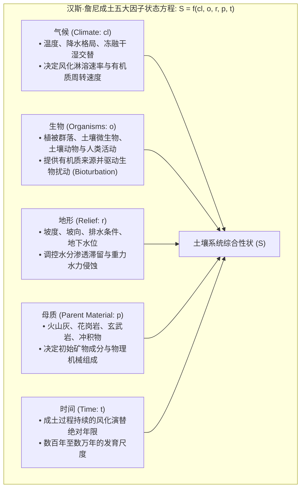
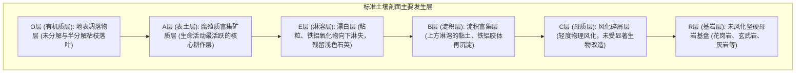
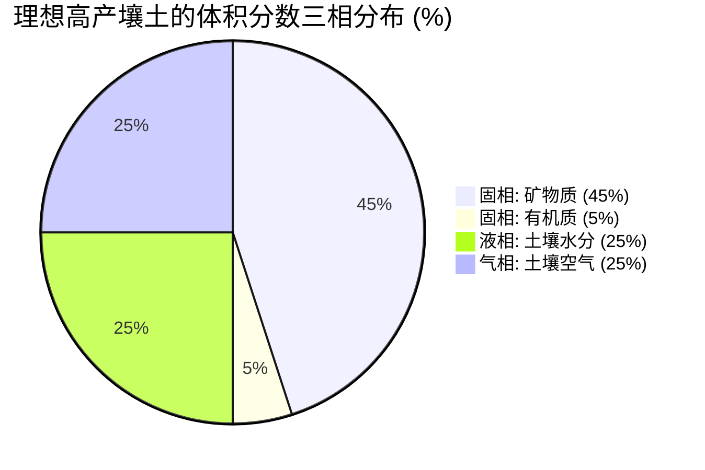
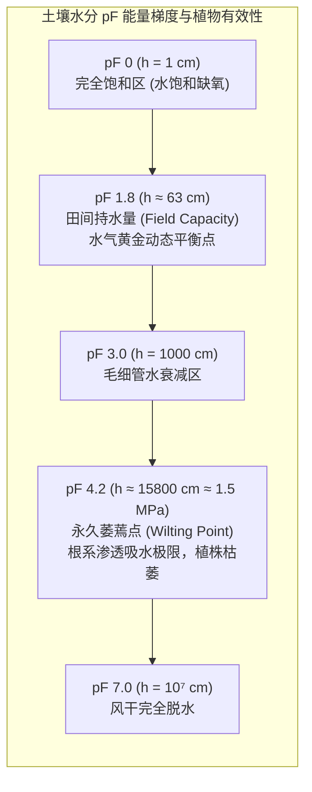
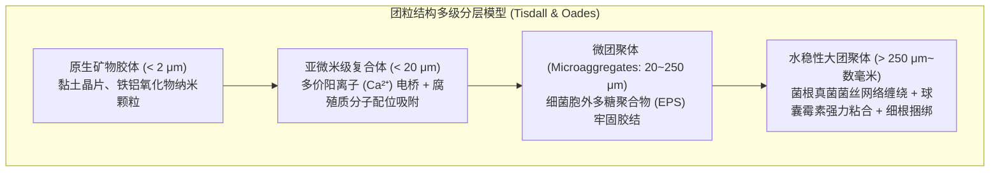
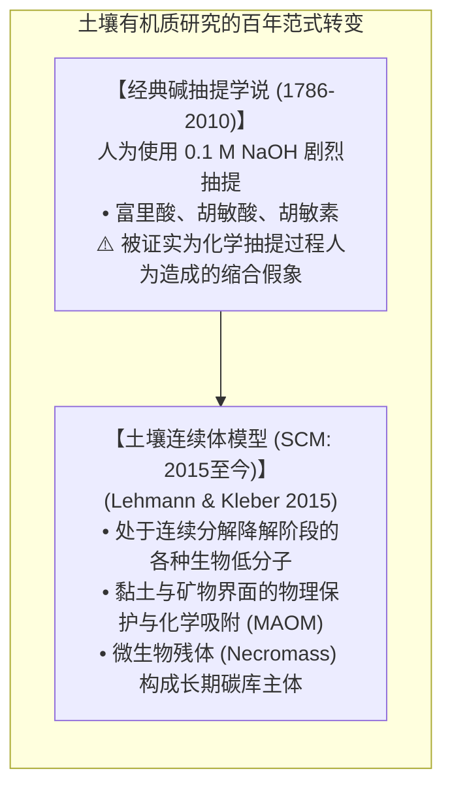
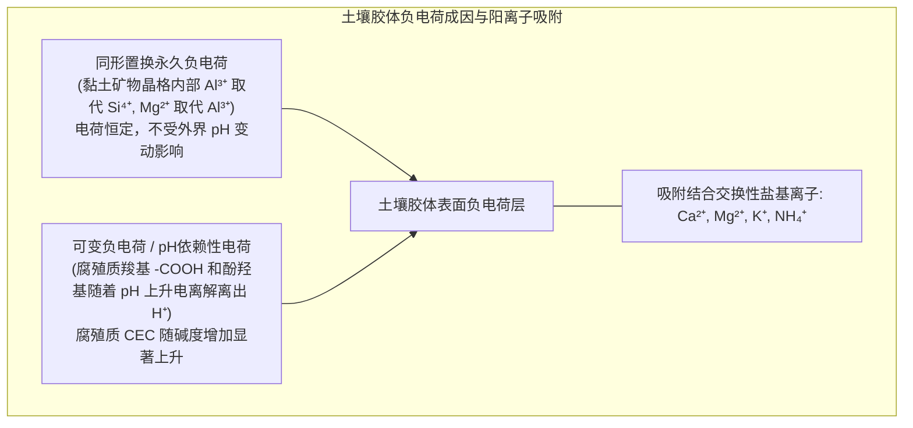
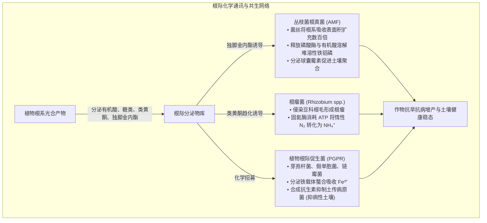
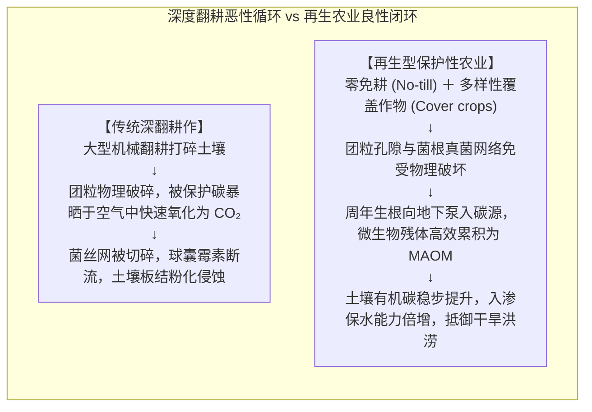

在我们每日驻足的大地之下，覆盖着一层仅仅数十厘米厚的薄薄表土——这层被称为<strong>“土壤圈（Pedosphere）”</strong>的地表活体皮肤，维系着陆地生态系统的运转，孕育了全人类95%以上的食物来源。

土壤绝不是简单的“岩石被风化碾碎的碎屑矿粉”。如果将完全无菌的月球土壤或火星碎石放入花盆中浇水，农作物将无法存活。只有当原生矿物颗粒历经万年风霜洗礼，与有机残体相遇，并由<strong>仅1克肥沃表土中超过100亿个细菌、放线菌、真菌与微型动物构成的超高密度生命体</strong>共同代谢、胶结，它才能蜕变为真正“有生命、有呼吸的土壤”。

近年来，土壤科学（Pedology）经历了一场波澜壮阔的理论革命：传统沿用了两个多世纪的碱抽提“胡敏酸（腐殖酸）”超大分子假说已被否定，取而代之的是由同步辐射与固体核磁技术证实的<strong>“土壤有机质连续体模型（Soil Continuum Model: SCM）”</strong>，并确立了<strong>微生物残体（Necromass）</strong>在长期土壤碳汇中的主导地位；由丛枝菌根真菌分泌的“超级生物胶水”<strong>球囊霉素（Glomalin）</strong>揭示了水稳性团粒结构的自组织奥秘；而联合国与国际社会倡导的“千分之四倡议（4 per 1000）”，更将土壤碳封存推向了应对全球气候变化的核心前沿。

本文将系统梳理土壤发生五大成土因子方程、剖面层位学、三相分布与水吸力（pF值）、团粒多级层次结构、腐殖质前沿化学、阳离子交换量（CEC）与酸化铝毒害、碳氮比生化动态、根圏互作网络以及再生农业的核心科学内涵。

---

### 1. 成土作用理论：汉斯·詹尼方程与剖面发生层发育

土壤并非沉积物的随意混杂，而是遵循严谨物理化学与生物学规律发育的自然历史产物。1941年，著名土壤学家汉斯·詹尼（Hans Jenny）提出了著名的<strong>成土五大因子状态方程</strong>：



$$S = f(cl, o, r, p, t, \dots)$$

在自然生境中，<strong>形成仅仅1厘米厚的肥沃表土，往往需要经历100年至1000年漫长的时间沉淀</strong>。

#### 土壤剖面构造：主要发生层
垂直挖掘一个发育成熟的土壤剖面，自地表向下呈现出层次分明的发生层序：



---

### 2. 土壤物理三相分布与水分吸力（pF值谱）

植物根系的呼吸、水肥吸收及物理机械伸展，严格受制于土壤的三相容积比例：



健康且结构良好的农业壤土，理想的体积分布为<strong>固相50%（45%矿物+5%有机质）</strong>与<strong>总孔隙度50%</strong>，其中孔隙空间内水分与空气各占25%。

#### 孔隙分级与水动力学
- <strong>粗孔隙（非毛管孔隙: 径向当量直径 > 30~50 μm）</strong>：不能抵抗重力吸附水分，雨后水分迅速下渗，被新鲜空气取代，为作物根系和好气性微生物提供至关重要的<strong>氧气扩散通道</strong>。
- <strong>细孔隙（毛管孔隙: 径向当量直径 < 30 μm）</strong>：依靠毛细管表面张力和弯液面力抵抗重力滞留水分，构建植物吸收的<strong>水库</strong>。

#### pF值水分吸力曲线
土壤吸附水分子力的大小，用吸抗水柱高（cm）的常用对数——<strong>pF值</strong>表示：

$$\text{pF} = \log_{10} |h| \quad (h \text{ 为水柱高度，单位 cm})$$



- <strong>pF 1.8（田间持水量）至 pF 4.2（永久萎蔫点）</strong>之间的区间，被严格定义为<strong>植物有效水（Available Water）</strong>。超过 pF 4.2 的水分被胶体紧密吸附，植物根系吸水能力（最大约 1.5 MPa 负压）无法克服此结合能，植物将陷入不可逆的枯萎死亡。

---

### 3. 土壤团粒结构（Soil Aggregates）：微观生命营造的地下都市

若土壤颗粒处于彼此分散的单粒状态（如海滩沙粒或粉化黏土），大雨倾盆时极易泥化板结并引发严重水土流失；天晴干涸时则龟裂坚如磐石，阻碍根系下扎。

高肥力土壤之所以疏松多孔，是因为矿物颗粒经生物胶合形成了多级微孔球状聚体——<strong>水稳性团粒结构（Crumb / Aggregate Structure）</strong>。



#### “通气透水”与“蓄水保墒”的矛盾统一
团粒结构通过跨尺度的多孔网络，将这对物理矛盾完美化解：
1. <strong>大团粒之间的间隙（大孔隙）</strong>：暴雨落入后迅速下渗排走，不发生地表径流冲刷，雨止后空气流通，根系呼吸畅通；
2. <strong>团粒内部的纳米/微米孔隙（毛管孔隙）</strong>：如同海绵内部的微小孔洞，将水分和溶解养分紧锁在团粒内部，供植物源源不断地缓慢抽取。

#### 超级生物胶水：球囊霉素（Glomalin）
1996年，美国农业部科学家萨拉·莱特（Sara Wright）揭开了大团粒水稳性的奥秘——由<strong>丛枝菌根真菌（AMF）</strong>菌丝分泌的疏水性糖蛋白<strong>球囊霉素（Glomalin: GRSP）</strong>。球囊霉素包被在真菌菌丝外壁，并在菌丝衰亡后渗透至周围土壤。它难溶于水、耐高温降解，像天然防水油漆一样涂覆在矿物颗粒表面，使形成的团聚体浸泡在水中也不会发生崩解散落。

---

### 4. 腐殖质化学与土壤有机质连续体模型（SCM）的范式转移

传统经典理论认为腐殖质是由植物木质素等经非酶聚合而成的超大抗降解分子——分为胡敏酸（腐殖酸）、富里酸和胡敏素。

然而，2015年康奈尔大学约翰内斯·莱曼（Johannes Lehmann）与马库斯·克莱伯（Markus Kleber）在《Nature》上发表重磅综述，彻底终结了这一假说，建立了<strong>土壤连续体模型（Soil Continuum Model: SCM）</strong>。



通过固体核磁（NMR）和同步辐射X射线显微学（STXM）分析表明：
1. 土壤中根本不存在所谓天生不可降解的超大腐殖质聚合物。土壤有机质是一个包含完整生物大分子、寡聚体和低分子有机酸的<strong>连续分子尺寸谱</strong>；
2. 碳能够在土壤中稳定封存数百年乃至上千年，不是因为其分子化学结构具有“惰性”，而是因为其获得了<strong>物理阻隔保护</strong>——嵌入在黏土纳米孔隙中，使得微生物分泌的胞外水解酶无法物理接触。
3. <strong>微生物残体（Necromass）的主导性</strong>：研究表明，稳定土壤有机碳库中50%~80%以上的物质并非未分解的植物木质素，而是<strong>细菌与真菌死亡后遗留的细胞壁碎片、肽聚糖与几丁质残体</strong>。植物碳被微生物同化后转化为微生物生物量，微生物衰亡后的残体与黏土矿物紧密键合，构成了肥沃黑土的基石。

---

### 5. 阳离子交换量（CEC）与土壤酸化铝毒害

土壤吸附保蓄肥料养分的能力，以<strong>阳离子交换量（Cation Exchange Capacity: CEC）</strong>衡量（单位: $\text{cmol}_c/\text{kg}$）。它代表土壤胶体表面所带负电荷吸附交换性阳离子（$\text{Ca}^{2+}, \text{Mg}^{2+}, \text{K}^{+}, \text{NH}_4^+$）的总容量。



#### 黏土矿物分类与保肥力差异
- <strong>1:1型高岭石（Kaolinite）</strong>：层间由牢固的氢键维系，不膨胀，CEC 极低（仅 $3 \sim 15\,\text{cmol}_c/\text{kg}$）；
- <strong>2:1型膨胀性蒙脱石（Smectite）</strong>：晶层间可吸水剧烈膨胀，同形置换强烈，CEC 高达 $80 \sim 150\,\text{cmol}_c/\text{kg}$；
- <strong>腐殖质胶体（Humus）</strong>：由于大量羧基在弱酸至中性环境中离解，其 CEC 达到惊人的 $150 \sim 300\,\text{cmol}_c/\text{kg}$，是提升贫瘠土壤保肥能力的王牌。

#### 酸化机制与活性铝毒害
多雨地区钙镁盐基离子随水淋溶，土壤胶体吸附的酸性阳离子增加，导致 pH 持续走低。当土壤 pH 跌破 <strong>5.0</strong> 时，层状硅酸盐晶格被破坏，释放出三价<strong>活性铝离子（$\text{Al}^{3+}$）</strong>。
$\text{Al}^{3+}$ 对植物根系具有极强毒性：它穿透细胞壁，与果胶分子刚性交联阻断细胞伸长，严重抑制钙调蛋白功能，导致根尖膨大发黑瘫痪。施用农用石灰（$\text{CaCO}_3$）中和游离氢离子，促使铝离子沉淀为不溶性氢氧化铝，是缓解酸害的核心农业技术。

---

### 6. 碳氮比（C/N比）生化平衡与微生物氮素饥饿

在堆肥发酵与土壤养分循环中，底物的<strong>碳氮比（C/N Ratio）</strong>决定了养分的释放轨迹。

土壤微生物细胞平均的 C/N 比维持在约 <strong>8:1</strong>。微生物在降解有机碳获取能量时，所摄取碳素的约 2/3 作为 $\text{CO}_2$ 通过呼吸作用被消耗释放，仅有约 1/3 被同化为自身细胞结构。因此，微生物每代谢 24 个单位的碳，就需要吸收固定 1 个单位的氮。

```mermaid
flowchart TD
    subgraph CNRatioDynamics ["C/N 比驱动矿化与生物固定的转折点"]
        OrganicInput["有机残体进入土壤"] --> Threshold{"基质碳氮比 (C/N)"}
        Threshold -->|C/N < 20:1 (豆科绿肥、油枯、畜禽粪便)| Mineralization["【净矿化过程 (Mineralization)】<br/>有机氮富余，超出微生物代谢需求<br/>多余氮素以 NH₄⁺ 和 NO₃⁻ 形式释放入土<br/>🌱 表现为显著当季增肥效果"]
        Threshold -->|C/N > 30:1 (生稻草、锯末、秸秆直接还田)| Immobilization["【净生物固定 (Immobilization)】<br/>基质高碳寡氮，微生物疯狂繁殖<br/>掠夺夺取土壤溶液中所有游离可利用氮素<br/>⚠️ 作物发生严重『微生物氮饥饿』，叶片泛黄停长"]
    end
```

---

### 7. 根际生物网络：植物与土壤微生物组的精密共生

植物并非被动扎根于土壤中。植物通过光合作用固定的碳水化合物中，有多达 <strong>20%~40%</strong> 被其主动通过根系释放到根际土壤中，这种现象被称为<strong>根系分泌物（Root Exudates）</strong>。



#### 生物固氮的铁钼固氮酶奇迹
豆科植物与根瘤菌的共生体系通过金属酶<strong>固氮酶（Nitrogenase）</strong>完成常温常压下将强化学三键（$\text{N}\equiv\text{N}$）断开的壮举。
为了保护极易被氧气不可逆灭活的固氮酶，根瘤组织内合成了与人类血红蛋白极度相似的<strong>豆血红蛋白（Leghemoglobin）</strong>。它将游离氧分压控制在纳摩尔级别，同时源源不断将结合氧输送给细菌呼吸链，使切开的新鲜根瘤呈现血红色。

---

### 8. 传统集约化耕作危机与再生农业（Regenerative Agriculture）

20世纪中叶的“绿色革命”通过化肥农药的大量投入与大型拖拉机的深度铧式犁耕，大幅提高了单产。但这种工业化农业也使全球表土侵蚀速度达到了自然恢复速度的 <strong>10至40倍</strong>。



#### 再生农业的五大支柱准则
为阻止土地退化并恢复土壤自我修复能力，再生农业提出了核心行动准则：
1. <strong>最小化机械与化学扰动（Minimize Disturbance）</strong>：推广免耕（No-till）或轻简化保护性耕作，保护水稳性大团粒与真菌菌丝网络；
2. <strong>长年保持土壤地表覆盖（Keep Soil Covered）</strong>：利用作物残茬覆盖或活体覆盖作物，避免雨滴直接击碎表土及阳光紫外线暴晒杀灭微生物；
3. <strong>保持地下常年有活根（Continuous Living Roots）</strong>：周年种植，维持根系分泌物对根际有益微生物群落的不间断碳供给；
4. <strong>最大化生物多样性（Maximize Diversity）</strong>：通过复杂轮作与间套作，杜绝单一种植引起的病原菌聚集与微生物多样性崩溃；
5. <strong>整合牲畜轮牧（Integrate Livestock）</strong>：模拟自然食草动物群的适度踩踏与粪尿回归，加速营养循环。

#### “千分之四（4 per 1000）”全球倡议
由法国在2015年巴黎气候大会（COP21）上提出的“千分之四倡议”给出了震撼的数学结论：<strong>全球地表40厘米土壤中的有机碳储量只要每年递增0.4%（4‰），就足以全部吸收并抵消人类全年在地球上排放的所有温室气体总量</strong>。

土壤不仅承载着粮食，更是地球最大的动态陆地碳库（储存着约2500吉吨碳，是大气的3倍以上）。通过保护性农业提升土壤有机碳，是兼具生态修复与气候负排放的可扩展宏伟工程。

---

### 9. 结语：踏向足下微观宇宙的科学觉醒

土壤从来不是死寂的泥土。它是光能、雨水、岩石矿物与兆亿微生物共同编织的<strong>地球生命交响乐</strong>。

一抔肥沃的黑土之中，蕴含着比银河系繁星还要密集的生灵，运转着令人敬畏的生化网络。善待土壤就是守护文明的根基。唯有以科学之眼审视足下的泥土，人类才能在充满未知的未来真正走向繁荣与可持续的共生。
