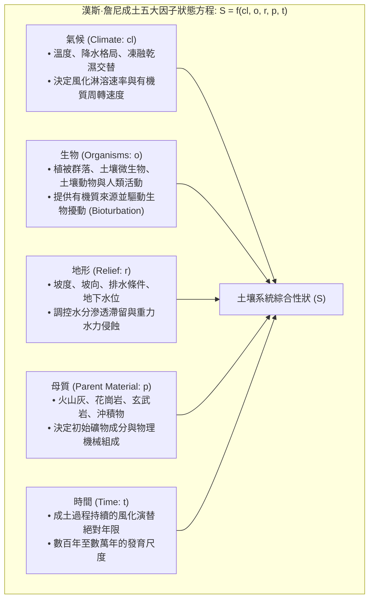
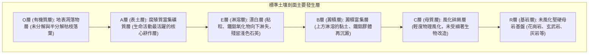
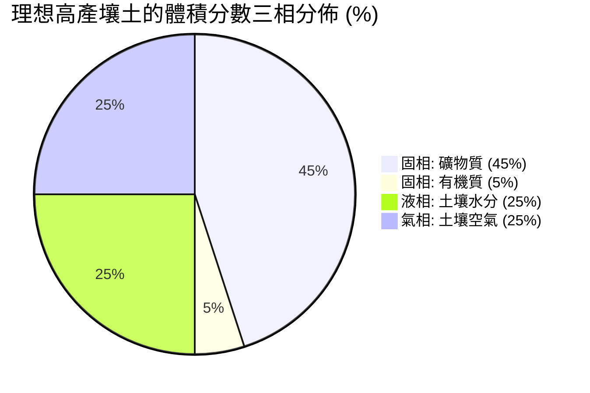
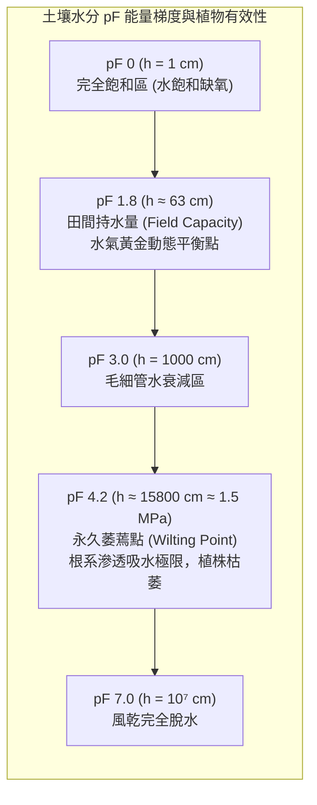
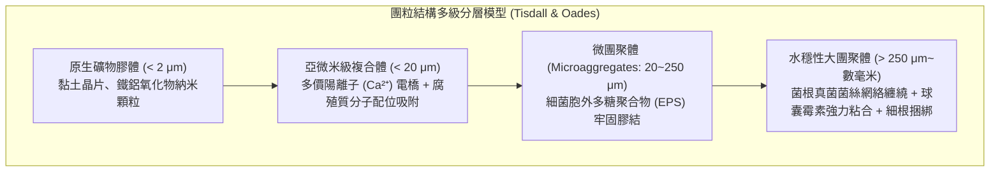
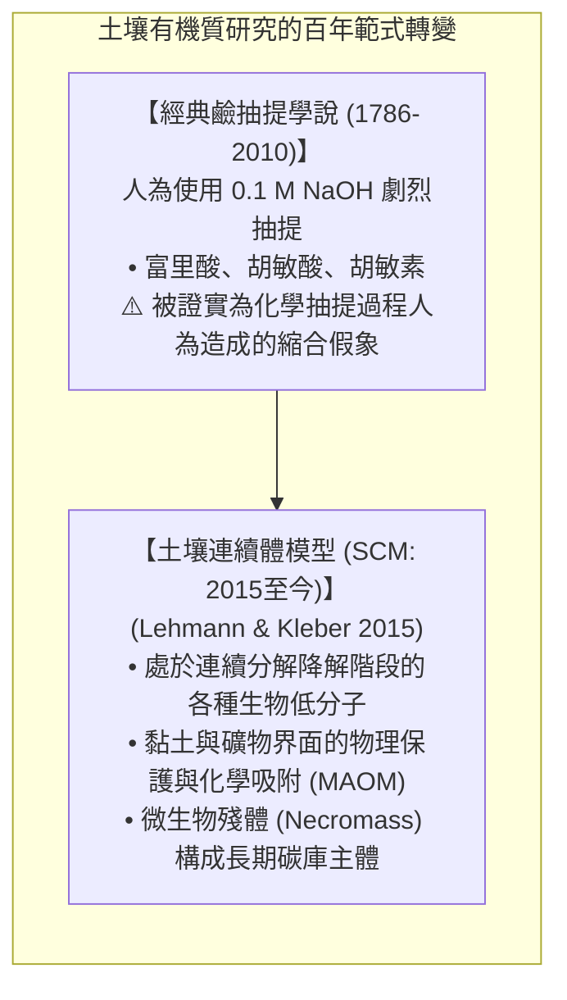
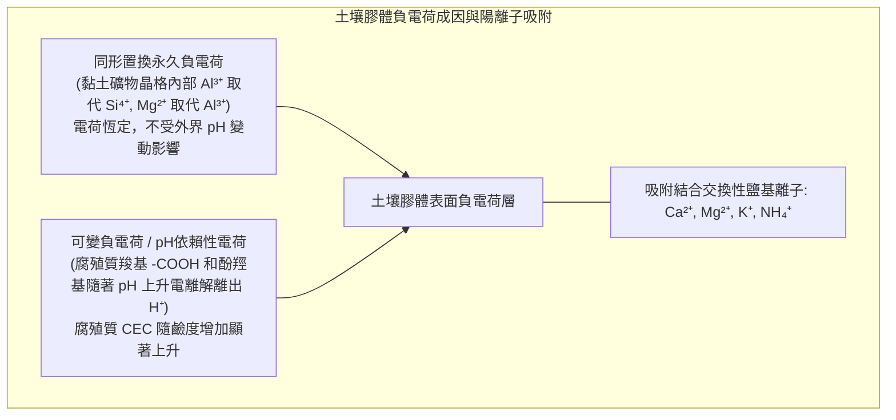
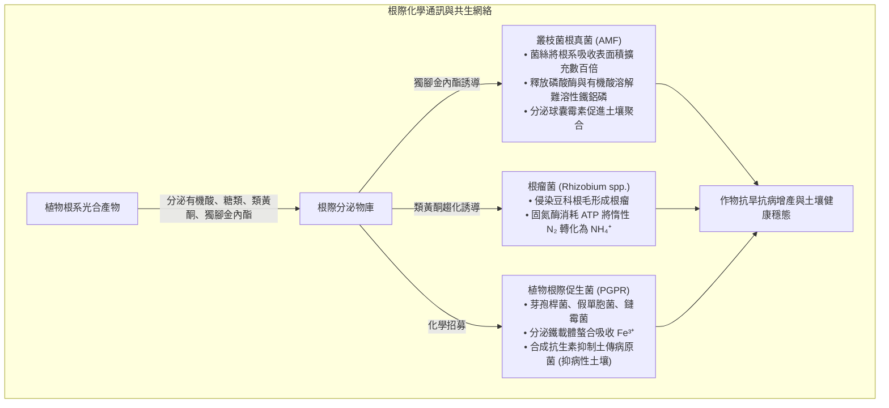
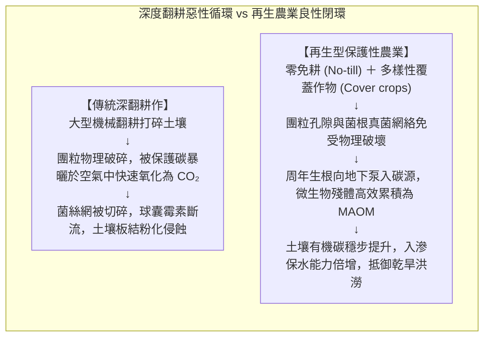

在我們每日駐足的大地之下，覆蓋著一層僅僅數十厘米厚的薄薄表土——這層被稱為<strong>「土壤圈（Pedosphere）」</strong>的地表活體皮膚，維繫著陸地生態系統的運轉，孕育了全人類95%以上的食物來源。

土壤絕不是簡單的「岩石被風化碾碎的碎屑礦粉」。如果將完全無菌的月球土壤或火星碎石放入花盆中澆水，農作物將無法存活。只有當原生礦物顆粒歷經萬年風霜洗禮，與有機殘體相遇，並由<strong>僅1克肥沃表土中超過100億個細菌、放線菌、真菌與微型動物構成的超高密度生命體</strong>共同代謝、膠結，它才能蛻變為真正「有生命、有呼吸的土壤」。

近年來，土壤科學（Pedology）經歷了一場波瀾壯闊的理論革命：傳統沿用了兩個多世紀的鹼抽提「胡敏酸（腐殖酸）」超大分子假說已被否定，取而代之的是由同步輻射與固體核磁技術證實的<strong>「土壤有機質連續體模型（Soil Continuum Model: SCM）」</strong>，並確立了<strong>微生物殘體（Necromass）</strong>在長期土壤碳匯中的主導地位；由叢枝菌根真菌分泌的「超級生物膠水」<strong>球囊霉素（Glomalin）</strong>揭示了水穩性團粒結構的自組織奧秘；而聯合國與國際社會倡導的「千分之四倡議（4 per 1000）」，更將土壤碳封存推向了應對全球氣候變化的核心前沿。

本文將系統梳理土壤發生五大成土因子方程、剖面層位學、三相分佈與水吸力（pF值）、團粒多級層次結構、腐殖質前沿化學、陽離子交換量（CEC）與酸化鋁毒害、碳氮比生化動態、根圈互作網絡以及再生農業的核心科學內涵。

---

### 1. 成土作用理論：漢斯·詹尼方程與剖面發生層發育

土壤並非沉積物的隨意混雜，而是遵循嚴謹物理化學與生物學規律發育的自然歷史產物。1941年，著名土壤學家漢斯·詹尼（Hans Jenny）提出了著名的<strong>成土五大因子狀態方程</strong>：



$$S = f(cl, o, r, p, t, \dots)$$

在自然生境中，<strong>形成僅僅1厘米厚的肥沃表土，往往需要經歷100年至1000年漫長的時間沉澱</strong>。

#### 土壤剖面構造：主要發生層
垂直挖掘一個發育成熟的土壤剖面，自地表向下呈現出層次分明的發生層序：



---

### 2. 土壤物理三相分佈與水分吸力（pF值譜）

植物根系的呼吸、水肥吸收及物理機械伸展，嚴格受制於土壤的三相容積比例：



健康且結構良好的農業壤土，理想的體積分佈為<strong>固相50%（45%礦物+5%有機質）</strong>與<strong>總孔隙度50%</strong>，其中孔隙空間內水分與空氣各佔25%。

#### 孔隙分級與水動力學
- <strong>粗孔隙（非毛管孔隙: 徑向當量直徑 > 30~50 μm）</strong>：不能抵抗重力吸附水分，雨後水分迅速下滲，被新鮮空氣取代，為作物根系和好氣性微生物提供至關重要的<strong>氧氣擴散通道</strong>。
- <strong>細孔隙（毛管孔隙: 徑向當量直徑 < 30 μm）</strong>：依靠毛細管表面張力和彎液面力抵抗重力滯留水分，構建植物吸收的<strong>水庫</strong>。

#### pF值水分吸力曲線
土壤吸附水分子力的大小，用吸抗水柱高（cm）的常用對數——<strong>pF值</strong>表示：

$$\text{pF} = \log_{10} |h| \quad (h \text{ 為水柱高度，單位 cm})$$



- <strong>pF 1.8（田間持水量）至 pF 4.2（永久萎蔫點）</strong>之間的區間，被嚴格定義為<strong>植物有效水（Available Water）</strong>。超過 pF 4.2 的水分被膠體緊密吸附，植物根系吸水能力（最大約 1.5 MPa 負壓）無法克服此結合能，植物將陷入不可逆的枯萎死亡。

---

### 3. 土壤團粒結構（Soil Aggregates）：微觀生命營造的地下都市

若土壤顆粒處於彼此分散的單粒狀態（如海灘沙粒或粉化黏土），大雨傾盆時極易泥化板結並引發嚴重水土流失；天晴乾涸時則龜裂堅如磐石，阻礙根系下扎。

高肥力土壤之所以疏鬆多孔，是因為礦物顆粒經生物膠合形成了多級微孔球狀聚體——<strong>水穩性團粒結構（Crumb / Aggregate Structure）</strong>。



#### 「通氣透水」與「蓄水保墒」的矛盾統一
團粒結構通過跨尺度的多孔網絡，將這對物理矛盾完美化解：
1. <strong>大團粒之間的間隙（大孔隙）</strong>：暴雨落入後迅速下滲排走，不發生地表徑流沖刷，雨止後空氣流通，根系呼吸暢通；
2. <strong>團粒內部的納米/微米孔隙（毛管孔隙）</strong>：如同海綿內部的微小孔洞，將水分和溶解養分緊鎖在團粒內部，供植物源源不斷地緩慢抽取。

#### 超級生物膠水：球囊霉素（Glomalin）
1996年，美國農業部科學家薩拉·萊特（Sara Wright）揭開了大團粒水穩性的奧秘——由<strong>叢枝菌根真菌（AMF）</strong>菌絲分泌的疏水性糖蛋白<strong>球囊霉素（Glomalin: GRSP）</strong>。球囊霉素包被在真菌菌絲外壁，並在菌絲衰亡後滲透至周圍土壤。它難溶於水、耐高溫降解，像天然防水油漆一樣塗覆在礦物顆粒表面，使形成的團聚體浸泡在水中也不會發生崩解散落。

---

### 4. 腐殖質化學與土壤有機質連續體模型（SCM）的範式轉移

傳統經典理論認為腐殖質是由植物木質素等經非酶聚合而成的超大抗降解分子——分為胡敏酸（腐殖酸）、富里酸和胡敏素。

然而，2015年康奈爾大學約翰內斯·萊曼（Johannes Lehmann）與馬庫斯·克萊伯（Markus Kleber）在《Nature》上發表重磅綜述，徹底終結了這一假說，建立了<strong>土壤連續體模型（Soil Continuum Model: SCM）</strong>。



通過固體核磁（NMR）和同步輻射X射線顯微學（STXM）分析表明：
1. 土壤中根本不存在所謂天生不可降解的超大腐殖質聚合物。土壤有機質是一個包含完整生物大分子、寡聚體和低分子有機酸的<strong>連續分子尺寸譜</strong>；
2. 碳能夠在土壤中穩定封存數百年乃至上千年，不是因為其分子化學結構具有「惰性」，而是因為其獲得了<strong>物理阻隔保護</strong>——嵌入在黏土納米孔隙中，使得微生物分泌的胞外水解酶無法物理接觸。
3. <strong>微生物殘體（Necromass）的主導性</strong>：研究表明，穩定土壤有機碳庫中50%~80%以上的物質並非未分解的植物木質素，而是<strong>細菌與真菌死亡後遺留的細胞壁碎片、肽聚糖與幾丁質殘體</strong>。植物碳被微生物同化後轉化為微生物生物量，微生物衰亡後的殘體與黏土礦物緊密鍵合，構成了肥沃黑土的基石。

---

### 5. 陽離子交換量（CEC）與土壤酸化鋁毒害

土壤吸附保蓄肥料養分的能力，以<strong>陽離子交換量（Cation Exchange Capacity: CEC）</strong>衡量（單位: $\text{cmol}_c/\text{kg}$）。它代表土壤膠體表面所帶負電荷吸附交換性陽離子（$\text{Ca}^{2+}, \text{Mg}^{2+}, \text{K}^{+}, \text{NH}_4^+$）的總容量。



#### 黏土礦物分類與保肥力差異
- <strong>1:1型高嶺石（Kaolinite）</strong>：層間由牢固的氫鍵維繫，不膨脹，CEC 極低（僅 $3 \sim 15\,\text{cmol}_c/\text{kg}$）；
- <strong>2:1型膨脹性蒙脫石（Smectite）</strong>：晶層間可吸水劇烈膨脹，同形置換強烈，CEC 高達 $80 \sim 150\,\text{cmol}_c/\text{kg}$；
- <strong>腐殖質膠體（Humus）</strong>：由於大量羧基在弱酸至中性環境中離解，其 CEC 達到驚人的 $150 \sim 300\,\text{cmol}_c/\text{kg}$，是提升貧瘠土壤保肥能力的王牌。

#### 酸化機制與活性鋁毒害
多雨地區鈣鎂鹽基離子隨水淋溶，土壤膠體吸附的酸性陽離子增加，導致 pH 持續走低。當土壤 pH 跌破 <strong>5.0</strong> 時，層狀硅酸鹽晶格被破壞，釋放出三價<strong>活性鋁離子（$\text{Al}^{3+}$）</strong>。
$\text{Al}^{3+}$ 對植物根系具有極強毒性：它穿透細胞壁，與果膠分子剛性交聯阻斷細胞伸長，嚴重抑制鈣調蛋白功能，導致根尖膨大發黑癱瘓。施用農用石灰（$\text{CaCO}_3$）中和游離氫離子，促使鋁離子沉澱為不溶性氫氧化鋁，是緩解酸害的核心農業技術。

---

### 6. 碳氮比（C/N比）生化平衡與微生物氮素飢餓

在堆肥發酵與土壤養分循環中，底物的<strong>碳氮比（C/N Ratio）</strong>決定了養分的釋放軌跡。

土壤微生物細胞平均的 C/N 比維持在約 <strong>8:1</strong>。微生物在降解有機碳獲取能量時，所攝取碳素的約 2/3 作為 $\text{CO}_2$ 通過呼吸作用被消耗釋放，僅有約 1/3 被同化為自身細胞結構。因此，微生物每代謝 24 個單位的碳，就需要吸收固定 1 個單位的氮。

```mermaid
flowchart TD
    subgraph CNRatioDynamics ["C/N 比驅動礦化與生物固定的轉折點"]
        OrganicInput["有機殘體進入土壤"] --> Threshold{"基質碳氮比 (C/N)"}
        Threshold -->|C/N < 20:1 (豆科綠肥、油枯、畜禽糞便)| Mineralization["【淨礦化過程 (Mineralization)】<br/>有機氮富餘，超出微生物代謝需求<br/>多餘氮素以 NH₄⁺ 和 NO₃⁻ 形式釋放入土<br/>🌱 表現為顯著當季增肥效果"]
        Threshold -->|C/N > 30:1 (生稻草、鋸末、秸稈直接還田)| Immobilization["【淨生物固定 (Immobilization)】<br/>基質高碳寡氮，微生物瘋狂繁殖<br/>掠奪奪取土壤溶液中所有游離可利用氮素<br/>⚠️ 作物發生嚴重『微生物氮飢餓』，葉片泛黃停長"]
    end
```

---

### 7. 根際生物網絡：植物與土壤微生物組的精密共生

植物並非被動扎根於土壤中。植物通過光合作用固定的碳水化合物中，有多達 <strong>20%~40%</strong> 被其主動通過根系釋放到根際土壤中，這種現象被稱為<strong>根系分泌物（Root Exudates）</strong>。



#### 生物固氮的鐵鉬固氮酶奇蹟
豆科植物與根瘤菌的共生體系通過金屬酶<strong>固氮酶（Nitrogenase）</strong>完成常溫常壓下將強化學三鍵（$\text{N}\equiv\text{N}$）斷開的壯舉。
為了保護極易被氧氣不可逆滅活的固氮酶，根瘤組織內合成了與人類血紅蛋白極度相似的<strong>豆血紅蛋白（Leghemoglobin）</strong>。它將游離氧分壓控制在納摩爾級別，同時源源不斷將結合氧輸送給細菌呼吸鏈，使切開的新鮮根瘤呈現血紅色。

---

### 8. 傳統集約化耕作危機與再生農業（Regenerative Agriculture）

20世紀中葉的「綠色革命」通過化肥農藥的大量投入與大型拖拉機的深度鏵式犁耕，大幅提高了單產。但這種工業化農業也使全球表土侵蝕速度達到了自然恢復速度的 <strong>10至40倍</strong>。



#### 再生農業的五大支柱準則
為阻止土地退化並恢復土壤自我修復能力，再生農業提出了核心行動準則：
1. <strong>最小化機械與化學擾動（Minimize Disturbance）</strong>：推廣免耕（No-till）或輕簡化保護性耕作，保護水穩性大團粒與真菌菌絲網絡；
2. <strong>長年保持土壤地表覆蓋（Keep Soil Covered）</strong>：利用作物殘茬覆蓋或活體覆蓋作物，避免雨滴直接擊碎表土及陽光紫外線暴曬殺滅微生物；
3. <strong>保持地下常年有活根（Continuous Living Roots）</strong>：周年種植，維持根系分泌物對根際有益微生物群落的不間斷碳供給；
4. <strong>最大化生物多樣性（Maximize Diversity）</strong>：通過複雜輪作與間套作，杜絕單一種植引起的病原菌聚集與微生物多樣性崩潰；
5. <strong>整合牲畜輪牧（Integrate Livestock）</strong>：模擬自然食草動物群的適度踩踏與糞尿回歸，加速營養循環。

#### 「千分之四（4 per 1000）」全球倡議
由法國在2015年巴黎氣候大會（COP21）上提出的「千分之四倡議」給出了震撼的數學結論：<strong>全球地表40厘米土壤中的有機碳儲量只要每年遞增0.4%（4‰），就足以全部吸收並抵消人類全年在地球上排放的所有溫室氣體總量</strong>。

土壤不僅承載著糧食，更是地球最大的動態陸地碳庫（儲存著約2500吉噸碳，是大氣的3倍以上）。通過保護性農業提升土壤有機碳，是兼具生態修復與氣候負排放的可擴展宏偉工程。

---

### 9. 結語：踏向足下微觀宇宙的科學覺醒

土壤從來不是死寂的泥土。它是光能、雨水、岩石礦物與兆億微生物共同編織的<strong>地球生命交響樂</strong>。

一抔肥沃的黑土之中，蘊含著比銀河系繁星還要密集的生靈，運轉著令人敬畏的生化網絡。善待土壤就是守護文明的根基。唯有以科學之眼審視足下的泥土，人類才能在充滿未知的未來真正走向繁榮與可持續的共生。
