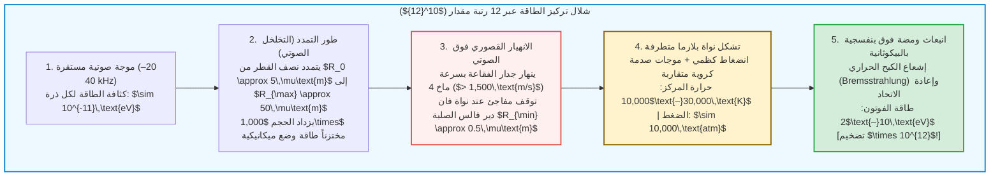

## مقدمة: نجم مجهري معلّق في قلب قارورة زجاجية

تخيّل قارورة زجاجية كروية مملوءة بماء منزوع الغازات داخل مختبر مظلم تماماً.
على الجدران الخارجية للقارورة، تُثبّت محولات كهرضغطية فوق صوتية تولّد موجة صوتية مستقرة بتردد يتراوح بين $20\text{ و}40\,\text{كيلوهرتز}$. وعندما يحقن الباحث فقاعة هواء مجهرية واحدة لا يتجاوز قطرها بضعة ميكرومترات في مركز القارورة، تحدث ظاهرة فيزيائية مذهلة:

تُحتجز الفقاعة بفعل القوة الخفية للموجة الصوتية، فتظل معلّقة بلا حراك في المركز الهندسي للسائل، وتبدأ بالتوهج المستمر بضوء أزرق مائل للبياض يُرى بوضوح بالعين المجردة كأنها نجم ساطع في الفضاء!

تُعرف هذه الظاهرة باسم <strong>الضيائية الصوتية (Sonoluminescence)</strong> — وتحديداً <strong>الضيائية الصوتية أحادية الفقاعة (Single-Bubble Sonoluminescence, SBSL)</strong> — حيث تنهار الفجوة الغازية عشرات الآلاف من المرات في الثانية الواحدة بدقة تضاهي الساعات الذرية، مطلقةً في كل انهيار ومضة فائقة القصر من الأشعة فوق البنفسجية.

من منظور الفيزياء الأساسية، تُعد الضيائية الصوتية <strong>مُركِّزاً غير خطي للطاقة</strong> لا مثيل له. فالموجة الصوتية في الماء تحمل طاقة حركية تقارب $10^{-11}\,\text{eV}$ لكل جزيء، بينما تمتلك الفوتونات فوق البنفسجية المنبعثة طاقة تصل إلى $10\,\text{eV}$ — أي تضخيم لكثافة الطاقة بمقدار <strong>اثنتي عشرة رتبة مقدار (تريليون مرة، $\times 10^{12}$)</strong> عبر ميكانيكا الموائع الصرفة!

يستعرض هذا المقال تاريخ الاكتشاف من عام 1934 إلى 1989، ويشتق <strong>معادلة رايلي-بليسيت (Rayleigh-Plesset Equation)</strong>، ويشرح المصيدة الصوتية عبر <strong>قوة بيركنس</strong>، والتنقية الكيميائية الذاتية وفق <strong>فرضية تقويم الأرغون</strong>، ونموذج إشعاع <strong>البلازما بالكبح الحراري</strong>.

---

## 1. التطور التاريخي: من سحب التكهف إلى دقة الساعة الذرية

### 1.1 عام 1934: الاكتشاف المصادف في أحواض التصوير الفوتوغرافي
في عام 1934 بجامعة كولونيا، غمر العالمان هـ. فرينزل وهـ. شولتس محول سونار عالي القدرة في حوض سائل إظهار الصور الفوتوغرافية. لاحظا أن الألواح الفوتوغرافية تتأثر بالضوء حتى في الظلام الدامس: كانت سحب فقاعات التكهف تطلق توهجاً خافتاً (<strong>الضيائية الصوتية متعددة الفقاعات، MBSL</strong>). غير أن التفاعل الفوضوي لملايين الفقاعات حال دون إجراء قياسات دقيقة لفقاعة منفردة طوال نصف قرن.

### 1.2 عام 1989: ثورة غايتان وكروم (SBSL)
في عام 1989، نجح <strong>فيليبي غايتان</strong> و<strong>لورانس كروم</strong> في احتجاز <strong>فقاعة تكهف واحدة (SBSL)</strong> عند بطن الضغط لموجة مستقرة.
كشفت القياسات عن ثلاث خصائص مدهشة:
1. <strong>نبضات بالبيكوثانية:</strong> تستمر كل ومضة ضوئية ما بين <strong>$35\text{ و}300\,\text{بيكوثانية}$</strong> ($10^{-12}\,\text{s}$).
2. <strong>ارتعاش زمني (Jitter) أقل من 50 بيكوثانية:</strong> رغم أن الدورة الصوتية تبلغ $\sim 35\,\mu\text{s}$، فإن دقة انتظام الومضات تصل إلى جزء من المليون.
3. <strong>طيف مستمر فوق بنفسجي:</strong> في الماء النقي، يرتفع الطيف بسلاسة نحو الأشعة فوق البنفسجية حتى حد امتصاص الماء عند $200\,\text{nm}$، مما يقابل درجات حرارة بين <strong>$10,000\text{ و}30,000\,\text{K}$</strong>.

---

## 2. الرفع الصوتي: قوة بيركنس الأولية

لماذا لا تدفع قوة طفو أرخميدس الفقاعة نحو السطح؟ تظل الفقاعة محتجزة بفضل <strong>قوة بيركنس الأولية (Primary Bjerknes Force)</strong>:

$$\mathbf{F}_B = -\langle V(t) \nabla P(\mathbf{x}, t) \rangle = -\frac{1}{T_{ac}} \int_0^{T_{ac}} V(t) \nabla P(\mathbf{x}, t) \, dt$$

خلال نصف دورة الضغط المنخفض ($\sin\omega t > 0$)، تتمدد الفقاعة إلى حجم هائل $V_{\max}$ وتنجذب بقوة نحو بطن الضغط (المركز). وخلال نصف دورة الانضغاط ($\sin\omega t < 0$)، يتقلص حجمها إلى $V_{\min} \ll V_{\max}$، فتصبح قوة الطرد للخارج مهملة. وفي المتوسط الزمني، تعادل القوة $\mathbf{F}_B$ قوة الطفو $\rho_L g \langle V \rangle$ تماماً.

---

## 3. هيدروديناميكا الانهيار: معادلة رايلي-بليسيت

انطلاقاً من معادلة الاستمرارية $\nabla \cdot \mathbf{u} = 0$ لمائع غير قابل للانضغاط، يُعطى حقل السرعة الشعاعية بالعلاقة $u(r, t) = R^2(t)\dot{R}(t)/r^2$. وبالتعويض في معادلة نافييه-ستوكس والتكامل من $r = R(t)$ إلى اللانهاية، نحصل على <strong>معادلة رايلي-بليسيت المعممة</strong>:

$$R \ddot{R} + \frac{3}{2} \dot{R}^2 = \frac{1}{\rho_L} \left[ P_g(R, t) - P_0 - P_a(t) - \frac{2\sigma}{R} - \frac{4\mu \dot{R}}{R} + \frac{R}{c_L} \frac{d}{dt} P_g(R, t) \right]$$

يتحكم الحد القصوري غير الخطي <strong>$\frac{3}{2}\dot{R}^2$</strong> في عنف الانهيار:
1. في طور التخلخل، تتمدد الفقاعة من $R_0 \approx 4.5\,\mu\text{m}$ إلى $R_{\max} \approx 45\,\mu\text{m}$ (يتضاعف الحجم $1,000$ مرة).
2. عند الانهيار، يتسارع الجدار متجاوزاً <strong>$1,500\,\text{m/s}$ (ماخ 4)</strong>.
3. يتوقف الانهيار فجأة عند <strong>نصف قطر الحجم المستبعد لفان دير فالس $a \approx R_0 / 8.8 \approx 0.5\,\mu\text{m}$</strong>:
   $$P_g(R) = P_0 \left( \frac{R_0^3 - a^3}{R^3 - a^3} \right)^\gamma, \qquad T(R) = T_0 \left( \frac{R_0^3 - a^3}{R^3 - a^3} \right)^{\gamma - 1}$$
   يقفز الضغط الداخلي فوق <strong>10,000 ضغط جوي</strong> ويتعرض الجدار لتباطؤ يفوق <strong>$10^{11}\,g$</strong> خلال بضع بيكوثوانٍ!

---

## 4. فرضية تقويم الأرغون

لا ينتج الهواء الاصطناعي النقي ($79\%\,\text{N}_2 + 21\%\,\text{O}_2$) ضيائية مستقرة؛ بل لا بد من وجود <strong>1% من غاز الأرغون ($\text{Ar}$)</strong> الموجود في الهواء الجوي.
في عام 1997، فسّر <strong>ديتليف لوزه (Detlef Lohse)</strong> ذلك عبر <strong>التقويم الكيميائي الصوتي للأرغون</strong>:
فوق درجة حرارة $6,000\,\text{K}$، تتفكك الجزيئات ثنائية الذرة ($\text{N}_2, \text{O}_2$) إلى جذور كيميائية ($\text{NO}, \text{HNO}_3$) شديدة الذوبان في الماء المحيط. ويبقى فقط غاز <strong>الأرغون</strong> أحادي الذرة والخامل كيميائياً داخل الفقاعة. وبعد آلاف الدورات، تصبح الفقاعة مكونة من <strong>أرغون نقي بنسبة تقارب 100%</strong>، حيث يضمن معاملها الكظمي المرتفع ($\gamma = 5/3 \approx 1.67$) أقصى تسخين انضغاطي.

---

## 5. آلية انبعاث الضوء: موجات الصدمة وإشعاع الكبح الحراري

يؤدي الانضغاط الكظمي وموجات الصدمة الكروية المتقاربة (حل غودرلي) إلى تسخين المركز لدرجة $15,000\text{–}30,000\,\text{K}$، مما يؤين الغاز النبيل جزئياً وفق <strong>معادلة ساها (Saha Equation)</strong>:

$$\frac{n_e^2}{n_0} = \frac{2}{\Lambda_{\text{th}}^3} \frac{g_1}{g_0} \exp\left( -\frac{E_{\text{ion}}}{k_B T} \right)$$

وتطلق الإلكترونات الحرة المتباطئة في الحقل الكولومي للأيونات ($\text{Ar}^+, \text{Xe}^+$) <strong>إشعاع الكبح الحراري (Bremsstrahlung)</strong> وإشعاع إعادة الاتحاد:

$$P_{\text{brem}}(\lambda, T) \propto \frac{n_e n_i Z^2}{\lambda^2 \sqrt{T}} \exp\left( -\frac{h c}{\lambda k_B T} \right)$$

وفي عام 2005، رصد <strong>كينيث ساسليك</strong> و<strong>ديفيد فلانيغان</strong> خطوط الانبعاث الذري لأيونات $\text{Ar}^+$ ($> 19\,\text{eV}$) مباشرة في حمض الكبريتيك المركز، مما أثبت بشكل قاطع وجود نواة بلازما كثيفة وساخنة.

---

## 6. خاتمة: سيمفونية الفيزياء على مقياس الميكرومتر

من الروبيان المسدس (*Alpheus heterochaelis*) الذي يصعق فرائسه بوميض التكهف إلى مفاعلات المختبرات الدقيقة، تُظهر الضيائية الصوتية كيف تتحد هيدروديناميكا الموائع والكيمياء وفيزياء البلازما لإشعال نجم مصغر في قلب قطرة ماء.
