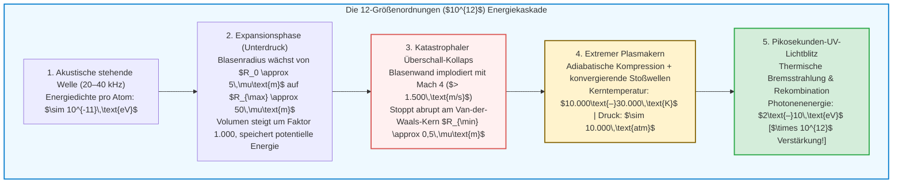

## Einleitung: Ein mikroskopischer Stern im Glaskolben

Stellen Sie sich einen mit entgastem Wasser gefüllten Rundkolben in einem vollkommen abgedunkelten Labor vor.
An der Außenseite des Glases sind piezoelektrische Ultraschallwandler angebracht, die eine stehende akustische Welle bei $20\text{ bis }40\,\text{kHz}$ erzeugen. Wenn ein Experimentator eine winzige Luftblase von nur wenigen Mikrometern Durchmesser in die Mitte des Kolbens injiziert, geschieht etwas Außergewöhnliches:

Gefangen im unsichtbaren Griff des Schallfeldes schwebt die Blase bewegungslos im geometrischen Zentrum der Flüssigkeit – und leuchtet für das bloße Auge sichtbar wie ein bläulich-weißer Stern.

Dieses Phänomen heißt <strong>Sonolumineszenz</strong>, genauer gesagt <strong>Einzelblasen-Sonolumineszenz (Single-Bubble Sonoluminescence, SBSL)</strong>. Eine einzelne Gasblase kollabiert dabei zehntausende Male pro Sekunde mit der Präzision einer Atomuhr und sendet bei jedem Kollaps ultrakurze Lichtblitze im sichtbaren und ultravioletten Spektrum aus.

Physikalisch betrachtet ist die Sonolumineszenz ein beispielloser <strong>nichtlinearer Energiekonzentrator</strong>. Eine Schallwelle im Wasser überträgt pro Molekül im Mittel nur rund $10^{-11}\,\text{eV}$. Doch die ausgesandten UV-Photonen besitzen Energien von bis zu $10\,\text{eV}$ – eine Fokussierung der Energiedichte um <strong>zwölf Größenordnungen ($\times 10^{12}$)</strong> allein durch Kontinuumsmechanik!

Dieser Artikel beleuchtet die Entdeckungsgeschichte von 1934 bis 1989, leitet die <strong>Rayleigh-Plesset-Gleichung</strong> her, erklärt die akustische Falle durch <strong>Bjerknes-Kräfte</strong>, die chemische Selbstreinigung durch die <strong>Argon-Gleichrichtungshypothese</strong> sowie das <strong>Plasma-Bremsstrahlungsmodell</strong>.

---

## 1. Historische Entwicklung: Vom Kavitationsnebel zur Einzelblase

### 1.1 1934: Zufallsentdeckung im Fotoentwicklerbad
1934 untersuchten H. Frenzel und H. Schultes an der Universität zu Köln die Wirkung starker Marine-Ultraschallgeber in Fotoentwicklerbädern. Sie stellten fest, dass Fotoplatten selbst bei völliger Dunkelheit belichtet wurden: Schwärme kollabierender Kavitationsblasen erzeugten ein schwaches Leuchten (<strong>Mehrblasen-Sonolumineszenz, MBSL</strong>). Da Millionen Blasen chaotisch interagierten, blieben präzise Messungen an Einzelblasen über Jahrzehnte unmöglich.

### 1.2 1989: Der Durchbruch von Gaitan und Crum
1989 gelang <strong>D. Felipe Gaitan</strong> und <strong>Lawrence A. Crum</strong> die Isolierung einer <strong>einzigen Kavitationsblase (SBSL)</strong> in einer stehenden Ultraschallwelle.
Die Messungen mit Streak-Kameras und Photomultipliern offenbarten drei erstaunliche Eigenschaften:
1. <strong>Pikosekunden-Lichtpulse:</strong> Jeder Lichtblitz dauert nur <strong>$35\text{ bis }300\,\text{Pikosekunden}$</strong> ($10^{-12}\,\text{s}$).
2. <strong>Jitter unter 50 Pikosekunden:</strong> Bei einer akustischen Periode von $\sim 35\,\mu\text{s}$ schwankt der Zeitpunkt aufeinanderfolgender Blitze um weniger als $50\,\text{ps}$ – eine Stabilität von eins zu einer Million.
3. <strong>Kontinuierliches UV-Spektrum:</strong> Während MBSL molekulare Emissionslinien (wie $\text{OH}^\bullet$ bei $310\,\text{nm}$) zeigt, weist SBSL in Wasser ein glattes Kontinuum auf, das bis zur Absorptionskante von Wasser bei $200\,\text{nm}$ ansteigt und Temperaturen von <strong>$10.000\text{ bis }30.000\,\text{K}$</strong> entspricht.

---

## 2. Akustische Levitation: Die primäre Bjerknes-Kraft

Warum steigt die Gasblase nicht durch den Auftrieb zur Wasseroberfläche? Sie wird durch die <strong>primäre Bjerknes-Kraft</strong> im Druckbauch (Pressure Antinode) festgehalten:

$$\mathbf{F}_B = -\langle V(t) \nabla P(\mathbf{x}, t) \rangle = -\frac{1}{T_{ac}} \int_0^{T_{ac}} V(t) \nabla P(\mathbf{x}, t) \, dt$$

In der Unterdruckphase ($\sin\omega t > 0$) dehnt sich die Blase auf ihr Maximalvolumen $V_{\max}$ aus; der Druckgradient zieht sie stark ins Zentrum des Druckbauchs. In der Überdruckphase ($\sin\omega t < 0$) schrumpft die Blase auf ein winziges Volumen $V_{\min} \ll V_{\max}$, sodass die nach außen gerichtete Kraft vernachlässigbar klein bleibt. Im zeitlichen Mittel kompensiert $\mathbf{F}_B$ exakt den statischen Auftrieb $\rho_L g \langle V \rangle$.

---

## 3. Hydrodynamik des Kollapses: Die Rayleigh-Plesset-Gleichung

Aus der Kontinuitätsgleichung $\nabla \cdot \mathbf{u} = 0$ einer inkompressiblen Flüssigkeit folgt für das radiale Geschwindigkeitsfeld $u(r, t) = R^2(t)\dot{R}(t)/r^2$. Setzt man dies in die Navier-Stokes-Gleichung ein und integriert von $r = R(t)$ bis $\infty$, erhält man unter Berücksichtigung von Oberflächenspannung $\sigma$, Viskosität $\mu$ und akustischer Abstrahlung die <strong>erweiterte Rayleigh-Plesset-Gleichung</strong>:

$$R \ddot{R} + \frac{3}{2} \dot{R}^2 = \frac{1}{\rho_L} \left[ P_g(R, t) - P_0 - P_a(t) - \frac{2\sigma}{R} - \frac{4\mu \dot{R}}{R} + \frac{R}{c_L} \frac{d}{dt} P_g(R, t) \right]$$

Der nichtlineare Trägheitsterm <strong>$\frac{3}{2}\dot{R}^2$</strong> führt zu einer dramatischen Beschleunigung der einströmenden Flüssigkeit:
1. Die Blase expandiert im Unterdruck von $R_0 \approx 4,5\,\mu\text{m}$ auf $R_{\max} \approx 45\,\mu\text{m}$ (Volumenfaktor $10^3$).
2. Beim anschließenden Kollaps beschleunigt die Blasenwand auf über <strong>$1.500\,\text{m/s}$ (Mach 4)</strong>.
3. Der Kollaps endet abrupt am <strong>Van-der-Waals-Eigenvolumen $a \approx R_0 / 8,8 \approx 0,5\,\mu\text{m}$</strong>:
   $$P_g(R) = P_0 \left( \frac{R_0^3 - a^3}{R^3 - a^3} \right)^\gamma, \qquad T(R) = T_0 \left( \frac{R_0^3 - a^3}{R^3 - a^3} \right)^{\gamma - 1}$$
   Der Innendruck springt auf über <strong>10.000 Atmosphären</strong>, und die Wand wird mit einer Verzögerung von mehr als <strong>$10^{11}\,g$</strong> innerhalb weniger Pikosekunden abgebremst.

---

## 4. Die Argon-Gleichrichtungshypothese

Reine synthetische Luft ($79\%\,\text{N}_2 + 21\%\,\text{O}_2$) zeigt kaum Sonolumineszenz. Erst die Zugabe von <strong>1 % Argon ($\text{Ar}$)</strong> – wie in natürlicher Luft – lässt die Blase hell erstrahlen.
1997 erklärten <strong>Detlef Lohse</strong> und Kollegen dies durch <strong>sonochemische Gleichrichtung</strong>:
Bei Temperaturen über $6.000\,\text{K}$ dissoziieren zweiatomige Moleküle ($\text{N}_2, \text{O}_2$) in reaktive Radikale ($\text{NO}, \text{HNO}_3$), die sich im umgebenden Wasser lösen. Das chemisch völlig inerte einatomige Edelgas <strong>Argon</strong> verbleibt in der Blase. Nach wenigen tausend Zyklen besteht die Blase zu <strong>fast 100 % aus reinem Argon</strong>, dessen hoher Adiabatenexponent ($\gamma = 5/3 \approx 1,67$) maximale Kompressionstemperaturen ermöglicht.

---

## 5. Lichtemission: Stoßwellen und thermische Bremsstrahlung

Durch adiabatische Kompression und einlaufende kugelsymmetrische Stoßwellen (Guderley-Lösung) entsteht im Blasenzentrum ein schwach ionisiertes Hochdruckplasma bei $15.000\text{ bis }30.000\,\text{K}$, beschrieben durch die <strong>Saha-Gleichung</strong>:

$$\frac{n_e^2}{n_0} = \frac{2}{\Lambda_{\text{th}}^3} \frac{g_1}{g_0} \exp\left( -\frac{E_{\text{ion}}}{k_B T} \right)$$

Freie Elektronen werden im elektrischen Feld der Ionen ($\text{Ar}^+, \text{Xe}^+$) abgebremst und emittieren <strong>thermische Bremsstrahlung</strong> sowie Rekombinationsstrahlung:

$$P_{\text{brem}}(\lambda, T) \propto \frac{n_e n_i Z^2}{\lambda^2 \sqrt{T}} \exp\left( -\frac{h c}{\lambda k_B T} \right)$$

2005 gelang <strong>Kenneth Suslick</strong> und <strong>David Flannigan</strong> in konzentrierter Schwefelsäure (extrem niedriger Dampfdruck) der direkte spektroskopische Nachweis angeregter $\text{Ar}^+$-Ionenlinien ($> 19\,\text{eV}$), was die Existenz eines heißen Plasmakerns endgültig bewies.

---

## 6. Fazit: Ein Kosmos im Mikrometermaßstab

Ob beim Knallkrebs (*Alpheus heterochaelis*) im Korallenriff oder im Hochpräzisionslabor: Die Sonolumineszenz vereint Hydrodynamik, Sonochemie, Stoßwellenphysik und Quantenstatistik zu einem leuchtenden Stern im Maßstab eines einzelnen Mikrometers.
