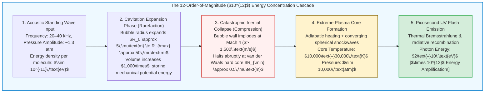
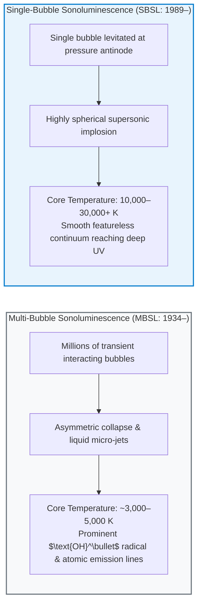
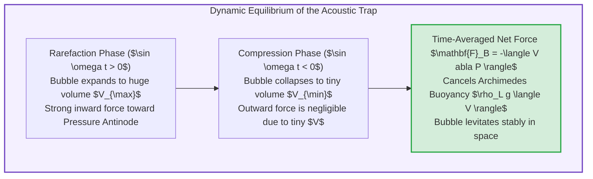
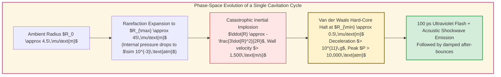
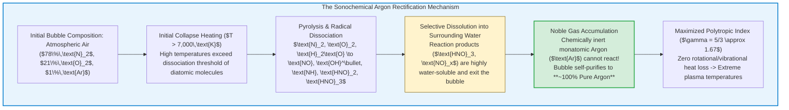
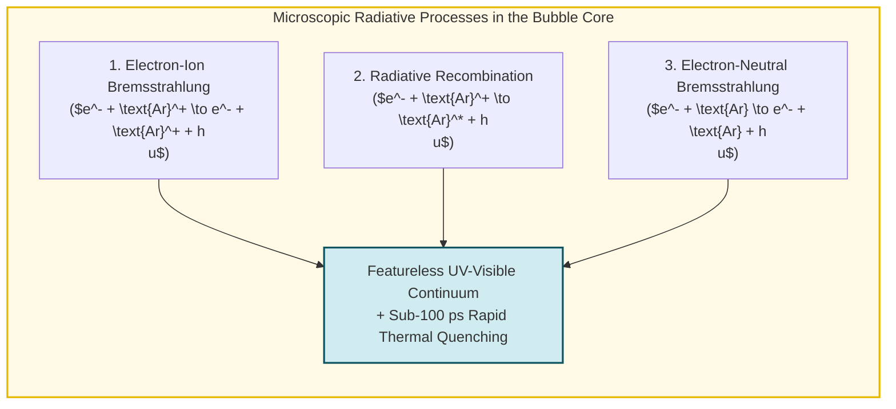

## Introduction: A Microscopic Star Suspended in a Flask

Picture a spherical glass flask filled with degassed water sitting inside a pitch-black laboratory.
Bonded to the exterior glass walls are piezoelectric ultrasonic transducers driven at a resonant frequency of $20\text{ to }40\,\text{kHz}$—just above the threshold of human hearing. When a researcher injects a single microscopic air bubble, barely a few micrometers in diameter, into the center of the flask, an extraordinary physical phenomenon unfolds.

Caught in the invisible grip of an acoustic standing wave, the bubble hangs motionless at the geometric center of the liquid. To the naked eye, it shines steadily like a brilliant blue-white star suspended in space.

This phenomenon is <strong>Sonoluminescence</strong>—specifically, <strong>Single-Bubble Sonoluminescence (SBSL)</strong>, wherein a solitary gas cavity undergoes rhythmic, catastrophic collapse tens of thousands of times per second, emitting clockwork bursts of ultraviolet and visible light.

From the standpoint of fundamental physics, sonoluminescence is an astonishing <strong>nonlinear energy concentrator</strong>.
A diffuse acoustic wave in water carries an average energy of roughly $10^{-11}\,\text{eV}$ per atom. Yet the ultraviolet photons emerging from the core of the collapsing bubble possess energies exceeding $6\text{ to }10\,\text{eV}$. Through pure continuum fluid mechanics and gas dynamics, the collapsing bubble focuses mechanical energy across twelve orders of magnitude ($\times 10^{12}$) in space and time!

This comprehensive guide explores the history of sonoluminescence from wartime sonar tanks to single-bubble levitation, derives the governing <strong>Rayleigh-Plesset equation</strong> from the Navier-Stokes equations, explains the <strong>Argon Rectification Hypothesis</strong>, analyzes imploding shockwaves and <strong>thermal bremsstrahlung plasma radiation</strong>, and examines modern experimental breakthroughs and open frontiers.

---

## 1. Historical Evolution: From Cavitation Clouds to Clockwork Precision

### 1.1 1934: The Accidental Discovery in Photographic Baths
The discovery of sonoluminescence arose directly from pre-World War II ultrasonic sonar research.
In 1934, H. Frenzel and H. Schultes at the University of Cologne immersed a high-power marine ultrasound transducer into a tank of photographic developer fluid, hoping that acoustic agitation would accelerate the chemical development of silver-halide photographic plates.

Instead, they noticed that plates submerged in the tank became fogged withtiny black dots even in complete darkness. Looking into the darkened tank, they observed faint, shimmering clouds of light emanating from swarms of cavitating bubbles. This regime became known as <strong>Multi-Bubble Sonoluminescence (MBSL)</strong>.

For over five decades, all experimental research was restricted to MBSL. Because cavitation clouds contain millions of transient bubbles that continuously nucleate, coalesce, deform against one another, and fragment within a few acoustic cycles, measuring the precise radius, symmetry, or internal state of any individual bubble was experimentally impossible.

### 1.2 1989: The Single-Bubble Breakthrough of Gaitan and Crum
The field was revolutionized in 1989 by graduate student <strong>D. Felipe Gaitan</strong> and his advisor <strong>Lawrence A. Crum</strong> at the University of Mississippi, later expanded rapidly by Seth Putterman and Barber at UCLA.

By carefully degassing water to ~10–20% of its saturation concentration and tuning the acoustic standing wave inside a high-$Q$ resonator to a narrow pressure window ($1.2\text{ to }1.5\,\text{atm}$), Gaitan succeeded in trapping <strong>a single cavitation bubble</strong> at the pressure antinode. Rather than fragmenting, this solitary bubble survived for hours—expanding and collapsing over $30,000$ times every second in complete isolation.

Once physicists trained streak cameras, Mie-scattering lasers, and photomultiplier tubes onto a single sonoluminescing bubble, three extraordinary properties emerged:

1. <strong>Ultrashort Picosecond Flashes:</strong>
   Time-correlated single-photon counting revealed that each light flash lasts between <strong>$35\text{ and }300\,\text{picoseconds}$</strong> ($10^{-12}\,\text{s}$), emitted precisely at the minimum bubble radius $R_{\min}$.
2. <strong>Sub-50-Picosecond Clockwork Jitter:</strong>
   Although the driving acoustic period is roughly $35\,\mu\text{s}$ ($3.5 \times 10^{-5}\,\text{s}$), the phase jitter (variation in arrival time from flash to flash) is less than <strong>$50\,\text{ps}$</strong>—a timing stability of nearly one part in a million!
3. <strong>Featureless Ultraviolet Continuum:</strong>
   Unlike MBSL, which displays clear molecular emission bands (such as the $310\,\text{nm}$ band of excited $\text{OH}^\bullet$ radicals), the spectrum of SBSL in water is completely smooth and featureless, rising monotonically into the ultraviolet until cut off by the electronic absorption edge of liquid water at $\lambda \approx 180\text{–}200\,\text{nm}$ ($> 6\,\text{eV}$).

---

## 2. Acoustic Levitation Mechanics: The Primary Bjerknes Force

Why doesn't Archimedes' buoyancy force carry the gas bubble immediately to the surface of the water?
The bubble is held stationary against gravity by a nonlinear acoustic radiation force known as the <strong>Primary Bjerknes Force</strong>.

### 2.1 Mathematical Formulation of the Bjerknes Trap
Consider a gas bubble of time-varying volume $V(t) = \frac{4}{3}\pi R^3(t)$ situated at position $\mathbf{x}$ within an oscillating acoustic pressure field $P(\mathbf{x}, t)$. Integrating the fluid pressure over the surface of the small bubble yields an instantaneous force $-V(t) \nabla P(\mathbf{x}, t)$.
Averaging this force over one complete acoustic period $T_{ac} = 2\pi/\omega$ defines the <strong>Primary Bjerknes Force $\mathbf{F}_B$</strong>:

$$\mathbf{F}_B = -\langle V(t) \nabla P(\mathbf{x}, t) \rangle = -\frac{1}{T_{ac}} \int_0^{T_{ac}} V(t) \nabla P(\mathbf{x}, t) \, dt$$

Let the standing wave near the center of the spherical resonator be modeled as:

$$P(\mathbf{x}, t) = P_0 - P_a(\mathbf{x}) \sin(\omega t)$$

where $P_0 = 1\,\text{atm}$ is the ambient hydrostatic pressure, and the acoustic pressure amplitude $P_a(\mathbf{x})$ attains a local maximum at the center of the flask ($\nabla P_a$ points inward toward the pressure antinode).

- <strong>During the Rarefaction Half-Cycle ($\sin(\omega t) > 0$):</strong>
  The total pressure drops below zero (tension), causing the bubble to expand dramatically to a huge volume $V_{\max}$. Because $\nabla P = -\nabla P_a \sin(\omega t)$, the instantaneous force $-V(t)\nabla P = +V(t) \nabla P_a \sin(\omega t)$ pulls the bubble <strong>strongly inward toward the pressure antinode</strong>.
- <strong>During the Compression Half-Cycle ($\sin(\omega t) < 0$):</strong>
  The acoustic pressure becomes positive, crushing the bubble to a minuscule volume $V_{\min} \ll V_{\max}$. Although the pressure gradient now pushes the bubble outward away from the center, the volume $V(t)$ is nearly zero, making the outward repulsive force negligible.

Consequently, the time-averaged integral $\mathbf{F}_B$ produces a powerful net restoring force directed toward the pressure antinode, balancing the upward buoyancy force $\mathbf{F}_{\text{buoy}} = \rho_L g \langle V(t) \rangle \hat{\mathbf{z}}$ and locking the bubble in place with micrometer stability.

---

## 3. Fluid Mechanics of Catastrophic Implosion: The Rayleigh-Plesset Equation

To understand how mechanical energy concentrates by twelve orders of magnitude, we must derive the nonlinear differential equation governing the bubble radius $R(t)$: the <strong>Rayleigh-Plesset Equation</strong>.

### 3.1 Full Derivation from the Navier-Stokes Equations
Assume a spherical bubble of radius $R(t)$ centered at the origin $r = 0$ in an infinite domain of incompressible liquid of density $\rho_L$ and dynamic viscosity $\mu$.
By spherical symmetry, the fluid velocity field is purely radial: $\mathbf{u}(r, t) = u(r, t)\hat{\mathbf{r}}$.
Conservation of mass for an incompressible fluid ($\nabla \cdot \mathbf{u} = 0$) in spherical coordinates gives:

$$\frac{1}{r^2} \frac{\partial}{\partial r} \left( r^2 u(r, t) \right) = 0 \implies r^2 u(r, t) = F(t)$$

Applying the kinematic boundary condition at the bubble wall $r = R(t)$, where the liquid velocity must match the interface velocity $u(R, t) = \dot{R}(t)$, uniquely determines $F(t) = R^2(t)\dot{R}(t)$. Thus, the velocity field throughout the entire liquid is:

$$u(r, t) = \frac{R^2(t)\dot{R}(t)}{r^2}$$

Next, substitute this velocity field into the radial component of the incompressible Navier-Stokes momentum equation:

$$\rho_L \left( \frac{\partial u}{\partial t} + u \frac{\partial u}{\partial r} \right) = -\frac{\partial P}{\partial r} + \mu \left[ \frac{1}{r^2}\frac{\partial}{\partial r}\left(r^2 \frac{\partial u}{\partial r}\right) - \frac{2u}{r^2} \right]$$

Note that for $u \propto 1/r^2$, the viscous bulk term inside the brackets vanishes identically ($\nabla^2 \mathbf{u} = 0$ in the bulk)! Viscosity acts solely through the normal stress boundary condition at the interface.
Evaluating the convective acceleration terms:

$$\frac{\partial u}{\partial t} = \frac{2R\dot{R}^2 + R^2\ddot{R}}{r^2}, \qquad u \frac{\partial u}{\partial r} = -\frac{2 R^4 \dot{R}^2}{r^5}$$

Integrating the momentum equation with respect to $r$ from the bubble wall $r = R(t)$ to infinity $r \to \infty$ (where $P(\infty, t) = P_0 + P_a(t)$):

$$\rho_L \int_R^\infty \left( \frac{2R\dot{R}^2 + R^2\ddot{R}}{r^2} - \frac{2 R^4 \dot{R}^2}{r^5} \right) dr = \int_R^\infty -\frac{\partial P}{\partial r} dr$$

$$\rho_L \left[ \frac{2R\dot{R}^2 + R^2\ddot{R}}{R} - \frac{2 R^4 \dot{R}^2}{4 R^4} \right] = P_L(R, t) - \left( P_0 + P_a(t) \right)$$

$$\rho_L \left( R\ddot{R} + \frac{3}{2}\dot{R}^2 \right) = P_L(R, t) - P_0 - P_a(t)$$

Finally, balancing the normal radial stress across the gas-liquid interface at $r = R(t)$ incorporates the Laplace surface tension $2\sigma / R$ and the normal viscous stress $4\mu \dot{R} / R$, along with the <strong>Keller-Miksis acoustic radiation damping term</strong> (accounting for finite liquid sound speed $c_L$):

$$R \ddot{R} + \frac{3}{2} \dot{R}^2 = \frac{1}{\rho_L} \left[ P_g(R, t) - P_0 - P_a(t) - \frac{2\sigma}{R} - \frac{4\mu \dot{R}}{R} + \frac{R}{c_L} \frac{d}{dt} P_g(R, t) \right]$$

### 3.2 Physical Anatomy of the Collapse Trajectory
Look closely at the left-hand side of the Rayleigh-Plesset equation: <strong>$R\ddot{R} + \frac{3}{2}\dot{R}^2$</strong>.
1. <strong>Runaway Expansion ($R_0 \to R_{\max}$):</strong>
   When the acoustic wave pulls the liquid into negative pressure ($P_0 + P_a(t) < 0$), the bubble expands from its ambient radius $R_0 \approx 4.5\,\mu\text{m}$ to a maximum radius $R_{\max} \approx 45\text{–}50\,\mu\text{m}$. Its volume increases by a factor of $10^3$, dropping the internal gas pressure $P_g$ to near-total vacuum.
2. <strong>Inertial Focusing ($\ddot{R} \propto -\frac{3}{2}\frac{\dot{R}^2}{R}$):</strong>
   Once the acoustic wave swings positive, the external pressure crushes the vacuum cavity. As $R \to 0$, conservation of kinetic energy of the converging spherical shell of water forces $\dot{R}^2$ to grow as $R^{-3}$. The bubble wall accelerates past the speed of sound in gas, reaching supersonic velocities exceeding <strong>$1,500\,\text{m/s}$ (Mach 4)</strong>.
3. <strong>Van der Waals Hard-Core Arrest ($R_{\min} \approx 0.5\,\mu\text{m}$):</strong>
   The implosion cannot proceed to $R = 0$ because the gas atoms possess a finite excluded volume $a^3$ (where $a \approx R_0 / 8.8$ is the van der Waals hard-core radius). Modeling the gas via the adiabatic van der Waals equation of state:
   $$P_g(R) = P_0 \left( \frac{R_0^3 - a^3}{R^3 - a^3} \right)^\gamma, \qquad T(R) = T_0 \left( \frac{R_0^3 - a^3}{R^3 - a^3} \right)^{\gamma - 1}$$
   As $R \to a \approx 0.5\,\mu\text{m}$, the denominator $(R^3 - a^3) \to 0$, causing the internal gas pressure to spike above <strong>$10,000\,\text{atmospheres}$</strong>. The collapsing wall slams into this incompressible atomic core, experiencing a deceleration exceeding <strong>$10^{11}\,g$</strong> and halting within picoseconds.

---

## 4. The Argon Rectification Hypothesis: Chemical Self-Purification

One of the greatest early puzzles of SBSL was discovered by Barber and Putterman in 1994:
If a bubble is formed from pure synthetic air ($79\%\,\text{N}_2 + 21\%\,\text{O}_2$), stable glowing SBSL is nearly impossible to achieve. However, if the water is doped with <strong>just 1% Argon ($\text{Ar}$)</strong>—matching natural atmospheric air—the bubble glows with brilliant intensity!

Why does a 1% trace of an inert noble gas dictate the entire physics of the bubble?

In 1997, <strong>Detlef Lohse</strong>, Michael Brenner, and colleagues resolved this enigma via the <strong>Argon Rectification Hypothesis</strong> (Sonochemical Rectification).

### 4.1 Thermodynamics of Monatomic vs. Diatomic Gases
The maximum adiabatic temperature $T_{\max} = T_0 (V_{\max}/V_{\min})^{\gamma - 1}$ is exponentially sensitive to the ratio of specific heats $\gamma = C_p / C_v = 1 + 2/f$, where $f$ is the number of microscopic degrees of freedom:
- <strong>Diatomic Gases ($\text{N}_2, \text{O}_2$):</strong> Possess 3 translational + 2 rotational + 2 vibrational degrees of freedom, driving $\gamma$ down from $1.4$ toward $1.28$ at high temperatures. Worse still, above $5,000\,\text{K}$, thermal energy is consumed endothermically by breaking covalent bonds ($\text{N}\equiv\text{N}$ dissociation requires $9.79\,\text{eV}$), clamping the core temperature.
- <strong>Monatomic Noble Gases ($\text{He}, \text{Ar}, \text{Kr}, \text{Xe}$):</strong> Possess exclusively $f = 3$ translational degrees of freedom. They have no rotational modes, no vibrational modes, and cannot chemically dissociate. Their polytropic exponent remains locked at the theoretical maximum <strong>$\gamma = 5/3 \approx 1.67$</strong>.

During the first few thousand cycles, extreme collapse temperatures dissociate $\text{N}_2$ and $\text{O}_2$ into reactive radicals ($\text{NO}, \text{NO}_2, \text{HNO}_3$), which immediately dissolve into the surrounding liquid water. Only the chemically inert Argon atoms remain trapped inside. Thus, an air bubble in water spontaneously rectifies itself into a <strong>100% pure Argon micro-reactor</strong>!

---

## 5. Mechanism of Light Emission: Imploding Shockwaves and Plasma Bremsstrahlung

What electromagnetic process generates the featureless ultraviolet continuum?

### 5.1 Converging Spherical Shockwaves and Guderley's Solution
As the bubble wall accelerates past the speed of sound during collapse, it launches compression waves inward into the dense noble gas.
According to the classic <strong>Guderley self-similar solution</strong> for an imploding spherical shockwave, as a shock front of radius $r_s(t) \propto (-t)^\alpha$ converges toward the origin $r = 0$, the post-shock temperature and pressure amplify dramatically.
Combined with uniform adiabatic compression, the inner core of the bubble reaches temperatures of <strong>$10,000\text{ to }30,000\,\text{K}$</strong> at densities approaching that of a solid ($n \sim 10^{22}\,\text{cm}^{-3}$).

### 5.2 Thermal Bremsstrahlung and Ionization Recombination
At temperatures exceeding $15,000\,\text{K}$, thermal collisions strip outer-shell electrons from the noble gas atoms, creating a weakly ionized, high-density plasma core governed by the <strong>Saha Ionization Equation</strong>:

$$\frac{n_e^2}{n_0} = \frac{2}{\Lambda_{\text{th}}^3} \frac{g_1}{g_0} \exp\left( -\frac{E_{\text{ion}}}{k_B T} \right), \qquad \Lambda_{\text{th}} = \sqrt{\frac{h^2}{2\pi m_e k_B T}}$$

where $n_e$ is the free electron density, $n_0$ is the neutral atom density, and $E_{\text{ion}}$ is the first ionization potential.

As free electrons accelerate and decelerate in the Coulomb fields of positive ions ($\text{Ar}^+, \text{Xe}^+$) and neutral atoms, they emit <strong>Thermal Bremsstrahlung (braking radiation / free-free transitions)</strong> and <strong>radiative recombination (free-bound transitions)</strong>.
The spectral power density $P_{\text{brem}}(\lambda, T)$ emitted per unit volume and wavelength is:

$$P_{\text{brem}}(\lambda, T) = \frac{16 \pi e^6}{3 c^2 (6\pi m_e^3 k_B)^{1/2}} \frac{Z_{\text{eff}}^2 n_e n_i}{\lambda^2 \sqrt{T}} \exp\left( -\frac{h c}{\lambda k_B T} \right) g_{ff}(\lambda, T)$$

This plasma bremsstrahlung model accounts for all experimental signatures of SBSL:
1. <strong>Noble Gas Scaling ($\text{Xe} > \text{Kr} > \text{Ar} > \text{Ne} > \text{He}$):</strong>
   Xenon bubbles emit orders of magnitude more light than Helium bubbles. Why? Because Xenon has a much lower ionization energy ($E_{\text{ion}} = 12.13\,\text{eV}$ vs. $24.59\,\text{eV}$ for Helium) and a much lower thermal conductivity, yielding an exponentially higher free electron density $n_e$ via the Saha equation.
2. <strong>Wavelength-Independent Pulse Width:</strong>
   If the bubble were an optically thick surface blackbody cooling slowly, red light would persist much longer than ultraviolet light as the bubble cooled. Instead, red and UV photons turn on and off simultaneously within $\sim 100\,\text{ps}$. Because the plasma is optically thin (or semi-transparent), the moment the bubble rebounds and expands slightly, the temperature drops, electrons recombine exponentially fast, and the entire plasma turns transparent simultaneously!

---

## 6. Definitive Proof and Modern Frontiers

### 6.1 Spectroscopic Confirmation of the Plasma Core (Suslick & Flannigan, 2005)
For years, because SBSL in water produces a featureless continuum, critics argued there was no direct spectroscopic proof of an ionized plasma. Furthermore, water's relatively high vapor pressure ($23\,\text{Torr}$ at room temperature) meant that water vapor invaded the bubble and cushioned the collapse.

In 2005, <strong>Kenneth S. Suslick</strong> and <strong>David J. Flannigan</strong> at the University of Illinois performed SBSL with Argon bubbles in <strong>concentrated sulfuric acid ($\text{H}_2\text{SO}_4$)</strong>, which has a vapor pressure thousands of times lower than water.
Freed from water vapor cushioning, the bubble emission brightened by a factor of $3,000$, and for the first time in history, <strong>resolved atomic emission lines of ionized Argon ($\text{Ar}^+$)</strong> were directly observed!
Because the excited states of $\text{Ar}^+$ lie more than $19\text{ to }35\,\text{eV}$ above the ground state—far too high to be populated by neutral thermal collisions—this provided irrefutable proof of an energetic, weakly ionized <strong>plasma core at temperatures exceeding $15,000\text{ to }25,000\,\text{K}$</strong>.

### 6.2 Comparative Regimes of Acoustic Cavitation Luminescence

| Regime / System | Bubble Symmetry | Vapour Pressure | Peak Core Temperature | Spectral Characteristics | Pulse Duration |
|---|---|---|---|---|---|
| <strong>MBSL in Water</strong> | Asymmetric (Micro-jets) | High ($\text{H}_2\text{O}$) | $3,000\text{–}5,000\,\text{K}$ | Strong $\text{OH}^\bullet$ ($310\,\text{nm}$) & metal lines | Nanoseconds (ensemble) |
| <strong>SBSL in Water ($\text{Ar}/\text{Xe}$)</strong> | Highly Spherical | High ($\text{H}_2\text{O}$) | $10,000\text{–}20,000\,\text{K}$ | Featureless UV continuum (200–800 nm) | $35\text{–}300\,\text{ps}$ |
| <strong>SBSL in Sulfuric Acid</strong> | Spherical / Moving | Ultra-low ($\text{H}_2\text{SO}_4$) | $15,000\text{–}30,000+\,\text{K}$ | Continuum + $\text{Ar}^*$, $\text{Ar}^+$, $\text{SO}$ lines | $500\text{–}1,500\,\text{ps}$ |
| <strong>Biological (Pistol Shrimp)</strong> | Toroidal Cavitation | Seawater | $\sim 5,000\,\text{K}$ | Broadband weak flash | $< 10\,\text{ns}$ |

### 6.3 Biological Sonoluminescence and the Bubble Fusion Controversy
In nature, the snapping pistol shrimp (*Alpheus heterochaelis*) snaps its specialized claw shut at extreme speeds, shooting a water jet that cavitates and collapses to generate a $210\,\text{dB}$ acoustic shockwave accompanied by a $5,000\,\text{K}$ flash of light ("shrimpoluminescence") to stun prey.

Meanwhile, in 2002, claims of desktop "bubble fusion" (thermonuclear D-D fusion in cavitating deuterated acetone) sparked intense global controversy before being thoroughly debunked and retracted. Detailed hydrodynamic models confirm that viscous dissipation, ionization losses, and acoustic radiation limit maximum bubble core temperatures to several tens of thousands of Kelvin ($\sim 2\text{–}5\,\text{eV}$), remaining three orders of magnitude below the $\sim 10\,\text{keV}$ ($10^8\,\text{K}$) required for thermonuclear fusion.

---

## 7. Conclusion: The Symphony of Continuum Physics

Sonoluminescence stands as one of the most breathtaking demonstrations of emergent physics in nature.
Without exotic lasers or particle accelerators—using only a glass flask of water and a gentle ultrasonic hum—classical fluid mechanics (the Rayleigh-Plesset equation), non-equilibrium sonochemistry (Argon rectification), gas dynamics (imploding shockwaves), and quantum statistical plasma physics (Saha ionization and thermal bremsstrahlung) conspire to forge a miniature star on a laboratory benchtop.
