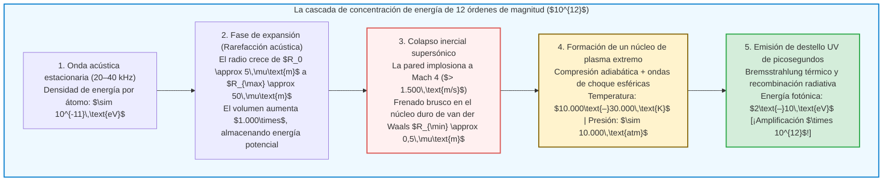

## Introducción: Una estrella microscópica suspendida en un matraz

Imagine un matraz esférico de vidrio lleno de agua desgasificada en la oscuridad absoluta de un laboratorio.
En las paredes exteriores del matraz, transductores piezoeléctricos generan una onda estacionaria ultrasónica de $20\text{ a }40\,\text{kHz}$. Cuando un investigador inyecta una única burbuja de aire microscópica de apenas unos micrómetros de diámetro en el centro del recipiente, ocurre un fenómeno físico extraordinario:

Atrapada por la fuerza invisible de la onda acústica, la burbuja permanece inmóvil en el centro geométrico del líquido y brilla de forma continua como una estrella blanco-azulada perfectamente visible a simple vista.

Este fenómeno es la <strong>sonoluminiscencia</strong> —específicamente la <strong>sonoluminiscencia de burbuja única (Single-Bubble Sonoluminescence, SBSL)</strong>—, en la cual una cavidad gaseosa solitaria colapsa decenas de miles de veces por segundo con la precisión de un reloj atómico, emitiendo destellos ultracortos de luz ultravioleta.

Desde el punto de vista de la física fundamental, la sonoluminiscencia es un <strong>concentrador de energía no lineal</strong> prodigioso. Una onda acústica en el agua transporta apenas $10^{-11}\,\text{eV}$ por molécula, pero los fotones UV emitidos superan los $6\text{ a }10\,\text{eV}$: ¡una amplificación de <strong>doce órdenes de magnitud ($\times 10^{12}$)</strong> mediante pura mecánica de fluidos!

Este artículo explora la historia del fenómeno desde 1934 hasta 1989, deduce la <strong>ecuación de Rayleigh-Plesset</strong>, explica la trampa acústica mediante la <strong>fuerza de Bjerknes</strong>, la autopurificación química por <strong>rectificación del argón</strong> y el modelo de emisión de <strong>plasma por Bremsstrahlung</strong>.

---

## 1. Evolución histórica: De las nubes de cavitación a la burbuja única

### 1.1 1934: El descubrimiento accidental en baños fotográficos
En 1934, en la Universidad de Colonia, H. Frenzel y H. Schultes sumergieron un transductor de sonar de alta potencia en un tanque de revelador fotográfico. Observaron que las placas quedaban veladas incluso en completa oscuridad: nubes de burbujas de cavitación emitían un tenue resplandor (<strong>sonoluminiscencia multiburbuja, MBSL</strong>). Sin embargo, la interacción caótica de millones de burbujas impidió mediciones individuales precisas durante medio siglo.

### 1.2 1989: La revolución de Gaitan y Crum
En 1989, <strong>D. Felipe Gaitan</strong> y <strong>Lawrence A. Crum</strong> lograron atrapar <strong>una sola burbuja de cavitación (SBSL)</strong> en el antinodo de presión de una onda estacionaria.
Las mediciones revelaron tres propiedades extraordinarias:
1. <strong>Destellos de picosegundos:</strong> Cada pulso luminoso dura solo entre <strong>$35\text{ y }300\,\text{picosegundos}$</strong> ($10^{-12}\,\text{s}$).
2. <strong>Fluctuación (Jitter) menor a 50 ps:</strong> Con un período acústico de $\sim 35\,\mu\text{s}$, la estabilidad temporal entre destellos alcanza una parte en un millón.
3. <strong>Espectro continuo ultravioleta:</strong> En agua pura, el espectro crece de forma continua hacia el UV hasta el corte de absorción del agua a $200\,\text{nm}$, correspondiendo a temperaturas de <strong>$10.000\text{ a }30.000\,\text{K}$</strong>.

---

## 2. Levitación acústica: La fuerza primaria de Bjerknes

¿Por qué el empuje de Arquímedes no lleva la burbuja hacia la superficie? Permanece atrapada gracias a la <strong>fuerza primaria de Bjerknes</strong>:

$$\mathbf{F}_B = -\langle V(t) \nabla P(\mathbf{x}, t) \rangle = -\frac{1}{T_{ac}} \int_0^{T_{ac}} V(t) \nabla P(\mathbf{x}, t) \, dt$$

Durante el полуciclo de depresión ($\sin\omega t > 0$), la burbuja se expande hasta un volumen enorme $V_{\max}$ y experimenta una fuerte atracción hacia el antinodo de presión (el centro). Durante la compresión ($\sin\omega t < 0$), su volumen se reduce a $V_{\min} \ll V_{\max}$, haciendo que la fuerza repulsiva sea despreciable. En promedio temporal, $\mathbf{F}_B$ equilibra exactamente la flotabilidad $\rho_L g \langle V \rangle$.

---

## 3. Hidrodinámica de la implosión: La ecuación de Rayleigh-Plesset

A partir de la ecuación de continuidad $\nabla \cdot \mathbf{u} = 0$ de un fluido incompresible, el campo de velocidad radial es $u(r, t) = R^2(t)\dot{R}(t)/r^2$. Sustituyendo esto en la ecuación de Navier-Stokes e integrando desde $r = R(t)$ hasta el infinito, se obtiene la <strong>ecuación de Rayleigh-Plesset generalizada</strong>:

$$R \ddot{R} + \frac{3}{2} \dot{R}^2 = \frac{1}{\rho_L} \left[ P_g(R, t) - P_0 - P_a(t) - \frac{2\sigma}{R} - \frac{4\mu \dot{R}}{R} + \frac{R}{c_L} \frac{d}{dt} P_g(R, t) \right]$$

El término inercial no lineal <strong>$\frac{3}{2}\dot{R}^2$</strong> gobierna la violencia del colapso:
1. En rarefacción, la burbuja pasa de $R_0 \approx 4,5\,\mu\text{m}$ a $R_{\max} \approx 45\,\mu\text{m}$ (volumen $\times 1.000$).
2. Al colapsar, la pared acelera superando los <strong>$1.500\,\text{m/s}$ (Mach 4)</strong>.
3. La implosión se detiene abruptamente en el <strong>radio de volumen excluido de van der Waals $a \approx R_0 / 8,8 \approx 0,5\,\mu\text{m}$</strong>:
   $$P_g(R) = P_0 \left( \frac{R_0^3 - a^3}{R^3 - a^3} \right)^\gamma, \qquad T(R) = T_0 \left( \frac{R_0^3 - a^3}{R^3 - a^3} \right)^{\gamma - 1}$$
   La presión interna supera las <strong>10.000 atmósferas</strong> y la pared sufre una desaceleración superior a <strong>$10^{11}\,g$</strong> en picosegundos.

---

## 4. La hipótesis de rectificación del argón

El aire sintético puro ($79\%\,\text{N}_2 + 21\%\,\text{O}_2$) apenas produce sonoluminiscencia; se requiere el <strong>1 % de argón ($\text{Ar}$)</strong> presente en la atmósfera para lograr un brillo intenso.
En 1997, <strong>Detlef Lohse</strong> demostró la <strong>rectificación sonoquímica del argón</strong>:
Por encima de $6.000\,\text{K}$, las moléculas diatómicas ($\text{N}_2, \text{O}_2$) se disocian en radicales ($\text{NO}, \text{HNO}_3$) altamente solubles que se disuelven en el agua circundante. Solo el argón monoatómico, químicamente inerte, permanece atrapado. Tras miles de ciclos, la burbuja contiene <strong>casi un 100 % de argón puro</strong>, cuyo elevado exponente adiabático ($\gamma = 5/3 \approx 1,67$) maximiza la temperatura de compresión.

---

## 5. Emisión de luz: Ondas de choque y Bremsstrahlung térmico

La compresión adiabática y las ondas de choque esféricas convergentes (solución de Guderley) calientan el núcleo a $15.000\text{–}30.000\,\text{K}$, ionizando parcialmente el gas noble según la <strong>ecuación de Saha</strong>:

$$\frac{n_e^2}{n_0} = \frac{2}{\Lambda_{\text{th}}^3} \frac{g_1}{g_0} \exp\left( -\frac{E_{\text{ion}}}{k_B T} \right)$$

Los electrones libres frenados por los iones ($\text{Ar}^+, \text{Xe}^+$) emiten <strong>radiación de frenado térmica (Bremsstrahlung)</strong> y recombinación radiativa:

$$P_{\text{brem}}(\lambda, T) \propto \frac{n_e n_i Z^2}{\lambda^2 \sqrt{T}} \exp\left( -\frac{h c}{\lambda k_B T} \right)$$

En 2005, <strong>Kenneth Suslick</strong> y <strong>David Flannigan</strong> observaron directamente líneas de emisión atómica de iones $\text{Ar}^+$ ($> 19\,\text{eV}$) en ácido sulfúrico concentrado, confirmando de forma definitiva la existencia de un núcleo de plasma denso y caliente.

---

## 6. Conclusión: Una sinfonía física a escala micrométrica

Desde el camarón pistola (*Alpheus heterochaelis*) que aturde a sus presas mediante cavitación hasta los reactores sonoquímicos de laboratorio, la sonoluminiscencia demuestra cómo la hidrodinámica, la química y la física de plasmas convergen para encender una estrella en el corazón de una gota de agua.
