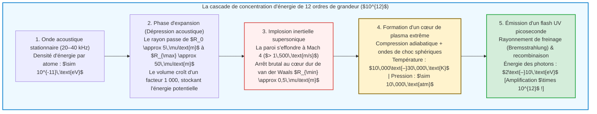

## Introduction : Une étoile microscopique en lévitation dans un flacon

Imaginez un ballon de verre sphérique rempli d'eau dégazée, plongé dans l'obscurité totale d'un laboratoire.
Sur les parois extérieures du flacon, des transducteurs piézoélectriques génèrent une onde ultrasonore stationnaire à une fréquence de $20\text{ à }40\,\text{kHz}$. Lorsqu'un chercheur injecte une unique bulle d'air microscopique de quelques micromètres de diamètre au centre du récipient, un phénomène physique stupéfiant se produit :

Piégée par la force invisible de l'onde acoustique, la bulle reste immobile en lévitation au centre géométrique du liquide et se met à briller d'une lueur bleutée continue, parfaitement visible à l'œil nu, telle une étoile miniature.

Ce phénomène est la <strong>sonoluminescence</strong> — et plus précisément la <strong>sonoluminescence à bulle unique (Single-Bubble Sonoluminescence, SBSL)</strong>, au cours de laquelle une cavité gazeuse solitaire implose des dizaines de milliers de fois par seconde avec la régularité d'une horloge atomique, émettant à chaque effondrement un flash ultrabref de lumière ultraviolette.

Du point de vue de la physique fondamentale, la sonoluminescence est un <strong>concentrateur d'énergie non linéaire</strong> prodigieux. Une onde sonore dans l'eau ne transporte qu'environ $10^{-11}\,\text{eV}$ par molécule, tandis que les photons UV émis dépassent $6\text{ à }10\,\text{eV}$ — soit une amplification de la densité d'énergie de <strong>douze ordres de grandeur ($\times 10^{12}$)</strong> par pure mécanique des fluides !

Cet article retrace l'histoire de cette découverte de 1934 à 1989, démontre l'<strong>équation de Rayleigh-Plesset</strong>, explique le piégeage par la <strong>force de Bjerknes</strong>, l'auto-purification chimique par <strong>rectification de l'argon</strong>, ainsi que le modèle d'émission de <strong>plasma par Bremsstrahlung</strong>.

---

## 1. Histoire : Des nuages de cavitation à la précision d'une horloge

### 1.1 1934 : La découverte fortuite dans les bains photographiques
En 1934, à l'université de Cologne, H. Frenzel et H. Schultes plongèrent un transducteur sonar puissant dans un bac de révélateur photographique. Ils constatèrent que les plaques photographiques étaient voilées même dans l'obscurité complète : des nuages de bulles de cavitation émettaient une faible lueur (<strong>sonoluminescence multi-bulles, MBSL</strong>). Toutefois, l'interaction chaotique de millions de bulles empêcha toute mesure individuelle précise pendant plus de cinquante ans.

### 1.2 1989 : La révolution de la bulle unique de Gaitan et Crum
En 1989, <strong>D. Felipe Gaitan</strong> et <strong>Lawrence A. Crum</strong> réussirent à piéger <strong>une seule bulle de cavitation (SBSL)</strong> au ventre de pression d'une onde stationnaire.
Les mesures au tube photomultiplicateur et à la caméra à balayage de fente révélèrent trois propriétés fascinantes :
1. <strong>Flashs picosecondes :</strong> Chaque impulsion lumineuse ne dure que <strong>$35\text{ à }300\,\text{picosecondes}$</strong> ($10^{-12}\,\text{s}$).
2. <strong>Gigue temporelle (Jitter) inférieure à 50 ps :</strong> Sur une période acoustique de $\sim 35\,\mu\text{s}$, la régularité d'émission atteint une précision d'une partie par million.
3. <strong>Spectre continu dans l'ultraviolet :</strong> Sans raies moléculaires dans l'eau pure, le spectre croît continûment vers l'UV jusqu'à la coupure d'absorption de l'eau à $200\,\text{nm}$, correspondant à des températures de <strong>$10\,000\text{ à }30\,000\,\text{K}$</strong>.

---

## 2. Lévitation acoustique : La force primaire de Bjerknes

Pourquoi la poussée d'Archimède ne fait-elle pas remonter la bulle à la surface ? Elle est maintenue au centre par la <strong>force primaire de Bjerknes</strong> :

$$\mathbf{F}_B = -\langle V(t) \nabla P(\mathbf{x}, t) \rangle = -\frac{1}{T_{ac}} \int_0^{T_{ac}} V(t) \nabla P(\mathbf{x}, t) \, dt$$

Durant la demi-période de dépression ($\sin\omega t > 0$), la bulle atteint un volume gigantesque $V_{\max}$ et subit une forte attraction vers le ventre de pression (le centre). Durant la demi-période de compression ($\sin\omega t < 0$), son volume devient infime ($V_{\min} \ll V_{\max}$), rendant la répulsion négligeable. En moyenne temporelle, $\mathbf{F}_B$ équilibre exactement la flottabilité $\rho_L g \langle V \rangle$.

---

## 3. Hydrodynamique de l'implosion : L'équation de Rayleigh-Plesset

À partir de l'équation de continuité $\nabla \cdot \mathbf{u} = 0$ d'un fluide incompressible, le champ de vitesse radial s'écrit $u(r, t) = R^2(t)\dot{R}(t)/r^2$. En l'injectant dans l'équation de Navier-Stokes et en intégrant de $r = R(t)$ à l'infini, on obtient l'<strong>équation de Rayleigh-Plesset généralisée</strong> :

$$R \ddot{R} + \frac{3}{2} \dot{R}^2 = \frac{1}{\rho_L} \left[ P_g(R, t) - P_0 - P_a(t) - \frac{2\sigma}{R} - \frac{4\mu \dot{R}}{R} + \frac{R}{c_L} \frac{d}{dt} P_g(R, t) \right]$$

Le terme inertiel non linéaire <strong>$\frac{3}{2}\dot{R}^2$</strong> gouverne la violence de l'effondrement :
1. En phase de dépression, la bulle passe de $R_0 \approx 4,5\,\mu\text{m}$ à $R_{\max} \approx 45\,\mu\text{m}$ (volume multiplié par $1\,000$).
2. Lors de la compression, la paroi accélère jusqu'à dépasser <strong>$1\,500\,\text{m/s}$ (Mach 4)</strong>.
3. L'implosion s'arrête brutalement lorsque le rayon atteint le <strong>volume exclu de van der Waals $a \approx R_0 / 8,8 \approx 0,5\,\mu\text{m}$</strong> :
   $$P_g(R) = P_0 \left( \frac{R_0^3 - a^3}{R^3 - a^3} \right)^\gamma, \qquad T(R) = T_0 \left( \frac{R_0^3 - a^3}{R^3 - a^3} \right)^{\gamma - 1}$$
   La pression interne bondit au-delà de <strong>10 000 atmosphères</strong> et la paroi subit une décélération dépassant <strong>$10^{11}\,g$</strong> en quelques picosecondes !

---

## 4. L'hypothèse de rectification de l'argon

L'air synthétique pur ($79\%\,\text{N}_2 + 21\%\,\text{O}_2$) ne produit pratiquement aucune sonoluminescence stable ; il faut <strong>1 % d'argon ($\text{Ar}$)</strong> pour que la bulle brille intensément.
En 1997, <strong>Detlef Lohse</strong> résolut cette énigme grâce à la <strong>rectification sonochimique de l'argon</strong> :
Au-dessus de $6\,000\,\text{K}$, les molécules diatomiques ($\text{N}_2, \text{O}_2$) se dissocient en radicaux ($\text{NO}, \text{HNO}_3$) très solubles qui se dissolvent dans l'eau environnante. Seul l'argon monoatomique, chimiquement inerte, reste piégé. Après quelques milliers de cycles, la bulle contient <strong>près de 100 % d'argon pur</strong>, dont l'indice adiabatique élevé ($\gamma = 5/3 \approx 1,67$) maximise le chauffage par compression.

---

## 5. Émission lumineuse : Ondes de choc et Bremsstrahlung thermique

Sous l'effet de la compression adiabatique et des ondes de choc sphériques convergentes (solution de Guderley), le cœur atteint $15\,000\text{ à }30\,000\,\text{K}$ et s'ionise partiellement selon l'<strong>équation de Saha</strong> :

$$\frac{n_e^2}{n_0} = \frac{2}{\Lambda_{\text{th}}^3} \frac{g_1}{g_0} \exp\left( -\frac{E_{\text{ion}}}{k_B T} \right)$$

Les électrons libres freinés par les ions ($\text{Ar}^+, \text{Xe}^+$) émettent un <strong>rayonnement de freinage thermique (Bremsstrahlung)</strong> et de recombinaison :

$$P_{\text{brem}}(\lambda, T) \propto \frac{n_e n_i Z^2}{\lambda^2 \sqrt{T}} \exp\left( -\frac{h c}{\lambda k_B T} \right)$$

En 2005, <strong>Kenneth Suslick</strong> et <strong>David Flannigan</strong> ont observé directement les raies d'émission atomique d'ions $\text{Ar}^+$ ($> 19\,\text{eV}$) lors de la SBSL dans l'acide sulfurique concentré, apportant la preuve définitive de l'existence d'un cœur de plasma dense et chaud.

---

## 6. Conclusion : Une symphonie physique à l'échelle du micron

De la crevette-pistolet (*Alpheus heterochaelis*) qui étourdit ses proies par cavitation jusqu'aux réacteurs sonochimiques de laboratoire, la sonoluminescence illustre comment l'hydrodynamique, la chimie et la physique des plasmas s'unissent pour allumer une étoile au cœur d'une goutte d'eau.
