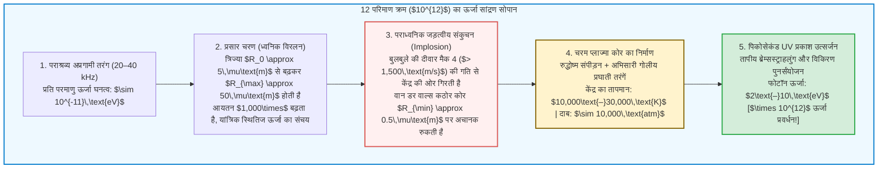

## प्रस्तावना: कांच के फ्लास्क में तैरता एक "सूक्ष्म तारा"

एक पूर्णतः अंधेरी प्रयोगशाला में रखे गैस-रहित पानी से भरे गोलाकार कांच के फ्लास्क की कल्पना करें।
फ्लास्क की बाहरी दीवारों पर पीजोइलेक्ट्रिक अल्ट्रासोनिक ट्रांसड्यूसर लगे हैं, जो $20\text{ से }40\,\text{kHz}$ की आवृत्ति पर अप्रगामी ध्वनि तरंगें (Standing Waves) उत्पन्न करते हैं। जब शोधकर्ता फ्लास्क के केंद्र में कुछ माइक्रोमीटर व्यास का एक सूक्ष्म हवा का बुलबुला इंजेक्ट करता है, तो एक अद्भुत भौतिक घटना घटित होती है:

ध्वनि तरंगों के अदृश्य बल में बंधकर वह बुलबुला द्रव के ज्यामितीय केंद्र में स्थिर तैरने लगता है और नग्न आंखों से दिखाई देने वाले नीले-सफेद तारे की तरह निरंतर चमकने लगता है!

इस घटना को <strong>सोनोलुमिनेसेंस (Sonoluminescence — ध्वनि-संदीप्ति)</strong> कहा जाता है, और विशेष रूप से इसे <strong>एकल-बुलबुला सोनोलुमिनेसेंस (Single-Bubble Sonoluminescence, SBSL)</strong> कहते हैं, जिसमें एक अकेला गैस बुलबुला परमाणु घड़ी की सटीकता के साथ प्रति सेकंड हजारों बार संकुचित होता है और पिकोसेकंड की पराबैंगनी (UV) प्रकाश चमक उत्सर्जित करता है।

मौलिक भौतिकी की दृष्टि से सोनोलुमिनेसेंस एक अद्वितीय <strong>अरैखिक ऊर्जा सांद्रक (Nonlinear Energy Concentrator)</strong> है। पानी में ध्वनि तरंग प्रति अणु केवल $10^{-11}\,\text{eV}$ ऊर्जा वहन करती है, किंतु बुलबुले के केंद्र से निकलने वाले पराबैंगनी फोटॉनों की ऊर्जा $6\text{ से }10\,\text{eV}$ तक होती है—अर्थात शुद्ध तरल यांत्रिकी द्वारा ऊर्जा घनत्व में <strong>बारह परिमाण क्रम (एक ट्रिलियन गुना, $\times 10^{12}$)</strong> की वृद्धि!

इस लेख में हम 1934 से 1989 तक के इतिहास, <strong>रेले-प्लेसेट समीकरण (Rayleigh-Plesset Equation)</strong> की व्युत्पत्ति, <strong>ब्योर्कनेस बल</strong> द्वारा ध्वनिक लेविटेशन, <strong>आर्गन परिशोधन परिकल्पना</strong> और <strong>तापीय ब्रेम्सस्ट्राहलुंग प्लाज्मा मॉडल</strong> का विस्तार से विश्लेषण करेंगे।

---

## 1. ऐतिहासिक विकास: कैविटेशन बादलों से एकल बुलबुले की सटीकता तक

### 1.1 1934: फोटोग्राफिक टैंक में आकस्मिक खोज
1934 में कोलोन विश्वविद्यालय के एच. फ्रेन्ज़ेल और एच. शुल्टेस ने फोटोग्राफिक डेवलपर टैंक में उच्च-शक्ति वाले सोनार ट्रांसड्यूसर को डुबोया। उन्होंने पाया कि पूर्ण अंधकार में भी फोटोग्राफिक प्लेटें काली पड़ गईं: कैविटेशन बुलबुलों के बादल मंद प्रकाश उत्सर्जित कर रहे थे (<strong>बहु-बुलबुला सोनोलुमिनेसेंस, MBSL</strong>)। परंतु लाखों बुलबुलों की अराजक अंतःक्रिया के कारण पचास वर्षों तक किसी एक बुलबुले का सटीक मापन असंभव रहा।

### 1.2 1989: गैतान और क्रम की एकल-बुलबुला क्रांति (SBSL)
1989 में <strong>डी. फेलिप गैतान</strong> और <strong>लॉरेंस ए. क्रम</strong> ने अप्रगामी तरंग के दाब प्रस्पंद (Pressure Antinode) पर <strong>एक अकेले कैविटेशन बुलबुले (SBSL)</strong> को स्थिर करने में सफलता प्राप्त की।
मापन से तीन आश्चर्यजनक तथ्य सामने आए:
1. <strong>पिकोसेकंड प्रकाश स्पंद:</strong> प्रत्येक चमक केवल <strong>$35\text{ से }300\,\text{पिकोसेकंड}$</strong> ($10^{-12}\,\text{s}$) तक रहती है।
2. <strong>50 पिकोसेकंड से कम जिटर (Jitter):</strong> $\sim 35\,\mu\text{s}$ के ध्वनिक आवर्तकाल के बावजूद क्रमिक चमक के समय में अंतर दस लाख में एक भाग से भी कम होता है।
3. <strong>सतत पराबैंगनी स्पेक्ट्रम:</strong> शुद्ध जल में स्पेक्ट्रम बिना किसी आणविक रेखा के $200\,\text{nm}$ तक निरंतर बढ़ता है, जो <strong>$10,000\text{ से }30,000\,\text{K}$</strong> के तापमान के समतुल्य है।

---

## 2. ध्वनिक उत्थापन (Levitation): प्राथमिक ब्योर्कनेस बल

आर्किमिडीज का उत्प्लावन बल बुलबुले को सतह पर क्यों नहीं ले जाता? इसे <strong>प्राथमिक ब्योर्कनेस बल (Primary Bjerknes Force)</strong> केंद्र में बांधे रखता है:

$$\mathbf{F}_B = -\langle V(t) \nabla P(\mathbf{x}, t) \rangle = -\frac{1}{T_{ac}} \int_0^{T_{ac}} V(t) \nabla P(\mathbf{x}, t) \, dt$$

विरलन अर्ध-चक्र ($\sin\omega t > 0$) के दौरान बुलबुला विशाल आयतन $V_{\max}$ तक फैलता है और दाब प्रवणता इसे केंद्र की ओर मजबूती से खींचती है। संपीड़न अर्ध-चक्र ($\sin\omega t < 0$) में इसका आयतन अत्यंत सूक्ष्म ($V_{\min} \ll V_{\max}$) हो जाता है, जिससे बाहर की ओर लगने वाला बल नगण्य हो जाता है। समय-औसत में $\mathbf{F}_B$ उत्प्लावन बल $\rho_L g \langle V \rangle$ को पूर्णतः संतुलित कर देता है।

---

## 3. संकुचन की तरल गतिकी: रेले-प्लेसेट समीकरण

असंपीड्य द्रव के सातत्य समीकरण $\nabla \cdot \mathbf{u} = 0$ से त्रिज्यीय वेग क्षेत्र $u(r, t) = R^2(t)\dot{R}(t)/r^2$ प्राप्त होता है। इसे नेवियर-स्टोक्स समीकरण में रखकर $r = R(t)$ से अनंत तक समाकलित करने पर <strong>विस्तारित रेले-प्लेसेट समीकरण</strong> मिलता है:

$$R \ddot{R} + \frac{3}{2} \dot{R}^2 = \frac{1}{\rho_L} \left[ P_g(R, t) - P_0 - P_a(t) - \frac{2\sigma}{R} - \frac{4\mu \dot{R}}{R} + \frac{R}{c_L} \frac{d}{dt} P_g(R, t) \right]$$

अरैखिक जड़त्वीय पद <strong>$\frac{3}{2}\dot{R}^2$</strong> संकुचन की प्रचंडता को नियंत्रित करता है:
1. कम दाब में बुलबुला $R_0 \approx 4.5\,\mu\text{m}$ से $R_{\max} \approx 45\,\mu\text{m}$ तक फैलता है (आयतन $\times 1,000$)।
2. संकुचन के समय दीवार का वेग <strong>$1,500\,\text{m/s}$ (मैक 4)</strong> को पार कर जाता है।
3. संकुचन <strong>वान डर वाल्स अपवर्जित आयतन त्रिज्या $a \approx R_0 / 8.8 \approx 0.5\,\mu\text{m}$</strong> पर अचानक रुकता है:
   $$P_g(R) = P_0 \left( \frac{R_0^3 - a^3}{R^3 - a^3} \right)^\gamma, \qquad T(R) = T_0 \left( \frac{R_0^3 - a^3}{R^3 - a^3} \right)^{\gamma - 1}$$
   आंतरिक दाब <strong>10,000 वायुमंडल</strong> से ऊपर पहुंच जाता है और दीवार कुछ पिकोसेकंड में <strong>$10^{11}\,g$</strong> से अधिक के मंदन के साथ रुकती है!

---

## 4. आर्गन परिशोधन परिकल्पना (Argon Rectification Hypothesis)

शुद्ध कृत्रिम वायु ($79\%\,\text{N}_2 + 21\%\,\text{O}_2$) में सोनोलुमिनेसेंस लगभग नहीं होता; तीव्र चमक के लिए वायुमंडल में उपस्थित <strong>1% आर्गन ($\text{Ar}$)</strong> अनिवार्य है।
1997 में <strong>डेटलेफ लोहसे (Detlef Lohse)</strong> ने इसे <strong>सोनोकेमिकल आर्गन परिशोधन</strong> द्वारा समझाया:
$6,000\,\text{K}$ से अधिक तापमान पर द्विपरमाणुक अणु ($\text{N}_2, \text{O}_2$) वियोजित होकर घुलनशील मूलकों ($\text{NO}, \text{HNO}_3$) में बदल जाते हैं और आसपास के पानी में घुल जाते हैं। केवल रासायनिक रूप से अक्रिय एकपरमाणुक <strong>आर्गन</strong> बुलबुले के भीतर बचती है। कुछ हजार चक्रों के बाद बुलबुला <strong>लगभग 100% शुद्ध आर्गन</strong> से भर जाता है, जिसका उच्च रुद्धोष्म घातांक ($\gamma = 5/3 \approx 1.67$) अधिकतम तापमान उत्पन्न करता है।

---

## 5. प्रकाश उत्सर्जन: प्रघाती तरंगें और तापीय ब्रेम्सस्ट्राहलुंग

रुद्धोष्म संपीड़न और अभिसारी गोलीय प्रघाती तरंगें (गुडरली हल) केंद्र को $15,000\text{–}30,000\,\text{K}$ तक गर्म करती हैं, जिससे <strong>साहा समीकरण (Saha Equation)</strong> के अनुसार आंशिक तापीय आयनीकरण होता है:

$$\frac{n_e^2}{n_0} = \frac{2}{\Lambda_{\text{th}}^3} \frac{g_1}{g_0} \exp\left( -\frac{E_{\text{ion}}}{k_B T} \right)$$

धनायनों ($\text{Ar}^+, \text{Xe}^+$) के कूलॉम क्षेत्र में मंदित होने वाले मुक्त इलेक्ट्रॉन <strong>तापीय ब्रेम्सस्ट्राहलुंग (Bremsstrahlung)</strong> और पुनर्संयोजन विकिरण उत्सर्जित करते हैं:

$$P_{\text{brem}}(\lambda, T) \propto \frac{n_e n_i Z^2}{\lambda^2 \sqrt{T}} \exp\left( -\frac{h c}{\lambda k_B T} \right)$$

2005 में <strong>केनेथ सस्लिक</strong> और <strong>डेविड फ्लैनिगन</strong> ने सांद्र सल्फ्यूरिक अम्ल में $\text{Ar}^+$ आयनों ($> 19\,\text{eV}$) की परमाणु उत्सर्जन रेखाओं को सीधे रिकॉर्ड किया, जिससे गर्म प्लाज्मा कोर के अस्तित्व का अकाट्य प्रमाण मिला।

---

## 6. निष्कर्ष: माइक्रोमीटर पैमाने पर भौतिकी की सिम्फनी

प्रकृति में कैविटेशन चमक से शिकार को अचेत करने वाले पिस्टल झींगा (*Alpheus heterochaelis*) से लेकर प्रयोगशाला के फ्लास्क तक, सोनोलुमिनेसेंस दिखाता है कि कैसे तरल यांत्रिकी, रसायन विज्ञान और प्लाज्मा भौतिकी मिलकर पानी की एक बूंद के भीतर एक नन्हा तारा प्रज्वलित करते हैं।
