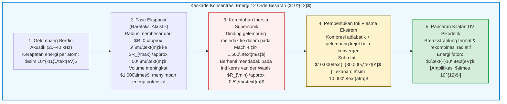

## Pendahuluan: Bintang Mikroskopis yang Melayang di Dalam Labu

Bayangkan sebuah labu kaca bulat berisi air bebas gas di dalam laboratorium yang gelap gulita.
Pada dinding luar labu dipasang transduser ultrasonik piezoelektrik yang membangkitkan gelombang berdiri akustik pada frekuensi $20\text{ hingga }40\,\text{kHz}$. Ketika seorang peneliti menyuntikkan satu gelembung udara mikroskopis berdiameter beberapa mikrometer ke tengah labu, fenomena fisika luar biasa terjadi:

Terperangkap oleh gaya gelombang suara yang tak terlihat, gelembung itu melayang diam di pusat geometris cairan dan memancarkan cahaya biru-putih terang yang dapat dilihat dengan mata telanjang, bagaikan bintang kecil di angkasa.

Fenomena ini disebut <strong>sonoluminesensi</strong> — khususnya <strong>sonoluminesensi gelembung tunggal (Single-Bubble Sonoluminescence, SBSL)</strong> — di mana rongga gas tunggal runtuh puluhan ribu kali per detik dengan presisi jam atom, memancarkan kilatan cahaya ultraviolet ultra-pendek.

Dari sudut pandang fisika dasar, sonoluminesensi adalah <strong>konsentrator energi nonlinier</strong> yang menakjubkan. Gelombang suara di air hanya membawa sekitar $10^{-11}\,\text{eV}$ per molekul, namun foton UV yang terpancar memiliki energi $6\text{ hingga }10\,\text{eV}$ — amplifikasi kerapatan energi sebesar <strong>dua belas orde besaran ($\times 10^{12}$)</strong> murni melalui mekanika fluida!

Artikel ini membahas sejarah penemuan dari 1934 hingga 1989, menurunkan <strong>persamaan Rayleigh-Plesset</strong>, menjelaskan perangkap akustik melalui <strong>gaya Bjerknes</strong>, pemurnian kimia mandiri melalui <strong>rektifikasi argon</strong>, serta model pancaran <strong>plasma Bremsstrahlung</strong>.

---

## 1. Evolusi Sejarah: Dari Awan Kavitasi hingga Gelembung Tunggal

### 1.1 1934: Penemuan Tak Sengaja dalam Bak Fotografi
Pada tahun 1934 di Universitas Cologne, H. Frenzel dan H. Schultes mencelupkan transduser sonar berdaya tinggi ke dalam tangki cairan pengembang fotografi. Mereka mendapati pelat foto terpapar cahaya meskipun berada dalam kegelapan total: awan gelembung kavitasi memancarkan pendaran redup (<strong>sonoluminesensi multi-gelembung, MBSL</strong>). Namun, interaksi kacau jutaan gelembung menghalangi pengukuran presisi selama setengah abad.

### 1.2 1989: Revolusi Gaitan dan Crum (SBSL)
Pada tahun 1989, <strong>D. Felipe Gaitan</strong> dan <strong>Lawrence A. Crum</strong> berhasil memerangkap <strong>satu gelembung kavitasi tunggal (SBSL)</strong> pada perut tekanan gelombang berdiri.
Pengukuran mengungkap tiga sifat luar biasa:
1. <strong>Denyut Pikodetik:</strong> Setiap kilatan cahaya hanya berlangsung <strong>$35\text{ hingga }300\,\text{pikodetik}$</strong> ($10^{-12}\,\text{s}$).
2. <strong>Jitter di Bawah 50 ps:</strong> Dengan periode akustik $\sim 35\,\mu\text{s}$, kestabilan waktu antar kilatan mencapai satuส่วน dalam sejuta.
3. <strong>Spektrum Kontinu Ultraviolet:</strong> Dalam air murni, spektrum meningkat secara mulus menuju UV hingga batas serapan air pada $200\,\text{nm}$, setara dengan suhu <strong>$10.000\text{ hingga }30.000\,\text{K}$</strong>.

---

## 2. Levitasi Akustik: Gaya Bjerknes Primer

Mengapa gaya apung Archimedes tidak membawa gelembung naik ke permukaan? Gelembung ditahan oleh <strong>gaya Bjerknes primer</strong>:

$$\mathbf{F}_B = -\langle V(t) \nabla P(\mathbf{x}, t) \rangle = -\frac{1}{T_{ac}} \int_0^{T_{ac}} V(t) \nabla P(\mathbf{x}, t) \, dt$$

Selama setengah siklus tekanan rendah ($\sin\omega t > 0$), gelembung mengembang hingga volume besar $V_{\max}$ dan ditarik kuat menuju perut tekanan (pusat labu). Selama fase kompresi ($\sin\omega t < 0$), volumenya menyusut menjadi $V_{\min} \ll V_{\max}$, sehingga gaya tolak keluar dapat diabaikan. Secara rata-rata waktu, $\mathbf{F}_B$ menyeimbangkan gaya apung $\rho_L g \langle V \rangle$.

---

## 3. Hidrodinamika Keruntuhan: Persamaan Rayleigh-Plesset

Dari persamaan kontinuitas $\nabla \cdot \mathbf{u} = 0$ fluida tak termampatkan, medan kecepatan radial adalah $u(r, t) = R^2(t)\dot{R}(t)/r^2$. Substitusi ke persamaan Navier-Stokes dan integrasi dari $r = R(t)$ hingga tak инга menghasilkan <strong>persamaan Rayleigh-Plesset yang diperluas</strong>:

$$R \ddot{R} + \frac{3}{2} \dot{R}^2 = \frac{1}{\rho_L} \left[ P_g(R, t) - P_0 - P_a(t) - \frac{2\sigma}{R} - \frac{4\mu \dot{R}}{R} + \frac{R}{c_L} \frac{d}{dt} P_g(R, t) \right]$$

Suku inersia nonlinier <strong>$\frac{3}{2}\dot{R}^2$</strong> mengatur dahsyatnya keruntuhan:
1. Saat rarefaksi, gelembung membesar dari $R_0 \approx 4,5\,\mu\text{m}$ ke $R_{\max} \approx 45\,\mu\text{m}$ (volume $\times 1.000$).
2. Saat runtuh, dinding melesat melampaui <strong>$1.500\,\text{m/s}$ (Mach 4)</strong>.
3. Implosi berhenti mendadak pada <strong>radius volume eksklusi van der Waals $a \approx R_0 / 8,8 \approx 0,5\,\mu\text{m}$</strong>:
   $$P_g(R) = P_0 \left( \frac{R_0^3 - a^3}{R^3 - a^3} \right)^\gamma, \qquad T(R) = T_0 \left( \frac{R_0^3 - a^3}{R^3 - a^3} \right)^{\gamma - 1}$$
   Tekanan internal melonjak di atas <strong>10.000 atmosfer</strong> dan dinding mengalami perlambatan lebih dari <strong>$10^{11}\,g$</strong> dalam hitungan pikodetik.

---

## 4. Hipotesis Rektifikasi Argon

Udara sintetis murni ($79\%\,\text{N}_2 + 21\%\,\text{O}_2$) hampir tidak menghasilkan sonoluminesensi; diperlukan <strong>1 % argon ($\text{Ar}$)</strong> di atmosfer agar gelembung bersinar terang.
Pada tahun 1997, <strong>Detlef Lohse</strong> membuktikan <strong>rektifikasi sonokimia argon</strong>:
Di atas $6.000\,\text{K}$, molekul diatomik ($\text{N}_2, \text{O}_2$) terdisosiasi menjadi radikal ($\text{NO}, \text{HNO}_3$) yang mudah larut ke dalam air di sekitarnya. Hanya argon monoatomik yang lembam secara kimia yang tetap terperangkap. Setelah ribuan siklus, gelembung berisi <strong>hampir 100 % argon murni</strong> dengan indeks adiabatik tinggi ($\gamma = 5/3 \approx 1,67$) yang memaksimalkan suhu kompresi.

---

## 5. Pancaran Cahaya: Gelombang Kejut dan Bremsstrahlung Termal

Kompresi adiabatik dan gelombang kejut bola konvergen (solusi Guderley) memanaskan inti hingga $15.000\text{–}30.000\,\text{K}$, mengionisasi sebagian gas mulia menurut <strong>persamaan Saha</strong>:

$$\frac{n_e^2}{n_0} = \frac{2}{\Lambda_{\text{th}}^3} \frac{g_1}{g_0} \exp\left( -\frac{E_{\text{ion}}}{k_B T} \right)$$

Elektron bebas yang diperlambat oleh ion ($\text{Ar}^+, \text{Xe}^+$) memancarkan <strong>radiasi pengereman termal (Bremsstrahlung)</strong> dan rekombinasi radiatif:

$$P_{\text{brem}}(\lambda, T) \propto \frac{n_e n_i Z^2}{\lambda^2 \sqrt{T}} \exp\left( -\frac{h c}{\lambda k_B T} \right)$$

Pada tahun 2005, <strong>Kenneth Suslick</strong> dan <strong>David Flannigan</strong> mengamati langsung garis emisi atomik ion $\text{Ar}^+$ ($> 19\,\text{eV}$) dalam asam sulfat pekat, membuktikan secara definitif keberadaan inti plasma padat bersuhu tinggi.

---

## 6. Kesimpulan: Simfoni Fisika pada Skala Mikrometer

Dari udang pistol (*Alpheus heterochaelis*) yang melumpuhkan mangsanya dengan kavitasi hingga reaktor sonokimia laboratorium, sonoluminesensi menunjukkan bagaimana hidrodinamika, kimia, dan fisika plasma menyatu untuk menyalakan bintang di dalam setetes air.
