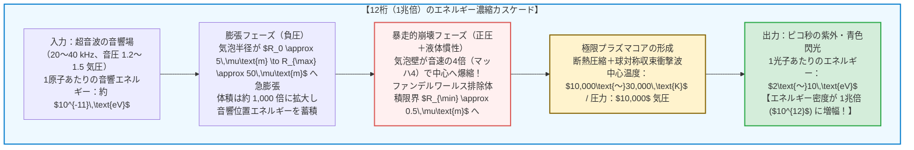
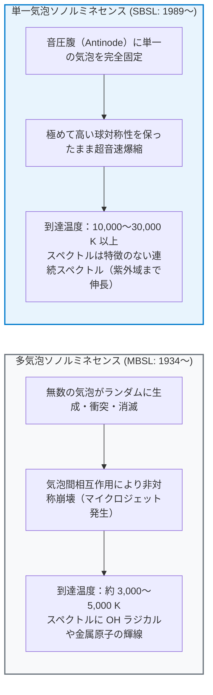
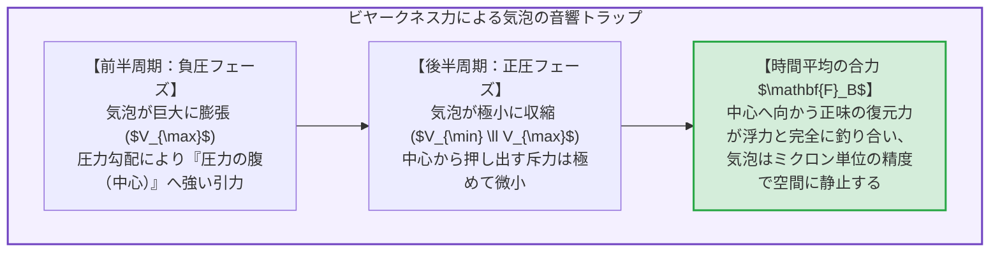
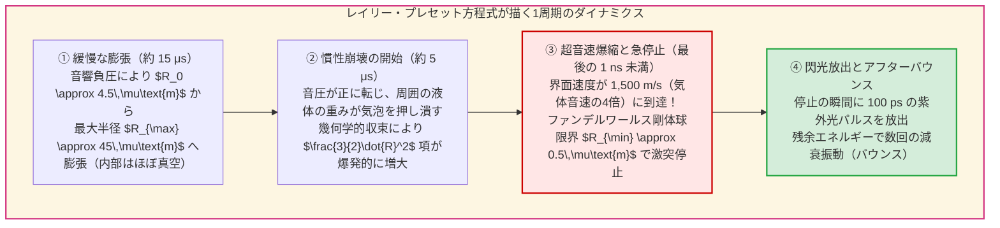
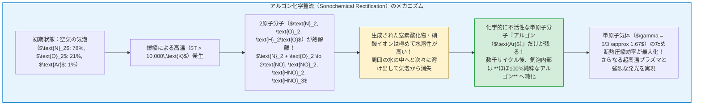
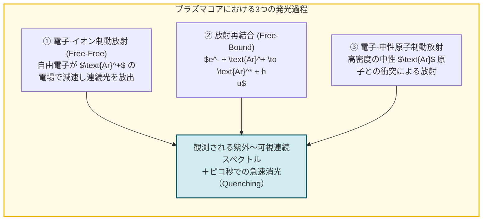

## 序論：フラスコの中に浮かぶ「極小の恒星」

暗室の中に置かれた、水で満たされた丸底フラスコを想像してみてください。
フラスコの外壁に取り付けられた圧電トランスデューサ（超音波振動子）にスイッチを入れ、人間の可聴域をわずかに超える $20\text{〜}40\,\text{kHz}$ の音波を水中に共鳴させます。そして、注射針で水中に直径わずか数マイクロメートルの微小な空気の泡を1個だけ注入します。

次の瞬間、驚くべき現象が起きます。
泡はフラスコの中心で目に見えない音の力に捕らえられて宙に浮き、まるで夜空に輝く青白い星のように、肉眼でもはっきりと見える<strong>神秘的な光</strong>を放ち始めるのです。

これが、現代物理学において最も劇的で美しい非線形現象のひとつ、<strong>ソノルミネセンス（Sonoluminescence：音響発光）</strong>――とりわけ単一の気泡が時計のように正確な周期で閃光を放ち続ける<strong>単一気泡ソノルミネセンス（Single-Bubble Sonoluminescence, SBSL）</strong>です。

なぜ「音」という極めて緩やかな圧力の波が、「光」という高エネルギーの電磁波へと変換されるのでしょうか？

物理学者の視点から見ると、この現象は驚異的な<strong>エネルギー濃縮装置</strong>です。
水中に伝わる超音波が水分子1個に与える運動エネルギーは、わずか $10^{-11}\,\text{eV}$（エレクトロンボルト）程度に過ぎません。一方、泡の中心から飛び出してくる青色や紫外線の光子1個が持つエネルギーは、数 $\text{eV}$ から $10\,\text{eV}$ 以上に達します。
つまり、泡という微小な流体力学系が、空間と時間の1点へとエネルギーを集束させ、<strong>エネルギー密度を実に12桁（1兆倍：$\times 10^{12}$）も引き上げている</strong>のです。

本稿では、1934年の偶然の発見から1989年の単一気泡捕捉のブレイクスルー、気泡崩壊を記述する<strong>レイリー・プレセット方程式（Rayleigh-Plesset Equation）</strong>の厳密な導出、<strong>ビヤークネス力</strong>による音響トラップ、気泡内部が純粋なアルゴンへと変貌する<strong>化学整流メカニズム</strong>、そして熱制動放射プラズマモデルから未解決の極限物理に至るまで、ソノルミネセンスの全貌を数理と物理の両面から徹底的に解き明かします。

---

## 1. 発見の歴史：ソナーのノイズから単一気泡の時計仕掛けへ

### 1.1 1934年：写真乾板を感光させた「キャビテーションの霧」
ソノルミネセンスの歴史は、第二次世界大戦前のソナー（水中音波探知機）研究に遡ります。
1934年、ドイツ・ケルン大学のH. フレンツェル（H. Frenzel）とH. シュルテス（H. Schultes）は、強力な超音波トランスデューサを現像液のタンクに浸し、銀塩写真の現像プロセスを加速できるかという実験を行っていました。

ところが、暗室で現像した写真乾板には、光を一切当てていないにもかかわらず、謎の黒ずんだカブリ（感光跡）が現れました。
彼らが暗闇の中で超音波タンクを凝視すると、液体中に発生した無数の微小気泡の雲（キャビテーション・クラウド）が、かすかな光を放っていたのです。これが<strong>多気泡ソノルミネセンス（Multi-Bubble Sonoluminescence, MBSL）</strong>の最初の発見でした。

しかし、MBSLでは数百万個の気泡が不規則に生成・合体・崩壊を繰り返すため、個々の気泡の物理状態を精密に測定することは半世紀以上にわたって不可能でした。

### 1.2 1989年：フェリペ・ガイタンとローレンス・クラムの革命
この状況を根底から覆したのが、1989年、ミシシッピ大学の大学院生だった<strong>フェリペ・ガイタン（D. Felipe Gaitan）</strong>と指導教授の<strong>ローレンス・クラム（Lawrence A. Crum）</strong>による歴史的ブレイクスルーでした。

彼らは、適切に脱気した水を入れた共鳴容器内に定在波を形成し、音圧振幅を絶妙な領域（約 $1.2\text{〜}1.4$ 気圧）に調整することで、<strong>たった1個の気泡を音響的に浮揚・固定し、何時間も破壊することなく毎周期安定して発光させ続けること</strong>に成功したのです。

この<strong>単一気泡ソノルミネセンス（SBSL）</strong>の確立により、物理学者たちは初めて「1個の気泡という極限の実験室」をレーザー干渉計や高速ストリークカメラで精密測定できるようになりました。そして測定されたデータは、理論物理学者たちの予想を遥かに超える衝撃的なものでした。

1. <strong>驚異的な短パルス：</strong>
   1回の発光の継続時間（パルス幅）は、わずか <strong>$35\text{〜}300\,\text{ピコ秒}$（$10^{-12}$ 秒）</strong>しかありませんでした。
2. <strong>原子時計並みの周期安定性（ジッター）：</strong>
   駆動する超音波の周期（約 $30\text{〜}50\,\text{マイクロ秒}$）に対して、閃光が放たれるタイミングの揺らぎ（ジッター）は <strong>$50\,\text{ピコ秒}$ 以下</strong>でした。駆動周期の100万分の1という、水晶発振器にも匹敵する驚異的な規則正しさで気泡が崩壊していたのです。
3. <strong>謎の連続スペクトル：</strong>
   MBSLで見られた分子の輝線スペクトルが消え、SBSLの光は可視光から水の透過限界である紫外線（波長 $200\,\text{nm}$、約 $6\,\text{eV}$）に向かって単調に強度が増大する滑らかな連続スペクトルを示しました。これを黒体放射でフィッティングすると、温度は優に <strong>$10,000\,\text{K}$ から数万ケルビン</strong>――太陽の表面温度（$5,778\,\text{K}$）の数倍に達していたのです。

---

## 2. 気泡を捕らえる音の罠：ビヤークネス力と定在波

そもそも、重力下で浮力によって水面に浮かび上がってしまうはずの気泡が、なぜフラスコの中心に静止し続けるのでしょうか？
その鍵は、音響流体力学における<strong>一次ビヤークネス力（Primary Bjerknes Force）</strong>にあります。

### 2.1 一次ビヤークネス力の数理導出
液体中の位置 $\mathbf{x}$、時刻 $t$ における圧力場を $P(\mathbf{x}, t)$ とし、体積 $V(t)$ の微小な気泡が存在するとします。気泡の表面に働く圧力勾配を面積分し、ガウスの発散定理を適用すると、気泡が流体から受ける瞬間的な力 $\mathbf{F}(t)$ は体積と圧力勾配の積で表されます。
これを超音波の1周期 $T_{ac} = 2\pi/\omega$ にわたって時間平均したものが、<strong>一次ビヤークネス力 $\mathbf{F}_B$</strong> です：

$$\mathbf{F}_B = -\langle V(t) \nabla P(\mathbf{x}, t) \rangle = -\frac{1}{T_{ac}} \int_0^{T_{ac}} V(t) \nabla P(\mathbf{x}, t) \, dt$$

球形フラスコの中心付近に形成された音響定在波の音圧場を、次のように表します：

$$P(\mathbf{x}, t) = P_0 - P_a(\mathbf{x}) \sin(\omega t)$$

ここで $P_0 \approx 1\,\text{atm}$ は静水圧、$P_a(\mathbf{x})$ は位置に依存する音圧振幅であり、フラスコの中心（圧力の腹：Pressure Antinode）で極大値をとります（すなわち中心に向かって $\nabla P_a(\mathbf{x})$ が向いています）。

- <strong>前半周期（$\sin(\omega t) > 0$：減圧・負圧フェーズ）：</strong>
  周囲の圧力が下がるため、気泡は大きく膨張し、体積 $V(t)$ は非常に大きくなります。このとき $\nabla P = -\nabla P_a \sin(\omega t)$ であるから、力 $-V(t)\nabla P$ は <strong>$+\nabla P_a$ の方向（音圧が最も高い中心部）</strong>を向きます。
- <strong>後半周期（$\sin(\omega t) < 0$：加圧・正圧フェーズ）：</strong>
  周囲の圧力が上がるため、気泡は収縮し、体積 $V(t)$ は極めて小さくなります。このとき力は中心から遠ざかる方向（$-\nabla P_a$）に働きますが、体積 $V(t)$ が極小であるため、力の大きさは無視できるほど小さくなります。

結果として、1周期の時間平均をとると、膨張時に受けた中心向きの巨大な引力が支配的となり、気泡は浮力 $\mathbf{F}_{\text{buoyancy}} = \rho_L g \langle V(t) \rangle \hat{\mathbf{z}}$ に逆らって、<strong>圧力の腹（中心の少し上）に強力にトラップされる</strong>のです。

---

## 3. 暴走的爆縮の流体力学：レイリー・プレセット方程式

音響トラップに捕らえられた気泡が、1周期（約 $35\,\mu\text{s}$）の間にどのような半径変化 $R(t)$ を辿るのか。これを記述する流体力学の基礎方程式が<strong>レイリー・プレセット方程式（Rayleigh-Plesset Equation）</strong>です。

### 3.1 レイリー・プレセット方程式の厳密な導出
1917年、ロード・レイリー（Lord Rayleigh）は船のスクリュープロペラを浸食するキャビテーション気泡の崩壊を解析するため、非圧縮性流体中の球対称気泡の運動方程式を導きました。その後、ミルトン・プレセット（Milton Plesset）らが表面張力と粘性を組み込みました。

気泡の中心から距離 $r$（$r \ge R(t)$）における液体の半径方向速度を $u(r, t)$ とします。液体を非圧縮性と仮定すると、連続の式（質量保存則）$\nabla \cdot \mathbf{u} = 0$ より：

$$\frac{1}{r^2} \frac{\partial}{\partial r} \left( r^2 u(r, t) \right) = 0 \implies u(r, t) = \frac{F(t)}{r^2}$$

気泡壁 $r = R(t)$ における境界条件 $u(R, t) = \dot{R}(t)$ を代入すると、液体中の至る所での速度場が気泡半径 $R(t)$ とその時間微分 $\dot{R}(t)$ だけで一意に決まります：

$$u(r, t) = \frac{R^2(t) \dot{R}(t)}{r^2}$$

これを非圧縮性ナビエ・ストークス方程式の半径方向成分に代入し、$r = R(t)$ から無限遠 $r \to \infty$ まで空間積分を行い、気泡界面での応力バランス（表面張力 $\sigma$、液体粘性率 $\mu$）および液体中の音波放射減衰（ケラー・ミクシス補正項）を考慮すると、以下の<strong>拡張レイリー・プレセット方程式</strong>が得られます：

$$R \ddot{R} + \frac{3}{2} \dot{R}^2 = \frac{1}{\rho_L} \left[ P_g(R, t) - P_0 - P_a(t) - \frac{2\sigma}{R} - \frac{4\mu \dot{R}}{R} + \frac{R}{c_L} \frac{d}{dt} P_g(R, t) \right]$$

ここで：
- $R(t), \dot{R}(t), \ddot{R}(t)$：気泡の半径、界面速度、界面加速度
- $\rho_L, c_L, \sigma, \mu$：液体の密度、音速、表面張力、粘性係数
- $P_g(R, t)$：気泡内部の気体圧力

この微分方程式の左辺にある非線形慣性項 <strong>$\frac{3}{2} \dot{R}^2$</strong> こそが、ソノルミネセンスの暴走的エネルギー集中を生む数学的心臓部です。

### 3.2 ファンデルワールス硬球コアと「ピコ秒の急ブレーキ」
気泡が $R_{\max} \approx 45\,\mu\text{m}$ から収縮するとき、内部の気体圧力がまだ低いうちは、周囲の液体が中心に向かって球対称に殺到します。球の表面積 $4\pi R^2$ が縮小するため、非圧縮性流体の運動エネルギーは中心に向かって極度に集中し、気泡壁の収縮速度 $|\dot{R}|$ は秒速 $1,500\,\text{m/s}$ 以上にまで加速します。

しかし、気泡は半径ゼロまで潰れることはできません。
気体分子そのものが持つ固有の体積――すなわち<strong>ファンデルワールス状態方程式の排除体積（Hard-core radius $a$）</strong>が存在するからです。
断熱過程におけるファンデルワールス気体の圧力 $P_g(R)$ と温度 $T(R)$ は次式で与えられます：

$$P_g(R) = P_0 \left( \frac{R_0^3 - a^3}{R^3 - a^3} \right)^\gamma, \qquad T(R) = T_0 \left( \frac{R_0^3 - a^3}{R^3 - a^3} \right)^{\gamma - 1}$$

ここで $\gamma = C_p / C_v$ は比熱比、$a \approx R_0 / 8.8$（空気・希ガスの標準密度における最密充填半径）です。
気泡半径 $R(t)$ が排除体積半径 $a \approx 0.5\,\mu\text{m}$ に肉薄した瞬間、分母の $(R^3 - a^3)$ がゼロに近づくため、気泡内部の圧力 $P_g(R)$ は瞬時に<strong>数万気圧</strong>へと跳ね上がります。
秒速 $1.5\,\text{km}$ で突進してきた水の壁が、分子の最密充填という「硬い壁」に激突し、<strong>わずか数ピコ秒の間に約 $10^{11}\,G$（地球重力の1000億倍）という凄まじい逆向き加速度</strong>で急停止させられるのです。

---

## 4. アルゴン整流仮説：なぜ「空気の泡」は純粋な希ガスへと変わるのか

初期のSBSL実験において、研究者たちを最も悩ませた謎のひとつが<strong>「希ガス（Noble Gas）の役割」</strong>でした。
窒素（$\text{N}_2$）79%と酸素（$\text{O}_2$）21%だけの純粋な合成空気を水に溶かして実験を行うと、気泡はほとんど光りません。ところが、そこに大気と同じく<strong>わずか1%のアルゴン（$\text{Ar}$）</strong>を混ぜた瞬間、気泡の明るさは数百倍に跳ね上がり、安定したSBSLが現れるのです。

なぜたった1%のアルゴンがこれほど決定的な違いを生むのでしょうか？

1997年、ドイツの物理学者<strong>デトレフ・ローゼ（Detlef Lohse）</strong>とマイケル・ブレナー（Michael Brenner）らは、この謎を完全に解き明かす<strong>「アルゴン整流仮説（Argon Rectification Hypothesis）」</strong>を発表しました。

### 4.1 2原子分子と単原子分子の熱力学的決定差
気体の断熱圧縮において到達温度を決定するのは、比熱比 $\gamma$ です：
- <strong>窒素 $\text{N}_2$・酸素 $\text{O}_2$（2原子分子）：</strong> 分子の回転自由度と振動自由度が熱エネルギーを吸収してしまうため、比熱比は $\gamma = 7/5 = 1.4$（高温では振動励起により $\gamma \approx 1.3$ まで低下）にとどまります。さらに $6,000\,\text{K}$ 以上では共有結合の解離エネルギーとして熱が奪われる（吸熱反応）ため、温度上昇にブレーキがかかります。
- <strong>アルゴン $\text{Ar}$・キセノン $\text{Xe}$（単原子希ガス）：</strong> 回転も振動も分子解離も一切存在せず、投入された機械的圧縮仕事の100%が並進運動エネルギー（すなわち温度）へと直結します。比熱比は理論最大値の <strong>$\gamma = 5/3 \approx 1.67$</strong> を保ちます。

ローゼらが示した通り、空気の泡が最初の数千回の崩壊を繰り返すうちに、高温で解離した窒素と酸素はラジカル反応によって $\text{NO}_x$ や硝酸（$\text{HNO}_3$）へと変わり、周囲の水へと溶け去っていきます（化学的整流）。
その結果、私たちが観察している光る気泡の中身は、もはや空気ではなく、<strong>自己精製された高純度のアルゴン・マイクロリアクター</strong>になっていたのです！

---

## 5. 発光の物理機構：球対称衝撃波と熱制動放射プラズマ

では、高温高圧に達したアルゴン気泡の中心から、具体的にどのような電磁気学的プロセスによって光子が放出されるのでしょうか？

### 5.1 収束球面衝撃波（Imploding Shockwaves）とグデルリーの解
1990年代初頭、C. C. ウー（C. C. Wu）とポール・ロバーツ（Paul H. Roberts）は、超音速で収縮する気泡壁が内部の気体中に<strong>球対称の収束衝撃波（Imploding Spherical Shockwave）</strong>を発生させることを数値流体力学（CFD）によって示しました。

自己相似解として知られる<strong>グデルリー（Guderley）の収束衝撃波解</strong>によれば、半径 $r_s(t)$ の球面衝撃波が中心 $r \to 0$ へと収束するとき、衝撃波背後の圧力と温度は中心からの距離のべき乗に従って発散的に増大します。
最新の分子動力学（MD）およびナビエ・ストークス計算によれば、気泡内部では均一な断熱圧縮（Adiabatic Compression）によって全体が約 $10,000\,\text{K}$ に加熱された上、強い駆動音圧下ではさらに中心部へ圧縮波・衝撃波が収束し、中心の直径数百ナノメートルの領域に <strong>$20,000\text{〜}30,000\,\text{K}$ の弱電離高密度プラズマコア</strong>が形成されます。

### 5.2 熱制動放射（Thermal Bremsstrahlung）と再結合放射
温度が $15,000\,\text{K}$ を超えると、アルゴンやキセノン原子の一部が熱電離（Thermal Ionization）を起こし、自由電子 $e^-$ と陽イオン $\text{Ar}^+$ のプラズマ状態が誕生します。
この高密度プラズマ中で自由電子がイオンのクーロン場によって急激に減速・偏向される際、電磁波が放射されます。これが<strong>熱制動放射（Thermal Bremsstrahlung：Free-Free Transition）</strong>および<strong>放射再結合（Free-Bound Transition）</strong>です。

温度 $T$、電子密度 $n_e$、イオン密度 $n_i$ のプラズマからの単位体積・単位波長あたりの制動放射スペクトル強度 $P_{\text{brem}}(\lambda, T)$ は、次式で与えられます：

$$P_{\text{brem}}(\lambda, T) \propto \frac{n_e n_i Z^2}{\lambda^2 \sqrt{T}} \exp\left( -\frac{h c}{\lambda k_B T} \right) g_{ff}(\lambda, T)$$

ここで $g_{ff}$ はガウント因子（Gaunt factor）、$h$ はプランク定数、$c$ は光速です。
サハの電離方程式（Saha Ionization Equation）より、電離度 $n_e / n_0$ はイオン化ポテンシャル $E_{\text{ion}}$ に対して指数関数的に変化します：

$$\frac{n_e^2}{n_0} = \frac{2}{\Lambda_{\text{th}}^3} \frac{g_1}{g_0} \exp\left( -\frac{E_{\text{ion}}}{k_B T} \right), \qquad \Lambda_{\text{th}} = \sqrt{\frac{h^2}{2\pi m_e k_B T}}$$

このモデルは見事にすべての観測事実を説明します：
1. <strong>なぜキセノン（$\text{Xe}$）が最も明るく光るのか？</strong>
   ヘリウム（$E_{\text{ion}} = 24.6\,\text{eV}$）やアルゴン（$15.8\,\text{eV}$）に比べ、キセノンはイオン化エネルギーが <strong>$12.1\,\text{eV}$ と最も低い</strong>ため、同じ温度でもサハの式に従って自由電子密度 $n_e$ が桁違いに高くなり、制動放射強度が劇的に増大するのです。
2. <strong>なぜパルス幅が数十ピコ秒なのか？</strong>
   気泡が最小半径 $R_{\min}$ で跳ね返り、わずか数ナノメートル膨張しただけで、断熱膨張によって温度が数千ケルビン低下します。サハの式の指数関数項により、温度がわずかに下がった瞬間に電子とイオンが一斉に再結合してプラズマが消滅（クエンチ）するため、光は爆縮の頂点のわずか数十ピコ秒の間だけ切り出されるのです。

### 5.3 棄却された異端理論：シュウィンガーの「量子真空カシミール放射」
なお、1992年にはノーベル物理学賞受賞者ジュリアン・シュウィンガー（Julian Schwinger）が、ソノルミネセンスを「急激に動く誘電体界面（気泡壁）が量子電磁力学（QED）の真空零点場を変調し、仮想光子を実光子へと変換する<strong>動的カシミール効果（Dynamical Casimir Effect）</strong>である」とする大胆な仮説を提唱しました。
しかし、動的カシミール効果でこれほどの光子数を生むには気泡壁が光速 $c$ に近い速度で動く必要があり、実際の気泡壁速度（$\sim 10^{-5} c$）ではエネルギーが10桁以上足りないことが判明し、現在ではプラズマ熱放射モデルが確立しています。

---

## 6. 決定的証拠と未解決のフロンティア

### 6.1 硫酸中でのSBSL：プラズマ輝線の直接観測（2005年）
水中でのSBSLでは、スペクトルが滑らかな連続光であるため、「本当に内部がプラズマ化しているのか？」という直接的な分光学的証明が困難でした。さらに水蒸気（$\text{H}_2\text{O}$）の蒸気圧が高いため、水分子が気泡内に侵入して吸熱解離を起こし、到達温度に上限（クエンチング）を作っていました。

2005年、イリノイ大学の<strong>ケネス・サスリック（Kenneth S. Suslick）</strong>とデイヴィッド・フラニガン（David J. Flannigan）は、水の代わりに蒸気圧が極めて低い<strong>濃硫酸（$\text{H}_2\text{SO}_4$）</strong>の中でアルゴン気泡のSBSLを実現しました。
すると、発光強度は水中の数千倍に激増し、スペクトルの中に<strong>電離したアルゴンイオン（$\text{Ar}^+$）の励起輝線スペクトル</strong>がくっきりと観測されたのです！
励起準位のエネルギー（$> 19\,\text{eV}$）は、熱力学的な分子衝突だけでは決して到達できない領域であり、気泡の中心に高エネルギー電子が飛び交う<strong>真の高温高密度プラズマコア（実効温度 $15,000\text{〜}20,000\,\text{K}$ 以上）が存在することの決定的な証拠</strong>となりました。

### 6.2 自然界のソノルミネセンス：テッポウエビの衝撃波砲
この極限物理を利用しているのは人間だけではありません。
サンゴ礁に生息する体長数センチの<strong>テッポウエビ（Pistol Shrimp: *Alpheus heterochaelis*）</strong>は、巨大なハサミを超高速で閉じることで秒速 $30\,\text{m}$ の水流ジェットを噴射します。ベルヌーイの定理により水流の圧力が飽和蒸気圧を下回ると、キャビテーション気泡が発生して爆縮し、$210\,\text{デシベル}$ の衝撃波とともに <strong>$5,000\,\text{K}$ の熱と光（シュリンプルミネセンス）</strong>を放って獲物を気絶させることが2001年に実証されました。

### 6.3 残された謎と「バブル核融合」の教訓
ソノルミネセンスの研究は、2002年に「重水アセトン中の中性子照射キャビテーションでD-D核融合（バブル核融合）が起きた」とする論文が『Science』誌に掲載され、後に再現性の欠如とデータ不正によって撤回されるという科学史上の大論争も経験しました。
通常のSBSLでは、気泡中心のプラズマ温度は数万ケルビン（数 $\text{eV}$）であり、熱核融合に必要な数千万〜1億ケルビン（$10\,\text{keV}$）には3桁〜4桁届かないことが流体力学シミュレーションからも厳密に示されています。

それでもなお、極限の最小半径 $R_{\min}$ における<strong>「弱電離・強結合プラズマ（Strongly Coupled Plasma）」</strong>の状態方程式や、フェムト秒レーザーを用いた気泡中心コアの直接時間分解分光、そして医療分野における高密度焦点式超音波（HIFU）やソノケミストリー（音響化学による難分解性物質の分解・ナノ材料合成）への応用など、ソノルミネセンスは今なお物理学・化学・工学の最前線を走り続けています。

---

## 7. 結論：ミクロの気泡が映し出す宇宙の縮図

水の中に浮かぶ、目に見えないほど小さな1個の気泡。
そこに穏やかな音の波を当てるだけで、ニュートン力学の流体慣性が空間を1000分の1に押し潰し、化学反応が不純物を洗い流し、熱力学が気体をプラズマへと変貌させ、量子統計力学がピコ秒の紫外閃光を放つ――。

ソノルミネセンスとは、流体力学・熱力学・化学反応論・プラズマ物理学・電磁気学のすべてが、直径1マイクロメートルの球体の中で完璧なハーモニーを奏でる<strong>「フラスコの中の宇宙」</strong>そのものなのです。
