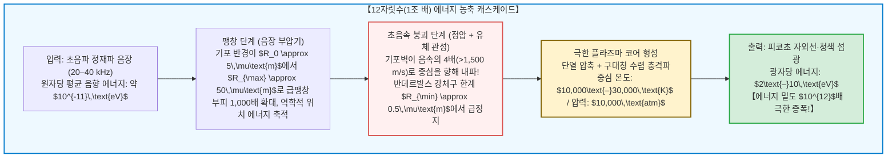

## 서론: 플라스크 중앙에 떠 있는 '미소 항성'

어두운 실험실 안, 탈기된 물로 가득 찬 둥근 유리 플라스크를 상상해 보십시오.
플라스크 외벽에 부착된 압전 초음파 변환기(Transducer)에 전원을 넣고 가청 주파수를 살짝 넘는 $20\text{–}40\,\text{kHz}$의 정재파 음장을 형성합니다. 그리고 물속에 지름 수 마이크로미터에 불과한 작은 공기 방울 하나를 주입합니다.

다음 순간 놀라운 물리적 기적이 일어납니다.
기포는 보이지 않는 소리의 힘에 붙잡혀 플라스크 정중앙에 허공에 뜬 채 고정되고, 마치 밤하늘의 푸른 별처럼 육안으로도 선명히 보이는 <strong>신비로운 빛</strong>을 뿜어내기 시작합니다.

이 현상이 바로 현대 비선형 물리학에서 가장 경이로운 현상 중 하나인 <strong>소노루미네선스(Sonoluminescence, 음향발광)</strong>, 특히 단일 기포가 시계처럼 정확한 주기로 섬광을 방출하는 <strong>단일 기포 소노루미네선스(Single-Bubble Sonoluminescence, SBSL)</strong>입니다.

물리학적 관점에서 소노루미네선스는 경이로운 <strong>비선형 에너지 농축기</strong>입니다. 물속을 전파하는 초음파가 물 분자 하나에 전달하는 운동 에너지는 약 $10^{-11}\,\text{eV}$에 불과하지만, 붕괴하는 기포 중심에서 방출되는 자외선 광자의 에너지는 $6\text{–}10\,\text{eV}$에 달합니다. 유체역학적 수렴을 통해 에너지 밀도가 무려 <strong>12자릿수(1조 배, $\times 10^{12}$)</strong>나 증폭되는 것입니다.

본 글에서는 1934년의 우연한 발견부터 1989년 단일 기포 포획의 혁명, 기포 역학을 지배하는 <strong>레일리-플레셋 방정식(Rayleigh-Plesset Equation)</strong>의 유도, 기포를 허공에 붙잡는 <strong>비에르크네스 힘</strong>, 공기 기포가 순수한 아르곤으로 변모하는 <strong>아르곤 정류 가설</strong>, 그리고 <strong>열 제동복사 플라즈마 모델</strong>까지 소노루미네선스의 전모를 완벽히 해부합니다.

---

## 1. 발견의 역사: 소나 탱크의 안개에서 단일 기포의 정밀 시계로

### 1.1 1934년: 사진 현상액에서 발견된 다중 기포 발광 (MBSL)
1934년 독일 쾰른 대학의 H. Frenzel과 H. Schultes는 강력한 초음파 변환기를 사진 현상액 수조에 넣고 실험하던 중, 암실 속에서도 사진 건판이 감광되는 현상을 발견했습니다. 초음파로 생성된 수많은 캐비테이션 기포 구름이 희미한 빛을 내고 있었던 것입니다(<strong>다중 기포 소노루미네선스, MBSL</strong>). 그러나 수백만 개의 기포가 불규칙하게 생성·충돌·소멸하기 때문에 개별 기포의 물리량을 정밀 측정하는 것은 불가능했습니다.

### 1.2 1989년: 가이탄과 크럼의 단일 기포 혁명 (SBSL)
1989년 미시시피 대학의 <strong>펠리페 가이탄(Felipe Gaitan)</strong>과 <strong>로렌스 크럼(Lawrence Crum)</strong>은 탈기된 물속의 정재파 음압을 정밀 제어하여 <strong>단 하나의 기포를 음압 배(Antinode)에 포획</strong>하는 데 성공했습니다.

단일 기포 소노루미네선스(SBSL)의 측정 결과는 물리학계를 충격에 빠뜨렸습니다:
1. <strong>초단 피코초 펄스:</strong> 한 번의 발광 지속 시간은 불과 <strong>$35\text{–}300\,\text{피코초}$($10^{-12}\,\text{s}$)</strong>였습니다.
2. <strong>원자시계급 주기 안정성:</strong> 약 $35\,\mu\text{s}$의 초음파 주기마다 방출되는 섬광의 시간 오차(Jitter)는 <strong>$50\,\text{ps}$ 미만</strong>으로, 백만분의 일이라는 경이로운 규칙성을 보였습니다.
3. <strong>연속 자외선 스펙트럼:</strong> 물의 투과 한계인 $200\,\text{nm}$ 자외선 영역까지 단조 증가하는 매끄러운 연속 스펙트럼이 관측되었으며, 등가 온도는 태양 표면 온도의 수 배인 <strong>$10,000\text{–}30,000\,\text{K}$</strong>에 달했습니다.

---

## 2. 음향 포획의 원리: 제1차 비에르크네스 힘 (Primary Bjerknes Force)

부력에 의해 수면으로 떠올라야 할 기포가 왜 플라스크 중앙에 정지해 있을까요? 이는 음장 내의 비선형 방사압인 <strong>제1차 비에르크네스 힘</strong> 때문입니다:

$$\mathbf{F}_B = -\langle V(t) \nabla P(\mathbf{x}, t) \rangle = -\frac{1}{T_{ac}} \int_0^{T_{ac}} V(t) \nabla P(\mathbf{x}, t) \, dt$$

- <strong>감압 반주기 ($\sin\omega t > 0$):</strong> 압력이 낮아져 기포가 거대하게 팽창($V_{\max}$)하며, 이때 압력 구배는 음압이 가장 높은 중심부(배, Antinode)로 기포를 강하게 끌어당깁니다.
- <strong>가압 반주기 ($\sin\omega t < 0$):</strong> 기포가 극소 부피($V_{\min} \ll V_{\max}$)로 수축하므로 중심에서 밀어내는 척력은 무시할 수 있을 만큼 작아집니다.

결과적으로 한 주기 시간 평균을 취하면 중심을 향한 강력한 복원력이 아르키메데스 부력 $\rho_L g \langle V \rangle$과 완벽히 평형을 이루어 기포를 허공에 고정시킵니다.

---

## 3. 폭주 내파의 유체역학: 레일리-플레셋 방정식

비압축성 유체 내에서 구대칭 기포의 반경 $R(t)$ 변화를 기술하기 위해 연속 방정식 $\nabla \cdot \mathbf{u} = 0$으로부터 속도장 $u(r, t) = R^2 \dot{R} / r^2$을 구하고, 이를 나비에-스토크스 방정식에 대입하여 $r=R$부터 $\infty$까지 적분하면 <strong>확장 레일리-플레셋 방정식(Rayleigh-Plesset Equation)</strong>이 도출됩니다:

$$R \ddot{R} + \frac{3}{2} \dot{R}^2 = \frac{1}{\rho_L} \left[ P_g(R, t) - P_0 - P_a(t) - \frac{2\sigma}{R} - \frac{4\mu \dot{R}}{R} + \frac{R}{c_L} \frac{d}{dt} P_g(R, t) \right]$$

좌변의 비선형 관성항 <strong>$\frac{3}{2}\dot{R}^2$</strong>에 의해, 부압기에 $R_0 \approx 4.5\,\mu\text{m}$에서 $R_{\max} \approx 45\,\mu\text{m}$까지 1,000배(부피 기준) 팽창했던 기포는 정압기에 들어서며 주변 물의 관성 질량에 의해 맹렬히 수축합니다. 기포벽의 수축 속도는 <strong>마하 4 ($>1,500\,\text{m/s}$)</strong>를 돌파합니다.

기포 반경이 기체 원자의 고유 부피인 <strong>반데르발스 강체구 한계 반경 $a \approx R_0 / 8.8 \approx 0.5\,\mu\text{m}$</strong>에 도달하는 순간:

$$P_g(R) = P_0 \left( \frac{R_0^3 - a^3}{R^3 - a^3} \right)^\gamma, \qquad T(R) = T_0 \left( \frac{R_0^3 - a^3}{R^3 - a^3} \right)^{\gamma - 1}$$

내부 압력이 순식간에 <strong>10,000 기압</strong> 이상으로 치솟으며, 기포벽은 지구 중력의 1,000억 배(<strong>$10^{11}\,g$</strong>)에 달하는 감속도를 받으며 수 피코초 만에 급정지합니다.

---

## 4. 아르곤 정류 가설: 왜 1%의 불활성 기체가 필수적인가?

순수한 질소와 산소 혼합기체($79\%\,\text{N}_2 + 21\%\,\text{O}_2$)만 녹인 물에서는 소노루미네선스가 거의 일어나지 않지만, 대기 중에 포함된 <strong>1%의 아르곤($\text{Ar}$)</strong>이 들어가면 밝기가 수백 배 증가합니다.

1997년 <strong>데틀레프 로제(Detlef Lohse)</strong>가 규명한 <strong>아르곤 정류 가설(Argon Rectification Hypothesis)</strong>은 그 이유를 명확히 설명합니다:
- 이원자 분자인 $\text{N}_2$와 $\text{O}_2$는 회전·진동 자유도를 가져 비열비가 낮고($\gamma \approx 1.4$), 고온에서 열해리되어 $\text{NO}, \text{NO}_2, \text{HNO}_3$ 등 수용성 라디칼을 형성하여 주변 물속으로 녹아 사라집니다.
- 반면 화학적으로 완전히 불활성인 단원자 기체 <strong>아르곤($\text{Ar}$)</strong>은 반응하지 않고 기포 내부에 남게 되어, 수천 사이클 후 기포 내부는 <strong>거의 100% 순수한 아르곤</strong>으로 정제됩니다! 단원자 기체의 높은 비열비($\gamma = 5/3 \approx 1.67$) 덕분에 압축 에너지가 온전히 병진 운동 에너지(온도)로 전환됩니다.

---

## 5. 발광 메커니즘: 수렴 충격파와 열 제동복사 플라즈마

초음속 내파 과정에서 기포 내부로 발사된 <strong>구대칭 수렴 충격파(Guderley 해)</strong>와 단열 압축은 기포 중심부를 $15,000\text{–}30,000\,\text{K}$로 가열합니다.
<strong>사하 전리 방정식(Saha Ionization Equation)</strong>에 따라 불활성 기체 원자들이 열전리되어 고밀도 약전리 플라즈마 코어가 형성됩니다. 자유 전자가 양이온($\text{Ar}^+, \text{Xe}^+$)의 쿨롱 장에서 가속·감속될 때 <strong>열 제동복사(Thermal Bremsstrahlung)</strong>와 <strong>복사 재결합</strong>을 통해 연속 스펙트럼의 빛이 방출됩니다:

$$P_{\text{brem}}(\lambda, T) \propto \frac{n_e n_i Z^2}{\lambda^2 \sqrt{T}} \exp\left( -\frac{h c}{\lambda k_B T} \right)$$

2005년 일리노이 대학의 <strong>케네스 서슬릭(Kenneth Suslick)</strong> 연구팀은 증기압이 극도로 낮은 진한 황산($\text{H}_2\text{SO}_4$) 속에서 단일 기포 발광 실험을 수행하여, 전리된 아르곤 이온($\text{Ar}^+$, 여기 에너지 $>19\,\text{eV}$)의 원자 방출 스펙트럼 선을 직접 관측함으로써 <strong>고온 플라즈마 코어의 존재를 최종 입증</strong>했습니다.

---

## 6. 결론: 1마이크로미터 공간에 펼쳐지는 우주의 축소판

산호초에서 집게발을 닫아 캐비테이션 충격파와 섬광으로 먹이를 기절시키는 딱총새우(Pistol Shrimp)에서부터 실험실의 초정밀 단일 기포에 이르기까지, 소노루미네선스는 유체역학, 음향화학, 충격파 물리, 양자 플라즈마 역학이 미크론의 공간 안에서 빚어내는 가장 아름다운 물리학의 교향곡입니다.
