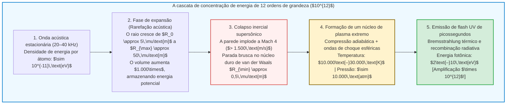

## Introdução: Uma estrela microscópica suspensa em um frasco

Imagine um balão esférico de vidro cheio de água desgaseificada na escuridão total de um laboratório.
Nas paredes externas do frasco, transdutores piezoelétricos geram uma onda estacionária ultrassônica de $20\text{ a }40\,\text{kHz}$. Quando um pesquisador injeta uma única bolha de ar microscópica de apenas alguns micrômetros de diâmetro no centro do recipiente, ocorre um fenômeno físico extraordinário:

Presa pela força invisível da onda acústica, a bolha permanece imóvel no centro geométrico do líquido e brilha continuamente como uma estrela azul-esbranquiçada perfeitamente visível a olho nu.

Esse fenômeno é a <strong>sonoluminescência</strong> — especificamente a <strong>sonoluminescência de bolha única (Single-Bubble Sonoluminescence, SBSL)</strong> —, na qual uma cavidade gasosa solitária colapsa dezenas de milhares de vezes por segundo com a precisão de um relógio atômico, emitindo flashes ultracurtos de luz ultravioleta.

Do ponto de vista da física fundamental, a sonoluminescência é um <strong>concentrador de energia não linear</strong> prodigioso. Uma onda sonora na água transporta apenas cerca de $10^{-11}\,\text{eV}$ por molécula, mas os fótons UV emitidos superam $6\text{ a }10\,\text{eV}$ — uma amplificação de <strong>doze ordens de grandeza ($\times 10^{12}$)</strong> por pura mecânica dos fluidos!

Este artigo explora a história do fenômeno de 1934 a 1989, deduz a <strong>equação de Rayleigh-Plesset</strong>, explica o aprisionamento acústico pela <strong>força de Bjerknes</strong>, a autopurificação química por <strong>retificação do argônio</strong> e o modelo de emissão de <strong>plasma por Bremsstrahlung</strong>.

---

## 1. Evolução histórica: Das nuvens de cavitação à bolha única

### 1.1 1934: A descoberta acidental em banhos fotográficos
Em 1934, na Universidade de Colônia, H. Frenzel e H. Schultes mergulharam um transdutor de sonar de alta potência em um tanque de revelador fotográfico. Notaram que as chapas ficavam veladas mesmo na escuridão total: nuvens de bolhas de cavitação emitiam um brilho tênue (<strong>sonoluminescência multibolha, MBSL</strong>). Contudo, a interação caótica de milhões de bolhas impediu medições individuais precisas durante meio século.

### 1.2 1989: A revolução de Gaitan e Crum
Em 1989, <strong>D. Felipe Gaitan</strong> e <strong>Lawrence A. Crum</strong> conseguiram aprisionar <strong>uma única bolha de cavitação (SBSL)</strong> no antinodo de pressão de uma onda estacionária.
As medições revelaram três propriedades extraordinárias:
1. <strong>Pulsos de picossegundos:</strong> Cada pulso luminoso dura apenas entre <strong>$35\text{ e }300\,\text{picossegundos}$</strong> ($10^{-12}\,\text{s}$).
2. <strong>Flutuação (Jitter) inferior a 50 ps:</strong> Com um período acústico de $\sim 35\,\mu\text{s}$, a estabilidade temporal entre flashes atinge uma parte em um milhão.
3. <strong>Espectro contínuo ultravioleta:</strong> Em água pura, o espectro cresce continuamente em direção ao UV até o corte de absorção da água a $200\,\text{nm}$, correspondendo a temperaturas de <strong>$10.000\text{ a }30.000\,\text{K}$</strong>.

---

## 2. Levitação acústica: A força primária de Bjerknes

Por que o empuxo de Arquimedes não leva a bolha até a superfície? Ela permanece presa graças à <strong>força primária de Bjerknes</strong>:

$$\mathbf{F}_B = -\langle V(t) \nabla P(\mathbf{x}, t) \rangle = -\frac{1}{T_{ac}} \int_0^{T_{ac}} V(t) \nabla P(\mathbf{x}, t) \, dt$$

Durante o semiciclo de rarefação ($\sin\omega t > 0$), a bolha expande-se até um volume enorme $V_{\max}$ e sofre forte atração para o antinodo de pressão (o centro). Durante a compressão ($\sin\omega t < 0$), seu volume reduz-se a $V_{\min} \ll V_{\max}$, tornando a força repulsiva desprezível. Na média temporal, $\mathbf{F}_B$ equilibra exatamente o empuxo $\rho_L g \langle V \rangle$.

---

## 3. Hidrodinâmica da implosão: A equação de Rayleigh-Plesset

A partir da equação da continuidade $\nabla \cdot \mathbf{u} = 0$ de um fluido incompressível, o campo de velocidade radial é $u(r, t) = R^2(t)\dot{R}(t)/r^2$. Substituindo na equação de Navier-Stokes e integrando de $r = R(t)$ até o infinito, obtém-se a <strong>equação de Rayleigh-Plesset generalizada</strong>:

$$R \ddot{R} + \frac{3}{2} \dot{R}^2 = \frac{1}{\rho_L} \left[ P_g(R, t) - P_0 - P_a(t) - \frac{2\sigma}{R} - \frac{4\mu \dot{R}}{R} + \frac{R}{c_L} \frac{d}{dt} P_g(R, t) \right]$$

O termo inercial não linear <strong>$\frac{3}{2}\dot{R}^2$</strong> governa a violência do colapso:
1. Na rarefação, a bolha passa de $R_0 \approx 4,5\,\mu\text{m}$ a $R_{\max} \approx 45\,\mu\text{m}$ (volume $\times 1.000$).
2. Ao colapsar, a parede acelera ultrapassando <strong>$1.500\,\text{m/s}$ (Mach 4)</strong>.
3. A implosão detém-se abruptamente no <strong>raio de volume excluído de van der Waals $a \approx R_0 / 8,8 \approx 0,5\,\mu\text{m}$</strong>:
   $$P_g(R) = P_0 \left( \frac{R_0^3 - a^3}{R^3 - a^3} \right)^\gamma, \qquad T(R) = T_0 \left( \frac{R_0^3 - a^3}{R^3 - a^3} \right)^{\gamma - 1}$$
   A pressão interna supera <strong>10.000 atmosferas</strong> e a parede sofre desaceleração superior a <strong>$10^{11}\,g$</strong> em picossegundos.

---

## 4. A hipótese de retificação do argônio

O ar sintético puro ($79\%\,\text{N}_2 + 21\%\,\text{O}_2$) quase não produz sonoluminescência; é necessário o <strong>1 % de argônio ($\text{Ar}$)</strong> presente na atmosfera para obter brilho intenso.
Em 1997, <strong>Detlef Lohse</strong> demonstrou a <strong>retificação sonoquímica do argônio</strong>:
Acima de $6.000\,\text{K}$, as moléculas diatômicas ($\text{N}_2, \text{O}_2$) dissociam-se em radicais ($\text{NO}, \text{HNO}_3$) altamente solúveis que se dissolvem na água circundante. Apenas o argônio monoatômico, quimicamente inerte, permanece retido. Após milhares de ciclos, a bolha contém <strong>quase 100 % de argônio puro</strong>, cujo elevado expoente adiabático ($\gamma = 5/3 \approx 1,67$) maximiza a temperatura de compressão.

---

## 5. Emissão de luz: Ondas de choque e Bremsstrahlung térmico

A compressão adiabática e as ondas de choque esféricas convergentes (solução de Guderley) aquecem o núcleo a $15.000\text{–}30.000\,\text{K}$, ionizando parcialmente o gás nobre segundo a <strong>equação de Saha</strong>:

$$\frac{n_e^2}{n_0} = \frac{2}{\Lambda_{\text{th}}^3} \frac{g_1}{g_0} \exp\left( -\frac{E_{\text{ion}}}{k_B T} \right)$$

Os elétrons livres freados pelos íons ($\text{Ar}^+, \text{Xe}^+$) emitem <strong>radiação de frenagem térmica (Bremsstrahlung)</strong> e recombinação radiativa:

$$P_{\text{brem}}(\lambda, T) \propto \frac{n_e n_i Z^2}{\lambda^2 \sqrt{T}} \exp\left( -\frac{h c}{\lambda k_B T} \right)$$

Em 2005, <strong>Kenneth Suslick</strong> e <strong>David Flannigan</strong> observaram diretamente linhas de emissão atômica de íons $\text{Ar}^+$ ($> 19\,\text{eV}$) em ácido sulfúrico concentrado, confirmando em definitivo a existência de um núcleo de plasma denso e quente.

---

## 6. Conclusão: Uma sinfonia física em escala micrométrica

Desde o camarão-pistola (*Alpheus heterochaelis*) que atordoa suas presas por cavitação até os reatores sonoquímicos de laboratório, a sonoluminescência demonstra como a hidrodinâmica, a química e a física de plasmas convergem para acender uma estrela no coração de uma gota d'água.
