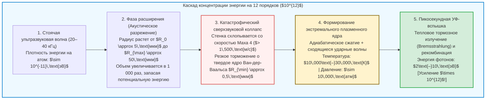

## Введение: Микроскопическая звезда внутри стеклянной колбы

Представьте себе сферическую стеклянную колбу, заполненную дегазированной водой, в абсолютно темной лаборатории.
На внешних стенках колбы закреплены пьезоэлектрические излучатели, создающие стоячую ультразвуковую волну частотой $20\text{–}40\,\text{кГц}$. Когда исследователь вводит в центр колбы одиночный микроскопический пузырек воздуха диаметром всего несколько микрометров, происходит поразительное физическое явление:

Захваченный невидимой силой акустического поля, пузырек неподвижно зависает в геометрическом центре сосуда и начинает непрерывно светиться ярким голубовато-белым светом, отчетливо видимым невооруженным глазом, словно крошечная звезда.

Это явление называется <strong>сонолюминесценцией</strong>, а точнее — <strong>однопузырьковой сонолюминесценцией (Single-Bubble Sonoluminescence, SBSL)</strong>, при которой одиночная газовая полость схлопывается десятки тысяч раз в секунду с точностью атомных часов, испуская при каждом коллапсе ультракороткие вспышки ультрафиолетового света.

С точки зрения фундаментальной физики сонолюминесценция представляет собой уникальный <strong>нелинейный концентратор энергии</strong>. Звуковая волна в воде сообщает одной молекуле в среднем лишь $10^{-11}\,\text{эВ}$, однако вылетающие из центра пузырька УФ-фотоны обладают энергией до $10\,\text{эВ}$ — плотность энергии возрастает на <strong>двенадцать порядков ($\times 10^{12}$)</strong> исключительно за счет гидродинамической фокусировки!

В этой статье мы проследим историю открытия с 1934 по 1989 год, выведем <strong>уравнение Рэлея — Плессета</strong>, объясним акустическую левитацию за счет <strong>силы Бьеркнеса</strong>, химическую самоочистку в рамках <strong>гипотезы аргоновой ректификации</strong> и механизм свечения <strong>плазмы за счет тормозного излучения</strong>.

---

## 1. История открытия: От кавитационного тумана к часовой точности

### 1.1 1934 год: Случайное открытие в фотографических ваннах
В 1934 году Х. Френцель и Х. Шультес из Кёльнского университета погрузили мощный гидролокационный излучатель в бак с фотопроявителем. Они обнаружили, что фотопластинки засвечиваются даже в полной темноте: облака кавитирующих пузырьков испускали слабое свечение (<strong>многопузырьковая сонолюминесценция, MBSL</strong>). Однако из-за хаотического взаимодействия миллионов пузырьков точные измерения отдельного пузырька оставались невозможными более полувека.

### 1.2 1989 год: Прорыв Гайтана и Крама (SBSL)
В 1989 году <strong>Фелипе Гайтан</strong> и <strong>Лоуренс Крам</strong> сумели захватить и удержать <strong>одиночный кавитационный пузырек (SBSL)</strong> в пучности давления стоячей волны.
Измерения выявили три поразительных свойства:
1. <strong>Пикосекундная длительность импульсов:</strong> Каждая вспышка длится всего <strong>$35\text{–}300\,\text{пикосекунд}$</strong> ($10^{-12}\,\text{с}$).
2. <strong>Джиттер менее 50 пикосекунд:</strong> При периоде ультразвука $\sim 35\,\text{мкс}$ разброс времени прихода вспышек составляет менее одной миллионной доли периода.
3. <strong>Гладкий УФ-континуум:</strong> Спектр SBSL в воде не имеет молекулярных линий и монотонно растет вплоть до границы поглощения воды ($200\,\text{нм}$), что соответствует температурам <strong>$10\,000\text{–}30\,000\,\text{К}$</strong>.

---

## 2. Акустическая левитация: Первичная сила Бьеркнеса

Почему сила Архимеда не выталкивает пузырек на поверхность? Его удерживает <strong>первичная сила Бьеркнеса</strong>:

$$\mathbf{F}_B = -\langle V(t) \nabla P(\mathbf{x}, t) \rangle = -\frac{1}{T_{ac}} \int_0^{T_{ac}} V(t) \nabla P(\mathbf{x}, t) \, dt$$

В полупериод разрежения ($\sin\omega t > 0$) пузырек расширяется до огромного объема $V_{\max}$, и градиент давления сильно тянет его к пучности давления (в центр колбы). В фазе сжатия ($\sin\omega t < 0$) объем падает до ничтожной величины $V_{\min} \ll V_{\max}$, поэтому выталкивающая из центра сила пренебрежимо мала. В среднем за период сила $\mathbf{F}_B$ точно уравновешивает плавучесть $\rho_L g \langle V \rangle$.

---

## 3. Гидродинамика схлопывания: Уравнение Рэлея — Плессета

Из уравнения неразрывности $\nabla \cdot \mathbf{u} = 0$ несжимаемой жидкости следует радиальное поле скоростей $u(r, t) = R^2(t)\dot{R}(t)/r^2$. Подстановка в уравнение Навье — Стокса и интегрирование от $r = R(t)$ до $\infty$ дает <strong>обобщенное уравнение Рэлея — Плессета</strong>:

$$R \ddot{R} + \frac{3}{2} \dot{R}^2 = \frac{1}{\rho_L} \left[ P_g(R, t) - P_0 - P_a(t) - \frac{2\sigma}{R} - \frac{4\mu \dot{R}}{R} + \frac{R}{c_L} \frac{d}{dt} P_g(R, t) \right]$$

Нелинейное инерционное слагаемое <strong>$\frac{3}{2}\dot{R}^2$</strong> обуславливает катастрофическое ускорение:
1. В фазе разрежения пузырек растет от $R_0 \approx 4,5\,\text{мкм}$ до $R_{\max} \approx 45\,\text{мкм}$ (объем увеличивается в $1\,000$ раз).
2. При сжатии стенка ускоряется свыше <strong>$1\,500\,\text{м/с}$ (4 Маха)</strong>.
3. Схлопывание резко останавливается на <strong>радиусе собственного объема молекул Ван-дер-Ваальса $a \approx R_0 / 8,8 \approx 0,5\,\text{мкм}$</strong>:
   $$P_g(R) = P_0 \left( \frac{R_0^3 - a^3}{R^3 - a^3} \right)^\gamma, \qquad T(R) = T_0 \left( \frac{R_0^3 - a^3}{R^3 - a^3} \right)^{\gamma - 1}$$
   Давление внутри подскакивает выше <strong>10 000 атмосфер</strong>, а стенка тормозится с ускорением более <strong>$10^{11}\,g$</strong> за считанные пикосекунды!

---

## 4. Гипотеза аргоновой ректификации

Чистый синтетический воздух ($79\%\,\text{N}_2 + 21\%\,\text{O}_2$) почти не дает свечения; необходим <strong>1 % аргона ($\text{Ar}$)</strong>, содержащийся в атмосфере.
В 1997 году <strong>Детлеф Лозе (Detlef Lohse)</strong> объяснил это механизмом <strong>сонохимической ректификации</strong>:
При температурах свыше $6\,000\,\text{К}$ двухатомные молекулы ($\text{N}_2, \text{O}_2$) диссоциируют на радикалы ($\text{NO}, \text{HNO}_3$), которые растворяются в окружающей воде. Химически инертный одноатомный <strong>аргон</strong> остается внутри. Через несколько тысяч циклов пузырек состоит <strong>почти на 100 % из чистого аргона</strong>, чей высокий показатель адиабаты ($\gamma = 5/3 \approx 1,67$) обеспечивает экстремальный нагрев.

---

## 5. Механизм свечения: Ударные волны и тормозное излучение

Адиабатическое сжатие и сходящиеся сферические ударные волны (решение Гудерлея) разогревают центр до $15\,000\text{–}30\,000\,\text{К}$, вызывая частичную термическую ионизацию согласно <strong>уравнению Саха</strong>:

$$\frac{n_e^2}{n_0} = \frac{2}{\Lambda_{\text{th}}^3} \frac{g_1}{g_0} \exp\left( -\frac{E_{\text{ion}}}{k_B T} \right)$$

Свободные электроны, тормозящиеся в кулоновском поле ионов ($\text{Ar}^+, \text{Xe}^+$), генерируют <strong>тепловое тормозное излучение (Bremsstrahlung)</strong> и рекомбинационное свечение:

$$P_{\text{brem}}(\lambda, T) \propto \frac{n_e n_i Z^2}{\lambda^2 \sqrt{T}} \exp\left( -\frac{h c}{\lambda k_B T} \right)$$

В 2005 году <strong>Кеннет Саслик</strong> и <strong>Дэвид Фланниган</strong> напрямую зафиксировали атомные линии ионов $\text{Ar}^+$ ($> 19\,\text{эВ}$) при сонолюминесценции в концентрированной серной кислоте, окончательно доказав существование горячего плазменного ядра.

---

## 6. Заключение: Симфония физики на микронном масштабе

От креветки-щелкуна (*Alpheus heterochaelis*), оглушающей добычу кавитационной вспышкой, до лабораторных резонаторов — сонолюминесценция демонстрирует, как гидродинамика, сонохимия и физика плазмы зажигают миниатюрную звезду внутри капли воды.
