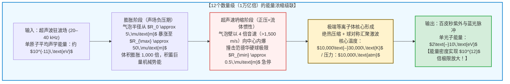

## 引言：悬浮在烧瓶中心的“微型恒星”

想象在一间漆黑的物理实验室里，一只装满脱气水的球形玻璃烧瓶静置在实验台上。
烧瓶外壁贴着压电超声换能器，向水中发射频率为 $20\text{–}40\,\text{kHz}$ 的驻波声场。当实验人员用微量注射器向烧瓶中心注入一颗直径仅数微米的微小气泡时，令人惊叹的物理奇观发生了：

这颗微小的气泡被无形的声波死死锁定在烧瓶正中央，不浮也不沉，并且以肉眼可见的亮度持续发出幽蓝色的星辰般光芒！

这就是现代非线性物理学中最迷人的现象之一——<strong>声致发光（Sonoluminescence）</strong>，更准确地说是<strong>单泡声致发光（Single-Bubble Sonoluminescence, SBSL）</strong>。

从热力学与能量尺度来看，声致发光是一台不可思议的<strong>能量浓缩机</strong>。水中的声波赋予单个水分子的动能仅有 $10^{-11}\,\text{eV}$，然而气泡坍缩瞬间发射出的紫外光子能量却高达 $6\text{–}10\,\text{eV}$。通过纯粹的流体力学汇聚，能量密度在时空奇点上被生生放大了 <strong>12个数量级（一万亿倍，$\times 10^{12}$）</strong>！

本文将从1934年的声呐槽偶然发现讲起，严密推导控制气泡动力学演化的<strong>瑞利-普莱塞特方程（Rayleigh-Plesset Equation）</strong>，揭示捕获气泡的<strong>皮耶克尼斯力（Bjerknes Force）</strong>、使空气泡自发提纯为纯氩气的<strong>化学整流机制</strong>，以及<strong>热轫致辐射（Thermal Bremsstrahlung）</strong>等离子体发光理论。

---

## 1. 历史演进：从多泡云雾到单泡的时钟精度

### 1.1 1934年：声呐显影液中的神秘曝光
1934年，德国科隆大学的 H. Frenzel 和 H. Schultes 在研究船用高频声呐时，将强超声换能器放入相纸显影液槽中。他们震惊地发现，即使在完全黑暗的暗室里，感光底片上也出现了密集的感光黑点。这是人类首次观测到<strong>多泡声致发光（MBSL）</strong>。然而，由于空化云中数以百万计的气泡不断随机生成、碰撞与破裂，物理学家在长达半个世纪里无法对单个气泡进行定量测量。

### 1.2 1989年：Gaitan 与 Crum 的单泡革命
1989年，密西西比大学的 <strong>Felipe Gaitan</strong> 与 <strong>Lawrence Crum</strong> 实现了历史性突破。他们通过精确控制脱气水中的声压幅值（约 $1.2\text{–}1.4\,\text{atm}$），成功在声压波腹处孤立并悬浮了<strong>唯一一颗微米气泡</strong>，使其每秒钟稳定内爆并发光数万次，连续维持数小时之久！

单泡声致发光（SBSL）揭示了三大惊人事实：
1. <strong>百皮秒级超短脉冲：</strong> 每次闪光持续时间仅为 <strong>$35\text{–}300\,\text{皮秒}$（$10^{-12}\,\text{s}$）</strong>。
2. <strong>亚50皮秒的时钟抖动（Jitter）：</strong> 尽管超声周期长达约 $35\,\mu\text{s}$，但相邻两次闪光的时间误差小于 <strong>$50\,\text{ps}$</strong>，稳定度高达百万分之一！
3. <strong>平滑的紫外连续谱：</strong> 不同于MBSL中带有明显的 $\text{OH}^\bullet$ 自由基分子谱线，水中SBSL呈现毫无特征的平滑连续光谱，强度向紫外区单调递增，等效黑体温度超过 <strong>$10,000\text{–}30,000\,\text{K}$</strong>，远超太阳表面温度（$5,778\,\text{K}$）。

---

## 2. 声学悬浮机制：一次皮耶克尼斯力（Primary Bjerknes Force）

为什么浮力没有让气泡浮出水面？这归功于声场中的非线性辐射力——<strong>一次皮耶克尼斯力</strong>。
体积为 $V(t)$ 的气泡在声压场 $P(\mathbf{x}, t) = P_0 - P_a(\mathbf{x})\sin(\omega t)$ 中受到的时均力为：

$$\mathbf{F}_B = -\langle V(t) \nabla P(\mathbf{x}, t) \rangle = -\frac{1}{T_{ac}} \int_0^{T_{ac}} V(t) \nabla P(\mathbf{x}, t) \, dt$$

- <strong>负压半周期（$\sin\omega t > 0$）：</strong> 压力下降，气泡剧烈膨胀至极大体积 $V_{\max}$。此时压力梯度指向声压波腹（烧瓶中心），产生强大的向心拉力。
- <strong>正压半周期（$\sin\omega t < 0$）：</strong> 气泡被压缩至极小体积 $V_{\min} \ll V_{\max}$，向外的推力因体积微乎其微而可以忽略。

在一个周期的平均下，强大的向心恢复力精准抵消了阿基米德浮力 $\rho_L g \langle V \rangle$，将气泡牢牢钉在烧瓶中央。

---

## 3. 暴走内爆的流体力学：瑞利-普莱塞特方程

### 3.1 从纳维-斯托克斯方程到气泡动力学
假设不可压缩液体（密度 $\rho_L$，黏度 $\mu$，表面张力 $\sigma$）中有一半径为 $R(t)$ 的球对称气泡。由质量守恒连续性方程 $\nabla \cdot \mathbf{u} = 0$，液体径向速度场分布为：

$$u(r, t) = \frac{R^2(t)\dot{R}(t)}{r^2}$$

将其代入径向纳维-斯托克斯动量方程，从气泡壁 $r=R(t)$ 积分至无穷远 $r \to \infty$，并计入界面应力平衡与声辐射阻尼（Keller-Miksis 修正），即可得到统治空化物理的<strong>扩展瑞利-普莱塞特方程（Rayleigh-Plesset Equation）</strong>：

$$R \ddot{R} + \frac{3}{2} \dot{R}^2 = \frac{1}{\rho_L} \left[ P_g(R, t) - P_0 - P_a(t) - \frac{2\sigma}{R} - \frac{4\mu \dot{R}}{R} + \frac{R}{c_L} \frac{d}{dt} P_g(R, t) \right]$$

### 3.2 范德华硬核与千亿倍重力加速度急停
方程左侧的非线性惯性项 <strong>$\frac{3}{2}\dot{R}^2$</strong> 决定了坍缩的狂暴性：
1. 在声波负压期，气泡从平衡半径 $R_0 \approx 4.5\,\mu\text{m}$ 膨胀至 $R_{\max} \approx 45\,\mu\text{m}$，内部近似真空。
2. 当声压转为正值，周围液体向中心球对称挤压。由于球面积 $4\pi R^2$ 急剧缩小，流体动能在几何上向中心汇聚，气泡壁向内坍缩的速度突破 <strong>$1,500\,\text{m/s}$（4倍音速）</strong>。
3. 坍缩一直持续到气体原子触及<strong>范德华状态方程的排除体积硬核半径 $a \approx R_0 / 8.8 \approx 0.5\,\mu\text{m}$</strong>：
   $$P_g(R) = P_0 \left( \frac{R_0^3 - a^3}{R^3 - a^3} \right)^\gamma, \qquad T(R) = T_0 \left( \frac{R_0^3 - a^3}{R^3 - a^3} \right)^{\gamma - 1}$$
   当 $R \to a$ 时，内部气压瞬间飙升至 <strong>10,000个大气压</strong> 以上，气泡壁在几皮秒内承受超过 <strong>$10^{11}\,g$（地球重力的1,000亿倍）</strong> 的制动加速度而急停，释放出耀眼的闪光！

---

## 4. 氩气整流假说：1% 的惰性气体如何主宰发光

早期实验发现了一个怪象：如果使用纯粹的氮氧混合气（$79\%\,\text{N}_2 + 21\%\,\text{O}_2$），气泡几乎无法稳定发光；只有加入大气中天然存在的 <strong>1% 氩气（$\text{Ar}$）</strong>，才会出现强烈的声致发光。

1997年，德国物理学家 <strong>Detlef Lohse</strong> 提出了著名的<strong>氩气化学整流假说（Argon Rectification Hypothesis）</strong>解开了谜团：
- 双原子分子（$\text{N}_2, \text{O}_2$）具有旋转和振动自由度，绝热指数较低（$\gamma \approx 1.4$），且在 $6,000\,\text{K}$ 以上会发生吸热解离反应生成 $\text{NO}, \text{NO}_2, \text{HNO}_3$。
- 这些含氮氧化物极易溶于水，在最初的数千次坍缩中被周围的液体彻底吸收并洗脱！
- 唯有化学性质绝对惰性的单原子分子<strong>氩气（$\text{Ar}$）</strong>无法反应，不断在气泡内富集。最终，气泡变成了一个 <strong>100% 纯氩气的微型反应器</strong>。单原子气体高达 $\gamma = 5/3 \approx 1.67$ 的绝热指数使压缩功全部转化为平动动能，造就了数万度的高温！

---

## 5. 发光的物理本质：汇聚激波与热轫致辐射等离子体

在坍缩极点，超声速内爆的气泡壁向内部发射<strong>球对称汇聚激波（Guderley 激波解）</strong>，结合绝热压缩，将气泡核心加热至 $15,000\text{–}30,000\,\text{K}$。
根据<strong>萨哈电离方程（Saha Ionization Equation）</strong>，部分稀有气体原子发生热电离，形成高密度弱电离等离子体核：

$$\frac{n_e^2}{n_0} = \frac{2}{\Lambda_{\text{th}}^3} \frac{g_1}{g_0} \exp\left( -\frac{E_{\text{ion}}}{k_B T} \right)$$

高速自由电子在正离子（$\text{Ar}^+, \text{Xe}^+$）库仑场中受阻减速，产生强烈的<strong>热轫致辐射（Thermal Bremsstrahlung）</strong>与<strong>辐射复合（Radiative Recombination）</strong>：

$$P_{\text{brem}}(\lambda, T) \propto \frac{n_e n_i Z^2}{\lambda^2 \sqrt{T}} \exp\left( -\frac{h c}{\lambda k_B T} \right)$$

由于氙气（$\text{Xe}$）的电离能（$12.1\,\text{eV}$）远低于氦气（$24.6\,\text{eV}$），在相同温度下电子密度 $n_e$ 高出数个量级，完美解释了为何氙气气泡的发光强度最为耀眼。

2005年，伊利诺伊大学的 <strong>Kenneth Suslick</strong> 与 <strong>David Flannigan</strong> 在低蒸气压的浓硫酸中实现了氩气单泡声致发光，首次在光谱中直接观测到了高激发态电离氩离子（$\text{Ar}^+$，激发能 $>19\,\text{eV}$）的原子发射谱线，为<strong>高温等离子体核心模型</strong>提供了无可辩驳的铁证。

---

## 6. 结语：微米尺度上的物理学交响曲

从自然界中利用空化冲击波与闪光击晕猎物的枪虾（Pistol Shrimp），到实验室里精确如原子钟的单泡发光，声致发光向我们展示了连续介质力学、声化学、激波动力学与量子等离子体统计力学如何在1微米的空间里交织出宇宙恒星般的绚丽光辉。
