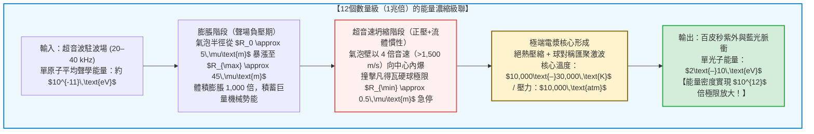

## 引言：懸浮在燒瓶中心的「微型恆星」

想像在一間漆黑的物理實驗室裡，一隻裝滿脫氣水的球形玻璃燒瓶靜置在實驗台上。
燒瓶外壁貼著壓電超音波換能器，向水中發射頻率為 $20\text{–}40\,\text{kHz}$ 的駐波聲場。當實驗人員用微量注射器向燒瓶中心注入一顆直徑僅數微米的微小氣泡時，令人驚嘆的物理奇觀發生了：

這顆微小的氣泡被無形的聲波死死鎖定在燒瓶正中央，不浮也不沉，並且以肉眼可見的亮度持續發出幽藍色的星辰般光芒！

這就是現代非線性物理學中最迷人的現象之一——<strong>聲致發光（Sonoluminescence）</strong>，更準確地說是<strong>單泡聲致發光（Single-Bubble Sonoluminescence, SBSL）</strong>。

從熱力學與能量尺度來看，聲致發光是一台不可思議的<strong>能量濃縮機</strong>。水中的聲波賦予單個水分子的動能僅有 $10^{-11}\,\text{eV}$，然而氣泡坍縮瞬間發射出的紫外光子能量卻高達 $6\text{–}10\,\text{eV}$。透過純粹的流體力學匯聚，能量密度在時空奇點上被生生放大了 <strong>12個數量級（一兆倍，$\times 10^{12}$）</strong>！

本文將從1934年的聲吶槽偶然發現講起，嚴密推導控制氣泡動力學演化的<strong>瑞利-普萊塞特方程式（Rayleigh-Plesset Equation）</strong>，揭示捕獲氣泡的<strong>皮耶克尼斯力（Bjerknes Force）</strong>、使空氣泡自發提純為純氬氣的<strong>化學整流機制</strong>，以及<strong>熱軔致輻射（Thermal Bremsstrahlung）</strong>電漿發光理論。

---

## 1. 歷史演進：從多泡雲霧到單泡的時鐘精度

### 1.1 1934年：聲吶顯影液中的神秘曝光
1934年，德國科隆大學的 H. Frenzel 和 H. Schultes 在研究船用高頻聲吶時，將強超音波換能器放入相紙顯影液槽中。他們震驚地發現，即使在完全黑暗的暗室裡，感光底片上也出現了密集的感光黑點。這是人類首次觀測到<strong>多泡聲致發光（MBSL）</strong>。然而，由於空化雲中數以百萬計的氣泡不斷隨機生成、碰撞與破裂，物理學家在長達半個世紀裡無法對單個氣泡進行定量測量。

### 1.2 1989年：Gaitan 與 Crum 的單泡革命
1989年，密西西比大學的 <strong>Felipe Gaitan</strong> 與 <strong>Lawrence Crum</strong> 實現了歷史性突破。他們透過精確控制脫氣水中的聲壓幅值（約 $1.2\text{–}1.4\,\text{atm}$），成功在聲壓波腹處孤立並懸浮了<strong>唯一一顆微米氣泡</strong>，使其每秒鐘穩定內爆並發光數萬次，連續維持數小時之久！

單泡聲致發光（SBSL）揭示了三大驚人事實：
1. <strong>百皮秒級超短脈衝：</strong> 每次閃光持續時間僅為 <strong>$35\text{–}300\,\text{皮秒}$（$10^{-12}\,\text{s}$）</strong>。
2. <strong>亞50皮秒的時鐘抖動（Jitter）：</strong> 儘管超音波週期長達約 $35\,\mu\text{s}$，但相鄰兩次閃光的時間誤差小於 <strong>$50\,\text{ps}$</strong>，穩定度高達百萬分之一！
3. <strong>平滑的紫外連續譜：</strong> 不同於MBSL中帶有明顯的 $\text{OH}^\bullet$ 自由基分子譜線，水中SBSL呈現毫無特徵的平滑連續光譜，強度向紫外區單調遞增，等效黑體溫度超過 <strong>$10,000\text{–}30,000\,\text{K}$</strong>，遠超太陽表面溫度（$5,778\,\text{K}$）。

---

## 2. 聲學懸浮機制：一次皮耶克尼斯力（Primary Bjerknes Force）

為什麼浮力沒有讓氣泡浮出水面？這歸功於聲場中的非線性輻射力——<strong>一次皮耶克尼斯力</strong>。
體積為 $V(t)$ 的氣泡在聲壓場 $P(\mathbf{x}, t) = P_0 - P_a(\mathbf{x})\sin(\omega t)$ 中受到的時均力為：

$$\mathbf{F}_B = -\langle V(t) \nabla P(\mathbf{x}, t) \rangle = -\frac{1}{T_{ac}} \int_0^{T_{ac}} V(t) \nabla P(\mathbf{x}, t) \, dt$$

- <strong>負壓半週期（$\sin\omega t > 0$）：</strong> 壓力下降，氣泡劇烈膨脹至極大體積 $V_{\max}$。此時壓力梯度指向聲壓波腹（燒瓶中心），產生強大的向心拉力。
- <strong>正壓半週期（$\sin\omega t < 0$）：</strong> 氣泡被壓縮至極小體積 $V_{\min} \ll V_{\max}$，向外的推力因體積微乎其微而可以忽略。

在一個週期的平均下，強大的向心恢復力精準抵消了阿基米德浮力 $\rho_L g \langle V \rangle$，將氣泡牢牢釘在燒瓶中央。

---

## 3. 暴走內爆的流體力學：瑞利-普萊塞特方程式

### 3.1 從納維-斯托克斯方程式到氣泡動力學
假設不可壓縮液體（密度 $\rho_L$，黏度 $\mu$，表面張力 $\sigma$）中有一半徑為 $R(t)$ 的球對稱氣泡。由質量守恆連續性方程式 $\nabla \cdot \mathbf{u} = 0$，液體徑向速度場分佈為：

$$u(r, t) = \frac{R^2(t)\dot{R}(t)}{r^2}$$

將其代入徑向納維-斯托克斯動量方程式，從氣泡壁 $r=R(t)$ 積分至無窮遠 $r \to \infty$，並計入界面應力平衡與聲輻射阻尼（Keller-Miksis 修正），即可得到統治空化物理的<strong>擴展瑞利-普萊塞特方程式（Rayleigh-Plesset Equation）</strong>：

$$R \ddot{R} + \frac{3}{2} \dot{R}^2 = \frac{1}{\rho_L} \left[ P_g(R, t) - P_0 - P_a(t) - \frac{2\sigma}{R} - \frac{4\mu \dot{R}}{R} + \frac{R}{c_L} \frac{d}{dt} P_g(R, t) \right]$$

### 3.2 凡得瓦硬核與千億倍重力加速度急停
方程式左側的非線性慣性項 <strong>$\frac{3}{2}\dot{R}^2$</strong> 決定了坍縮的狂暴性：
1. 在聲波負壓期，氣泡從平衡半徑 $R_0 \approx 4.5\,\mu\text{m}$ 膨脹至 $R_{\max} \approx 45\,\mu\text{m}$，內部近似真空。
2. 當聲壓轉為正值，周圍液體向中心球對稱擠壓。由於球面積 $4\pi R^2$ 急劇縮小，流體動能在幾何上向中心匯聚，氣泡壁向內坍縮的速度突破 <strong>$1,500\,\text{m/s}$（4倍音速）</strong>。
3. 坍縮一直持續到氣體原子觸及<strong>凡得瓦狀態方程式的排除體積硬核半徑 $a \approx R_0 / 8.8 \approx 0.5\,\mu\text{m}$</strong>：
   $$P_g(R) = P_0 \left( \frac{R_0^3 - a^3}{R^3 - a^3} \right)^\gamma, \qquad T(R) = T_0 \left( \frac{R_0^3 - a^3}{R^3 - a^3} \right)^{\gamma - 1}$$
   當 $R \to a$ 時，內部氣壓瞬間飆升至 <strong>10,000個大氣壓</strong> 以上，氣泡壁在幾皮秒內承受超過 <strong>$10^{11}\,g$（地球重力的1,000億倍）</strong> 的制動加速度而急停，釋放出耀眼的閃光！

---

## 4. 氬氣整流假說：1% 的惰性氣體如何主宰發光

早期實驗發現了一個怪象：如果使用純粹的氮氧混合氣（$79\%\,\text{N}_2 + 21\%\,\text{O}_2$），氣泡幾乎無法穩定發光；只有加入大氣中天然存在的 <strong>1% 氬氣（$\text{Ar}$）</strong>，才會出現強烈的聲致發光。

1997年，德國物理學家 <strong>Detlef Lohse</strong> 提出了著名的<strong>氬氣化學整流假說（Argon Rectification Hypothesis）</strong>解開了謎團：
- 雙原子分子（$\text{N}_2, \text{O}_2$）具有旋轉和振動自由度，絕熱指數較低（$\gamma \approx 1.4$），且在 $6,000\,\text{K}$ 以上會發生吸熱解離反應生成 $\text{NO}, \text{NO}_2, \text{HNO}_3$。
- 這些含氮氧化物極易溶於水，在最初的數千次坍縮中被周圍的液體徹底吸收並洗脫！
- 唯有化學性質絕對惰性的單原子分子<strong>氬氣（$\text{Ar}$）</strong>無法反應，不斷在氣泡內富集。最終，氣泡變成了一個 <strong>100% 純氬氣的微型反應器</strong>。單原子氣體高達 $\gamma = 5/3 \approx 1.67$ 的絕熱指數使壓縮功全部轉化為平動動能，造就了數萬度的高溫！

---

## 5. 發光的物理本質：匯聚激波與熱軔致輻射電漿

在坍縮極點，超音速內爆的氣泡壁向內部發射<strong>球對稱匯聚激波（Guderley 激波解）</strong>，結合絕熱壓縮，將氣泡核心加熱至 $15,000\text{–}30,000\,\text{K}$。
根據<strong>薩哈電離方程式（Saha Ionization Equation）</strong>，部分稀有氣體原子發生熱電離，形成高密度弱電離電漿核：

$$\frac{n_e^2}{n_0} = \frac{2}{\Lambda_{\text{th}}^3} \frac{g_1}{g_0} \exp\left( -\frac{E_{\text{ion}}}{k_B T} \right)$$

高速自由電子在正離子（$\text{Ar}^+, \text{Xe}^+$）庫侖場中受阻減速，產生強烈的<strong>熱軔致輻射（Thermal Bremsstrahlung）</strong>與<strong>輻射複合（Radiative Recombination）</strong>：

$$P_{\text{brem}}(\lambda, T) \propto \frac{n_e n_i Z^2}{\lambda^2 \sqrt{T}} \exp\left( -\frac{h c}{\lambda k_B T} \right)$$

由於氙氣（$\text{Xe}$）的電離能（$12.1\,\text{eV}$）遠低於氦氣（$24.6\,\text{eV}$），在相同溫度下電子密度 $n_e$ 高出數個量級，完美解釋了為何氙氣氣泡的發光強度最為耀眼。

2005年，伊利諾大學的 <strong>Kenneth Suslick</strong> 與 <strong>David Flannigan</strong> 在低蒸氣壓的濃硫酸中實現了氬氣單泡聲致發光，首次在光譜中直接觀測到了高激發態電離氬離子（$\text{Ar}^+$，激發能 $>19\,\text{eV}$）的原子發射譜線，為<strong>高溫電漿核心模型</strong>提供了無可辯駁的鐵證。

---

## 6. 結語：微米尺度上的物理學交響曲

從自然界中利用空化衝擊波與閃光擊暈獵物的槍蝦（Pistol Shrimp），到實驗室裡精確如原子鐘的單泡發光，聲致發光向我們展示了連續介質力學、聲化學、激波動力學與量子電漿統計力學如何在1微米的空間裡交織出宇宙恆星般的絢麗光輝。
