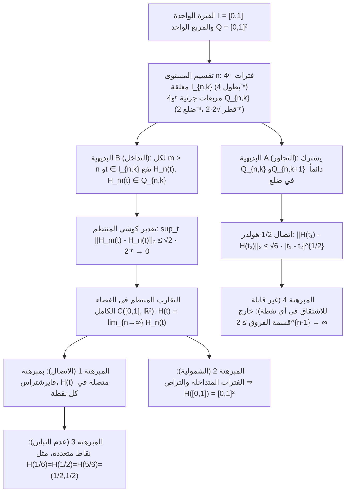

في مستهل الكتاب الأول من «الأصول»، وضع إقليدس الإسكندري تعريفين أساسيين: «النقطة هي ما لا جزء له؛ والخط هو طول بلا عرض ($\mu\tilde{\eta}\kappa\omicron\varsigma\ \dot{\alpha}\pi\lambda\alpha\tau\acute{\varepsilon}\varsigma$).» وفقاً لحدسنا الهندسي اليومي، فإن المنحنى الرياضي المثالي له سماكة تساوي الصفر تماماً ($\delta = 0$). وعلى مدى أكثر من ألفي عام، بدا من البديهي أن خيطاً أحادي البعد عديم العرض لا يمكنه أبداً أن يملأ داخل مربع ثنائي الأبعاد $[0,1]^2$ بالكامل دون ترك فراغات.

غير أنه في عام 1890، حطّم عالم الرياضيات الإيطالي <strong>جوزيبي بيانو (Giuseppe Peano، 1858–1932)</strong> هذا اليقين الذي دام ألفي عام في ورقة بحثية من خمس صفحات فقط في مجلة *Mathematische Annalen*، حيث بنى <strong>تطبيقاً متصلاً وشاملاً (Continuous Surjection)</strong> $f: [0,1] \to [0,1]^2$ من الفترة الواحدة إلى المربع الواحد. وبعد عام واحد (1891)، قدّم <strong>ديفيد هيلبرت (David Hilbert، 1862–1943)</strong> بناءه الهندسي العودي الشهير: <strong>منحنى هيلبرت (Hilbert Curve)</strong>. والأكثر إدهاشاً أن هذا الكائن الذي وصفه محللو أواخر القرن التاسع عشر بأنه «مسخ مرضي» في الرياضيات البحتة، تحوّل بعد قرن من الزمان إلى أحد أهم الخوارزميات في علوم الحاسوب الحديثة، في قلب <strong>خرائط جوجل (مكتبة Google S2)</strong> وقواعد البيانات المكانية (<strong>Hilbert R-Tree</strong>) وموازنة الأحمال في <strong>الحواسيب الفائقة</strong>.

---

## 1. صدمة كانتور (1877) ومبرهنة نيتو (1879)

في عام 1877، اكتشف مؤسس نظرية المجموعات <strong>جورج كانتور (Georg Cantor)</strong> وجود <strong>تقابل (تطبيق متباين وشامل Bijection)</strong> بين نقاط القطعة المستقيمة $[0,1]$ ونقاط المربع $[0,1]^2$. وكتب في رسالته الشهيرة إلى ريتشارد ديديكيند: <strong>«Je le vois, mais je ne le crois pas!» (إنني أراه، لكنني لا أصدقه!)</strong>

كانت فكرة كانتور الأساسية هي <strong>المزاوجة المتناوبة (Interleaving)</strong> للأرقام العشرية (أو لكتل الأرقام المنتهية برقم غير صفري لتفادي مشكلة التمثيل المزدوج للكسور العشرية المنتهية مثل $0.5 = 0.4999\dots$):

$$x = 0.a_1 a_2 a_3 \dots, \quad y = 0.b_1 b_2 b_3 \dots \quad \Longrightarrow \quad t = \phi(x, y) = 0.a_1 b_1 a_2 b_2 a_3 b_3 \dots$$

$$|[0,1]| = |[0,1]^2| = |[0,1]^n| = |\mathbb{R}| = \mathfrak{c} = 2^{\aleph_0}$$

أثبت ذلك أن القطعة $[0,1]$ والمربع $[0,1]^2$ والمكعب الفائق $[0,1]^n$ لها نفس <strong>قدرة المتصل $\mathfrak{c} = 2^{\aleph_0}$</strong>. لكن ديديكيند لاحظ فوراً أن تقابل كانتور <strong>منقطع في كل مكان</strong>. وفي عام 1879، أثبت <strong>أويغن نيتو (Eugen Netto)</strong> أنه <strong>لا يوجد أي تقابل متصل (تشاكل طوبولوجي Homeomorphism) بين $[0,1]$ و$[0,1]^2$</strong>: فبما أن $[0,1]$ متراص و$[0,1]^2$ فضاء هاوسدورف، فإن أي تقابل متصل سيكون تشاكلاً طوبولوجياً؛ لكن حذف النقطة الداخلية $t_0 = 1/2$ يفصل $[0,1]\setminus\{1/2\} = [0,1/2) \cup (1/2,1]$ إلى جزأين غير مترابطين، بينما يبقى المربع المثقوب $[0,1]^2 \setminus \{f(1/2)\}$ مترابطاً مسارياً — وهذا تناقض!

---

## 2. منحنى بيانو (1890): التضحية بالتباين تفتح باب الشمولية المتصلة!

أدرك بيانو الثغرة المنطقية في مبرهنة نيتو: المستحيل هو فقط اجتماع الاتصال والشمولية والتباين معاً. <strong>أما إذا تخلينا عن التباين (وسمحنا للمنحنى بالتقاطع الذاتي أي المرور بنفس النقطة عدة مرات)، فيمكننا بناء تطبيق متصل وشامل $f: [0,1] \to [0,1]^2$!</strong>

استخدم بيانو النشر بالأساس $3$ (الثلاثي) $t = 0.t_1 t_2 t_3 \dots_3$ ($t_m \in \{0,1,2\}$) مع <strong>مؤثر المتمم $k(d) = 2 - d$</strong>:

$$t = \sum_{m=1}^{\infty} \frac{t_m}{3^m} \;\; (t_m \in \{0,1,2\}), \qquad k(d) = 2 - d, \qquad k^n(d) = \begin{cases} d & (n \text{ even}) \\ 2 - d & (n \text{ odd}) \end{cases}$$

$$x_n = k^{t_2 + t_4 + \cdots + t_{2n-2}}(t_{2n-1}), \qquad y_n = k^{t_1 + t_3 + \cdots + t_{2n-1}}(t_{2n})$$

بما أن $k^n(d)$ يعتمد فقط على زوجية أو فردية الأس $n$، فإنه عند نقاط التمثيل المزدوج الثلاثي (مثل $t = 1/3 = 0.0222\dots_3 = 0.1000\dots_3$)، يؤدي تغير $t_1$ من $0$ (زوجي) إلى $1$ (فردي) إلى تفعيل $k^1$ الذي يقلب جميع الأصفار اللاحقة إلى اثنينات ويلحم النهايتين بدقة عند النقطة $(1/3, 1)$!

---

## 3. البناء الهندسي لهيلبرت (1891) والبراهين التحليلية الكاملة

في عام 1891، استبدل ديفيد هيلبرت تقسيم بيانو $3 \times 3$ بتقسيم ثنائي عودي إلى <strong>$2 \times 2 = 4$ أرباع</strong>: في المستوى $n$، تُقسَّم الفترة $[0,1]$ إلى $4^n$ فترات جزئية مغلقة $I_{n,k}$ بطول $4^{-n}$، ويُقسَّم المربع $[0,1]^2$ إلى $4^n$ مربعات صغيرة $Q_{n,k}$ بطول ضلع $2^{-n}$، بحيث تتحقق <strong>البديهية A (التجاور: يشترك $Q_{n,k}$ و$Q_{n,k+1}$ دائماً في ضلع)</strong> و<strong>البديهية B (التداخل: $Q_{n,k} = \bigcup_{j=0}^3 Q_{n+1, 4k-j}$)</strong>.

1. <strong>المبرهنة 1 (التقارب المنتظم والاتصال)</strong>: لكل $m > n \ge 1$ وأي $t \in I_{n,k}$، تضمن البديهية B وقوع $H_n(t)$ و$H_m(t)$ داخل نفس المربع الجزئي $Q_{n,k}$ ذي القطر $\sqrt{2}\cdot 2^{-n}$:

$$I_{n,k} = \left[ \frac{k-1}{4^n}, \, \frac{k}{4^n} \right], \qquad \|H_m - H_n\|_\infty = \sup_{t \in [0,1]} \|H_m(t) - H_n(t)\|_2 \le \operatorname{diam}(Q_{n,k}) = \frac{\sqrt{2}}{2^n} \quad (\forall m > n \ge 1)$$

   وبالتالي فإن $\{H_n\}$ متتالية كوشي منتظمة في فضاء باناخ $\mathcal{C}([0,1], \mathbb{R}^2)$، ونهايتها المنتظمة $H(t)$ متصلة على $[0,1]$.
2. <strong>المبرهنة 2 (الشمولية)</strong>: لكل نقطة $p \in [0,1]^2$، تحدد متتالية المربعات المتداخلة $Q_{n,k_n} \ni p$ فترات مغلقة متداخلة $I_{n,k_n}$ بطول $4^{-n} \to 0$ يتقاطع كلها في نقطة وحيدة $t^* \in [0,1]$ تحقق $H(t^*) = p$:

$$\bigcap_{n=1}^{\infty} I_{n, k_n} = \{t^*\}, \qquad \|H(t^*) - p\|_2 \le \frac{\sqrt{2}}{2^n} \xrightarrow{n \to \infty} 0 \quad \Longrightarrow \quad H([0,1]) = [0,1]^2$$

3. <strong>المبرهنة 3 (النقاط المتعددة)</strong>: يُزار مركز المربع $(1/2, 1/2)$ ثلاث مرات ($H(1/6) = H(1/2) = H(5/6) = (1/2, 1/2)$)، وتظهر نقاط رباعية عند رؤوس الشبكة الثنائية الأعلى.
4. <strong>المبرهنة 4 (طول القوس اللانهائي، اتصال $\frac{1}{2}$-هولدر، وعدم قابلية الاشتقاق في أي نقطة)</strong>: طول المنحنى التقريبي $L(H_n) = 2^n - 2^{-n} \to \infty$ يتباعد. ولكل $t \in I_{n,k}$، يبعد أحد رؤوس $Q_{n,k}$ الأربعة $v_n = H(s_n)$ مسافة $\ge 2^{-(n+1)}$ عن $H(t)$ مع $|s_n - t| \le 4^{-n}$، مما يجعل خارج قسمة الفروق يتباعد بمعدل $2^{n-1} \to \infty$ — <strong>فالدالة $H(t)$ غير قابلة للاشتقاق عند أي نقطة في $[0,1]$</strong>:

$$L(H_n) = (4^n - 1) 2^{-n} = 2^n - 2^{-n} \to +\infty, \qquad \|H(t_1) - H(t_2)\|_2 \le \sqrt{6}\, |t_1 - t_2|^{1/2}$$

$$\frac{\|H(s_n) - H(t)\|_2}{|s_n - t|} \ge \frac{2^{-(n+1)}}{4^{-n}} = 2^{n-1} \xrightarrow{n \to \infty} +\infty$$

---

## 4. حل أزمة الأبعاد: البعد الطوبولوجي $\dim_T$ مقابل بعد هاوسدورف الكسيري $D_H$

في عام 1911، أثبت <strong>براور (Brouwer)</strong> <strong>مبرهنة ثبات البعد</strong> ($\mathbb{R}^n \cong \mathbb{R}^m \iff n = m$) عبر زمر الهومولوجيا المحلية. ويقيس <strong>بعد التغطية للوبيغ $\dim_T$</strong> أصغر رتبة تداخل $d + 1$ للتغطيات المفتوحة ($\dim_T([0,1]) = 1$، بينما $\dim_T([0,1]^2) = 2$ مثل المفاصل الثلاثية لجدار من الطوب، مما يفسر طوبولوجياً حتمية وجود نقاط ثلاثية على الأقل!). أما <strong>بعد هاوسدورف (الكسيري) $D_H$</strong> فيقيس عامل القياس المتشابه ذاتياً:

$$H_k(U, U \setminus \{p\}; \mathbb{Z}) \cong \tilde{H}_{k-1}(S^{n-1}; \mathbb{Z}) \cong \begin{cases} \mathbb{Z} & (k = n) \\ 0 & (k \ne n) \end{cases}, \qquad \dim_T([0,1]) = 1 < \dim_T([0,1]^2) = 2$$

$$D_H = \frac{\log N}{\log(1/r)} \quad \Longrightarrow \quad D_H(\text{Peano}) = \frac{\log 9}{\log 3} = 2, \qquad D_H(\text{Hilbert}) = \frac{\log 4}{\log 2} = 2$$

يرفع منحنى هيلبرت بعده الكسيري إلى $D_H = 2$ عبر الطي اللانهائي، ويرفع البعد الطوبولوجي لصورته إلى $\dim_T = 2$ عبر التقاطع الذاتي.

| نوع المنحنى / التطبيق | متصل | متباين (بدون تقاطع ذاتي) | شامل على $[0,1]^2$ | قابلية الاشتقاق | البعد الطوبولوجي $\dim_T(\text{Image})$ | بعد هاوسدورف $D_H$ | مساحة لوبيغ $\mu_2$ |
| :--- | :---: | :---: | :---: | :---: | :---: | :---: | :---: |
| <strong>منحنى أملس بسيط (قطعة/قوس)</strong> | نعم ($C^\infty$) | نعم | لا | قابل للاشتقاق في كل مكان | $1$ | $1$ | $0$ |
| <strong>منحنى كوخ (ندفة الثلج)</strong> | نعم | نعم | لا | غير قابل للاشتقاق في أي مكان | $1$ | $\frac{\log 4}{\log 3} \approx 1.262$ | $0$ |
| <strong>منحنى أوسغود (1903)</strong> | نعم | نعم (قوس جوردان) | لا (داخل فارغ) | غير قابل للاشتقاق تقريباً في كل مكان | $1$ | $2$ | $> 0$ (مساحة موجبة!) |
| <strong>مزاوجة أرقام كانتور</strong> | لا (منقطع) | نعم (تقابل) | نعم | غير متصل/غير قابل للاشتقاق | $2$ | $2$ | $1$ |
| <strong>منحنى بيانو (أساس 3، 1890)</strong> | نعم | لا (نقاط متعددة) | نعم (يملأ الفضاء) | غير قابل للاشتقاق في أي مكان | $2$ | $\frac{\log 9}{\log 3} = 2$ | $1$ |
| <strong>منحنى هيلبرت (أساس 2، 1891)</strong> | نعم ($\frac{1}{2}$-هولدر) | لا (حتى نقاط رباعية) | نعم (يملأ الفضاء) | غير قابل للاشتقاق في أي مكان | $2$ | $\frac{\log 4}{\log 2} = 2$ | $1$ |

---

## 5. تطبيقات علوم الحاسوب الحديثة: فهرسة العالم متعدد الأبعاد في ذاكرة أحادية البعد

نظراً لأن ذاكرة الحاسوب (عناوين DRAM، وكتل SSD، وأشجار B+) أحادية البعد بينما البيانات الجغرافية والفيزيائية متعددة الأبعاد، فإن منحنى هيلبرت المتقطع يوفر أفضل <strong>حفاظ على المحلية المكانية (Locality Preservation)</strong> بفضل اتصال $\frac{1}{2}$-هولدر وتداخل أشجار الرباعيات:

$$z = \text{Morton}(x, y) = (y_{n-1} x_{n-1} \dots y_1 x_1 y_0 x_0)_2, \qquad C_{\text{dilation}} = \sup_{t_1 \ne t_2} \frac{\|\gamma(t_1) - \gamma(t_2)\|_2^2}{|t_1 - t_2|} = 6 \;\; (\text{Hilbert})$$

وخلافاً <strong>لمنحنى مورتون (Z-Order Curve)</strong> الذي يزاوج البتات الثنائية دون دوران ويعاني من قفزات قطرية كبيرة ($C_{\text{dilation}} = \infty$)، يتحرك منحنى هيلبرت دائماً بمسافة مانهاتن تساوي $1$ بالضبط ($C_{\text{dilation}} = 6$)، مما يقلل تجزئة فترات البحث في شجرة B+ بنسبة $25\%\text{–}40\%$.
1. <strong>مكتبة Google S2 Geometry (خرائط جوجل، أوبر، MongoDB)</strong>: تسقط الكرة الأرضية $S^2$ على أوجه مكعب ستة، وتصحح تشوه المساحة، وتطبق <strong>منحنى هيلبرت من المستوى 30 ($H_{30}$)</strong> على كل وجه. وبذلك تُرمَّز كل بقعة بحجم $0.7\,\text{cm} \times 0.7\,\text{cm}$ على الأرض في عدد صحيح وحيد <strong>64-بت (`S2CellId`)</strong>، مما يحول استعلامات النطاق الجغرافي ثنائية الأبعاد إلى مسح فترات أحادي البعد فائق السرعة.
2. <strong>أشجار Hilbert R-Tree والحوسبة الفائقة (HPC)</strong>: يقلل ترتيب المضلعات حسب مؤشر هيلبرت من تداخل العقد في PostGIS وApache Sedona، كما يقسم منحنى هيلبرت ثلاثي الأبعاد أشجار الثمانيات في المحاكاة الكونية (Gadget-4 وAMReX) لتحقيق توازن أحمال ديناميكي مثالي.
