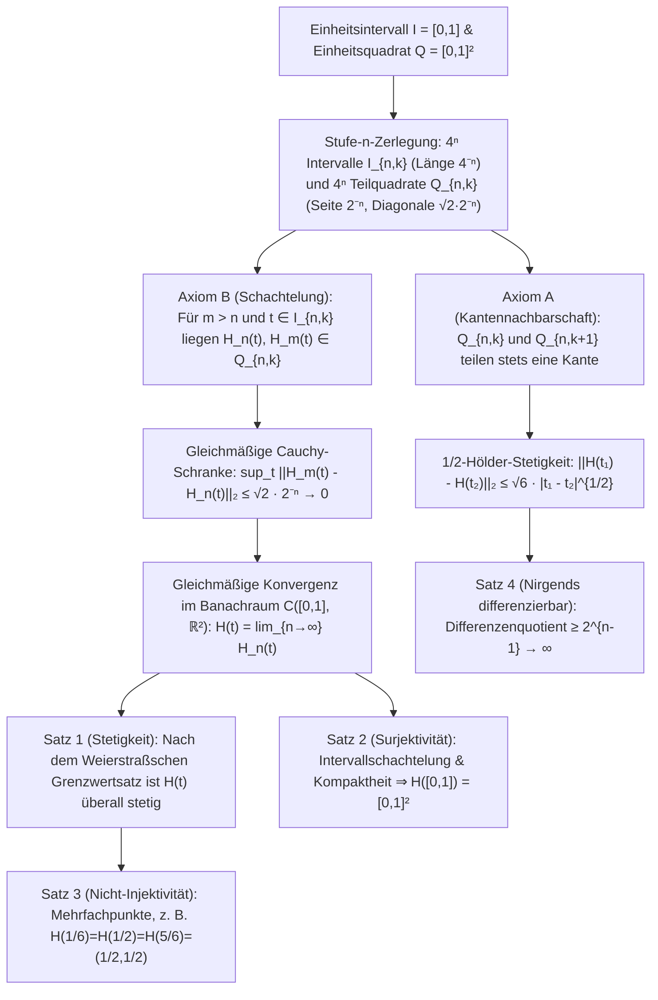

Am Anfang des ersten Buches der *Elemente* definierte Euklid von Alexandria Punkt und Linie mit den berühmten Worten: „Ein Punkt ist, was keine Teile hat; eine Linie ist eine breitenlose Länge ($\mu\tilde{\eta}\kappa\omicron\varsigma\ \dot{\alpha}\pi\lambda\alpha\tau\acute{\varepsilon}\varsigma$).“ Nach unserer alltäglichen geometrischen Anschauung besitzt eine ideale mathematische Kurve die Breite null ($\delta = 0$). Über zweitausend Jahre lang galt es daher als selbstverständlich, dass ein eindimensionaler Faden ohne jede Dicke niemals eine zweidimensionale Fläche wie das Einheitsquadrat $[0,1]^2$ lückenlos ausfüllen kann.

Doch im Jahr 1890 brachte der italienische Mathematiker <strong>Giuseppe Peano (1858–1932)</strong> diese zweitausendjährige Gewissheit in einer nur fünfseitigen Arbeit in den *Mathematischen Annalen* zum Einsturz: Er konstruierte eine <strong>stetige surjektive Abbildung</strong> $f: [0,1] \to [0,1]^2$ vom eindimensionalen Einheitsintervall auf das zweidimensionale Einheitsquadrat. Ein Jahr später (1891) veröffentlichte <strong>David Hilbert (1862–1943)</strong> seine geometrisch-rekursive <strong>Hilbert-Kurve</strong>. Noch erstaunlicher ist, dass dieses einst als „pathologisches Monster“ gefürchtete Konstrukt der reinen Mathematik ein Jahrhundert später zu einem der wichtigsten Algorithmen der modernen Informatik wurde – als Herzstück von <strong>Google Maps (Google S2 Geometry Library)</strong>, räumlichen Datenbanken (<strong>Hilbert R-Tree</strong>), <strong>Cache-Oblivious-Algorithmen</strong> und der Lastverteilung auf <strong>Supercomputern</strong>.

---

## 1. Cantors Schock (1877) und der Satz von Netto (1879)

Im Jahr 1877 entdeckte der Begründer der Mengenlehre, <strong>Georg Cantor</strong>, dass zwischen den Punkten der eindimensionalen Strecke $[0,1]$ und den Punkten des zweidimensionalen Quadrats $[0,1]^2$ eine <strong>Bijektion (eineindeutige Zuordnung)</strong> existiert. Erschüttert schrieb er an Richard Dedekind: <strong>„Je le vois, mais je ne le crois pas!“ (Ich sehe es, aber ich glaube es nicht!)</strong>

Cantors Grundidee war das <strong>Verschränken (Interleaving)</strong> der Nachkommastellen (bzw. unzerlegbarer Ziffernblöcke, die auf eine von null verschiedene Ziffer enden, um die Doppeldeutigkeit abbrechender Dezimalbrüche wie $0{,}5 = 0{,}4999\dots$ exakt zu beheben):

$$x = 0.a_1 a_2 a_3 \dots, \quad y = 0.b_1 b_2 b_3 \dots \quad \Longrightarrow \quad t = \phi(x, y) = 0.a_1 b_1 a_2 b_2 a_3 b_3 \dots$$

$$|[0,1]| = |[0,1]^2| = |[0,1]^n| = |\mathbb{R}| = \mathfrak{c} = 2^{\aleph_0}$$

Damit war bewiesen, dass die Strecke $[0,1]$, das Quadrat $[0,1]^2$ und jeder $n$-dimensionale Hyperwürfel $[0,1]^n$ exakt dieselbe <strong>Kontinuumsmächtigkeit $\mathfrak{c} = 2^{\aleph_0}$</strong> besitzen. Dedekind bemerkte jedoch sofort, dass Cantors Abbildung <strong>überall unstetig</strong> ist. 1879 bewies <strong>Eugen Netto</strong>, dass <strong>zwischen $[0,1]$ und $[0,1]^2$ keine stetige Bijektion (kein Homöomorphismus) existieren kann</strong>: Da $[0,1]$ kompakt und $[0,1]^2$ ein Hausdorff-Raum ist, wäre jede stetige Bijektion automatisch ein Homöomorphismus; entfernt man jedoch den inneren Punkt $t_0 = 1/2$, zerfällt $[0,1]\setminus\{1/2\} = [0,1/2) \cup (1/2,1]$ in zwei unzusammenhängende Teile, während das punktierte Quadrat $[0,1]^2 \setminus \{f(1/2)\}$ wegzusammenhängend bleibt – ein Widerspruch!

---

## 2. Die Peano-Kurve (1890): Verzicht auf Injektivität ermöglicht stetige Surjektivität!

Peano erkannte die logische Lücke im Satz von Netto: Verboten ist nur das gleichzeitige Erfüllen von Stetigkeit, Surjektivität und Injektivität. <strong>Gibt man die Injektivität auf (erlaubt man also Selbstüberschneidungen bzw. Mehrfachpunkte), lässt sich eine stetige Surjektion $f: [0,1] \to [0,1]^2$ konstruieren!</strong>

Peano nutzte die Entwicklung zur Basis 3 (Ternärsystem), $t = 0{,}t_1 t_2 t_3 \dots_3$ ($t_m \in \{0,1,2\}$), zusammen mit dem <strong>Komplementoperator $k(d) = 2 - d$</strong>:

$$t = \sum_{m=1}^{\infty} \frac{t_m}{3^m} \;\; (t_m \in \{0,1,2\}), \qquad k(d) = 2 - d, \qquad k^n(d) = \begin{cases} d & (n \text{ even}) \\ 2 - d & (n \text{ odd}) \end{cases}$$

$$x_n = k^{t_2 + t_4 + \cdots + t_{2n-2}}(t_{2n-1}), \qquad y_n = k^{t_1 + t_3 + \cdots + t_{2n-1}}(t_{2n})$$

Da $k^n(d)$ nur von der Parität (gerade/ungerade) des Exponenten $n$ abhängt, bewirkt ein Übertrag an einer ternären Grenze (wie $t = 1/3 = 0{,}0222\dots_3 = 0{,}1000\dots_3$), dass $t_1$ von $0$ (gerade) auf $1$ (ungerade) springt, wodurch $k^1$ alle nachfolgenden Nullen in Zweien verwandelt und beide Darstellungen exakt denselben Punkt $(1/3, 1)$ liefern!

---

## 3. Hilberts geometrische Rekursion (1891) und strenge analytische Beweise

1891 ersetzte David Hilbert Peanos $3 \times 3$-Teilung durch eine binäre <strong>$2 \times 2 = 4$-Quadranten-Rekursion</strong>: Auf Stufe $n$ wird $[0,1]$ in $4^n$ abgeschlossene Teilintervalle $I_{n,k}$ der Länge $4^{-n}$ und $[0,1]^2$ in $4^n$ Teilquadrate $Q_{n,k}$ der Seitenlänge $2^{-n}$ zerlegt, sodass <strong>Axiom A (Nachbarschaftserhaltung: $Q_{n,k}$ und $Q_{n,k+1}$ teilen stets eine Kante)</strong> und <strong>Axiom B (Schachtelung: $Q_{n,k} = \bigcup_{j=0}^3 Q_{n+1, 4k-j}$)</strong> gelten.

1. <strong>Satz 1 (Gleichmäßige Konvergenz & Stetigkeit)</strong>: Für $m > n \ge 1$ und jedes $t \in I_{n,k}$ liegen $H_n(t)$ und $H_m(t)$ nach Axiom B im selben Teilquadrat $Q_{n,k}$ mit Durchmesser $\sqrt{2}\cdot 2^{-n}$:

$$I_{n,k} = \left[ \frac{k-1}{4^n}, \, \frac{k}{4^n} \right], \qquad \|H_m - H_n\|_\infty = \sup_{t \in [0,1]} \|H_m(t) - H_n(t)\|_2 \le \operatorname{diam}(Q_{n,k}) = \frac{\sqrt{2}}{2^n} \quad (\forall m > n \ge 1)$$

   Damit ist $\{H_n\}$ eine gleichmäßige Cauchy-Folge in $\mathcal{C}([0,1], \mathbb{R}^2)$, und die Grenzfunktion $H(t)$ ist überall stetig.
2. <strong>Satz 2 (Surjektivität)</strong>: Für jedes $p \in [0,1]^2$ liefert eine geschachtelte Folge $Q_{n,k_n} \ni p$ eine Intervallschachtelung $I_{n,k_n}$ der Länge $4^{-n} \to 0$ mit eindeutigem Schnittpunkt $t^* \in [0,1]$ und $H(t^*) = p$:

$$\bigcap_{n=1}^{\infty} I_{n, k_n} = \{t^*\}, \qquad \|H(t^*) - p\|_2 \le \frac{\sqrt{2}}{2^n} \xrightarrow{n \to \infty} 0 \quad \Longrightarrow \quad H([0,1]) = [0,1]^2$$

3. <strong>Satz 3 (Mehrfachpunkte)</strong>: Der Mittelpunkt $(1/2, 1/2)$ wird dreimal durchlaufen ($H(1/6) = H(1/2) = H(5/6) = (1/2, 1/2)$), und an Gitterpunkten höherer Stufe treten bis zu vierfache Punkte auf.
4. <strong>Satz 4 (Unendliche Bogenlänge, $\frac{1}{2}$-Hölder-Stetigkeit & Nirgends-Differenzierbarkeit)</strong>: Die Bogenlänge $L(H_n) = 2^n - 2^{-n} \to \infty$ divergiert. Für jedes $t \in I_{n,k}$ hat mindestens eine Ecke $v_n = H(s_n)$ von $Q_{n,k}$ den Abstand $\ge 2^{-(n+1)}$ zu $H(t)$ bei $|s_n - t| \le 4^{-n}$, sodass der Differenzenquotient mit $2^{n-1} \to \infty$ divergiert – <strong>$H(t)$ ist in keinem einzigen Punkt $t \in [0,1]$ differenzierbar</strong>:

$$L(H_n) = (4^n - 1) 2^{-n} = 2^n - 2^{-n} \to +\infty, \qquad \|H(t_1) - H(t_2)\|_2 \le \sqrt{6}\, |t_1 - t_2|^{1/2}$$

$$\frac{\|H(s_n) - H(t)\|_2}{|s_n - t|} \ge \frac{2^{-(n+1)}}{4^{-n}} = 2^{n-1} \xrightarrow{n \to \infty} +\infty$$

---

## 4. Lösung der Dimensionskrise: Topologische Dimension $\dim_T$ vs. Hausdorff-Dimension $D_H$

1911 bewies <strong>L. E. J. Brouwer</strong> den <strong>Satz von der Invarianz der Dimension</strong> ($\mathbb{R}^n \cong \mathbb{R}^m \iff n = m$) mithilfe lokaler Homologiegruppen. Die <strong>Lebesgue'sche Überdeckungsdimension $\dim_T$</strong> misst die minimale Überlappungsordnung $d + 1$ offener Überdeckungen ($\dim_T([0,1]) = 1$, aber $\dim_T([0,1]^2) = 2$ wie bei einer Ziegelmauer mit Dreifachfugen, was topologisch erzwingt, dass jede stetige Surjektion $[0,1] \to [0,1]^2$ mindestens Dreifachpunkte besitzt!). Die <strong>Hausdorff-Dimension (fraktale Dimension) $D_H$</strong> hingegen misst das Skalenverhalten:

$$H_k(U, U \setminus \{p\}; \mathbb{Z}) \cong \tilde{H}_{k-1}(S^{n-1}; \mathbb{Z}) \cong \begin{cases} \mathbb{Z} & (k = n) \\ 0 & (k \ne n) \end{cases}, \qquad \dim_T([0,1]) = 1 < \dim_T([0,1]^2) = 2$$

$$D_H = \frac{\log N}{\log(1/r)} \quad \Longrightarrow \quad D_H(\text{Peano}) = \frac{\log 9}{\log 3} = 2, \qquad D_H(\text{Hilbert}) = \frac{\log 4}{\log 2} = 2$$

Die Hilbert-Kurve hebt durch unendliche Faltung ihre fraktale Dimension auf $D_H = 2$ und durch Selbstüberschneidung auch die topologische Dimension ihres Bildes auf $\dim_T = 2$.

| Kurventyp / Abbildung | Stetig | Injektiv (doppelpunktfrei) | Surjektiv auf $[0,1]^2$ | Differenzierbarkeit | Topologische Dim. $\dim_T(\text{Bild})$ | Hausdorff-Dim. $D_H$ | 2D-Flächenmaß $\mu_2$ |
| :--- | :---: | :---: | :---: | :---: | :---: | :---: | :---: |
| <strong>Glatte einfache Kurve (Strecke/Kreisbogen)</strong> | Ja ($C^\infty$) | Ja | Nein | Überall differenzierbar | $1$ | $1$ | $0$ |
| <strong>Koch-Kurve (Schneeflockenkurve)</strong> | Ja | Ja | Nein | Nirgends differenzierbar | $1$ | $\frac{\log 4}{\log 3} \approx 1{,}262$ | $0$ |
| <strong>Osgood-Kurve (1903)</strong> | Ja | Ja (Jordan-Bogen) | Nein (leeres Inneres) | Fast überall nicht diff. | $1$ | $2$ | $> 0$ (positives Maß!) |
| <strong>Cantors Ziffernverschränkung</strong> | Nein (unstetig) | Ja (Bijektion) | Ja | Nirgends stetig/diff. | $2$ | $2$ | $1$ |
| <strong>Peano-Kurve (Basis 3, 1890)</strong> | Ja | Nein (Mehrfachpunkte) | Ja (raumfüllend) | Nirgends differenzierbar | $2$ | $\frac{\log 9}{\log 3} = 2$ | $1$ |
| <strong>Hilbert-Kurve (Basis 2, 1891)</strong> | Ja ($\frac{1}{2}$-Hölder) | Nein (bis 4-fach-Punkte) | Ja (raumfüllend) | Nirgends differenzierbar | $2$ | $\frac{\log 4}{\log 2} = 2$ | $1$ |

---

## 5. Anwendungen in der modernen Informatik: Mehrdimensionale Daten im 1D-Speicher

Da Computerspeicher (DRAM-Adressen, SSD-Blöcke, B+-Baum-Schlüssel) eindimensional ist, reale Geodaten und Simulationsgitter jedoch mehrdimensional sind, liefert die diskrete Hilbert-Kurve dank $\frac{1}{2}$-Hölder-Stetigkeit und Quadtree-Schachtelung die optimale <strong>Lokalitätserhaltung (Locality Preservation)</strong>:

$$z = \text{Morton}(x, y) = (y_{n-1} x_{n-1} \dots y_1 x_1 y_0 x_0)_2, \qquad C_{\text{dilation}} = \sup_{t_1 \ne t_2} \frac{\|\gamma(t_1) - \gamma(t_2)\|_2^2}{|t_1 - t_2|} = 6 \;\; (\text{Hilbert})$$

Während die <strong>Morton-Kurve (Z-Order Curve)</strong> durch bloßes Bit-Interleaving an Quadrantengrenzen weite Diagonalsprünge macht ($C_{\text{dilation}} = \infty$), bewegt sich die Hilbert-Kurve bei jedem Schritt $t \to t+1$ exakt um die Manhattan-Distanz $1$ ($C_{\text{dilation}} = 6$) und reduziert B+-Baum-Suchbereiche um $25\%\text{–}40\%$.
1. <strong>Google S2 Geometry Library (Google Maps, Uber, MongoDB)</strong>: Projiziert die Erdkugel $S^2$ auf die $6$ Seiten eines Würfels, korrigiert Flächenverzerrungen und unterteilt jede Seite mit einer <strong>30-stufigen Hilbert-Kurve $H_{30}$</strong>. Jedes $0{,}7\,\text{cm} \times 0{,}7\,\text{cm}$ kleine Flächenstück der Erde wird durch eine einzige <strong>64-Bit-Ganzzahl (`S2CellId`)</strong> adressiert, sodass komplexe 2D-Geofence-Abfragen zu ultraschnellen 1D-Bereichsabfragen im B+-Baum werden.
2. <strong>Hilbert R-Trees und Supercomputing</strong>: Sortieren von Polygonen nach dem Hilbert-Index minimiert Überlappungen in R-Bäumen (PostGIS, Apache Sedona), und in 3D-Kosmologiesimulationen (Gadget-4) sowie adaptiven Gittern (AMReX) zerlegt eine 3D-Hilbert-Kurve Octrees in kompakte Teilgebiete mit minimalem MPI-Kommunikationsaufwand.
