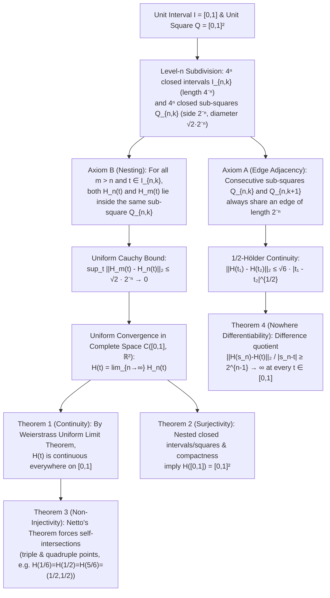
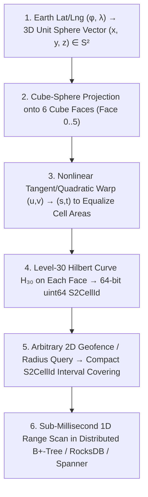

## Introduction: The Collapse of Euclidean Intuition and the Paradox of Painting a Plane with a Thread

At the very opening of Book I of the *Elements*—the monument of deductive geometry that governed human spatial intuition for more than two millennia—Euclid of Alexandria laid down two foundational definitions:

- <strong>Definition 1</strong>: "A point is that which has no part ($\Sigma\eta\mu\varepsilon\tilde{\iota}\acute{o}\nu\ \dot{\varepsilon}\sigma\tau\iota\nu,\ \omicron\tilde{\dot{\upsilon}}\ \mu\acute{\varepsilon}\rho\omicron\varsigma\ \omicron\dot{\upsilon}\theta\acute{\varepsilon}\nu$)."
- <strong>Definition 2</strong>: "A line is breadthless length ($\Gamma\rho\alpha\mu\mu\grave{\eta}\ \delta\grave{\varepsilon}\ \mu\tilde{\eta}\kappa\omicron\varsigma\ \dot{\alpha}\pi\lambda\alpha\tau\acute{\varepsilon}\varsigma$)."

Viewed through everyday physical experience, these definitions seem unimpeachable. When we color in a square on a sheet of paper with a single continuous stroke of a marker, we succeed only because the nib of the pen has a nonzero physical width $\delta > 0$. An idealized mathematical curve, however, is a one-dimensional trajectory of thickness strictly equal to zero ($\delta = 0$). No matter how intricately one folds or meanders a breadthless thread, it seemed self-evident to every mathematician up to the late nineteenth century that a one-dimensional line could never completely fill a two-dimensional region of positive area without leaving gaps.

In 1890, that two-thousand-year-old certainty shattered. In a five-page paper published in *Mathematische Annalen* titled *"Sur une courbe, qui remplit toute une aire plane"* ("On a curve that fills an entire planar area"), the Italian mathematician <strong>Giuseppe Peano (1858–1932)</strong> constructed an explicit <strong>continuous surjective mapping</strong> $f: [0,1] \to [0,1]^2$ from the one-dimensional unit interval $I = [0,1]$ onto the two-dimensional unit square $Q = [0,1]^2$.

Pause to absorb what this means: as time $t$ flows continuously from $t = 0$ to $t = 1$, a single moving point $f(t) = (x(t), y(t))$ tracing an unbroken path in the plane <strong>passes through every single point inside and on the boundary of the unit square $[0,1]^2$</strong>—every point with rational coordinates and every point with transcendental coordinates, without a single exception! One year later, in 1891, the German mathematician <strong>David Hilbert (1862–1943)</strong> distilled Peano's purely arithmetic construction into a transparent geometric recursion, giving birth to the <strong>Hilbert Curve</strong>.

If a one-dimensional line can completely fill a two-dimensional surface, <strong>what does "dimension" actually mean?</strong>

Even more remarkably, what late-nineteenth-century analysts recoiled from as a "pathological monster" turned out a century later to be one of the most indispensable algorithms in modern computer science. Because computer memory (DRAM addresses, SSD logical blocks, and B+-tree keys) is fundamentally <strong>one-dimensional</strong> whereas real-world data (geographic coordinates, 3D fluid meshes, multi-attribute database records, and dense matrices) is <strong>multidimensional</strong>, the Hilbert curve provides the theoretically optimal locality-preserving bridge between $d$-dimensional space and $1$-dimensional storage—powering <strong>Google Maps (the Google S2 Geometry Library)</strong>, <strong>PostGIS / Hilbert R-Trees</strong>, <strong>cache-oblivious matrix multiplication</strong>, and <strong>petascale supercomputer load balancing</strong>.

In this article, we trace the complete mathematical and computational story of space-filling curves: from Georg Cantor's 1877 shock and Eugen Netto's topological obstruction, to Peano's ternary parity operator and Hilbert's recursive polygonal approximations, complete analytical proofs of uniform convergence, surjectivity, non-injectivity, $\frac{1}{2}$-Hölder continuity, and nowhere differentiability, the resolution of the dimension crisis via Brouwer's Invariance of Dimension, Lebesgue covering dimension $\dim_T$, and Hausdorff fractal dimension $D_H$, and finally modern industrial applications in spatial databases and high-performance computing.

---

## Chapter 1: Cantor's 1877 Shock — A Line Segment and a Square Have the Exact Same Number of Points

The story of space-filling curves begins thirteen years before Peano's paper, with a question that shook the founder of set theory, <strong>Georg Cantor (1845–1918)</strong>.

### 1.1 "Je le vois, mais je ne le crois pas!" ("I see it, but I don't believe it!")

After proving in 1874 that the set of real numbers $\mathbb{R}$ is uncountably infinite ($|\mathbb{R}| > |\mathbb{N}|$), Cantor wrote to his close friend <strong>Richard Dedekind (1831–1916)</strong> asking whether the points of a continuous one-dimensional interval $[0,1]$ could ever be placed in one-to-one correspondence (bijection) with the points of a two-dimensional square $[0,1]^2$ or an $n$-dimensional cube $[0,1]^n$.

Almost every mathematician of the era assumed the answer was a categorical *no*: specifying a point on $[0,1]$ requires one real coordinate $t$, whereas specifying a point in $[0,1]^2$ requires two independent real coordinates $(x, y)$. Surely a two-parameter continuum must have a strictly higher order of infinity than a one-parameter continuum?

Yet on June 20, 1877, after three years of work, Cantor discovered an explicit one-to-one correspondence between $[0,1]$ and $[0,1]^2$. Stunned by his own proof, Cantor penned one of the most famous lines in the history of mathematics in his letter to Dedekind:

> <strong>"Je le vois, mais je ne le crois pas!" ("I see it, but I do not believe it!")</strong>

### 1.2 Digit Interleaving and the Dual-Representation Trap

Cantor's core idea was the <strong>interleaving of decimal (or binary) digits</strong>. Represent each real number in $(0,1]$ uniquely by an infinite decimal expansion that never terminates in an infinite string of zeros (for example, writing $0.5$ as $0.49999\dots$):

$$x = 0.a_1 a_2 a_3 \dots, \quad y = 0.b_1 b_2 b_3 \dots \quad \Longrightarrow \quad t = \phi(x, y) = 0.a_1 b_1 a_2 b_2 a_3 b_3 \dots$$

$$|[0,1]| = |[0,1]^2| = |[0,1]^n| = |\mathbb{R}| = \mathfrak{c} = 2^{\aleph_0}$$

Given $(x, y) \in (0,1]^2$ with $x = 0.a_1 a_2 a_3 \dots$ and $y = 0.b_1 b_2 b_3 \dots$, weaving their digits together produces a single real number $t = 0.a_1 b_1 a_2 b_2 a_3 b_3 \dots \in (0,1]$. Conversely, given $t = 0.c_1 c_2 c_3 c_4 \dots$, extracting the odd-indexed digits yields $x = 0.c_1 c_3 c_5 \dots$ and extracting the even-indexed digits yields $y = 0.c_2 c_4 c_6 \dots$.

Dedekind immediately spotted a subtle flaw in naive single-digit interleaving: <strong>the dual representation of terminating decimals</strong>. Even if $t = 0.2102020202\dots$ does not end in all zeros, extracting its odd-indexed digits gives $x = 0.20000\dots$ (which violates our rule against trailing zeros!) while its even-indexed digits give $y = 0.12222\dots$. Thus naive digit unzipping fails to be surjective onto the allowed expansions.

Cantor and Dedekind repaired this flaw in two rigorous ways:
1. <strong>Continued Fraction Bijection</strong>: Every irrational number $x \in (0,1) \setminus \mathbb{Q}$ has a <strong>strictly unique</strong> infinite simple continued fraction expansion $x = [0; a_1, a_2, a_3, \dots]$ with $a_k \in \mathbb{N}$. Interleaving $a_k$ and $b_k$ into $t = [0; a_1, b_1, a_2, b_2, \dots]$ gives an exact bijection between $([0,1]\setminus\mathbb{Q})^2$ and $[0,1]\setminus\mathbb{Q}$, and the countable set of rationals is easily absorbed via a Hilbert-hotel shift.
2. <strong>Block Interleaving (or Cantor-Bernstein-Schröder Theorem)</strong>: Group each expansion into indivisible blocks consisting of consecutive zeros terminated by a single nonzero digit—for instance, $x = 0.\underline{3}\,\underline{02}\,\underline{007}\,\underline{5}\dots$ and $y = 0.\underline{04}\,\underline{9}\,\underline{01}\,\underline{8}\dots$—and interleave whole blocks: $t = 0.\underline{3}\,\underline{04}\,\underline{02}\,\underline{9}\,\underline{007}\,\underline{01}\,\underline{5}\,\underline{8}\dots$. Because every valid expansion consists of an infinite sequence of such blocks, block interleaving is an exact bijection!

Thus the one-dimensional interval $[0,1]$, the two-dimensional square $[0,1]^2$, and any $n$-dimensional hypercube $[0,1]^n$ have the <strong>exact same continuum cardinality $\mathfrak{c} = 2^{\aleph_0}$</strong>.

### 1.3 Dedekind's Topological Insight and Netto's Theorem (1879): No Continuous Bijection Exists

While congratulating Cantor, Dedekind immediately conjectured that Cantor's bijection must be <strong>everywhere discontinuous</strong>: if one requires the mapping between $[0,1]$ and $[0,1]^2$ to be <strong>continuous</strong>, no one-to-one correspondence can exist. Indeed, in 1879, the German mathematician <strong>Eugen Netto (1846–1919)</strong> proved that <strong>there is no continuous bijection between $[0,1]$ and $[0,1]^2$</strong>.

In modern point-set topology, the proof takes just five lines:

> <strong>Theorem (Non-Existence of a Continuous Bijection $f: [0,1] \to [0,1]^2$)</strong>:
> Suppose for contradiction that $f: [0,1] \to [0,1]^2$ is a continuous bijection. Because the domain $[0,1]$ is <strong>compact</strong> and the codomain $[0,1]^2$ is <strong>Hausdorff</strong>, a fundamental theorem of topology guarantees that any continuous bijection from a compact space to a Hausdorff space is automatically a <strong>homeomorphism</strong> (its inverse $f^{-1}$ is also continuous).
> Now remove the midpoint $t_0 = 1/2$ from $[0,1]$. The restriction $f|_{[0,1]\setminus\{1/2\}}: [0,1]\setminus\{1/2\} \to [0,1]^2 \setminus \{f(1/2)\}$ must also be a homeomorphism.
> However, $[0,1] \setminus \{1/2\} = [0, 1/2) \cup (1/2, 1]$ is <strong>disconnected</strong> (a union of two disjoint open intervals), whereas the punctured square $[0,1]^2 \setminus \{f(1/2)\}$ is path-connected and therefore <strong>connected</strong>! Since connectedness is a topological invariant preserved under continuous maps, this is a contradiction. $\blacksquare$

Reassured by Netto's theorem, mathematicians in the 1880s breathed a sigh of relief: dimension was safe, they thought, because no continuous map could ever turn a 1D interval into a 2D square.

---

## Chapter 2: Peano's 1890 Curve — Sacrificing Injectivity Unlocks Continuous Surjectivity!

Every mathematician had overlooked a crucial logical loophole. Netto's theorem proves that a map $f: [0,1] \to [0,1]^2$ cannot simultaneously satisfy <strong>all three</strong> of the following properties:
1. <strong>Continuity</strong> (no jumps; the point traces an unbroken trajectory),
2. <strong>Surjectivity</strong> (every point in $[0,1]^2$ is visited at least once),
3. <strong>Injectivity</strong> (no point in $[0,1]^2$ is visited more than once; no self-intersection).

In 1887, <strong>Camille Jordan</strong> defined a planar "curve" in his *Cours d'analyse* simply as a continuous map $f: [0,1] \to \mathbb{R}^2$, without requiring injectivity. In 1890, <strong>Giuseppe Peano</strong> asked: <strong>What if we drop Condition 3 (injectivity), allowing the curve to touch itself at multiple points, while keeping Condition 1 (continuity) and Condition 2 (surjectivity)?</strong>

### 2.1 Peano's Arithmetic Construction via Base-3 (Ternary) Expansions

In his 1890 paper, Peano included zero illustrations. Determined to leave no room for geometric hand-waving, he constructed $f(t) = (x(t), y(t))$ purely algebraically using <strong>base-3 (ternary) expansions</strong> and the <strong>digit complement operator $k(d) = 2 - d$</strong> (which swaps $0 \leftrightarrow 2$ and leaves $1$ fixed):

$$t = \sum_{m=1}^{\infty} \frac{t_m}{3^m} \;\; (t_m \in \{0,1,2\}), \qquad k(d) = 2 - d, \qquad k^n(d) = \begin{cases} d & (n \text{ even}) \\ 2 - d & (n \text{ odd}) \end{cases}$$

$$x_n = k^{t_2 + t_4 + \cdots + t_{2n-2}}(t_{2n-1}), \qquad y_n = k^{t_1 + t_3 + \cdots + t_{2n-1}}(t_{2n})$$

Notice that $k(k(d)) = d$, so the $n$-fold iterate $k^n(d)$ depends only on the <strong>parity (even or odd)</strong> of the exponent $n$: if the sum of preceding digits in the exponent is even, $k^n(d) = d$; if the sum is odd, $k^n(d) = 2 - d$ (reversing the direction of traversal!).

### 2.2 Why Peano's Parity Operator Heals the Dual-Representation Discontinuity

Why is Peano's map continuous whereas Cantor's digit-interleaving map is everywhere discontinuous? Let us test the exact boundary where base-3 dual representations occur: $t = 1/3$, which has two distinct ternary expansions:
- $t^{(A)} = 0.022222\dots_3$ ($t_1 = 0$, and $t_m = 2$ for all $m \ge 2$),
- $t^{(B)} = 0.100000\dots_3$ ($t_1 = 1$, and $t_m = 0$ for all $m \ge 2$).

Under Cantor's naive unzipping (without $k$), $t^{(A)}$ gives $y = 0.222\dots_3 = 1$ whereas $t^{(B)}$ gives $y = 0.000\dots_3 = 0$—a catastrophic jump of distance $1$! Now plug $t^{(A)}$ and $t^{(B)}$ into Peano's formula:
1. <strong>For $x(t)$</strong>:
   - From $t^{(A)}$: $x_1 = t_1 = 0$, and for $n \ge 2$, the exponent $t_2 + t_4 + \cdots + t_{2n-2} = 2(n-1)$ is always <strong>even</strong>, so $x_n = k^{\text{even}}(2) = 2$. Thus $x(t^{(A)}) = 0.0222\dots_3 = 1/3$.
   - From $t^{(B)}$: $x_1 = t_1 = 1$, and for $n \ge 2$, the exponent is $0$ (<strong>even</strong>), so $x_n = k^0(0) = 0$. Thus $x(t^{(B)}) = 0.1000\dots_3 = 1/3$. They match!
2. <strong>For $y(t)$</strong>:
   - From $t^{(A)}$: $t_1 = 0$ and $t_3 = t_5 = \cdots = 2$ are all even, so the exponent $t_1 + t_3 + \cdots + t_{2n-1}$ is always <strong>even</strong>, giving $y_n = k^{\text{even}}(2) = 2 \implies y(t^{(A)}) = 0.222\dots_3 = 1$.
   - From $t^{(B)}$: $t_1 = 1$ (<strong>odd!</strong>) and $t_3 = t_5 = \cdots = 0$, so for every $n \ge 1$ the exponent $t_1 + t_3 + \cdots + t_{2n-1} = 1$ is <strong>odd</strong>! Therefore the operator $k^1$ flips every single trailing $t_{2n} = 0$ into $k^1(0) = 2 - 0 = 2$, yielding $y(t^{(B)}) = 0.222\dots_3 = 1$!

The moment $t_1$ increments from $0$ to $1$, its parity flip activates the complement operator $k$, reversing all subsequent digits from $000\dots$ to $222\dots$ so that the exit corner of sub-square $0$ is glued seamlessly to the entry corner of sub-square $1$! Geometrically, Peano's curve subdivides $[0,1]^2$ into $3 \times 3 = 9$ sub-squares and traverses them in a continuous S-shaped <strong>boustrophedon ("ox-turning") path</strong>: up the left column, down the middle column, and up the right column, recursively to infinity.

---

## Chapter 3: Hilbert's 1891 Geometric Curve and Complete Analytical Proofs

In 1891, <strong>David Hilbert</strong> published a two-page paper (*"Über die stetige Abbildung einer Linie auf ein Flächenstück"*) replacing Peano's $3 \times 3$ ternary subdivision with a binary <strong>$2 \times 2 = 4$ quadrant recursion</strong>. Because it operates in base $2$ ($4^n = (2^n)^2$), the <strong>Hilbert Curve</strong> is both the cleanest model for mathematical analysis and the native coordinate system for binary digital computers.

### 3.1 Recursive Construction of the Polygonal Approximations $\{H_n\}$

At each recursion level $n = 1, 2, 3, \dots$:
1. <strong>Partition of the unit interval</strong>: Divide $I = [0,1]$ into $4^n$ closed subintervals of length $4^{-n}$: $I_{n,k} = \left[\frac{k-1}{4^n}, \frac{k}{4^n}\right]$ for $k = 1, 2, \dots, 4^n$.
2. <strong>Partition and Hilbert ordering of the unit square</strong>: Divide $Q = [0,1]^2$ into $4^n$ congruent closed sub-squares $Q_{n,k}$ of side length $2^{-n}$ (and diagonal $\operatorname{diam}(Q_{n,k}) = \sqrt{2}\cdot 2^{-n}$), numbered $k = 1, \dots, 4^n$ so as to satisfy two axioms:
   - <strong>Axiom A (Adjacency Preservation)</strong>: Consecutive sub-squares $Q_{n,k}$ and $Q_{n,k+1}$ always share a common edge of length $2^{-n}$.
   - <strong>Axiom B (Hierarchical Nesting)</strong>: When passing from level $n$ to level $n+1$, each sub-square $Q_{n,k}$ is partitioned into the four sub-squares corresponding to the four subintervals of $I_{n,k}$: $Q_{n,k} = \bigcup_{j=0}^3 Q_{n+1, 4k-j}$.

At $n = 1$, the four quadrants are visited in a $\sqcap$-shaped cup order: Bottom-Left ($Q_{1,1}$) $\to$ Top-Left ($Q_{1,2}$) $\to$ Top-Right ($Q_{1,3}$) $\to$ Bottom-Right ($Q_{1,4}$). To pass from $n$ to $n+1$ while preserving edge adjacency at the quadrant transitions, the local $\sqcap$-curve inside the initial Bottom-Left sub-square is <strong>reflected across the main diagonal</strong> (so it starts at Bottom-Left and exits at Top-Left, right across the border from $Q_{1,2}$'s Bottom-Left entry!), the Top-Left and Top-Right sub-squares keep the standard orientation, and the final Bottom-Right sub-square is <strong>reflected across the anti-diagonal</strong>.Connecting the centers of $Q_{n,1}, Q_{n,2}, \dots, Q_{n,4^n}$ by piecewise linear segments defines the $n\text{th}$ polygonal approximation $H_n: [0,1] \to [0,1]^2$.

---

### 3.2 Complete Proof of Theorem 1 (Uniform Convergence and Continuity) and Theorem 2 (Surjectivity)

> <strong>Theorem 1 (Uniform Convergence and Continuity of the Hilbert Curve)</strong>:
> The sequence of continuous polygonal curves $\{H_n\}_{n=1}^\infty$ converges uniformly on $[0,1]$ to a well-defined limit mapping $H: [0,1] \to [0,1]^2$, and $H(t)$ is continuous everywhere on $[0,1]$.

<strong>Proof</strong>: Let $m > n \ge 1$ and let $t \in [0,1]$ be arbitrary. Then $t \in I_{n,k}$ for some $k \in \{1, \dots, 4^n\}$. By Axiom B (Nesting), for every $m > n$, the point $H_m(t)$ lies in a sub-square $Q_{m,j} \subset Q_{n,k}$, so both $H_n(t)$ and $H_m(t)$ belong to the same closed square $Q_{n,k}$ of side length $2^{-n}$. Since the Euclidean diameter of $Q_{n,k}$ is its diagonal $\sqrt{2}\cdot 2^{-n}$, we have:

$$I_{n,k} = \left[ \frac{k-1}{4^n}, \, \frac{k}{4^n} \right], \qquad \|H_m - H_n\|_\infty = \sup_{t \in [0,1]} \|H_m(t) - H_n(t)\|_2 \le \operatorname{diam}(Q_{n,k}) = \frac{\sqrt{2}}{2^n} \quad (\forall m > n \ge 1)$$

Because the upper bound $\sqrt{2}\cdot 2^{-n} \to 0$ as $n \to \infty$ independently of $t$, $\{H_n\}$ is a <strong>uniformly Cauchy sequence</strong> in the Banach space $(\mathcal{C}([0,1], \mathbb{R}^2), \|\cdot\|_\infty)$. By completeness, the uniform limit $H(t) = \lim_{n\to\infty} H_n(t)$ exists for all $t \in [0,1]$. Since each $H_n$ is continuous, the <strong>Weierstrass Uniform Limit Theorem</strong> guarantees that the limit function $H(t)$ is continuous on $[0,1]$. Letting $m \to \infty$ also shows that $H(I_{n,k}) \subset Q_{n,k}$ for every $n$ and $k$. $\blacksquare$

> <strong>Theorem 2 (Surjectivity: $H([0,1]) = [0,1]^2$)</strong>:
> For every point $p = (x, y) \in [0,1]^2$, there exists at least one $t^* \in [0,1]$ such that $H(t^*) = p$.

<strong>Proof</strong>: Fix any $p \in [0,1]^2$. By Axiom B, we can inductively choose a nested sequence of closed sub-squares $Q_{1, k_1} \supset Q_{2, k_2} \supset \cdots \supset Q_{n, k_n} \supset \cdots$ each containing $p$. The corresponding closed subintervals $I_{1, k_1} \supset I_{2, k_2} \supset \cdots \supset I_{n, k_n} \supset \cdots$ are also nested with lengths $|I_{n, k_n}| = 4^{-n} \to 0$. By <strong>Cantor's Nested Interval Theorem</strong>, their intersection consists of a unique point $t^* \in [0,1]$. Since $t^* \in I_{n, k_n}$ for all $n$, both $H(t^*)$ and $p$ lie inside $Q_{n, k_n}$ for every $n \ge 1$:

$$\bigcap_{n=1}^{\infty} I_{n, k_n} = \{t^*\}, \qquad \|H(t^*) - p\|_2 \le \frac{\sqrt{2}}{2^n} \xrightarrow{n \to \infty} 0 \quad \Longrightarrow \quad H([0,1]) = [0,1]^2$$

(Alternatively, $[0,1]$ is compact and $H$ is continuous, so $H([0,1])$ is compact and hence closed in $[0,1]^2$; since $H([0,1])$ intersects every $Q_{n,k}$, it is dense in $[0,1]^2$, so $H([0,1]) = \overline{H([0,1])} = [0,1]^2$.) $\blacksquare$

---

### 3.3 Proof of Theorem 3 (Multiple Points) and Theorem 4 ($\frac{1}{2}$-Hölder Continuity & Nowhere Differentiability)

Because $H: [0,1] \to [0,1]^2$ is continuous and surjective, Netto's Theorem implies that $H$ <strong>cannot be injective</strong>. Indeed, consider the center of the unit square $p_c = (1/2, 1/2)$, where all four level-$1$ quadrants $Q_{1,1}, Q_{1,2}, Q_{1,3}, Q_{1,4}$ meet:
- Within $Q_{1,1}$ ($t \in [0, 1/4]$), the top-right corner $(1/2, 1/2)$ is approached by the geometric series $t_1 = \frac{1}{4}\sum_{j=1}^\infty \frac{2}{4^j} = \frac{1}{6}$.
- At the transition between $Q_{1,2}$ and $Q_{1,3}$, the curve crosses $(1/2, 1/2)$ at $t_2 = \frac{1}{2}$.
- Within $Q_{1,4}$ ($t \in [3/4, 1]$), by symmetry the curve hits $(1/2, 1/2)$ again at $t_3 = 1 - \frac{1}{6} = \frac{5}{6}$.

Thus $H(1/6) = H(1/2) = H(5/6) = (1/2, 1/2)$ is a <strong>triple point</strong>, and at finer binary grid vertices where four sub-squares meet at non-consecutive times, the Hilbert curve exhibits <strong>quadruple points</strong> ($4$ distinct times mapping to the same point).

Now let us examine arc length, Hölder continuity, and differentiability:

$$L(H_n) = (4^n - 1) 2^{-n} = 2^n - 2^{-n} \to +\infty, \qquad \|H(t_1) - H(t_2)\|_2 \le \sqrt{6}\, |t_1 - t_2|^{1/2}$$

$$\frac{\|H(s_n) - H(t)\|_2}{|s_n - t|} \ge \frac{2^{-(n+1)}}{4^{-n}} = 2^{n-1} \xrightarrow{n \to \infty} +\infty$$

1. <strong>Infinite Arc Length</strong>: The $n\text{th}$ approximation $H_n$ consists of $4^n - 1$ segments of length $2^{-n}$, so its total length is $L(H_n) = (4^n - 1)2^{-n} = 2^n - 2^{-n} \to +\infty$. Every increment $n \to n+1$ doubles the length of the curve inside the unit square!
2. <strong>$\frac{1}{2}$-Hölder Continuity</strong>: For any $t_1 \neq t_2$, choose the unique integer $n \ge 1$ such that $4^{-n} < |t_1 - t_2| \le 4^{-(n-1)}$. Then $[t_1, t_2]$ has length at most $4^{-(n-1)}$ and therefore spans at most two adjacent intervals $I_{n-1, k}$ and $I_{n-1, k+1}$. By Axiom A, $Q_{n-1, k} \cup Q_{n-1, k+1}$ is a $2^{-(n-1)} \times 2 \cdot 2^{-(n-1)}$ rectangle, and a finer sub-cell check shows $\|H(t_1) - H(t_2)\|_2 \le \sqrt{6}\cdot 2^{-n} < \sqrt{6}\,|t_1 - t_2|^{1/2}$. The exponent $\alpha = 1/2$ reflects the fundamental dimensional scaling: time scales as $\Delta t \sim 4^{-n}$ ($1\text{D}$) while space scales as $\Delta x \sim 2^{-n} = (\Delta t)^{1/2}$ ($2\text{D}$), identical to $2\text{D}$ Brownian motion!
3. <strong>Complete Proof of Nowhere Differentiability</strong>: Fix any $t \in [0,1]$ and any $n \ge 1$. Then $t \in I_{n,k}$ and $H(I_{n,k}) = Q_{n,k}$ is a square of side $2^{-n}$. Regardless of where $H(t)$ sits inside $Q_{n,k}$, at least one of the four corners $v_n$ of $Q_{n,k}$ lies at Euclidean distance at least $\frac{1}{2}\cdot 2^{-n} = 2^{-(n+1)}$ from $H(t)$. Since $H(I_{n,k}) = Q_{n,k}$, there exists $s_n \in I_{n,k}$ with $H(s_n) = v_n$. Because $0 < |s_n - t| \le 4^{-n}$, the Newton difference quotient satisfies $\frac{\|H(s_n) - H(t)\|_2}{|s_n - t|} \ge \frac{2^{-(n+1)}}{4^{-n}} = 2^{n-1} \to +\infty$ as $n \to \infty$ ($s_n \to t$). Hence <strong>$H'(t)$ does not exist at any point $t \in [0,1]$!</strong> (By Sard's Theorem, any Lipschitz or differentiable curve $f: [0,1] \to \mathbb{R}^2$ has $2\text{D}$ Lebesgue measure zero; nowhere differentiability is the mandatory analytical price a $1\text{D}$ parameter pays to sweep out positive $2\text{D}$ area.)

---

## Chapter 4: Resolving the Crisis of Dimension — Topological Dimension $\dim_T$ vs. Hausdorff Fractal Dimension $D_H$

Cantor's bijection and the Peano-Hilbert curves forced twentieth-century mathematicians to separate two distinct concepts of dimension:

1. <strong>Brouwer's Invariance of Dimension (1911) and Lebesgue Covering Dimension $\dim_T$</strong>:
   In 1911, <strong>L. E. J. Brouwer</strong> proved that non-empty open subsets $U \subset \mathbb{R}^n$ and $V \subset \mathbb{R}^m$ are homeomorphic if and only if $n = m$, using the topological invariance of local homology groups $H_k(U, U\setminus\{p\}; \mathbb{Z}) \cong \tilde{H}_{k-1}(S^{n-1}; \mathbb{Z})$. Furthermore, <strong>Henri Lebesgue</strong> noticed that any open cover of a $1\text{D}$ interval $[0,1]$ can be refined so that no point belongs to more than $1 + 1 = 2$ open sets, whereas any fine open cover of a $2\text{D}$ square $[0,1]^2$ (like a brick wall) inevitably contains triple junctions where at least $2 + 1 = 3$ open sets overlap! Defining the <strong>Lebesgue Covering Dimension $\dim_T(X)$</strong> as the minimum $d$ such that every finite open cover has a refinement of overlap order at most $d + 1$ yields $\dim_T([0,1]) = 1$ and $\dim_T([0,1]^2) = 2$. This also explains topologically why any continuous surjection $[0,1] \to [0,1]^2$ must have at least triple points ($d + 1 = 3$)!
2. <strong>Hausdorff (Fractal) Dimension $D_H$ and Box-Counting Dimension $D_B$</strong>:
   Introduced by <strong>Felix Hausdorff (1918)</strong>, the similarity/box-counting dimension of a self-similar set composed of $N$ copies scaled by factor $r$ is $D_H = \frac{\log N}{\log(1/r)}$:

$$H_k(U, U \setminus \{p\}; \mathbb{Z}) \cong \tilde{H}_{k-1}(S^{n-1}; \mathbb{Z}) \cong \begin{cases} \mathbb{Z} & (k = n) \\ 0 & (k \ne n) \end{cases}, \qquad \dim_T([0,1]) = 1 < \dim_T([0,1]^2) = 2$$

$$D_H = \frac{\log N}{\log(1/r)} \quad \Longrightarrow \quad D_H(\text{Peano}) = \frac{\log 9}{\log 3} = 2, \qquad D_H(\text{Hilbert}) = \frac{\log 4}{\log 2} = 2$$

   For a smooth curve, $N = 2, r = 1/2 \implies D_H = 1$. For the Koch curve, $N = 4, r = 1/3 \implies D_H = \frac{\log 4}{\log 3} \approx 1.262$. For the Peano ($N = 9, r = 1/3$) and Hilbert ($N = 4, r = 1/2$) curves, <strong>$D_H = 2$</strong>! Thus a space-filling curve is a map whose domain has topological dimension $\dim_T([0,1]) = 1$, but whose infinite recursive folding elevates its metric fractal dimension to $D_H = 2$ and, via self-intersection, raises the topological dimension of its image to $\dim_T(H([0,1])) = 2$.

In 1914, the <strong>Hahn-Mazurkiewicz Theorem</strong> completely characterized all spaces that are continuous images of $[0,1]$ (Peano continua): a non-empty Hausdorff space $X$ is a continuous image of $[0,1]$ if and only if $X$ is <strong>compact, connected, locally connected, and metrizable</strong>. Meanwhile, in 1903, <strong>William Fogg Osgood</strong> constructed the <strong>Osgood Curve</strong>—an <strong>injective</strong> (non-self-intersecting Jordan arc) curve in $\mathbb{R}^2$ that has positive $2\text{D}$ Lebesgue area ($\mu_2 > 0$) without filling any open interior disk!

| Curve / Mapping Type | Continuity | Injectivity (No Self-Intersection) | Surjectivity onto $[0,1]^2$ | Differentiability | Topological Dim. $\dim_T(\text{Image})$ | Hausdorff Dim. $D_H$ | 2D Lebesgue Area $\mu_2$ |
| :--- | :---: | :---: | :---: | :---: | :---: | :---: | :---: |
| <strong>Smooth Simple Curve (Line / Arc)</strong> | Yes ($C^\infty$) | Yes (Injective) | No | Everywhere differentiable | $1$ | $1$ | $0$ |
| <strong>Koch Snowflake Curve</strong> | Yes | Yes (Injective) | No | Nowhere differentiable | $1$ | $\frac{\log 4}{\log 3} \approx 1.262$ | $0$ |
| <strong>Osgood Curve (1903)</strong> | Yes | Yes (Injective Jordan arc) | No (Empty interior) | Almost everywhere non-diff. | $1$ | $2$ | $> 0$ (Positive area!) |
| <strong>Cantor Digit-Interleaving Map</strong> | No (Discontinuous) | Yes (Bijection) | Yes | Nowhere continuous/diff. | $2$ | $2$ | $1$ |
| <strong>Peano Curve (Base-3, 1890)</strong> | Yes | No (Multiple points) | Yes (Space-filling) | Nowhere differentiable | $2$ | $\frac{\log 9}{\log 3} = 2$ | $1$ |
| <strong>Hilbert Curve (Base-2, 1891)</strong> | Yes ($\frac{1}{2}$-Hölder) | No (Up to quadruple pts) | Yes (Space-filling) | Nowhere differentiable | $2$ | $\frac{\log 4}{\log 2} = 2$ | $1$ |

---

## Chapter 5: Modern Computer Science Applications — Indexing the Multidimensional World in 1D Memory

Why do modern software engineers care passionately about a 130-year-old theorem in pure topology? Because of a fundamental hardware mismatch: <strong>real-world spatial data is multidimensional ($2\text{D}$ GPS coordinates, $3\text{D}$ simulation meshes, $k\text{D}$ database keys), whereas computer memory (DRAM addresses, CPU cache lines, SSD pages, and B+-tree indexes) is strictly one-dimensional!</strong>

If we store a $2^n \times 2^n$ grid in traditional <strong>Row-Major Order</strong> ($\text{Index}(x, y) = y \cdot 2^n + x$), two horizontally adjacent pixels $(x, y)$ and $(x+1, y)$ sit at distance $1$ in memory, but two vertically adjacent pixels $(x, y)$ and $(x, y+1)$ are separated by a stride of $2^n$ memory addresses! Consequently, a $2\text{D}$ bounding-box query triggers catastrophic CPU cache misses and random disk seeks.

By contrast, indexing the $2^n \times 2^n$ grid along the discrete <strong>Hilbert Curve</strong> $H_n^{-1}: \{0, \dots, 2^n-1\}^2 \to \{0, \dots, 4^n-1\}$ exploits <strong>$\frac{1}{2}$-Hölder continuity</strong> and <strong>Axiom B (quadtree nesting)</strong>: points that are close in $1\text{D}$ Hilbert index are guaranteed to be close in $2\text{D}$ Euclidean space, and every quadtree cell maps to a <strong>single contiguous $1\text{D}$ interval $[a, b]$</strong>!

### 5.1 Morton Curve (Z-Order Curve) vs. Hilbert Curve Locality

In 1966, Guy Macdonald Morton introduced the <strong>Morton Curve (Z-Order Curve)</strong> for GIS databases by interleaving the binary bits of integer coordinates $x$ and $y$—which is literally <strong>Cantor's 1877 binary bit-interleaving map</strong>!

$$z = \text{Morton}(x, y) = (y_{n-1} x_{n-1} \dots y_1 x_1 y_0 x_0)_2, \qquad C_{\text{dilation}} = \sup_{t_1 \ne t_2} \frac{\|\gamma(t_1) - \gamma(t_2)\|_2^2}{|t_1 - t_2|} = 6 \;\; (\text{Hilbert})$$

While Morton codes can be computed in a couple of CPU cycles using BMI2 hardware instructions (`PDEP` / `PEXT`), they lack Peano/Hilbert quadrant rotations and therefore suffer from large diagonal jumps across quadtree boundaries ($C_{\text{dilation}} = \infty$). The <strong>Hilbert Curve</strong> adds a $2$-bit state rotation/reflection at each bit level so that every step $t \to t+1$ moves by an exact Manhattan distance of $1$ in the grid, achieving the optimal worst-case locality dilation factor $C_{\text{dilation}} = 6$ and reducing $2\text{D}$ range-query cluster fragmentation (B+-tree seeks) by $25\%\text{–}40\%$ compared to Z-order curves.

| Comparison Metric | Row-Major Order | Morton Curve (Z-Order, 1966) | Hilbert Curve (1891) |
| :--- | :--- | :--- | :--- |
| <strong>Mathematical Origin</strong> | Linear stride array flattening | Cantor's 1877 binary bit interleaving | Hilbert's 1891 continuous quadtree recursion |
| <strong>Step Distance ($t \to t+1$)</strong> | $1$ horizontally, $\mathcal{O}(2^n)$ jump at row end | $1$ or $\sqrt{2}$ locally, $\mathcal{O}(2^n)$ diagonal jump | <strong>Strictly $1$ everywhere (zero jumps!)</strong> |
| <strong>Spatial Locality & Cache Efficiency</strong> | Poor (anisotropic; terrible along $y$) | Good (degrades across quadrant seams) | <strong>Optimal ($C_{\text{dilation}} = 6$, isotropic)</strong> |
| <strong>2D Range Query Seek Clusters</strong> | Very high ($1$ seek per row) | Low (doubles across Z-seams) | <strong>Minimal ($25\%\text{–}40\%$ fewer seeks than Z)</strong> |
| <strong>Encoding / Decoding Cost</strong> | $1$ multiply-add ($\mathcal{O}(1)$) | Hardware `PDEP`/`PEXT` ($\mathcal{O}(1)$ cycles) | Bitwise state table / Gray-code LUT ($\mathcal{O}(n)$ bits) |

### 5.2 Google S2 Geometry Library, Hilbert R-Trees, and Petascale Supercomputing

1. <strong>Google S2 Geometry Library (Google Maps, Uber, MongoDB, BigQuery GIS)</strong>:
   To index the entire spherical Earth without polar singularities or dateline seams, Google S2 projects the unit sphere $S^2$ onto the $6$ faces of a circumscribed cube, applies a nonlinear coordinate warp to equalize projected cell areas, and subdivides each face using a <strong>$30$-level Hilbert Curve ($H_{30}$)</strong>. Every location on Earth down to a <strong>$0.7\,\text{cm} \times 0.7\,\text{cm}$ leaf cell</strong> is encoded into a single <strong>$64$-bit unsigned integer (`S2CellId`)</strong>: $3$ bits for the cube face ($0\text{–}5$), $60$ bits ($30 \times 2$ bits) for the Hilbert quadtree path, and $1$ sentinel bit to mark the hierarchy level. Because the Hilbert curve is continuous, any circular radius search or city polygon is covered by a tiny handful of contiguous `uint64` intervals, turning $2\text{D}$ spherical spatial joins into blazingly fast $1\text{D}$ B+-tree range scans!
2. <strong>Hilbert R-Trees (Kamel & Faloutsos, 1994)</strong>:
   Sorting spatial polygons by the $1\text{D}$ Hilbert index of their centroids before packing them into R-Tree leaf pages minimizes Minimum Bounding Rectangle (MBR) perimeter and node overlap, powering bulk spatial indexing in PostGIS, Oracle Spatial, and Apache Sedona.
3. <strong>Cache-Oblivious Algorithms and Supercomputer Load Balancing</strong>:
   Storing matrices in Hilbert order allows recursive block matrix multiplication $C = A \times B$ to achieve the theoretical lower bound $\mathcal{O}(N^3 / (B\sqrt{M}))$ cache misses simultaneously across L1, L2, L3 caches and TLB pages without knowing the cache sizes (*cache-oblivious*). In cosmological $N$-body codes (such as <strong>Gadget-4</strong>) and $3\text{D}$ adaptive mesh refinement (<strong>AMReX</strong>, <strong>Peano Framework</strong>), ordering $3\text{D}$ octree cells along a $3\text{D}$ Hilbert curve reduces an NP-hard $3\text{D}$ domain decomposition problem across $P$ MPI ranks to simply slicing a $1\text{D}$ array into $P$ equal-weight segments—automatically yielding compact $3\text{D}$ subdomains with minimal surface-to-volume communication overhead!

---

## References

1. <strong>Giuseppe Peano</strong>, <em>"Sur une courbe, qui remplit toute une aire plane"</em>, Mathematische Annalen, Vol. 36, pp. 157–160 (1890).
2. <strong>David Hilbert</strong>, <em>"Über die stetige Abbildung einer Linie auf ein Flächenstück"</em>, Mathematische Annalen, Vol. 38, pp. 459–460 (1891).
3. <strong>Hans Sagan</strong>, <em>Space-Filling Curves</em>, Springer-Verlag (1994).
4. <strong>Michael Bader</strong>, <em>Space-Filling Curves: An Introduction with Applications in Scientific Computing</em>, Springer (2012).
5. <strong>Ibrahim Kamel and Christos Faloutsos</strong>, <em>"Hilbert R-tree: An Improved R-tree using Fractals"</em>, VLDB, pp. 500–509 (1994).
