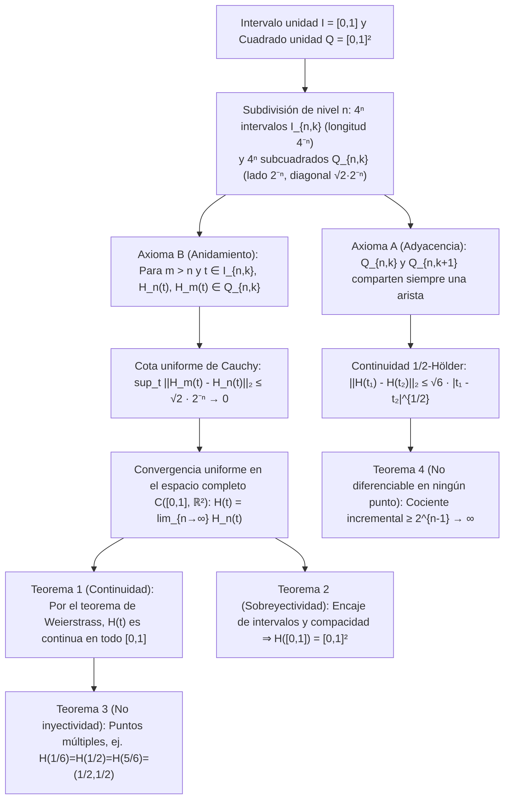

Al comienzo del Libro I de los *Elementos*, Euclides de Alejandría estableció dos definiciones fundamentales: «Un punto es lo que no tiene partes; una línea es una longitud sin anchura ($\mu\tilde{\eta}\kappa\omicron\varsigma\ \dot{\alpha}\pi\lambda\alpha\tau\acute{\varepsilon}\varsigma$).» Según nuestra intuición geométrica cotidiana, una curva matemática ideal tiene un grosor estrictamente igual a cero ($\delta = 0$). Durante más de dos milenios pareció evidente que un hilo unidimensional sin anchura jamás podría rellenar por completo el interior de un cuadrado bidimensional $[0,1]^2$ sin dejar huecos.

Sin embargo, en 1890, el matemático italiano <strong>Giuseppe Peano (1858–1932)</strong> derribó esa certeza de dos mil años en un artículo de apenas cinco páginas en *Mathematische Annalen*, construyendo una <strong>aplicación continua y sobreyectiva</strong> $f: [0,1] \to [0,1]^2$ del intervalo unidad sobre el cuadrado unidad. Un año después (1891), <strong>David Hilbert (1862–1943)</strong> presentó su construcción geométrica recursiva: la <strong>curva de Hilbert</strong>. Más sorprendente aún: lo que a finales del siglo XIX fue visto como un «monstruo patológico» de la matemática pura se convirtió un siglo más tarde en uno de los algoritmos esenciales de la informática moderna, impulsando <strong>Google Maps (biblioteca Google S2)</strong>, bases de datos espaciales (<strong>Hilbert R-Tree</strong>), algoritmos <strong>cache-oblivious</strong> y el balanceo de carga en <strong>supercomputadoras</strong>.

---

## 1. El impacto de Cantor (1877) y el teorema de Netto (1879)

En 1877, el creador de la teoría de conjuntos, <strong>Georg Cantor</strong>, descubrió que existe una <strong>biyección (correspondencia uno a uno)</strong> entre los puntos del segmento $[0,1]$ y los del cuadrado $[0,1]^2$. Asombrado por su propio hallazgo, escribió a Richard Dedekind la célebre frase: <strong>«Je le vois, mais je ne le crois pas!» (¡Lo veo, pero no lo creo!)</strong>

La idea central de Cantor fue <strong>entrelazar (interleave)</strong> los dígitos decimales (o bloques indivisibles terminados en un dígito no nulo para eliminar rigurosamente la doble representación de decimales finitos como $0{,}5 = 0{,}4999\dots$):

$$x = 0.a_1 a_2 a_3 \dots, \quad y = 0.b_1 b_2 b_3 \dots \quad \Longrightarrow \quad t = \phi(x, y) = 0.a_1 b_1 a_2 b_2 a_3 b_3 \dots$$

$$|[0,1]| = |[0,1]^2| = |[0,1]^n| = |\mathbb{R}| = \mathfrak{c} = 2^{\aleph_0}$$

Esto demostró que el segmento $[0,1]$, el cuadrado $[0,1]^2$ y el hipercubo $[0,1]^n$ poseen exactamente la misma <strong>cardinalidad del continuo $\mathfrak{c} = 2^{\aleph_0}$</strong>. No obstante, Dedekind advirtió de inmediato que dicha biyección es <strong>discontinua en todas partes</strong>. En 1879, <strong>Eugen Netto</strong> demostró que <strong>no existe ninguna biyección continua (homeomorfismo) entre $[0,1]$ y $[0,1]^2$</strong>: como $[0,1]$ es compacto y $[0,1]^2$ es Hausdorff, toda biyección continua sería un homeomorfismo; pero al quitar el punto interior $t_0 = 1/2$, $[0,1]\setminus\{1/2\} = [0,1/2) \cup (1/2,1]$ queda desconectado, mientras que el cuadrado perforado $[0,1]^2 \setminus \{f(1/2)\}$ sigue siendo conexo por caminos, ¡lo cual es una contradicción!

---

## 2. La curva de Peano (1890): ¡renunciar a la inyectividad permite la sobreyectividad continua!

Peano descubrió el resquicio lógico del teorema de Netto: solo es imposible cumplir simultáneamente continuidad, sobreyectividad e inyectividad. <strong>Si prescindimos de la inyectividad (permitiendo autointersecciones o puntos múltiples), ¡podemos construir una sobreyección continua $f: [0,1] \to [0,1]^2$!</strong>

Peano empleó el desarrollo en base $3$ (ternario) $t = 0{,}t_1 t_2 t_3 \dots_3$ ($t_m \in \{0,1,2\}$) junto con el <strong>operador complemento $k(d) = 2 - d$</strong>:

$$t = \sum_{m=1}^{\infty} \frac{t_m}{3^m} \;\; (t_m \in \{0,1,2\}), \qquad k(d) = 2 - d, \qquad k^n(d) = \begin{cases} d & (n \text{ even}) \\ 2 - d & (n \text{ odd}) \end{cases}$$

$$x_n = k^{t_2 + t_4 + \cdots + t_{2n-2}}(t_{2n-1}), \qquad y_n = k^{t_1 + t_3 + \cdots + t_{2n-1}}(t_{2n})$$

Como $k^n(d)$ depende únicamente de la paridad (par o impar) del exponente $n$, en cualquier frontera de doble representación ternaria (como $t = 1/3 = 0{,}0222\dots_3 = 0{,}1000\dots_3$), el cambio de $t_1 = 0$ (par) a $t_1 = 1$ (impar) activa $k^1$, invirtiendo todos los ceros siguientes en doses y uniendo ambas representaciones en el mismo punto $(1/3, 1)$.

---

## 3. La recursión geométrica de Hilbert (1891) y demostraciones analíticas completas

En 1891, David Hilbert reemplazó la subdivisión $3 \times 3$ de Peano por una recursión binaria de <strong>$2 \times 2 = 4$ cuadrantes</strong>: en el nivel $n$, $[0,1]$ se divide en $4^n$ subintervalos cerrados $I_{n,k}$ de longitud $4^{-n}$ y $[0,1]^2$ en $4^n$ subcuadrados $Q_{n,k}$ de lado $2^{-n}$, cumpliendo el <strong>Axioma A (Adyacencia: $Q_{n,k}$ y $Q_{n,k+1}$ comparten siempre un lado)</strong> y el <strong>Axioma B (Anidamiento: $Q_{n,k} = \bigcup_{j=0}^3 Q_{n+1, 4k-j}$)</strong>.

1. <strong>Teorema 1 (Convergencia uniforme y continuidad)</strong>: Para $m > n \ge 1$ y cualquier $t \in I_{n,k}$, por el Axioma B tanto $H_n(t)$ como $H_m(t)$ pertenecen al mismo subcuadrado $Q_{n,k}$ de diámetro $\sqrt{2}\cdot 2^{-n}$:

$$I_{n,k} = \left[ \frac{k-1}{4^n}, \, \frac{k}{4^n} \right], \qquad \|H_m - H_n\|_\infty = \sup_{t \in [0,1]} \|H_m(t) - H_n(t)\|_2 \le \operatorname{diam}(Q_{n,k}) = \frac{\sqrt{2}}{2^n} \quad (\forall m > n \ge 1)$$

   Por tanto, $\{H_n\}$ es uniformemente de Cauchy en $\mathcal{C}([0,1], \mathbb{R}^2)$ y su límite uniforme $H(t)$ es continuo en todo $[0,1]$.
2. <strong>Teorema 2 (Sobreyectividad)</strong>: Para todo $p \in [0,1]^2$, una sucesión encajada de subcuadrados $Q_{n,k_n} \ni p$ define intervalos cerrados encajados $I_{n,k_n}$ de longitud $4^{-n} \to 0$ cuya intersección única $t^* \in [0,1]$ cumple $H(t^*) = p$:

$$\bigcap_{n=1}^{\infty} I_{n, k_n} = \{t^*\}, \qquad \|H(t^*) - p\|_2 \le \frac{\sqrt{2}}{2^n} \xrightarrow{n \to \infty} 0 \quad \Longrightarrow \quad H([0,1]) = [0,1]^2$$

3. <strong>Teorema 3 (Puntos múltiples)</strong>: El centro $(1/2, 1/2)$ se alcanza tres veces ($H(1/6) = H(1/2) = H(5/6) = (1/2, 1/2)$), y en vértices diádicos superiores aparecen puntos cuádruples.
4. <strong>Teorema 4 (Longitud infinita, continuidad $\frac{1}{2}$-Hölder y no diferenciabilidad en ningún punto)</strong>: La longitud $L(H_n) = 2^n - 2^{-n} \to \infty$ diverge. Para cualquier $t \in I_{n,k}$, al menos un vértice $v_n = H(s_n)$ de $Q_{n,k}$ dista $\ge 2^{-(n+1)}$ de $H(t)$ con $|s_n - t| \le 4^{-n}$, por lo que el cociente incremental diverge como $2^{n-1} \to \infty$: <strong>$H(t)$ no es diferenciable en ningún punto de $[0,1]$</strong>:

$$L(H_n) = (4^n - 1) 2^{-n} = 2^n - 2^{-n} \to +\infty, \qquad \|H(t_1) - H(t_2)\|_2 \le \sqrt{6}\, |t_1 - t_2|^{1/2}$$

$$\frac{\|H(s_n) - H(t)\|_2}{|s_n - t|} \ge \frac{2^{-(n+1)}}{4^{-n}} = 2^{n-1} \xrightarrow{n \to \infty} +\infty$$

---

## 4. Resolución de la crisis de la dimensión: dimensión topológica $\dim_T$ vs. dimensión de Hausdorff $D_H$

En 1911, <strong>L. E. J. Brouwer</strong> demostró la <strong>invariancia de la dimensión</strong> ($\mathbb{R}^n \cong \mathbb{R}^m \iff n = m$) mediante homología local. La <strong>dimensión de recubrimiento de Lebesgue $\dim_T$</strong> mide el orden mínimo de solapamiento $d + 1$ de recubrimientos abiertos ($\dim_T([0,1]) = 1$, mientras que $\dim_T([0,1]^2) = 2$ como las juntas triples de una pared de ladrillos, lo que explica topológicamente por qué toda curva que llena el cuadrado debe tener puntos al menos triples). En cambio, la <strong>dimensión de Hausdorff (fractal) $D_H$</strong> mide el escalamiento autosimilar:

$$H_k(U, U \setminus \{p\}; \mathbb{Z}) \cong \tilde{H}_{k-1}(S^{n-1}; \mathbb{Z}) \cong \begin{cases} \mathbb{Z} & (k = n) \\ 0 & (k \ne n) \end{cases}, \qquad \dim_T([0,1]) = 1 < \dim_T([0,1]^2) = 2$$

$$D_H = \frac{\log N}{\log(1/r)} \quad \Longrightarrow \quad D_H(\text{Peano}) = \frac{\log 9}{\log 3} = 2, \qquad D_H(\text{Hilbert}) = \frac{\log 4}{\log 2} = 2$$

La curva de Hilbert alcanza dimensión fractal $D_H = 2$ por plegamiento infinito y eleva la dimensión topológica de su imagen a $\dim_T = 2$ mediante autointersecciones.

| Tipo de curva / aplicación | Continua | Inyectiva (sin autointersección) | Sobreyectiva en $[0,1]^2$ | Diferenciabilidad | Dim. topológica $\dim_T(\text{Imagen})$ | Dim. de Hausdorff $D_H$ | Área de Lebesgue $\mu_2$ |
| :--- | :---: | :---: | :---: | :---: | :---: | :---: | :---: |
| <strong>Curva suave simple (segmento/arco)</strong> | Sí ($C^\infty$) | Sí | No | Diferenciable en todo punto | $1$ | $1$ | $0$ |
| <strong>Curva de Koch (copo de nieve)</strong> | Sí | Sí | No | No diferenciable en ningún pto. | $1$ | $\frac{\log 4}{\log 3} \approx 1{,}262$ | $0$ |
| <strong>Curva de Osgood (1903)</strong> | Sí | Sí (arco de Jordan) | No (interior vacío) | Casi en todas partes no dif. | $1$ | $2$ | $> 0$ (¡área positiva!) |
| <strong>Entrelazado de dígitos de Cantor</strong> | No (discontinua) | Sí (biyección) | Sí | No continua/diferenciable | $2$ | $2$ | $1$ |
| <strong>Curva de Peano (base 3, 1890)</strong> | Sí | No (puntos múltiples) | Sí (llena el espacio) | No diferenciable en ningún pto. | $2$ | $\frac{\log 9}{\log 3} = 2$ | $1$ |
| <strong>Curva de Hilbert (base 2, 1891)</strong> | Sí ($\frac{1}{2}$-Hölder) | No (hasta pts. cuádruples) | Sí (llena el espacio) | No diferenciable en ningún pto. | $2$ | $\frac{\log 4}{\log 2} = 2$ | $1$ |

---

## 5. Aplicaciones en ciencias de la computación: indexar el mundo multidimensional en memoria 1D

Dado que la memoria del hardware (direcciones DRAM, bloques SSD, árboles B+) es unidimensional mientras que los datos geoespaciales y físicos son multidimensionales, la curva de Hilbert discreta ofrece una <strong>preservación de localidad (Locality Preservation)</strong> óptima gracias a su continuidad $\frac{1}{2}$-Hölder y su anidamiento quadtree:

$$z = \text{Morton}(x, y) = (y_{n-1} x_{n-1} \dots y_1 x_1 y_0 x_0)_2, \qquad C_{\text{dilation}} = \sup_{t_1 \ne t_2} \frac{\|\gamma(t_1) - \gamma(t_2)\|_2^2}{|t_1 - t_2|} = 6 \;\; (\text{Hilbert})$$

A diferencia de la <strong>curva de Morton (Z-Order Curve)</strong>, que entrelaza bits sin rotación y sufre grandes saltos diagonales ($C_{\text{dilation}} = \infty$), la curva de Hilbert avanza siempre una distancia de Manhattan igual a $1$ ($C_{\text{dilation}} = 6$), reduciendo entre un $25\%$ y un $40\%$ la fragmentación de intervalos en consultas espaciales 2D.
1. <strong>Google S2 Geometry Library (Google Maps, Uber, MongoDB)</strong>: Proyecta la esfera terrestre $S^2$ sobre las $6$ caras de un cubo, corrige la distorsión de área y aplica una <strong>curva de Hilbert de nivel 30 ($H_{30}$)</strong> en cada cara. Cada celda de $0{,}7\,\text{cm} \times 0{,}7\,\text{cm}$ de la Tierra se codifica en un único entero de <strong>64 bits (`S2CellId`)</strong>, convirtiendo búsquedas geográficas 2D en rapidísimos escaneos de rango 1D en árboles B+.
2. <strong>Hilbert R-Tree y supercomputación (HPC)</strong>: Ordenar polígonos por su índice de Hilbert minimiza el solapamiento de nodos en PostGIS y Apache Sedona, mientras que la curva de Hilbert 3D particiona octrees en simulaciones cosmológicas (Gadget-4, AMReX) para lograr un balanceo dinámico de carga óptimo.
