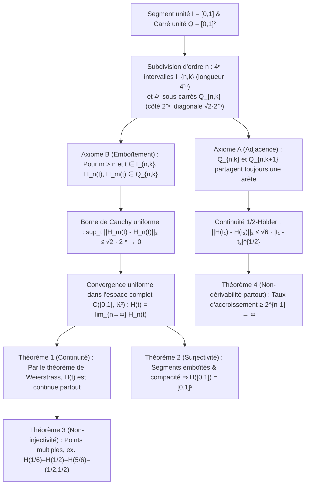

Au tout début du Livre I des *Éléments*, Euclide d'Alexandrie posait deux définitions fondatrices : « Le point est ce qui n'a aucune partie ; une ligne est une longueur sans largeur ($\mu\tilde{\eta}\kappa\omicron\varsigma\ \dot{\alpha}\pi\lambda\alpha\tau\acute{\varepsilon}\varsigma$). » Selon notre intuition géométrique quotidienne, une courbe mathématique idéale a une épaisseur strictement nulle ($\delta = 0$). Pendant plus de deux millénaires, il a semblé évident qu'un fil unidimensionnel dépourvu d'épaisseur ne pourrait jamais remplir intégralement l'intérieur d'un carré bidimensionnel $[0,1]^2$ sans laisser d'espaces vides.

Pourtant, en 1890, le mathématicien italien <strong>Giuseppe Peano (1858–1932)</strong> fit voler en éclats cette certitude bimillénaire dans un article de cinq pages publié dans les *Mathematische Annalen* : il construisit une <strong>application continue et surjective</strong> $f: [0,1] \to [0,1]^2$ du segment unité sur le carré unité. Un an plus tard, en 1891, <strong>David Hilbert (1862–1943)</strong> dévoila la <strong>courbe de Hilbert</strong> par une récursion géométrique lumineuse. Plus fascinant encore : cet objet que les analystes de la fin du XIXe siècle qualifiaient de « monstre pathologique » est devenu un siècle plus tard l'un des algorithmes les plus puissants de l'informatique moderne, au cœur de <strong>Google Maps (bibliothèque Google S2)</strong>, des bases de données spatiales (<strong>Hilbert R-Tree</strong>), des algorithmes <strong>cache-oblivious</strong> et de l'équilibrage de charge des <strong>supercalculateurs</strong>.

---

## 1. Le choc de Cantor (1877) et le théorème de Netto (1879)

En 1877, le père de la théorie des ensembles, <strong>Georg Cantor</strong>, découvrit qu'il existe une <strong>bijection (correspondance biunivoque)</strong> entre les points du segment $[0,1]$ et ceux du carré $[0,1]^2$. Stupéfait par sa propre démonstration, il écrivit à Richard Dedekind cette phrase célèbre : <strong>« Je le vois, mais je ne le crois pas ! »</strong>

L'idée de Cantor consistait à <strong>entrelacer (interleave)</strong> les décimales (ou des blocs de chiffres se terminant par un chiffre non nul afin d'éliminer rigoureusement le problème de la double représentation des décimaux finis comme $0,5 = 0,4999\dots$) :

$$x = 0.a_1 a_2 a_3 \dots, \quad y = 0.b_1 b_2 b_3 \dots \quad \Longrightarrow \quad t = \phi(x, y) = 0.a_1 b_1 a_2 b_2 a_3 b_3 \dots$$

$$|[0,1]| = |[0,1]^2| = |[0,1]^n| = |\mathbb{R}| = \mathfrak{c} = 2^{\aleph_0}$$

Ainsi, le segment $[0,1]$, le carré $[0,1]^2$ et l'hypercube $[0,1]^n$ possèdent exactement la même <strong>puissance du continu $\mathfrak{c} = 2^{\aleph_0}$</strong>. Toutefois, Dedekind fit aussitôt remarquer que cette bijection est <strong>partout discontinue</strong>. En 1879, <strong>Eugen Netto</strong> démontra qu'<strong>il n'existe aucune bijection continue (aucun homéomorphisme) entre $[0,1]$ et $[0,1]^2$</strong> : comme $[0,1]$ est compact et $[0,1]^2$ est séparé (Hausdorff), toute bijection continue serait un homéomorphisme ; or, si l'on retire le point intérieur $t_0 = 1/2$, $[0,1]\setminus\{1/2\} = [0,1/2) \cup (1/2,1]$ devient non connexe, tandis que le carré épointé $[0,1]^2 \setminus \{f(1/2)\}$ reste connexe par arcs — contradiction !

---

## 2. La courbe de Peano (1890) : sacrifier l'injectivité pour gagner la surjectivité continue !

Peano comprit la faille logique du théorème de Netto : seule la réunion simultanée de la continuité, de la surjectivité et de l'injectivité est impossible. <strong>Si l'on renonce à l'injectivité (en autorisant les points multiples d'auto-intersection), on peut construire une surjection continue $f: [0,1] \to [0,1]^2$ !</strong>

Peano utilisa le développement en base $3$ (ternaire) $t = 0,t_1 t_2 t_3 \dots_3$ ($t_m \in \{0,1,2\}$) et l'<strong>opérateur de complément $k(d) = 2 - d$</strong> :

$$t = \sum_{m=1}^{\infty} \frac{t_m}{3^m} \;\; (t_m \in \{0,1,2\}), \qquad k(d) = 2 - d, \qquad k^n(d) = \begin{cases} d & (n \text{ even}) \\ 2 - d & (n \text{ odd}) \end{cases}$$

$$x_n = k^{t_2 + t_4 + \cdots + t_{2n-2}}(t_{2n-1}), \qquad y_n = k^{t_1 + t_3 + \cdots + t_{2n-1}}(t_{2n})$$

Comme $k^n(d)$ ne dépend que de la parité de l'exposant $n$, aux points de double représentation ternaire (tels que $t = 1/3 = 0,0222\dots_3 = 0,1000\dots_3$), le passage de $t_1 = 0$ (pair) à $t_1 = 1$ (impair) active l'opérateur $k^1$, qui transforme tous les $0$ suivants en $2$ et recolle parfaitement les deux limites au point $(1/3, 1)$ !

---

## 3. La récursion géométrique de Hilbert (1891) et les preuves analytiques complètes

En 1891, David Hilbert remplaça la subdivision $3 \times 3$ de Peano par une récursion binaire sur <strong>$2 \times 2 = 4$ quadrants</strong> : à l'étape $n$, $[0,1]$ est divisé en $4^n$ sous-intervalles fermés $I_{n,k}$ de longueur $4^{-n}$ et $[0,1]^2$ en $4^n$ petits carrés $Q_{n,k}$ de côté $2^{-n}$, numérotés de façon à vérifier l'<strong>Axiome A (Adjacence : $Q_{n,k}$ et $Q_{n,k+1}$ partagent toujours un côté)</strong> et l'<strong>Axiome B (Emboîtement : $Q_{n,k} = \bigcup_{j=0}^3 Q_{n+1, 4k-j}$)</strong>.

1. <strong>Théorème 1 (Convergence uniforme et continuité)</strong> : Pour $m > n \ge 1$ et tout $t \in I_{n,k}$, l'Axiome B garantit que $H_n(t)$ et $H_m(t)$ appartiennent au même sous-carré $Q_{n,k}$ de diamètre $\sqrt{2}\cdot 2^{-n}$ :

$$I_{n,k} = \left[ \frac{k-1}{4^n}, \, \frac{k}{4^n} \right], \qquad \|H_m - H_n\|_\infty = \sup_{t \in [0,1]} \|H_m(t) - H_n(t)\|_2 \le \operatorname{diam}(Q_{n,k}) = \frac{\sqrt{2}}{2^n} \quad (\forall m > n \ge 1)$$

   La suite $\{H_n\}$ est donc uniformément de Cauchy dans $\mathcal{C}([0,1], \mathbb{R}^2)$, et sa limite uniforme $H(t)$ est continue sur $[0,1]$.
2. <strong>Théorème 2 (Surjectivité)</strong> : Pour tout point $p \in [0,1]^2$, une suite emboîtée de sous-carrés $Q_{n,k_n} \ni p$ définit une suite de segments emboîtés $I_{n,k_n}$ de longueur $4^{-n} \to 0$ dont l'intersection unique $t^* \in [0,1]$ vérifie $H(t^*) = p$ :

$$\bigcap_{n=1}^{\infty} I_{n, k_n} = \{t^*\}, \qquad \|H(t^*) - p\|_2 \le \frac{\sqrt{2}}{2^n} \xrightarrow{n \to \infty} 0 \quad \Longrightarrow \quad H([0,1]) = [0,1]^2$$

3. <strong>Théorème 3 (Points multiples)</strong> : Le centre $(1/2, 1/2)$ est visité trois fois ($H(1/6) = H(1/2) = H(5/6) = (1/2, 1/2)$), et les sommets dyadiques d'ordre supérieur présentent jusqu'à des points quadruples.
4. <strong>Théorème 4 (Longueur infinie, continuité $\frac{1}{2}$-Hölder et non-dérivabilité partout)</strong> : La longueur $L(H_n) = 2^n - 2^{-n} \to \infty$ diverge. Pour tout $t \in I_{n,k}$, au moins un sommet $v_n = H(s_n)$ de $Q_{n,k}$ est à distance $\ge 2^{-(n+1)}$ de $H(t)$ avec $|s_n - t| \le 4^{-n}$, de sorte que le taux d'accroissement diverge en $2^{n-1} \to \infty$ : <strong>$H(t)$ n'est dérivable en aucun point de $[0,1]$</strong> :

$$L(H_n) = (4^n - 1) 2^{-n} = 2^n - 2^{-n} \to +\infty, \qquad \|H(t_1) - H(t_2)\|_2 \le \sqrt{6}\, |t_1 - t_2|^{1/2}$$

$$\frac{\|H(s_n) - H(t)\|_2}{|s_n - t|} \ge \frac{2^{-(n+1)}}{4^{-n}} = 2^{n-1} \xrightarrow{n \to \infty} +\infty$$

---

## 4. Résolution de la crise de la dimension : dimension topologique $\dim_T$ vs dimension de Hausdorff $D_H$

En 1911, <strong>L. E. J. Brouwer</strong> démontra l'<strong>invariance de la dimension</strong> ($\mathbb{R}^n \cong \mathbb{R}^m \iff n = m$) via l'homologie locale. La <strong>dimension de recouvrement de Lebesgue $\dim_T$</strong> mesure l'ordre minimal de chevauchement $d + 1$ des recouvrements ouverts ($\dim_T([0,1]) = 1$, mais $\dim_T([0,1]^2) = 2$ comme les joints triples d'un mur de briques, ce qui explique topologiquement l'existence obligatoire de points au moins triples !). À l'inverse, la <strong>dimension de Hausdorff (fractale) $D_H$</strong> mesure le facteur d'échelle auto-similaire :

$$H_k(U, U \setminus \{p\}; \mathbb{Z}) \cong \tilde{H}_{k-1}(S^{n-1}; \mathbb{Z}) \cong \begin{cases} \mathbb{Z} & (k = n) \\ 0 & (k \ne n) \end{cases}, \qquad \dim_T([0,1]) = 1 < \dim_T([0,1]^2) = 2$$

$$D_H = \frac{\log N}{\log(1/r)} \quad \Longrightarrow \quad D_H(\text{Peano}) = \frac{\log 9}{\log 3} = 2, \qquad D_H(\text{Hilbert}) = \frac{\log 4}{\log 2} = 2$$

La courbe de Hilbert porte sa dimension fractale à $D_H = 2$ par pliage infini et élève la dimension topologique de son image à $\dim_T = 2$ grâce à ses auto-intersections.

| Type de courbe / application | Continue | Injective (sans auto-intersection) | Surjective sur $[0,1]^2$ | Dérivabilité | Dim. topologique $\dim_T(\text{Image})$ | Dim. de Hausdorff $D_H$ | Aire de Lebesgue $\mu_2$ |
| :--- | :---: | :---: | :---: | :---: | :---: | :---: | :---: |
| <strong>Courbe lisse simple (segment/arc)</strong> | Oui ($C^\infty$) | Oui | Non | Dérivable partout | $1$ | $1$ | $0$ |
| <strong>Courbe de Koch (flocon)</strong> | Oui | Oui | Non | Non dérivable partout | $1$ | $\frac{\log 4}{\log 3} \approx 1,262$ | $0$ |
| <strong>Courbe d'Osgood (1903)</strong> | Oui | Oui (arc de Jordan) | Non (intérieur vide) | Non dérivable p.p. | $1$ | $2$ | $> 0$ (aire positive !) |
| <strong>Entrelacement de Cantor</strong> | Non (discontinue) | Oui (bijection) | Oui | Non continue/dérivable | $2$ | $2$ | $1$ |
| <strong>Courbe de Peano (base 3, 1890)</strong> | Oui | Non (points multiples) | Oui (remplissante) | Non dérivable partout | $2$ | $\frac{\log 9}{\log 3} = 2$ | $1$ |
| <strong>Courbe de Hilbert (base 2, 1891)</strong> | Oui ($\frac{1}{2}$-Hölder) | Non (jusqu'à 4-uples) | Oui (remplissante) | Non dérivable partout | $2$ | $\frac{\log 4}{\log 2} = 2$ | $1$ |

---

## 5. Applications en informatique moderne : indexer un monde multidimensionnel dans une mémoire 1D

La mémoire informatique (adresses DRAM, blocs SSD, arbres B+) étant unidimensionnelle alors que les données géospatiales et physiques sont multidimensionnelles, la courbe de Hilbert discrète offre une <strong>préservation de la localité (Locality Preservation)</strong> optimale grâce à sa continuité $\frac{1}{2}$-Hölder et son emboîtement en quadtree :

$$z = \text{Morton}(x, y) = (y_{n-1} x_{n-1} \dots y_1 x_1 y_0 x_0)_2, \qquad C_{\text{dilation}} = \sup_{t_1 \ne t_2} \frac{\|\gamma(t_1) - \gamma(t_2)\|_2^2}{|t_1 - t_2|} = 6 \;\; (\text{Hilbert})$$

Contrairement à la <strong>courbe de Morton (Z-Order Curve)</strong> qui entrelace les bits sans rotation et subit de grands sauts diagonaux ($C_{\text{dilation}} = \infty$), la courbe de Hilbert avance toujours d'une distance de Manhattan exactement égale à $1$ ($C_{\text{dilation}} = 6$), réduisant de $25\%\text{–}40\%$ le nombre de segments B+-tree lors de requêtes spatiales 2D.
1. <strong>Google S2 Geometry Library (Google Maps, Uber, MongoDB)</strong> : Projette la sphère terrestre $S^2$ sur les $6$ faces d'un cube, corrige la distorsion d'aire et applique une <strong>courbe de Hilbert de niveau 30 ($H_{30}$)</strong> sur chaque face. Chaque parcelle de $0,7\,\text{cm} \times 0,7\,\text{cm}$ sur Terre est représentée par un unique entier <strong>64 bits (`S2CellId`)</strong>, transformant toute recherche géographique 2D en un balayage d'intervalles 1D ultra-rapide.
2. <strong>Hilbert R-Tree et calcul intensif (HPC)</strong> : Le tri des objets spatiaux selon leur indice de Hilbert minimise le chevauchement des rectangles englobants dans PostGIS et Apache Sedona, tandis que la courbe de Hilbert 3D découpe les octrees des simulations cosmologiques (Gadget-4, AMReX) pour équilibrer dynamiquement la charge entre des milliers de processeurs.
