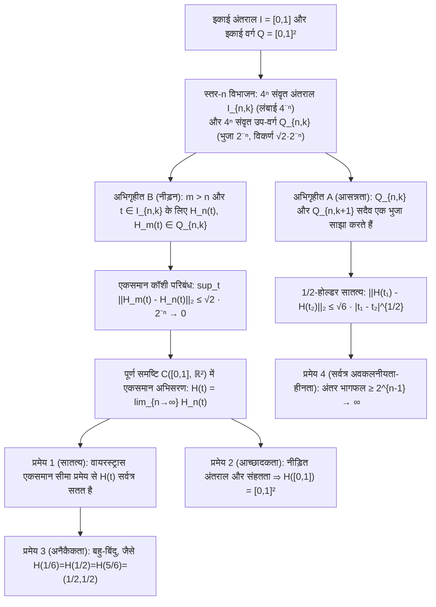

अपनी अमर कृति *एलिमेंट्स (Elements)* की प्रथम पुस्तक के प्रारंभ में ही सिकंदरिया के यूक्लिड ने बिंदु और रेखा की दो मूलभूत परिभाषाएँ दी थीं: "बिंदु वह है जिसका कोई भाग नहीं होता; और रेखा चौड़ाई रहित लंबाई ($\mu\tilde{\eta}\kappa\omicron\varsigma\ \dot{\alpha}\pi\lambda\alpha\tau\acute{\varepsilon}\varsigma$) है।" हमारे दैनिक ज्यामितीय अंतर्ज्ञान के अनुसार, एक आदर्श गणितीय वक्र की मोटाई पूर्णतः शून्य ($\delta = 0$) होती है। दो हजार से अधिक वर्षों तक यह स्वतःसिद्ध माना जाता रहा कि बिना चौड़ाई वाला एक-आयामी धागा चाहे कितना भी मोड़ा जाए, वह कभी भी बिना खाली जगह छोड़े दो-आयामी इकाई वर्ग $[0,1]^2$ के पूरे क्षेत्रफल को नहीं भर सकता।

किंतु 1890 में, इतालवी गणितज्ञ <strong>जुसेपे पियानो (Giuseppe Peano, 1858–1932)</strong> ने *Mathematische Annalen* में प्रकाशित मात्र पाँच पृष्ठों के शोधपत्र में इस दो हजार वर्ष पुरानी धारणा को ध्वस्त कर दिया: उन्होंने एक-आयामी इकाई अंतराल $I = [0,1]$ से दो-आयामी इकाई वर्ग $Q = [0,1]^2$ पर एक <strong>सतत आच्छादक प्रतिचित्रण (Continuous Surjection)</strong> $f: [0,1] \to [0,1]^2$ का निर्माण किया! एक वर्ष बाद (1891), <strong>डेविड हिल्बर्ट (David Hilbert, 1862–1943)</strong> ने अपनी ज्यामितीय पुनरावर्ती रचना—<strong>हिल्बर्ट वक्र (Hilbert Curve)</strong>—प्रस्तुत की। इससे भी अधिक आश्चर्यजनक बात यह है कि जिसे 19वीं सदी के अंत के गणितज्ञों ने शुद्ध गणित का "विकृत दैत्य (pathological monster)" कहा था, वह एक सदी बाद आधुनिक कंप्यूटर विज्ञान के सबसे शक्तिशाली एल्गोरिदम में से एक बन गया, जो आज <strong>Google Maps (Google S2 Geometry Library)</strong>, स्थानिक डेटाबेस (<strong>Hilbert R-Tree</strong>), <strong>कैश-ओब्लिवियस (cache-oblivious) एल्गोरिदम</strong> और <strong>सुपरकंप्यूटर लोड संतुलन</strong> का आधार है।

---

## 1. कैंटर का आघात (1877) और नेट्टो का प्रमेय (1879)

1877 में, समुच्चय सिद्धांत के जनक <strong>जॉर्ज कैंटर (Georg Cantor)</strong> ने खोजा कि एक-आयामी रेखाखंड $[0,1]$ के बिंदुओं और दो-आयामी वर्ग $[0,1]^2$ के बिंदुओं के बीच <strong>एकैकी आच्छादक संगति (Bijection)</strong> विद्यमान है। अपनी ही उत्पत्ति से स्तब्ध होकर उन्होंने रिचर्ड डेडेकिंड को प्रसिद्ध वाक्य लिखा: <strong>"Je le vois, mais je ne le crois pas!" (मैं इसे देख रहा हूँ, पर मुझे इस पर विश्वास नहीं हो रहा है!)</strong>

कैंटर का मूल विचार दशमलव प्रसार के अंकों (या शांत दशमलवों जैसे $0.5 = 0.4999\dots$ के दोहरे निरूपण की समस्या को समाप्त करने के लिए अशून्य अंक पर समाप्त होने वाले अविभाज्य अंकों के गुच्छों) को <strong>एकांतर क्रम में पिरोना (Interleaving)</strong> था:

$$x = 0.a_1 a_2 a_3 \dots, \quad y = 0.b_1 b_2 b_3 \dots \quad \Longrightarrow \quad t = \phi(x, y) = 0.a_1 b_1 a_2 b_2 a_3 b_3 \dots$$

$$|[0,1]| = |[0,1]^2| = |[0,1]^n| = |\mathbb{R}| = \mathfrak{c} = 2^{\aleph_0}$$

इससे सिद्ध हुआ कि रेखाखंड $[0,1]$, वर्ग $[0,1]^2$ और $n$-आयामी अतिघन $[0,1]^n$ की <strong>सातत्य गणनीयता (continuum cardinality) $\mathfrak{c} = 2^{\aleph_0}$</strong> बिल्कुल समान है। तथापि, डेडेकिंड ने तुरंत इंगित किया कि कैंटर का प्रतिचित्रण <strong>सर्वत्र असतत (everywhere discontinuous)</strong> है। 1879 में, <strong>यूजेन नेट्टो (Eugen Netto)</strong> ने सिद्ध किया कि <strong>$[0,1]$ और $[0,1]^2$ के बीच कोई सतत एकैकी आच्छादक प्रतिचित्रण (होमियोमॉर्फिज्म) नहीं हो सकता</strong>: चूँकि $[0,1]$ संहत (compact) है और $[0,1]^2$ हौसडॉर्फ समष्टि है, इसलिए कोई भी सतत बाइजेक्शन स्वतः होमियोमॉर्फिज्म होगा; किंतु आंतरिक बिंदु $t_0 = 1/2$ को हटाने पर $[0,1]\setminus\{1/2\} = [0,1/2) \cup (1/2,1]$ असंबद्ध (disconnected) हो जाता है, जबकि छिद्रित वर्ग $[0,1]^2 \setminus \{f(1/2)\}$ पथ-संबद्ध बना रहता है—जो एक विरोधाभास है!

---

## 2. पियानो वक्र (1890): एकैकता (Injectivity) का त्याग कर सतत आच्छादकता प्राप्त करना!

पियानो ने नेट्टो के प्रमेय में छिपे तार्किक मार्ग को पहचाना: केवल सातत्य, आच्छादकता और एकैकता तीनों को एक साथ संतुष्ट करना असंभव है। <strong>यदि हम एकैकता (स्व-प्रतिच्छेदन निषेध) को छोड़ दें और वक्र को एक ही बिंदु से कई बार गुजरने की अनुमति दें, तो हम सतत आच्छादक प्रतिचित्रण $f: [0,1] \to [0,1]^2$ का निर्माण कर सकते हैं!</strong>

पियानो ने आधार-$3$ (त्रिआधारी) प्रसार $t = 0.t_1 t_2 t_3 \dots_3$ ($t_m \in \{0,1,2\}$) और <strong>पूरक संकारक $k(d) = 2 - d$</strong> का उपयोग किया:

$$t = \sum_{m=1}^{\infty} \frac{t_m}{3^m} \;\; (t_m \in \{0,1,2\}), \qquad k(d) = 2 - d, \qquad k^n(d) = \begin{cases} d & (n \text{ even}) \\ 2 - d & (n \text{ odd}) \end{cases}$$

$$x_n = k^{t_2 + t_4 + \cdots + t_{2n-2}}(t_{2n-1}), \qquad y_n = k^{t_1 + t_3 + \cdots + t_{2n-1}}(t_{2n})$$

चूँकि $k^n(d)$ केवल घातांक $n$ की सम-विषमता (parity) पर निर्भर करता है, इसलिए त्रिआधारी दोहरे निरूपण की सीमा (जैसे $t = 1/3 = 0.0222\dots_3 = 0.1000\dots_3$) पर जब $t_1$ का मान $0$ (सम) से $1$ (विषम) होता है, तो संकारक $k^1$ सक्रिय होकर आगे के सभी $0$ को $2$ में बदल देता है और दोनों सीमाओं को बिंदु $(1/3, 1)$ पर निर्बाध रूप से जोड़ देता है!

---

## 3. हिल्बर्ट की ज्यामितीय पुनरावर्ती रचना (1891) और पूर्ण विश्लेषणात्मक प्रमाण

1891 में, डेविड हिल्बर्ट ने पियानो के $3 \times 3$ विभाजन के स्थान पर द्विआधारी <strong>$2 \times 2 = 4$ चतुर्थांश पुनरावर्तन</strong> प्रस्तुत किया: स्तर $n$ पर $[0,1]$ को लंबाई $4^{-n}$ के $4^n$ संवृत उप-अंतरालों $I_{n,k}$ में और $[0,1]^2$ को भुजा $2^{-n}$ के $4^n$ उप-वर्गों $Q_{n,k}$ में इस प्रकार विभाजित किया जाता है कि <strong>अभिगृहीत A (आसन्नता: $Q_{n,k}$ और $Q_{n,k+1}$ सदैव एक भुजा साझा करते हैं)</strong> और <strong>अभिगृहीत B (नीड़न/Nesting: $Q_{n,k} = \bigcup_{j=0}^3 Q_{n+1, 4k-j}$)</strong> संतुष्ट हों।

1. <strong>प्रमेय 1 (एकसमान अभिसरण और सातत्य)</strong>: किसी भी $m > n \ge 1$ और $t \in I_{n,k}$ के लिए, अभिगृहीत B के अनुसार $H_n(t)$ और $H_m(t)$ दोनों व्यास $\sqrt{2}\cdot 2^{-n}$ वाले एक ही उप-वर्ग $Q_{n,k}$ में स्थित होते हैं:

$$I_{n,k} = \left[ \frac{k-1}{4^n}, \, \frac{k}{4^n} \right], \qquad \|H_m - H_n\|_\infty = \sup_{t \in [0,1]} \|H_m(t) - H_n(t)\|_2 \le \operatorname{diam}(Q_{n,k}) = \frac{\sqrt{2}}{2^n} \quad (\forall m > n \ge 1)$$

   अतः $\{H_n\}$ बानाख समष्टि $\mathcal{C}([0,1], \mathbb{R}^2)$ में एकसमान कॉशी अनुक्रम है और इसकी सीमा $H(t)$ सर्वत्र सतत है।
2. <strong>प्रमेय 2 (आच्छादकता)</strong>: किसी भी बिंदु $p \in [0,1]^2$ के लिए, नीड़ित उप-वर्ग अनुक्रम $Q_{n,k_n} \ni p$ लंबाई $4^{-n} \to 0$ वाले नीड़ित संवृत अंतराल $I_{n,k_n}$ निर्धारित करता है जिनका अद्वितीय सर्वनिष्ठ बिंदु $t^* \in [0,1]$ $H(t^*) = p$ को संतुष्ट करता है:

$$\bigcap_{n=1}^{\infty} I_{n, k_n} = \{t^*\}, \qquad \|H(t^*) - p\|_2 \le \frac{\sqrt{2}}{2^n} \xrightarrow{n \to \infty} 0 \quad \Longrightarrow \quad H([0,1]) = [0,1]^2$$

3. <strong>प्रमेय 3 (बहु-बिंदु)</strong>: वर्ग के केंद्र $(1/2, 1/2)$ से वक्र तीन बार गुजरता है ($H(1/6) = H(1/2) = H(5/6) = (1/2, 1/2)$), और उच्चतर द्विआधारी जालक शीर्षों पर चतुर्गुण बिंदु मिलते हैं।
4. <strong>प्रमेय 4 (अनंत चाप लंबाई, $\frac{1}{2}$-होल्डर सातत्य, और सर्वत्र अवकलनीयता-हीनता)</strong>: लंबाई $L(H_n) = 2^n - 2^{-n} \to \infty$ अपसारित होती है। किसी भी $t \in I_{n,k}$ के लिए $Q_{n,k}$ का कम से कम एक शीर्ष $v_n = H(s_n)$, $H(t)$ से $\ge 2^{-(n+1)}$ की दूरी पर होता है जबकि $|s_n - t| \le 4^{-n}$, जिससे न्यूटन अंतर भागफल $2^{n-1} \to \infty$ के रूप में अपसारित होता है—<strong>अर्थात् $H(t)$ अंतराल $[0,1]$ के किसी भी बिंदु पर अवकलनीय नहीं है</strong>:

$$L(H_n) = (4^n - 1) 2^{-n} = 2^n - 2^{-n} \to +\infty, \qquad \|H(t_1) - H(t_2)\|_2 \le \sqrt{6}\, |t_1 - t_2|^{1/2}$$

$$\frac{\|H(s_n) - H(t)\|_2}{|s_n - t|} \ge \frac{2^{-(n+1)}}{4^{-n}} = 2^{n-1} \xrightarrow{n \to \infty} +\infty$$

---

## 4. आयाम के संकट का समाधान: टोपोलॉजिकल आयाम $\dim_T$ बनाम हौसडॉर्फ आयाम $D_H$

1911 में, <strong>एल. ई. जे. ब्राउवर (Brouwer)</strong> ने स्थानीय होमोलॉजी समूहों द्वारा <strong>आयाम निश्चरता प्रमेय</strong> ($\mathbb{R}^n \cong \mathbb{R}^m \iff n = m$) सिद्ध किया। <strong>लेबेग आवरण आयाम $\dim_T$</strong> खुले आवरणों के न्यूनतम अतिव्यापन क्रम $d + 1$ को मापता है ($\dim_T([0,1]) = 1$, किंतु $\dim_T([0,1]^2) = 2$ जैसे ईंटों की दीवार के त्रिक जोड़, जो टोपोलॉजिकल रूप से स्पष्ट करता है कि किसी भी स्थान-पूरक वक्र में कम से कम त्रिक बिंदु क्यों अनिवार्य हैं!)। इसके विपरीत, <strong>हौसडॉर्फ (फ्रैक्टल) आयाम $D_H$</strong> स्व-समान मापन को मापता है:

$$H_k(U, U \setminus \{p\}; \mathbb{Z}) \cong \tilde{H}_{k-1}(S^{n-1}; \mathbb{Z}) \cong \begin{cases} \mathbb{Z} & (k = n) \\ 0 & (k \ne n) \end{cases}, \qquad \dim_T([0,1]) = 1 < \dim_T([0,1]^2) = 2$$

$$D_H = \frac{\log N}{\log(1/r)} \quad \Longrightarrow \quad D_H(\text{Peano}) = \frac{\log 9}{\log 3} = 2, \qquad D_H(\text{Hilbert}) = \frac{\log 4}{\log 2} = 2$$

हिल्बर्ट वक्र अनंत मोड़ों के माध्यम से अपने फ्रैक्टल आयाम को $D_H = 2$ तक पहुँचाता है और स्व-प्रतिच्छेदन द्वारा अपने प्रतिबिंब के टोपोलॉजिकल आयाम को भी $\dim_T = 2$ तक उठा देता है।

| वक्र / प्रतिचित्रण प्रकार | सातत्य | एकैकता (स्व-प्रतिच्छेदन रहित) | $[0,1]^2$ पर आच्छादकता | अवकलनीयता | टोपोलॉजिकल आयाम $\dim_T(\text{Image})$ | हौसडॉर्फ आयाम $D_H$ | 2D लेबेग क्षेत्रफल $\mu_2$ |
| :--- | :---: | :---: | :---: | :---: | :---: | :---: | :---: |
| <strong>निष्कोण सरल वक्र (रेखाखंड/चाप)</strong> | हाँ ($C^\infty$) | हाँ | नहीं | सर्वत्र अवकलनीय | $1$ | $1$ | $0$ |
| <strong>कोख हिमकण वक्र (Koch)</strong> | हाँ | हाँ | नहीं | सर्वत्र अवकलनीयता-हीन | $1$ | $\frac{\log 4}{\log 3} \approx 1.262$ | $0$ |
| <strong>ओसगुड वक्र (Osgood, 1903)</strong> | हाँ | हाँ (जॉर्डन चाप) | नहीं (रिक्त अभ्यंतर) | लगभग सर्वत्र अवकलनीयता-हीन | $1$ | $2$ | $> 0$ (धनात्मक क्षेत्रफल!) |
| <strong>कैंटर अंक-पिरोना प्रतिचित्रण</strong> | नहीं (असतत) | हाँ (बाइजेक्शन) | हाँ | सर्वत्र असतत/अवकलनीयता-हीन | $2$ | $2$ | $1$ |
| <strong>पियानो वक्र (आधार 3, 1890)</strong> | हाँ | नहीं (बहु-बिंदु) | हाँ (स्थान-पूरक) | सर्वत्र अवकलनीयता-हीन | $2$ | $\frac{\log 9}{\log 3} = 2$ | $1$ |
| <strong>हिल्बर्ट वक्र (आधार 2, 1891)</strong> | हाँ ($\frac{1}{2}$-होल्डर) | नहीं (चतुर्गुण बिंदु तक) | हाँ (स्थान-पूरक) | सर्वत्र अवकलनीयता-हीन | $2$ | $\frac{\log 4}{\log 2} = 2$ | $1$ |

---

## 5. आधुनिक कंप्यूटर विज्ञान अनुप्रयोग: 1D मेमोरी में बहु-आयामी विश्व का अनुक्रमण

चूँकि कंप्यूटर हार्डवेयर मेमोरी (DRAM पते, SSD ब्लॉक, B+ ट्री कुंजियाँ) एक-आयामी होती है जबकि भू-स्थानिक और भौतिक डेटा बहु-आयामी होता है, इसलिए विविक्त हिल्बर्ट वक्र $\frac{1}{2}$-होल्डर सातत्य और क्वाडट्री नीड़न के कारण इष्टतम <strong>स्थानिक स्थानीयता संरक्षण (Locality Preservation)</strong> प्रदान करता है:

$$z = \text{Morton}(x, y) = (y_{n-1} x_{n-1} \dots y_1 x_1 y_0 x_0)_2, \qquad C_{\text{dilation}} = \sup_{t_1 \ne t_2} \frac{\|\gamma(t_1) - \gamma(t_2)\|_2^2}{|t_1 - t_2|} = 6 \;\; (\text{Hilbert})$$

<strong>मॉर्टन वक्र (Z-Order Curve)</strong> के विपरीत, जो बिना घूर्णन के बिट्स को पिरोता है और लंबी विकर्ण छलांगें लगाता है ($C_{\text{dilation}} = \infty$), हिल्बर्ट वक्र प्रत्येक चरण $t \to t+1$ पर ठीक $1$ की मैनहट्टन दूरी तय करता है ($C_{\text{dilation}} = 6$), जिससे 2D स्थानिक प्रश्नों में B+ ट्री रेंज स्कैन की संख्या $25\%\text{–}40\%$ कम हो जाती है।
1. <strong>Google S2 Geometry Library (Google Maps, Uber, MongoDB)</strong>: पृथ्वी के गोले $S^2$ को घन के $6$ फलकों पर प्रक्षेपित करता है, क्षेत्रफल विरूपण को सुधारता है, और प्रत्येक फलक पर <strong>30-स्तरीय हिल्बर्ट वक्र ($H_{30}$)</strong> लागू करता है। पृथ्वी के प्रत्येक $0.7\,\text{cm} \times 0.7\,\text{cm}$ प्रकोष्ठ को एक एकल <strong>64-बिट पूर्णांक (`S2CellId`)</strong> में कोडित किया जाता है, जिससे जटिल 2D भू-स्थानिक खोजें अति-तीव्र 1D B+ ट्री रेंज स्कैन में बदल जाती हैं।
2. <strong>Hilbert R-Tree और सुपरकंप्यूटिंग (HPC)</strong>: हिल्बर्ट सूचकांक द्वारा बहुभुजों को क्रमबद्ध करने से PostGIS और Apache Sedona में R-ट्री नोड अतिव्यापन न्यूनतम होता है, जबकि ब्रह्मांडीय सिमुलेशन (Gadget-4, AMReX) में 3D हिल्बर्ट वक्र ऑक्ट्री को विभाजित कर इष्टतम गतिशील लोड संतुलन स्थापित करता है।
