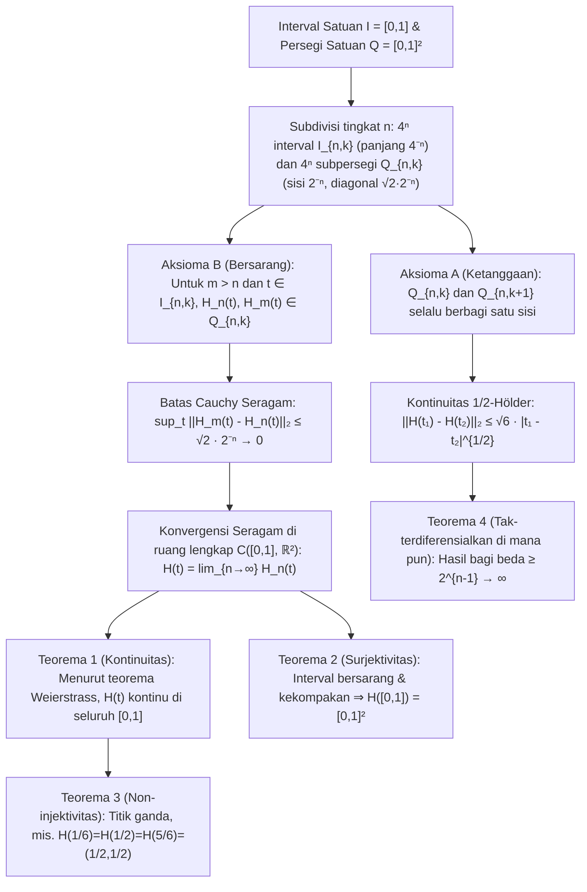

Di bagian paling awal Buku I *Elements*, Euklides dari Aleksandria menetapkan dua definisi dasar: "Titik adalah sesuatu yang tidak memiliki bagian; garis adalah panjang tanpa lebar ($\mu\tilde{\eta}\kappa\omicron\varsigma\ \dot{\alpha}\pi\lambda\alpha\tau\acute{\varepsilon}\varsigma$)." Menurut intuisi geometri sehari-hari, kurva matematika ideal memiliki ketebalan tepat nol ($\delta = 0$). Selama lebih dari dua milenium, tampak jelas bahwa sehelai benang satu dimensi tanpa ketebalan tidak akan pernah bisa mengisi penuh bagian dalam persegi dua dimensi $[0,1]^2$ tanpa menyisakan celah.

Namun pada tahun 1890, matematikawan Italia <strong>Giuseppe Peano (1858–1932)</strong> meruntuhkan kepastian dua ribu tahun itu dalam makalah lima halaman di *Mathematische Annalen*, dengan mengonstruksi <strong>pemetaan kontinu dan surjektif</strong> $f: [0,1] \to [0,1]^2$ dari interval satuan ke persegi satuan. Setahun kemudian (1891), <strong>David Hilbert (1862–1943)</strong> memperkenalkan konstruksi rekursif geometrisnya: <strong>Kurva Hilbert</strong>. Lebih menakjubkan lagi, objek yang pada akhir abad ke-19 dijuluki "monster patologis" matematika murni ini bangkit satu abad kemudian sebagai salah satu algoritma paling vital dalam ilmu komputer modern—menggerakkan <strong>Google Maps (pustaka Google S2)</strong>, basis data spasial (<strong>Hilbert R-Tree</strong>), algoritma <strong>cache-oblivious</strong>, dan penyeimbangan beban <strong>superkomputer</strong>.

---

## 1. Kejutan Cantor (1877) dan Teorema Netto (1879)

Pada tahun 1877, bapak teori himpunan <strong>Georg Cantor</strong> menemukan bahwa terdapat <strong>bijeksi (korespondensi satu-satu)</strong> antara titik-titik pada segmen garis $[0,1]$ dan titik-titik pada persegi $[0,1]^2$. Terpukau oleh buktinya sendiri, ia menulis kalimat legendaris kepada Richard Dedekind: <strong>"Je le vois, mais je ne le crois pas!" (Saya melihatnya, tetapi saya tidak mempercayainya!)</strong>

Ide inti Cantor adalah <strong>menyisipkan secara bergantian (interleaving)</strong> digit-digit desimal (atau blok digit tak-terpisahkan yang diakhiri digit tak-nol guna menghilangkan masalah representasi ganda desimal berhingga seperti $0{,}5 = 0{,}4999\dots$):

$$x = 0.a_1 a_2 a_3 \dots, \quad y = 0.b_1 b_2 b_3 \dots \quad \Longrightarrow \quad t = \phi(x, y) = 0.a_1 b_1 a_2 b_2 a_3 b_3 \dots$$

$$|[0,1]| = |[0,1]^2| = |[0,1]^n| = |\mathbb{R}| = \mathfrak{c} = 2^{\aleph_0}$$

Ini membuktikan bahwa segmen $[0,1]$, persegi $[0,1]^2$, dan hiperkubus $[0,1]^n$ memiliki <strong>kardinalitas kontinuum $\mathfrak{c} = 2^{\aleph_0}$</strong> yang sama persis. Namun, Dedekind segera menunjukkan bahwa bijeksi Cantor <strong>diskontinu di mana-mana</strong>. Pada tahun 1879, <strong>Eugen Netto</strong> membuktikan bahwa <strong>tidak ada bijeksi kontinu (homeomorfisme) antara $[0,1]$ dan $[0,1]^2$</strong>: karena $[0,1]$ kompak dan $[0,1]^2$ Hausdorff, setiap bijeksi kontinu otomatis merupakan homeomorfisme; tetapi jika titik dalam $t_0 = 1/2$ dihapus, $[0,1]\setminus\{1/2\} = [0,1/2) \cup (1/2,1]$ menjadi tak-terhubung, sedangkan persegi berlubang $[0,1]^2 \setminus \{f(1/2)\}$ tetap terhubung-lintasan—suatu kontradiksi!

---

## 2. Kurva Peano (1890): Melepaskan Injektivitas demi Surjektivitas Kontinu!

Peano melihat celah logika dalam teorema Netto: yang mustahil hanyalah memenuhi kontinuitas, surjektivitas, dan injektivitas secara bersamaan. <strong>Jika kita melepaskan syarat injektivitas (mengizinkan perpotongan diri atau titik ganda), kita dapat membangun surjeksi kontinu $f: [0,1] \to [0,1]^2$!</strong>

Peano menggunakan ekspansi basis-$3$ (terner) $t = 0{,}t_1 t_2 t_3 \dots_3$ ($t_m \in \{0,1,2\}$) bersama <strong>operator komplemen $k(d) = 2 - d$</strong>:

$$t = \sum_{m=1}^{\infty} \frac{t_m}{3^m} \;\; (t_m \in \{0,1,2\}), \qquad k(d) = 2 - d, \qquad k^n(d) = \begin{cases} d & (n \text{ even}) \\ 2 - d & (n \text{ odd}) \end{cases}$$

$$x_n = k^{t_2 + t_4 + \cdots + t_{2n-2}}(t_{2n-1}), \qquad y_n = k^{t_1 + t_3 + \cdots + t_{2n-1}}(t_{2n})$$

Karena $k^n(d)$ hanya bergantung pada paritas (genap/ganjil) eksponen $n$, pada batas representasi ganda terner (seperti $t = 1/3 = 0{,}0222\dots_3 = 0{,}1000\dots_3$), perubahan $t_1 = 0$ (genap) menjadi $t_1 = 1$ (ganjil) mengaktifkan $k^1$, membalik semua angka $0$ berikutnya menjadi $2$ dan menyatukan kedua limit secara mulus di titik $(1/3, 1)$!

---

## 3. Rekursi Geometris Hilbert (1891) dan Bukti Analitik Lengkap

Pada tahun 1891, David Hilbert mengganti pembagian $3 \times 3$ Peano dengan rekursi biner <strong>$2 \times 2 = 4$ kuadran</strong>: pada tingkat $n$, $[0,1]$ dibagi menjadi $4^n$ subinterval tertutup $I_{n,k}$ dengan panjang $4^{-n}$ dan $[0,1]^2$ dibagi menjadi $4^n$ subpersegi $Q_{n,k}$ dengan sisi $2^{-n}$, memenuhi <strong>Aksioma A (Ketanggaan: $Q_{n,k}$ dan $Q_{n,k+1}$ selalu berbagi satu sisi)</strong> dan <strong>Aksioma B (Penyisipan Bersarang: $Q_{n,k} = \bigcup_{j=0}^3 Q_{n+1, 4k-j}$)</strong>.

1. <strong>Teorema 1 (Konvergensi Seragam dan Kontinuitas)</strong>: Untuk $m > n \ge 1$ dan setiap $t \in I_{n,k}$, berdasarkan Aksioma B baik $H_n(t)$ maupun $H_m(t)$ berada di dalam subpersegi $Q_{n,k}$ yang sama dengan diameter $\sqrt{2}\cdot 2^{-n}$:

$$I_{n,k} = \left[ \frac{k-1}{4^n}, \, \frac{k}{4^n} \right], \qquad \|H_m - H_n\|_\infty = \sup_{t \in [0,1]} \|H_m(t) - H_n(t)\|_2 \le \operatorname{diam}(Q_{n,k}) = \frac{\sqrt{2}}{2^n} \quad (\forall m > n \ge 1)$$

   Maka $\{H_n\}$ adalah barisan Cauchy seragam di $\mathcal{C}([0,1], \mathbb{R}^2)$ dan limit seragamnya $H(t)$ kontinu di seluruh $[0,1]$.
2. <strong>Teorema 2 (Surjektivitas)</strong>: Untuk setiap $p \in [0,1]^2$, barisan subpersegi bersarang $Q_{n,k_n} \ni p$ menentukan interval tertutup bersarang $I_{n,k_n}$ dengan panjang $4^{-n} \to 0$ yang irisannya tunggal $t^* \in [0,1]$ memenuhi $H(t^*) = p$:

$$\bigcap_{n=1}^{\infty} I_{n, k_n} = \{t^*\}, \qquad \|H(t^*) - p\|_2 \le \frac{\sqrt{2}}{2^n} \xrightarrow{n \to \infty} 0 \quad \Longrightarrow \quad H([0,1]) = [0,1]^2$$

3. <strong>Teorema 3 (Titik Ganda)</strong>: Pusat $(1/2, 1/2)$ dilewati tiga kali ($H(1/6) = H(1/2) = H(5/6) = (1/2, 1/2)$), dan pada simpul kisi biner tingkat lanjut muncul titik empat-rangkap.
4. <strong>Teorema 4 (Panjang Busur Takhingga, Kontinuitas $\frac{1}{2}$-Hölder, dan Tak-Terdiferensialkan di Mana Pun)</strong>: Panjang $L(H_n) = 2^n - 2^{-n} \to \infty$ divergen. Untuk setiap $t \in I_{n,k}$, setidaknya satu titik sudut $v_n = H(s_n)$ dari $Q_{n,k}$ berjarak $\ge 2^{-(n+1)}$ dari $H(t)$ dengan $|s_n - t| \le 4^{-n}$, sehingga hasil bagi beda Newton divergen sebesar $2^{n-1} \to \infty$: <strong>$H(t)$ tidak terdiferensialkan di titik mana pun pada $[0,1]$</strong>:

$$L(H_n) = (4^n - 1) 2^{-n} = 2^n - 2^{-n} \to +\infty, \qquad \|H(t_1) - H(t_2)\|_2 \le \sqrt{6}\, |t_1 - t_2|^{1/2}$$

$$\frac{\|H(s_n) - H(t)\|_2}{|s_n - t|} \ge \frac{2^{-(n+1)}}{4^{-n}} = 2^{n-1} \xrightarrow{n \to \infty} +\infty$$

---

## 4. Menyelesaikan Krisis Dimensi: Dimensi Topologi $\dim_T$ vs. Dimensi Hausdorff $D_H$

Pada tahun 1911, <strong>L. E. J. Brouwer</strong> membuktikan <strong>invariansi dimensi</strong> ($\mathbb{R}^n \cong \mathbb{R}^m \iff n = m$) melalui homologi lokal. <strong>Dimensi peliputan Lebesgue $\dim_T$</strong> mengukur orde tumpang-tindih minimum $d + 1$ dari liputan terbuka ($\dim_T([0,1]) = 1$, tetapi $\dim_T([0,1]^2) = 2$ seperti sambungan tiga-bata pada dinding, yang secara topologi menjelaskan mengapa setiap kurva pengisi persegi wajib memiliki setidaknya titik rangkap tiga!). Sebaliknya, <strong>dimensi Hausdorff (fraktal) $D_H$</strong> mengukur penskalaan serupa-diri:

$$H_k(U, U \setminus \{p\}; \mathbb{Z}) \cong \tilde{H}_{k-1}(S^{n-1}; \mathbb{Z}) \cong \begin{cases} \mathbb{Z} & (k = n) \\ 0 & (k \ne n) \end{cases}, \qquad \dim_T([0,1]) = 1 < \dim_T([0,1]^2) = 2$$

$$D_H = \frac{\log N}{\log(1/r)} \quad \Longrightarrow \quad D_H(\text{Peano}) = \frac{\log 9}{\log 3} = 2, \qquad D_H(\text{Hilbert}) = \frac{\log 4}{\log 2} = 2$$

Kurva Hilbert mencapai dimensi fraktal $D_H = 2$ melalui pelipatan takhingga dan mengangkat dimensi topologi bayangannya menjadi $\dim_T = 2$ melalui perpotongan diri.

| Jenis Kurva / Pemetaan | Kontinu | Injektif (Tanpa Perpotongan Diri) | Surjektif ke $[0,1]^2$ | Keterdiferensialan | Dim. Topologi $\dim_T(\text{Bayangan})$ | Dim. Hausdorff $D_H$ | Luas Lebesgue $\mu_2$ |
| :--- | :---: | :---: | :---: | :---: | :---: | :---: | :---: |
| <strong>Kurva mulus sederhana (segmen/busur)</strong> | Ya ($C^\infty$) | Ya | Tidak | Terdiferensialkan di mana pun | $1$ | $1$ | $0$ |
| <strong>Kurva Koch (kepingan salju)</strong> | Ya | Ya | Tidak | Tak-terdiferensialkan di mana pun | $1$ | $\frac{\log 4}{\log 3} \approx 1{,}262$ | $0$ |
| <strong>Kurva Osgood (1903)</strong> | Ya | Ya (busur Jordan) | Tidak (interior kosong) | Hampir di mana pun tak-terdif. | $1$ | $2$ | $> 0$ (luas positif!) |
| <strong>Penyisipan digit Cantor</strong> | Tidak (diskontinu) | Ya (bijeksi) | Ya | Tak-kontinu/terdiferensialkan | $2$ | $2$ | $1$ |
| <strong>Kurva Peano (basis 3, 1890)</strong> | Ya | Tidak (titik ganda) | Ya (mengisi ruang) | Tak-terdiferensialkan di mana pun | $2$ | $\frac{\log 9}{\log 3} = 2$ | $1$ |
| <strong>Kurva Hilbert (basis 2, 1891)</strong> | Ya ($\frac{1}{2}$-Hölder) | Tidak (hingga 4-rangkap) | Ya (mengisi ruang) | Tak-terdiferensialkan di mana pun | $2$ | $\frac{\log 4}{\log 2} = 2$ | $1$ |

---

## 5. Aplikasi Ilmu Komputer Modern: Mengindeks Dunia Multidimensi dalam Memori 1D

Karena memori perangkat keras (alamat DRAM, blok SSD, pohon B+) bersifat satu dimensi sedangkan data geospasial dan fisika bersifat multidimensi, kurva Hilbert diskrit memberikan <strong>pelestarian lokalitas (Locality Preservation)</strong> optimal berkat kontinuitas $\frac{1}{2}$-Hölder dan penyisipan quadtree:

$$z = \text{Morton}(x, y) = (y_{n-1} x_{n-1} \dots y_1 x_1 y_0 x_0)_2, \qquad C_{\text{dilation}} = \sup_{t_1 \ne t_2} \frac{\|\gamma(t_1) - \gamma(t_2)\|_2^2}{|t_1 - t_2|} = 6 \;\; (\text{Hilbert})$$

Berbeda dengan <strong>Kurva Morton (Z-Order Curve)</strong> yang menyisipkan bit tanpa rotasi dan mengalami lompatan diagonal besar ($C_{\text{dilation}} = \infty$), kurva Hilbert selalu melangkah sejauh jarak Manhattan tepat $1$ ($C_{\text{dilation}} = 6$), mengurangi jumlah pemindaian rentang pohon B+ sebesar $25\%\text{–}40\%$ pada kueri spasial 2D.
1. <strong>Google S2 Geometry Library (Google Maps, Uber, MongoDB)</strong>: Memproyeksikan bola Bumi $S^2$ ke $6$ sisi kubus, mengoreksi distorsi luas, dan menerapkan <strong>kurva Hilbert tingkat 30 ($H_{30}$)</strong> pada setiap sisi. Setiap petak $0{,}7\,\text{cm} \times 0{,}7\,\text{cm}$ di permukaan Bumi dikodekan menjadi satu bilangan bulat <strong>64-bit (`S2CellId`)</strong>, mengubah pencarian radius 2D menjadi pemindaian rentang 1D super cepat di pohon B+.
2. <strong>Hilbert R-Tree dan Superkomputasi (HPC)</strong>: Mengurutkan poligon berdasarkan indeks Hilbert meminimalkan tumpang-tindih simpul R-Tree di PostGIS dan Apache Sedona, sementara kurva Hilbert 3D mempartisi octree dalam simulasi kosmologi (Gadget-4, AMReX) untuk penyeimbangan beban dinamis yang optimal.
