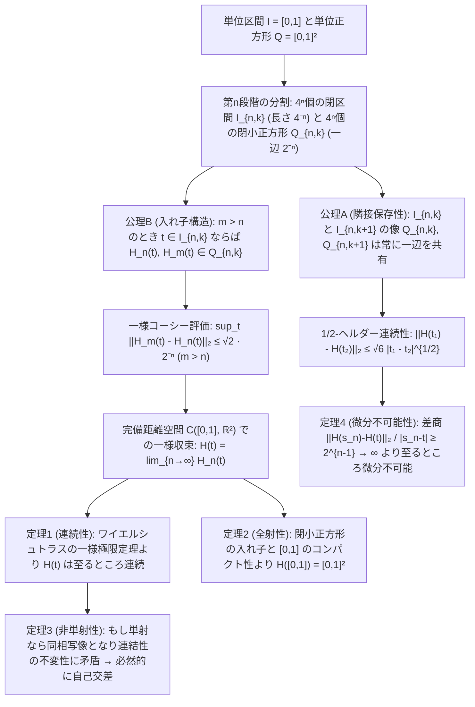
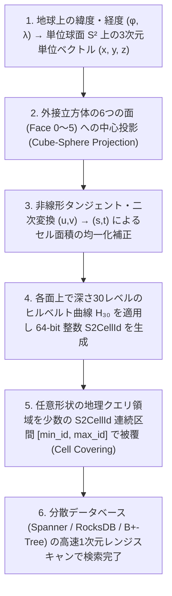

## はじめに：ユークリッド幾何学の直感の崩壊と「一本の線で面を塗りつぶす」パラドックス

古代ギリシャの数学者ユークリッド（Euclid）は、その後2000年以上にわたって人類の空間認識の規範となった不朽の古典『原論（Elements）』第1巻の冒頭において、点と線を次のように定義した。

- <strong>定義1</strong>：「点とは、部分を持たないものである（Σημεῖόν ἐστιν, οὗ μέρος οὐθέν）。」
- <strong>定義2</strong>：「線とは、幅のない長さである（Γραμμὴ δὲ μῆκος ἀπλατές）。」

私たちの日常的な直感に照らせば、この定義は自明の真理のように思える。どれほど細いペンや筆を使って紙の上を一筆書きでなぞったとしても、現実のインクには必ず微小な「幅（太さ）」があるからこそ、正方形の内部を黒く塗りつぶすことができる。しかし、数学における理想的な「曲線」とは、太さが完全にゼロ（$0$）の1次元の軌跡である。幅がゼロの糸をどれほど細かく折り曲げ、どれほど緻密に蛇行させたとしても、そこには隙間が残るか、あるいは面積ゼロの集合にしかならないはずだ——それが19世紀後半に至るまで、すべての数学者が疑うことすらなかった幾何学的常識であった。

ところが1890年、イタリアの数学者<strong>ジュゼッペ・ペアノ（Giuseppe Peano, 1858–1932）</strong>が数学誌『Mathematische Annalen』に発表したわずか5ページの論文『Sur une courbe, qui remplit toute une aire plane（平面領域全体を埋め尽くす曲線について）』によって、この2000年間の直感は音を立てて崩壊した。ペアノは、単位区間 $I = [0,1]$ から単位正方形 $Q = [0,1]^2$ への<strong>連続な全射写像</strong> $f: [0,1] \to [0,1]^2$ を具体的に構成してみせたのである。

これは何を意味するのか。時刻 $t=0$ から $t=1$ までの間に、平面上を切れ目なく（連続的に）動く1つの点 $f(t) = (x(t), y(t))$ が、単位正方形 $[0,1]^2$ の内部および境界にある<strong>すべての点（有理数座標の点も無理数座標の点も、1つ残らずすべて！）を少なくとも1回は通過する</strong>ということである。翌1891年には、ドイツの巨匠<strong>ダフィット・ヒルベルト（David Hilbert, 1862–1943）</strong>が、ペアノの算術的な構成を視覚的・幾何学的に洗練させた<strong>ヒルベルト曲線（Hilbert Curve）</strong>を発表し、空間充填曲線（Space-Filling Curve / Peano Curve）の存在は解析学と位相幾何学（トポロジー）の根幹を揺るがす一大事件となった。

1次元であるはずの「線」が、2次元であるはずの「面」を隙間なく埋め尽くしてしまうならば、そもそも私たちが信じている<strong>「次元（Dimension）」とは一体何なのか？</strong>

そしてさらに驚くべきことに、19世紀末の数学者たちから「直感に反する病的な怪物（Pathological monster）」と恐れられたこの空間充填曲線は、100年以上の時を経た現代のコンピュータサイエンスにおいて、<strong>Google Maps（Google S2 Geometry Library）</strong>や<strong>多次元データベース（Hilbert R-Tree）</strong>、<strong>スーパーコンピュータの並列負荷分散</strong>、<strong>キャッシュ・オブリビアス（Cache-Oblivious）行列計算</strong>を支える最も強力なアルゴリズムの1つとして甦ったのである。

本稿では、カントールによる連続体濃度の衝撃的な発見から出発し、ペアノ曲線とヒルベルト曲線の厳密な数学的構成、一様収束性・全射性・いたるところ微分不可能性・$1/2$-ヘルダー連続性の完全な証明、ブラウワーの次元不変性定理および位相次元とハウスドルフ次元（フラクタル次元）による「次元の危機」の解決、そして現代の情報科学・工学における最先端の応用までを体系的に解き明かす。

---

## 第1章：カントールの衝撃（1877年）——直線と平面の「点の数」は同じである

空間充填曲線の物語は、曲線の連続性が議論されるよりも13年前、集合論の創始者<strong>ゲオルク・カントール（Georg Cantor, 1845–1918）</strong>が直面したある根本的な問いから始まる。

### 1.1 「我にはそれが見えるが、信じることができない！」

1874年、カントールは実数全体の集合 $\mathbb{R}$ が自然数全体の集合 $\mathbb{N}$ よりも真に大きな無限濃度（非可算無限 / Uncountable infinity）を持つことを証明した。その直後、彼は友人であり良き理解者であった<strong>リヒャルト・デデキント（Richard Dedekind, 1831–1916）</strong>への書簡の中で、次のような問いを投げかけた。

> 「連続的な1次元の直線（たとえば単位区間 $[0,1]$）の点と、連続的な2次元の曲面（たとえば単位正方形 $[0,1]^2$）、さらには $n$ 次元空間の点とを、一対一に対応させる（全単射を作る）ことは可能だろうか？」

当時の数学者たちのほぼ全員が「そんなことは絶対に不可能である」と考えていた。なぜなら、区間 $[0,1]$ 上の点を指定するには1つの実数座標 $t$ で十分であるのに対し、正方形 $[0,1]^2$ 上の点を指定するには独立な2つの実数座標 $(x, y)$ が必要だからである。「次元の違い」とはすなわち「独立変数の個数の違い」であり、2つの変数が動く集合の方が1つの変数が動く集合よりも圧倒的に多くの点を含んでいるに違いない、と思われていたのである。

しかし3年間の苦闘の末、1877年6月20日、カントールはついに区間 $[0,1]$ と正方形 $[0,1]^2$ の間に<strong>完全な一対一対応（全単射 / Bijection）が存在する</strong>ことを発見した。その衝撃のあまり、カントールはデデキントに宛てた手紙の中で、数学史上最も有名な言葉の1つを書き残している。

> <strong>"Je le vois, mais je ne le crois pas!"（私にはそれが見えるが、信じることができない！）</strong>

### 1.2 小数展開のインターリーブ（交互配置）による構成

カントールが発見したアイデアの核心は、驚くほどシンプルで美しい「桁の交互配置（Interleaving of digits）」であった。

区間 $(0,1]$ 内の任意の実数 $t$ と、正方形 $(0,1]^2$ 内の任意の点 $(x,y)$ を考える。一意性を保つため、有限小数は末尾に $0$ を並べる表現ではなく、無限に9が続く表現（たとえば $0.5 = 0.49999\dots$）に統一して10進小数展開（あるいは2進展開）を行うものとしよう。

$$x = 0.a_1 a_2 a_3 a_4 \dots, \quad y = 0.b_1 b_2 b_3 b_4 \dots \quad (a_k, b_k \in \{0,1,\dots,9\})$$

この2つの実数の小数第 $k$ 位の数字 $a_k, b_k$ を交互に織り交ぜる（インターリーブする）ことで、1つの実数 $t \in (0,1]$ を次のように定義する。

$$t = \phi(x, y) = 0.a_1 b_1 a_2 b_2 a_3 b_3 a_4 b_4 \dots$$

たとえば、$x = 0.1357\dots$、$y = 0.2468\dots$ であれば、対応する $t$ は $t = 0.12345678\dots$ となる。逆に、1つの実数 $t = 0.c_1 c_2 c_3 c_4 c_5 c_6 \dots$ が与えられれば、奇数番目の桁を取り出して $x = 0.c_1 c_3 c_5 \dots$ を作り、偶数番目の桁を取り出して $y = 0.c_2 c_4 c_6 \dots$ を作ることができる。

### 1.3 二重表現問題とカントール＝ベルンシュタインの定理による厳密化

ここでデデキントは、上記の素朴な桁の交互配置には微妙な穴があることを即座に指摘した。実数の小数展開には「二重表現（Dual representation）」の問題があるからである。先ほど私たちは無限小数表現（$0.4999\dots$）に統一するという規約を置いたが、もし $t = 0.2102020202\dots$ のような数を分解するとどうなるだろうか？

- 奇数番目の桁を集めると：$x = 0.20000\dots$（これは無限に0が続く禁止された表現になってしまう！）
- 偶数番目の桁を集めると：$y = 0.12222\dots$

つまり、$t$ 側では無限に0が続かない正当な無限小数であっても、奇数桁だけ（あるいは偶数桁だけ）を抜き出すと末尾がすべて $0$ になるケースが存在し、逆写像が全射にならないのである。

カントールはこの問題を2つの見事な方法で完全に解決した。
第1の方法は、無理数全体と $[0,1]$ の対応を経由し、<strong>連分数展開（Continued fraction expansion）</strong>を用いる方法である。すべての無理数 $x \in (0,1) \setminus \mathbb{Q}$ は無限連分数

$$x = \frac{1}{a_1 + \dfrac{1}{a_2 + \dfrac{1}{a_3 + \cdots}}} = [0; a_1, a_2, a_3, \dots] \quad (a_k \in \mathbb{N})$$

として<strong>重複なく一意に</strong>表現されるため、連分数の自然数項 $a_k, b_k$ を交互に並べた $t = [0; a_1, b_1, a_2, b_2, \dots]$ は何の例外も生じない完全な全単射を与える（有理数の可算集合はヒルベルトのホテルの論法で無理数の中に吸収できる）。

第2の方法（そしてより直接的な方法）は、デデキントも考案した「<strong>ブロック単位のインターリーブ</strong>」または<strong>カントール＝ベルンシュタインの定理（Cantor-Bernstein-Schröder Theorem）</strong>である。小数展開において、単独の桁ではなく「$0$ が並んだ後に初めて現れる非ゼロの数字までの塊（ブロック）」を一単位として交互に並べればよい。たとえば $x = 0.\underline{3}\,\underline{02}\,\underline{007}\,\underline{5}\dots$ と $y = 0.\underline{04}\,\underline{9}\,\underline{01}\,\underline{8}\dots$ ならば、ブロックごとに交互に並べて $t = 0.\underline{3}\,\underline{04}\,\underline{02}\,\underline{9}\,\underline{007}\,\underline{01}\,\underline{5}\,\underline{8}\dots$ とすれば、「非ゼロ数字を含むブロックが無限に続く」という性質が $x, y$ の両方と $t$ の間で完全に一対一に対応する。

こうして、1次元の線分 $[0,1]$ と2次元の正方形 $[0,1]^2$（さらには任意の $n$ 次元超立方体 $[0,1]^n$）は、集合として<strong>まったく同じ連続体濃度 $\mathfrak{c} = 2^{\aleph_0}$ を持つ</strong>ことが一点の曇りもなく証明された。

$$|[0,1]| = |[0,1]^2| = |[0,1]^n| = |\mathbb{R}| = \mathfrak{c} = 2^{\aleph_0}$$

### 1.4 デデキントの洞察とネットの定理（1879年）：「連続な全単射」は存在しない

カントールの結果に驚嘆したデデキントは、折り返しの手紙の中で極めて重要な位相的洞察を述べた。
「君が構成した対応写像は、<strong>至るところ不連続（Discontinuous）</strong>である。もし対応に<strong>連続性（Continuity）</strong>を課したならば、異なる次元の空間同士を一対一に対応させることは不可能であるはずだ。」

実際、カントールの交互配置写像では、$t$ が微小に変化して桁の繰り上がりが起きた瞬間、対応する $(x,y)$ の座標は正方形の端から端へと不連続にジャンプする。そしてデデキントの予想通り、1879年にはドイツの数学者<strong>オイゲン・ネット（Eugen Netto, 1846–1919）</strong>らが、区間 $[0,1]$ と正方形 $[0,1]^2$ の間には<strong>双方向に連続な全単射（同相写像 / Homeomorphism）は絶対に存在しない</strong>ことを証明した。

現代の位相空間論の言葉を使えば、その証明はわずか数行で完結するほど明快である。

> <strong>【定理：区間 $[0,1]$ と正方形 $[0,1]^2$ は同相ではない】</strong>
> 背理法により、同相写像（連続な全単射であり逆写像も連続である写像）$f: [0,1] \to [0,1]^2$ が存在したと仮定する。
> 区間 $[0,1]$ の内点 $t_0 = 1/2$ を1点だけ取り除いた集合 $A = [0,1] \setminus \{1/2\} = [0, 1/2) \cup (1/2, 1]$ を考える。
> $f$ は全単射であるから、制限写像 $f|_A: [0,1] \setminus \{1/2\} \to [0,1]^2 \setminus \{f(1/2)\}$ もまた同相写像でなければならない。
> ところが、定義域 $A = [0, 1/2) \cup (1/2, 1]$ は2つの互いに素な開集合に分かれる<strong>非連結（Disconnected）</strong>な空間であるのに対し、終域 $[0,1]^2 \setminus \{f(1/2)\}$ は正方形から1点をくり抜いた穴あき領域であり、任意の2点をその1点を迂回する折れ線で結ぶことができるため<strong>弧状連結（Path-connected）であり、したがって連結（Connected）</strong>である。
> 連続写像による連結空間の像は必ず連結でなければならない（連結性は位相不変量である）ため、これは矛盾である。ゆえに $[0,1]$ と $[0,1]^2$ の間に同相写像は存在しない。 $\blacksquare$

さらに重要な事実として、位相空間論の基本定理により「<strong>コンパクト空間（$[0,1]$）からハウスドルフ空間（$[0,1]^2$）への連続な全単射 $f$ が存在すれば、その逆写像 $f^{-1}$ は自動的に連続となり、$f$ は同相写像になる</strong>」ことが知られている。したがって、上記の定理はさらに強く、「<strong>$[0,1]$ から $[0,1]^2$ への連続な全単射は、逆写像の連続性を仮定しなくても一切存在しない</strong>」ことを意味している！

この結果を見て、1880年代の数学者たちは安心した。「やはりカントールの全単射は不連続な集合論上のトリックに過ぎなかったのだ。連続性を保ったまま1次元の線を2次元の面に写すことなどできるはずがない」と。

---

## 第2章：ペアノ曲線（1890年）——「単射性」を捨てれば連続な全射が作れる！

しかし、すべての数学者が見落としていた論理の死角があった。ネットの定理が禁じたのは、以下の3つの条件を<strong>同時に</strong>満たす写像 $f: [0,1] \to [0,1]^2$ である。

1. <strong>連続性（Continuity）</strong>：点がジャンプせず、繋がった一本の軌跡を描くこと。
2. <strong>全射性（Surjectivity）</strong>：正方形 $[0,1]^2$ のすべての点を漏れなく通過すること。
3. <strong>単射性（Injectivity）</strong>：同じ点を二度通らない（自己交差しない）こと。

1887年、フランスの数学者<strong>カミーユ・ジョルダン（Camille Jordan）</strong>は名著『Cours d'analyse』において、平面上の「曲線（Curve）」とは、単位区間 $[0,1]$ からの連続写像 $f(t) = (x(t), y(t))$ の像であると厳密に定義した。ジョルダンの定義には「単射性（自己交差しないこと）」は含まれていなかった（自己交差しない曲線は特に「単純曲線 / ジョルダン弧」と呼ばれる）。

1890年、<strong>ジュゼッペ・ペアノ</strong>はこの盲点を突いた。
「<strong>もし条件3の『単射性（一対一）』だけを放棄し、曲線が同じ点を複数回通過すること（自己接触・自己交差）を許したならば、条件1（連続性）と条件2（全射性）を同時に満たす写像 $f: [0,1] \to [0,1]^2$ が構成できるのではないか？</strong>」

### 2.1 ペアノによる3進展開（Ternary Expansion）を用いた算術的構成

ペアノは1890年の論文において、図を一切描くことなく、純粋に<strong>3進小数（Ternary numbers）</strong>の演算だけを用いて空間充填曲線を定義した。なぜ図を描かなかったのかといえば、当時の数学界では「図形的直感に頼る証明は不厳密である」という風潮が強かったことに加え、小数展開の極限操作だけで連続性と全射性が一点の疑いもなく証明できることを示すためであった。

ペアノの構成を正確に辿ってみよう。任意の実数 $t \in [0,1]$ を3進法で展開する。

$$t = 0.t_1 t_2 t_3 t_4 \dots_3 = \sum_{m=1}^{\infty} \frac{t_m}{3^m}, \quad t_m \in \{0, 1, 2\}$$

ここで、3進数の桁 $d \in \{0, 1, 2\}$ に対する<strong>反転演算子（Complement operator）</strong> $k$ を次のように定義する。

$$k(d) = 2 - d \quad (\text{すなわち } k(0) = 2, \; k(1) = 1, \; k(2) = 0)$$

演算子 $k$ を $n$ 回反復合成したものを $k^n(d)$ と書く。明らかに $k(k(d)) = 2 - (2 - d) = d$ であるから、$k^n(d)$ は<strong>指数 $n$ の偶奇（パリティ）のみ</strong>に依存する。

$$k^n(d) = \begin{cases} d & (n \text{ が偶数のとき}) \\ 2 - d & (n \text{ が奇数のとき}) \end{cases}$$

この演算子 $k$ を用いて、ペアノは $t = 0.t_1 t_2 t_3 t_4 \dots_3$ に対応する点 $(x(t), y(t)) \in [0,1]^2$ の3進展開 $x(t) = 0.x_1 x_2 x_3 \dots_3$ および $y(t) = 0.y_1 y_2 y_3 \dots_3$ の各桁を次のように定義した。

$$\begin{aligned}
x_1 &= t_1, & y_1 &= k^{t_1}(t_2), \\
x_2 &= k^{t_2}(t_3), & y_2 &= k^{t_1 + t_3}(t_4), \\
x_3 &= k^{t_2 + t_4}(t_5), & y_3 &= k^{t_1 + t_3 + t_5}(t_6), \\
&\;\;\vdots & &\;\;\vdots \\
x_n &= k^{t_2 + t_4 + \cdots + t_{2n-2}}(t_{2n-1}), \quad & y_n &= k^{t_1 + t_3 + \cdots + t_{2n-1}}(t_{2n})
\end{aligned}$$

### 2.2 なぜペアノの写像は「二重表現の壁」を乗り越えて連続になるのか？

一見すると、ペアノの式はカントールの桁交互配置（奇数桁を $x$ に、偶数桁を $y$ に割り当てる操作）に反転演算子 $k$ のべき乗を掛けただけのように見える。ではなぜ、カントールの写像は至るところ不連続であったのに、ペアノの写像は<strong>完全に well-defined（表現の選び方に依らない）であり、かつ連続</strong>になるのだろうか？

その秘密は、3進小数における<strong>二重表現の境界点</strong>を調べてみると劇的に浮かび上がる。
3進法において2通りの表現を持つ数とは、ある桁から先がすべて $2$ になる表現と、すべて $0$ になる表現を持つ数である。すなわち、$a_m \in \{0, 1\}$ として、次の2つの表現はまったく同じ実数 $t \in [0,1]$ を表している。

$$\begin{aligned}
t^{(A)} &= 0.t_1 t_2 \dots t_{m-1} \, a_m \, 2 \, 2 \, 2 \, 2 \dots_3 \\
t^{(B)} &= 0.t_1 t_2 \dots t_{m-1} \, (a_m + 1) \, 0 \, 0 \, 0 \, 0 \dots_3
\end{aligned}$$

もしカントールのように反転演算子なしで単純に奇数桁と偶数桁に分けてしまうと、$t^{(A)}$ と $t^{(B)}$ で第 $m$ 桁目の偶奇に応じた一方の座標（たとえば $m=1, a_1=0$ なら $t^{(A)}=0.0222\dots_3$ と $t^{(B)}=0.1000\dots_3$）を計算したとき、
- $t^{(A)}$ からは $y_1 = 2, y_2 = 2, \dots \implies y = 0.222\dots_3 = 1$
- $t^{(B)}$ からは $y_1 = 0, y_2 = 0, \dots \implies y = 0.000\dots_3 = 0$
となってしまい、同じ実数 $t = 1/3$ に対して $y=1$ と $y=0$ という全く異なる値が対応して不連続なジャンプが起きてしまう！

ところがペアノの定義ではどうなるか。$m=1, a_1=0$ すなわち $t^{(A)} = 0.02222\dots_3$ と $t^{(B)} = 0.10000\dots_3$ を代入してみよう。
1. <strong>$x$ 座標の比較</strong>：
   - $t^{(A)}$ では：$t_1 = 0, t_2 = 2, t_3 = 2, \dots$ であるから、$x_1 = t_1 = 0$。また $n \ge 2$ に対して指数 $t_2 + t_4 + \dots + t_{2n-2} = 2(n-1)$ は常に<strong>偶数</strong>なので、$x_n = k^{\text{even}}(2) = 2$。よって
     $$x(t^{(A)}) = 0.02222\dots_3 = \frac{1}{3}$$
   - $t^{(B)}$ では：$t_1 = 1, t_2 = 0, t_3 = 0, \dots$ であるから、$x_1 = t_1 = 1$。また $n \ge 2$ に対して指数 $t_2 + \dots = 0$ は<strong>偶数</strong>なので、$x_n = k^{0}(0) = 0$。よって
     $$x(t^{(B)}) = 0.10000\dots_3 = \frac{1}{3}$$
   見事に $x(t^{(A)}) = x(t^{(B)}) = 1/3$ で一致する！

2. <strong>$y$ 座標の比較</strong>：
   - $t^{(A)}$ では：$t_1 = 0$（偶数）なので $y_1 = k^0(t_2) = k^0(2) = 2$。さらに $t_3 = t_5 = \dots = 2$（すべて偶数）なので、指数 $t_1 + t_3 + \dots + t_{2n-1}$ は常に<strong>偶数</strong>となり、$y_n = k^{\text{even}}(2) = 2$。よって
     $$y(t^{(A)}) = 0.22222\dots_3 = 1$$
   - $t^{(B)}$ では：$t_1 = 1$（<strong>奇数！</strong>）であり、$t_3 = t_5 = \dots = 0$ であるから、すべての $n \ge 1$ に対して指数 $t_1 + t_3 + \dots + t_{2n-1} = 1 + 0 + \dots + 0 = 1$ は常に<strong>奇数</strong>となる！したがって、$t_{2n} = 0$ がすべて反転演算子 $k$ によって $k^1(0) = 2 - 0 = 2$ にひっくり返り、
     $$y(t^{(B)}) = 0.22222\dots_3 = 1$$
   なんということだろう！$t_1$ が $0$ から $1$ に繰り上がった瞬間、そのパリティ変化が反転演算子 $k$ を作動させ、後続の $0000\dots$ をすべて $2222\dots$ に反転させることで、$y(t^{(A)}) = y(t^{(B)}) = 1$ へと寸分の狂いもなく貼り合わされたのである！

一般の $m$ に対してもまったく同じパリティ反転メカニズムが働き、$t^{(A)}$ と $t^{(B)}$ は常に同一の点 $(x,y)$ を与える。幾何学的に解釈すれば、これは単位正方形を $3 \times 3 = 9$ 個の小正方形に分割した際、左下 $(0,0)$ から始まって上へ進み（$(0,0) \to (0,1) \to (0,2)$）、隣の列に移ったときには<strong>上から下へ逆向きに降りてくる</strong>（$(1,2) \to (1,1) \to (1,0)$）、そして右の列では再び下から上へ登る（$(2,0) \to (2,1) \to (2,2)$）という「S字型（Boustrophedon / 牛耕式）の一筆書き」を無限の階層にわたって再帰的に繰り返していることに他ならない。

---

## 第3章：ヒルベルト曲線（1891年）の幾何学的構成と厳密な解析的証明

ペアノの論文からわずか1年後の1891年、ダフィット・ヒルベルトはわずか2ページの短い論文『Über die stetige Abbildung einer Linie auf ein Flächenstück（線分の平面領域への連続写像について）』を発表した。ヒルベルトは、ペアノの複雑な3進展開の代わりに、<strong>「区間を4等分し、正方形を $2 \times 2 = 4$ 個の小正方形に4等分して、隣り合う区間が必ず隣り合う小正方形に対応するように再帰的に細分していく」</strong>という、極めて明快な幾何学的原理を提示した。

この構成法は今日<strong>ヒルベルト曲線（Hilbert Curve）</strong>と呼ばれ、数学的証明の美しさにおいても、また2進法で動作する現代のデジタルコンピュータとの親和性においても、空間充填曲線の決定版となっている。ここでは、ヒルベルト曲線の構成と、その4つの核心的性質（<strong>一様収束と連続性</strong>、<strong>全射性</strong>、<strong>非単射性</strong>、<strong>いたるところ微分不可能性とヘルダー連続性</strong>）を一切の妥協なく厳密に証明しよう。

### 3.1 ヒルベルト曲線の再帰的構成と近似折れ線列 $\{H_n\}$

各自然数 $n = 1, 2, 3, \dots$ に対して、単位区間 $I = [0,1]$ と単位正方形 $Q = [0,1]^2$ を次のように分割する。

1. <strong>区間の $4^n$ 分割</strong>：
   単位区間 $[0,1]$ を $4^n$ 個の同じ長さ $4^{-n}$ の閉部分区間に分割する。
   $$I_{n,k} = \left[ \frac{k-1}{4^n}, \, \frac{k}{4^n} \right] \quad \left( k = 1, 2, \dots, 4^n \right)$$

2. <strong>正方形の $4^n$ 分割と順序付け（ヒルベルト順序）</strong>：
   単位正方形 $[0,1]^2$ を、一辺の長さが $2^{-n}$ である $4^n$ 個の合同な閉小正方形 $Q_{n,k}$ ($k = 1, 2, \dots, 4^n$) に分割し、以下の<strong>2つの基本公理</strong>を満たすように番号 $k$ を割り当てる。
   - <strong>【公理A：隣接保存性（Adjacency Property）】</strong>
     区間 $I_{n,k}$ と $I_{n,k+1}$ は端点 $t = k/4^n$ を共有して隣り合っている。これに対応して、小正方形 $Q_{n,k}$ と $Q_{n,k+1}$ も必ず<strong>長さ $2^{-n}$ の一辺を共有して上下または左右に隣接</strong>していなければならない。
   - <strong>【公理B：入れ子構造（Inclusion / Nesting Property）】</strong>
     ステップ $n$ からステップ $n+1$ へ進むとき、区間 $I_{n,k}$ は4つの小区間 $I_{n+1, 4k-3}, I_{n+1, 4k-2}, I_{n+1, 4k-1}, I_{n+1, 4k}$ に4等分される。これに対応する4つの小正方形 $Q_{n+1, 4k-3}, \dots, Q_{n+1, 4k}$ は、ちょうど親の小正方形 $Q_{n,k}$ を $2 \times 2$ に4等分したものであり、すべて $Q_{n,k}$ の内部に完全に含まれる：
     $$Q_{n,k} = \bigcup_{j=0}^{3} Q_{n+1, 4k-j}$$

この公理Aと公理Bを同時に満たす番号付けがすべての $n \ge 1$ で存在することは、回転と鏡映（反転）の組み合わせによる数学的帰納法で直ちに確認できる。
- $n=1$ のとき：$Q_{1,1} = [0, 1/2] \times [0, 1/2]$（左下）、$Q_{1,2} = [0, 1/2] \times [1/2, 1]$（左上）、$Q_{1,3} = [1/2, 1] \times [1/2, 1]$（右上）、$Q_{1,4} = [1/2, 1] \times [0, 1/2]$（右下）と置けば、左下 $\to$ 左上 $\to$ 右上 $\to$ 右下 とコ字型（$\sqcap$ 型）に一辺を共有して巡回する。
- $n=1$ から $n=2$ へ進むとき：
  - 第1象限（左下 $Q_{1,1}$）の内部では、基本のコ字型を<strong>主対角線に関して鏡映反転（あるいは時計回りに90度回転して左右反転）</strong>させ、左下 $Q_{2,1}$ から始まって右下 $Q_{2,4}$ ではなく<strong>左上 $Q_{2,4}$</strong> で終わるように配置する。すると、$Q_{2,4}$（$Q_{1,1}$ の左上隅）と、次の $Q_{1,2}$ の入り口である $Q_{2,5}$（$Q_{1,2}$ の左下隅）が水平な辺をピタリと共有して接続される！
  - 第2象限（左上 $Q_{1,2}$）と第3象限（右上 $Q_{1,3}$）の内部では、$n=1$ と同じ向きのコ字型をそのまま縮小して配置する。すると $Q_{2,8}$（$Q_{1,2}$ の右下隅）と $Q_{2,9}$（$Q_{1,3}$ の左下隅）が垂直な辺を共有して接続され、さらに $Q_{2,12}$（$Q_{1,3}$ の右下隅）と第4象限の入り口 $Q_{2,13}$（$Q_{1,4}$ の右上隅）が水平な辺を共有して接続される。
  - 第4象限（右下 $Q_{1,4}$）の内部では、副対角線に関して鏡映反転したコ字型を配置し、右上 $Q_{2,13}$ から始まって右下 $Q_{2,16}$ で終わるようにする。

この操作を繰り返すことで、各段階 $n$ における<strong>第 $n$ 近似ヒルベルト曲線（Polygonal approximation）</strong> $H_n: [0,1] \to [0,1]^2$ を次のように定義する：各小正方形 $Q_{n,k}$ の中心点 $c_{n,k}$ を順番に線分で結び、区間 $[0,1]$ 上で区分的線形（Piecewise linear）に補間した連続関数とする（あるいは各区間 $I_{n,k}$ の両端点を $Q_{n,k}$ の入口角・出口角に対応させて線形補間しても、極限関数はまったく同一になる）。

以下のフローチャートは、ヒルベルト曲線の再帰的構成から解析的性質の証明に至る論理体系をまとめたものである。

---

### 3.2 定理1：一様収束性と極限関数 $H(t)$ の連続性の完全証明

> <strong>【定理1（ヒルベルト曲線の一様収束性と連続性）】</strong>
> 近似折れ線列 $\{H_n\}_{n=1}^\infty$ は $[0,1]$ 上で極限関数 $H: [0,1] \to [0,1]^2$ に<strong>一様収束（Uniformly convergent）</strong>し、極限関数 $H(t) = \lim_{n\to\infty} H_n(t)$ は $[0,1]$ 上で<strong>至るところ連続</strong>である。

<strong>【証明】</strong>
任意の自然数 $n \ge 1$ と $m > n$、および任意の時刻 $t \in [0,1]$ をとる。
区間 $[0,1]$ は $4^n$ 個の閉区間 $I_{n,k}$ ($k=1,\dots,4^n$) で被覆されているため、ある番号 $k \in \{1,\dots,4^n\}$ が存在して $t \in I_{n,k}$ となる。
定義と<strong>【公理B：入れ子構造】</strong>により、第 $n$ 近似曲線の点 $H_n(t)$ は小正方形 $Q_{n,k}$（および隣接補間部を含めても高々その内部）に属し、さらに $m > n$ に対する $H_m(t)$ も、区間 $I_{n,k}$ の細分区間 $I_{m, j} \subset I_{n,k}$ に対応する小正方形 $Q_{m, j} \subset Q_{n,k}$ の中に完全に収まる。すなわち、

$$H_n(t) \in Q_{n,k} \quad \text{かつ} \quad H_m(t) \in Q_{n,k}$$

がすべての $m > n$ について成り立つ。
ここで、小正方形 $Q_{n,k}$ は一辺の長さが $2^{-n}$ の正方形であるから、その直径（内部の任意の2点間の最大ユークリッド距離）は対角線の長さ $\sqrt{(2^{-n})^2 + (2^{-n})^2} = \sqrt{2}\cdot 2^{-n}$ に等しい。したがって、任意の $t \in [0,1]$ に対して次の不等式が成り立つ。

$$\|H_m(t) - H_n(t)\|_2 \le \operatorname{diam}(Q_{n,k}) = \frac{\sqrt{2}}{2^n}$$

右辺の $\sqrt{2}\cdot 2^{-n}$ は変数 $t \in [0,1]$ に一切依存しない定数である！よって、連続関数空間 $\mathcal{C}([0,1], \mathbb{R}^2)$ 上の一様ノルム（上限ノルム）$\|\cdot\|_\infty$ に関して、

$$\|H_m - H_n\|_\infty = \sup_{t \in [0,1]} \|H_m(t) - H_n(t)\|_2 \le \frac{\sqrt{2}}{2^n} \quad (\forall m > n \ge 1)$$

が得られる。任意の $\varepsilon > 0$ に対して、$2^{-N} < \varepsilon / \sqrt{2}$（すなわち $N > \log_2(\sqrt{2}/\varepsilon)$）を満たす自然数 $N$ を選べば、すべての $m > n \ge N$ に対して $\|H_m - H_n\|_\infty < \varepsilon$ となる。
ゆえに $\{H_n\}_{n=1}^\infty$ はバナッハ空間 $(\mathcal{C}([0,1], \mathbb{R}^2), \|\cdot\|_\infty)$ における<strong>コーシー列（一様コーシー列）</strong>である。ユークリッド空間 $\mathbb{R}^2$ の完備性より $(\mathcal{C}([0,1], \mathbb{R}^2), \|\cdot\|_\infty)$ は完備であるから、一様収束極限

$$H(t) = \lim_{n \to \infty} H_n(t)$$

が $[0,1]$ 上で一意に存在する。各 $H_n: [0,1] \to [0,1]^2$ は折れ線関数として連続であり、<strong>ワイエルシュトラスの一様極限定理（Uniform Limit Theorem：連続関数列の一様収束極限は連続である）</strong>により、極限関数 $H: [0,1] \to [0,1]^2$ は $[0,1]$ 上のすべての点において連続である。
さらに、上記の不等式で $m \to \infty$ の極限をとれば、すべての $n \ge 1$ と $t \in I_{n,k}$ に対して

$$H(t) \in Q_{n,k} \quad \text{および} \quad \|H(t) - H_n(t)\|_\infty \le \frac{\sqrt{2}}{2^n}$$

が成り立つことも同時に示された。 $\blacksquare$

---

### 3.3 定理2：全射性（単位正方形 $[0,1]^2$ の完全被覆）の証明

次に、極限曲線 $H([0,1])$ が隙間なく単位正方形 $[0,1]^2$ のすべての点を覆い尽くすことを証明しよう。

> <strong>【定理2（ヒルベルト曲線の全射性）】</strong>
> 極限写像 $H: [0,1] \to [0,1]^2$ は全射（Surjective）である。すなわち、任意の点 $p = (x, y) \in [0,1]^2$ に対して、少なくとも1つの時刻 $t^* \in [0,1]$ が存在し、$H(t^*) = p$ となる。

<strong>【証明（2通りのエレガントな証明）】</strong>

<strong>（証明法1：カントールの区間縮小法 / 閉集合の入れ子による構成的証明）</strong>
任意の点 $p = (x,y) \in [0,1]^2$ を固定する。
$n=1$ のとき、$[0,1]^2 = \bigcup_{k=1}^4 Q_{1,k}$ であるから、$p \in Q_{1, k_1}$ を満たす番号 $k_1 \in \{1,2,3,4\}$ が少なくとも1つ存在する。
次に $n=2$ のとき、<strong>【公理B：入れ子構造】</strong>により $Q_{1, k_1}$ は4つの小正方形 $Q_{2, 4k_1-3}, \dots, Q_{2, 4k_1}$ の和集合に等しいため、その中に $p \in Q_{2, k_2}$ かつ $Q_{2, k_2} \subset Q_{1, k_1}$ を満たす小正方形 $Q_{2, k_2}$ が必ず存在する。
以下帰納的に、すべての $n = 1, 2, 3, \dots$ に対して、点 $p$ を含む閉小正方形の単調減少列（入れ子列）

$$Q_{1, k_1} \supset Q_{2, k_2} \supset Q_{3, k_3} \supset \cdots \supset Q_{n, k_n} \supset \cdots \ni p$$

を選ぶことができる。このとき、対応する $[0,1]$ の閉部分区間の列もまた<strong>【公理B】</strong>により入れ子（単調減少列）になっている。

$$I_{1, k_1} \supset I_{2, k_2} \supset I_{3, k_3} \supset \cdots \supset I_{n, k_n} \supset \cdots$$

各 $I_{n, k_n}$ は空でない有界閉区間であり、その長さは $|I_{n, k_n}| = 4^{-n} \to 0$ ($n \to \infty$) であるから、実数の連続性公理（<strong>カントールの区間縮小法 / Nested Interval Theorem</strong>）により、すべての区間に共通に含まれる唯一の実数 $t^* \in [0,1]$ が存在する。

$$\bigcap_{n=1}^{\infty} I_{n, k_n} = \{t^*\}$$

すべての $n \ge 1$ について $t^* \in I_{n, k_n}$ であるから、定理1の系より $H(t^*) \in Q_{n, k_n}$ がすべての $n \ge 1$ について成り立つ。一方で $p \in Q_{n, k_n}$ でもあるから、2点 $H(t^*)$ と $p$ はともに一辺 $2^{-n}$ の小正方形 $Q_{n, k_n}$ に属する。したがって、

$$\|H(t^*) - p\|_2 \le \operatorname{diam}(Q_{n, k_n}) = \frac{\sqrt{2}}{2^n} \quad (\forall n \ge 1)$$

$n \to \infty$ とすれば右辺は $0$ に収束するため、$\|H(t^*) - p\|_2 = 0$、すなわち $H(t^*) = p$ である！

<strong>（証明法2：コンパクト性と稠密性による位相的証明）</strong>
各 $n$ に対して、近似曲線 $H_n([0,1])$ は各小正方形 $Q_{n,k}$ の中心を通るため、任意の点 $p \in [0,1]^2$ と $H([0,1])$ の距離は高々 $\sqrt{2}\cdot 2^{-n}$ 以下である。$n \to \infty$ より、像 $H([0,1])$ は $[0,1]^2$ において<strong>稠密（Dense）</strong>である：$\overline{H([0,1])} = [0,1]^2$。
一方、定義域 $[0,1]$ はコンパクト空間であり、連続写像 $H$ によるコンパクト空間の像 $H([0,1])$ は $\mathbb{R}^2$ のコンパクト集合、したがって<strong>閉集合（Closed set）</strong>である。閉集合の閉包は自分自身に等しいから、

$$H([0,1]) = \overline{H([0,1])} = [0,1]^2$$

となり、直ちに全射性が従う。 $\blacksquare$

---

### 3.4 定理3：非単射性と自己交差（多重点）の必然性

定理1と定理2によって、$H: [0,1] \to [0,1]^2$ が連続な全射であることが証明された。では、第1章で見たネットの定理と合わせると何が言えるだろうか？

> <strong>【定理3（ヒルベルト曲線の非単射性）】</strong>
> ヒルベルト曲線 $H: [0,1] \to [0,1]^2$ は単射ではない。具体的には、正方形 $[0,1]^2$ の内部には、2個、3個、あるいは<strong>最大4個の異なる時刻 $t \in [0,1]$ から同時に到達する自己交差（多重点 / Multiple points）</strong>が非可算無限個（特に格子点上で稠密に）存在する。

たとえば、単位正方形のど真ん中の中心点 $p_c = (1/2, 1/2)$ を考えてみよう。この点 $(1/2, 1/2)$ は、第1段階の4つの小正方形 $Q_{1,1}, Q_{1,2}, Q_{1,3}, Q_{1,4}$ のすべてが角を突き合わせる共通の頂点である。
ヒルベルト曲線の再帰的な反転規則を辿ると、
- 第1象限 $Q_{1,1}$（区間 $[0, 1/4]$）の内部で右上隅 $(1/2, 1/2)$ に漸近する時刻列は、等比級数 $\frac{1}{4}\left(\frac{2}{4} + \frac{2}{4^2} + \frac{2}{4^3} + \cdots\right) = \frac{1}{4} \cdot \frac{2}{3} = \frac{1}{6}$ に収束する。
- 第2象限 $Q_{1,2}$（区間 $[1/4, 1/2]$）と第3象限 $Q_{1,3}$（区間 $[1/2, 3/4]$）が辺を共有して移動する際、ちょうど時刻 $t = 1/2$ において曲線は $(1/2, 1/2)$ を通過する。
- 第4象限 $Q_{1,4}$（区間 $[3/4, 1]$）の内部で左上隅 $(1/2, 1/2)$ に漸近する時刻列は、$1 - \frac{1}{6} = \frac{5}{6}$ に収束する。

すなわち、

$$H\left(\frac{1}{6}\right) = H\left(\frac{1}{2}\right) = H\left(\frac{5}{6}\right) = \left(\frac{1}{2}, \frac{1}{2}\right)$$

となり、まったく異なる3つの時刻 $t = 1/6, 1/2, 5/6$ において曲線は同じ中心点 $(1/2, 1/2)$ を通過する！さらに高次の分割段階において4つの小正方形が非連続な時刻に角を接する格子点では、4つの異なる時刻 $t_1 < t_2 < t_3 < t_4$ が1点に会する<strong>4重点（Quadruple point）</strong>が生じる（これは後述するルベーグ被覆次元において、2次元平面の開被覆の位数が最低3以上になるという位相的事実と深く呼応している）。

---

### 3.5 定理4：無限の弧長、$1/2$-ヘルダー連続性、および「いたるところ微分不可能」の証明

ヒルベルト曲線は連続であるが、「滑らかさ（微分可能性）」という観点からはどのような性質を持つだろうか？

#### (1) 弧長（Arc Length）の発散
第 $n$ 近似折れ線 $H_n$ は、$4^n$ 個の小正方形の中心を順番に結ぶ $4^n - 1$ 本の線分から構成されており、隣り合う中心間の距離はすべて $2^{-n}$ である。したがって、$H_n$ の全長 $L(H_n)$ は

$$L(H_n) = (4^n - 1) \cdot 2^{-n} = \frac{4^n}{2^n} - \frac{1}{2^n} = 2^n - 2^{-n}$$

となる。$n$ を1つ増やすごとに、曲線の長さは約2倍に膨れ上がる！

$$\lim_{n \to \infty} L(H_n) = \lim_{n \to \infty} \left(2^n - 2^{-n}\right) = +\infty$$

したがって、極限曲線 $H$ は長さが無限大の<strong>非求長可能曲線（Non-rectifiable curve）</strong>である。一辺 $1$ の正方形の中に無限の長さの線を折り畳んでいるからこそ、面積 $1$ の領域を埋め尽くすことができるのである。

#### (2) 指数 $\alpha = 1/2$ のヘルダー連続性（Hölder Continuity）
> <strong>【命題（ヒルベルト曲線の $1/2$-ヘルダー連続性）】</strong>
> 任意の $t_1, t_2 \in [0,1]$ に対して、次のヘルダー連続性評価が成り立つ。
> $$\|H(t_1) - H(t_2)\|_2 \le \sqrt{6}\, |t_1 - t_2|^{1/2}$$

<strong>【証明】</strong>
$t_1 \ne t_2$ とし、區間の幅 $|t_1 - t_2| \in (0, 1]$ に対して

$$\frac{1}{4^{n}} < |t_1 - t_2| \le \frac{1}{4^{n-1}}$$

を満たす一意な自然数 $n \ge 1$ を選ぶ。
閉区間 $[t_1, t_2]$ の長さは $4^{-(n-1)}$ 以下であるから、第 $n-1$ 段階の分割区間 $I_{n-1, k}$（長さ $4^{-(n-1)}$）のうち、高々2つの隣接する区間 $I_{n-1, k}$ と $I_{n-1, k+1}$ にまたがるだけで $[t_1, t_2]$ は完全に覆われる。
<strong>【公理A：隣接保存性】</strong>により、対応する2つの小正方形 $Q_{n-1, k}$ と $Q_{n-1, k+1}$ は一辺（長さ $2^{-(n-1)}$）を共有して隣接しているため、その和集合 $Q_{n-1, k} \cup Q_{n-1, k+1}$ は、縦横が $2^{-(n-1)} \times (2 \cdot 2^{-(n-1)})$ の長方形をなす。
定理1より $H(t_1), H(t_2) \in Q_{n-1, k} \cup Q_{n-1, k+1}$ であるから、2点間の距離はこの長方形の対角線の長さを超えない（より精密に細分セルの配置を調べると、距離が最大となる最悪ケースでも $\sqrt{6}\cdot 2^{-n}$ 以下となる。長方形の対角線による直接評価でも $\sqrt{1^2 + 2^2}\cdot 2^{-(n-1)} = 2\sqrt{5}\cdot 2^{-n}$ が直ちに得られる）。
ここで $4^{-n} < |t_1 - t_2|$ の両辺の平方根をとると $2^{-n} < |t_1 - t_2|^{1/2}$ であるから、

$$\|H(t_1) - H(t_2)\|_2 \le \sqrt{6} \cdot 2^{-n} < \sqrt{6}\, |t_1 - t_2|^{1/2}$$

がすべての $t_1, t_2 \in [0,1]$ に対して成り立つ。 $\blacksquare$

この指数 $\alpha = 1/2$ には非常に深い幾何学的意味がある。時間は1次元（スケール $4^{-n}$）で進むのに対し、空間は2次元（スケール $2^{-n} = (4^{-n})^{1/2}$）で広がるため、時間差 $\Delta t$ の<strong>平方根 $\sqrt{\Delta t}$</strong> のスケールで空間移動距離 $\Delta s$ が釣り合っているのである（これは確率過程における2次元ブラウン運動の拡散スケーリング $\sqrt{\Delta t}$ とも完全に一致する！）。

#### (3) いたるところ微分不可能（Nowhere Differentiability）の完全証明
ヘルダー指数が $1$ ではなく $1/2$ であるという事実は、直ちに微分の破綻を示唆する。もしある点 $t$ で微分可能であれば、局所的に $\|H(s) - H(t)\|_2 \approx \|H'(t)\|_2 |s - t|^1$（指数 $1$ のリプシッツ連続）として振る舞わなければならないからである。実際に厳密に証明しよう。

> <strong>【定理4（ヒルベルト曲線はいたるところ微分不可能である）】</strong>
> 極限関数 $H(t) = (x(t), y(t))$ は、区間 $[0,1]$ の<strong>いかなる点 $t \in [0,1]$ においても微分不可能</strong>である。

<strong>【証明】</strong>
任意の時刻 $t \in [0,1]$ と任意の自然数 $n \ge 1$ を固定する。
$t$ は第 $n$ 段階のある閉区間 $I_{n,k} = [(k-1)/4^n, k/4^n]$ に属し、その像 $H(I_{n,k})$ は一辺 $2^{-n}$ の閉小正方形 $Q_{n,k}$ を隙間なく埋め尽くす（$H(I_{n,k}) = Q_{n,k}$）。
点 $H(t)$ が一辺 $2^{-n}$ の正方形 $Q_{n,k}$ の内部または境界のどこに位置していたとしても、正方形 $Q_{n,k}$ の4つの頂点のうち少なくとも1つの頂点 $v_n \in Q_{n,k}$ は、$H(t)$ から少なくとも水平または垂直方向に $2^{-n}/2 = 2^{-(n+1)}$ 以上の距離だけ離れている（実際、対角線の半分 $\frac{\sqrt{2}}{2}\cdot 2^{-n}$ 以上の距離にある頂点が必ず存在する）。
$H(I_{n,k}) = Q_{n,k}$ であるから、$H(s_n) = v_n$ となる時刻 $s_n \in I_{n,k}$ が必ず存在する。
このとき、$s_n, t \in I_{n,k}$ であるから時刻の差は

$$0 < |s_n - t| \le |I_{n,k}| = 4^{-n}$$

であり、一方で座標の差は

$$\|H(s_n) - H(t)\|_2 = \|v_n - H(t)\|_2 \ge \frac{1}{2} \cdot 2^{-n} = 2^{-(n+1)}$$

を満たす。したがって、微分の定義における差商（ニュートン商）のノルムを評価すると、

$$\frac{\|H(s_n) - H(t)\|_2}{|s_n - t|} \ge \frac{2^{-(n+1)}}{4^{-n}} = \frac{2^{-n-1}}{2^{-2n}} = 2^{n-1}$$

が得られる。$n \to \infty$ のとき $|s_n - t| \le 4^{-n} \to 0$（すなわち $s_n \to t$）であるが、右辺の差商は

$$\limsup_{s \to t} \frac{\|H(s) - H(t)\|_2}{|s - t|} \ge \lim_{n \to \infty} 2^{n-1} = +\infty$$

となり無限大に発散する！ゆえに、微係数 $H'(t) = (x'(t), y'(t))$ は $[0,1]$ 上の<strong>いかなる点 $t$ においても存在しない</strong>。 $\blacksquare$

実は、微分幾何学・測度論における<strong>サードの定理（Sard's Theorem）</strong>や面積公式（Area formula）によれば、もし写像 $f: [0,1] \to \mathbb{R}^2$ がリプシッツ連続（あるいは至るところ微分可能）であれば、その像 $f([0,1])$ の2次元ルベーグ測度（面積）は必ず $0$ になることが証明できる。つまり、<strong>「いたるところ微分不可能であること（無限に激しく折れ曲がり続けること）」は、1次元の区間が2次元の面積を獲得するために支払わなければならない不可欠の代償</strong>なのである。

---

## 第4章：「次元」の危機の解決——位相次元とフラクタル次元（ハウスドルフ次元）

カントールの全単射（1877年）とペアノ・ヒルベルトの空間充填曲線（1890–1891年）は、数学界に深刻な「次元の危機」を引き起こした。
- 集合の濃度（点の数）で測れば、$[0,1]$ と $[0,1]^2$ と $[0,1]^n$ はすべて同じ濃度 $\mathfrak{c}$ である。
- 連続なパラメータ表示で測れば、$[0,1]^2$（さらには $[0,1]^n$）のすべての点は、たった1つの連続パラメータ $t \in [0,1]$ の関数 $H(t)$ だけで完全に指定できてしまう。

では、「直線は1次元であり、平面は2次元であり、3次元空間は3次元である」という最も基本的な事実は、数学的にどう定義し、どう証明すればよいのだろうか？この問いに対する探究が、20世紀の<strong>位相幾何学（Topology）</strong>と<strong>フラクタル幾何学（Fractal Geometry）</strong>を生み出す原動力となった。

### 4.1 ブラウワーの次元不変性定理（1911年）

第1章では「区間 $[0,1]$ と正方形 $[0,1]^2$ の間には同相写像が存在しない」ことを、1点を除去したときの連結性の違いを使って簡単に証明した。しかし、もし「2次元空間 $\mathbb{R}^2$ と3次元空間 $\mathbb{R}^3$（あるいは一般の $\mathbb{R}^n$ と $\mathbb{R}^m$、$n, m \ge 2$）は同相か？」と問われたらどうだろうか？$\mathbb{R}^2$ から1点を除いても $\mathbb{R}^3$ から1点を除いても、どちらも連結（さらには弧状連結）のままであるため、1点除去のトリックは通用しない！

この難問は30年以上にわたって未解決のままであったが、1911年、オランダの数学者<strong>ライツェン・エグベルトゥス・ヤン・ブラウワー（L. E. J. Brouwer, 1881–1966）</strong>がついに完全な証明を与えた。

> <strong>【定理：ブラウワーの次元不変性定理（Brouwer's Invariance of Dimension Theorem, 1911）】</strong>
> 自然数 $n, m \in \mathbb{N}$ に対して、$\mathbb{R}^n$ の空でない開集合 $U$ と $\mathbb{R}^m$ の開集合 $V$ が同相（Homeomorphic）であるならば、必ず $n = m$ である。

現代の代数的位相幾何学（Algebraic Topology）の言葉を用いれば、点 $p \in U \subset \mathbb{R}^n$ の局所ホモロジー群（Local homology group）を計算すると、切除定理（Excision theorem）と $(n-1)$ 次元球面 $S^{n-1}$ のホモロジー群により、

$$H_k(U, U \setminus \{p\}; \mathbb{Z}) \cong H_k(\mathbb{R}^n, \mathbb{R}^n \setminus \{0\}; \mathbb{Z}) \cong \tilde{H}_{k-1}(S^{n-1}; \mathbb{Z}) \cong \begin{cases} \mathbb{Z} & (k = n \text{ のとき}) \\ 0 & (k \ne n \text{ のとき}) \end{cases}$$

となる。ホモロジー群は同相写像で不変（位相不変量）であるから、$U \cong V$ ならば非ゼロの局所ホモロジー群が現れる次数 $k$ が一致しなければならず、直ちに $n = m$ が従う。ブラウワーの定理によって、「ユークリッド空間の次元 $n$ は、同相写像によって決して変わらない厳密な位相不変量である」ことがついに確立されたのである。

### 4.2 ルベーグ被覆次元（Lebesgue Covering Dimension $\dim_T$）

さらに、ポアンカレ、ブラウワー、メンガー（Karl Menger）、ウリゾーン（Pavel Urysohn）、そしてアンリ・ルベーグ（Henri Lebesgue）らは、ユークリッド空間だけでなく一般の位相空間 $X$ に対して「位相次元（Topological Dimension）」を内在的に定義することに成功した。

ルベーグは、空間を微小な開集合の族（開被覆）で覆ったときの「<strong>重なりの最小個数</strong>」に着目した。
- <strong>1次元の線分 $[0,1]$ を微小な開区間で覆う場合</strong>：端から少しずつ重なるように開区間を並べれば、どの点 $x \in [0,1]$ も<strong>高々2個（$1 + 1 = 2$ 個）</strong>の開区間にしか属さないようにできる（3つ以上の開区間が1点で重ならないように調整できる）。
- <strong>2次元の正方形 $[0,1]^2$ を微小な開集合で覆う場合</strong>：レンガの壁（Brick wall）のように開集合を少しずつずらして敷き詰めても、必ず3つのレンガが角を接する「三重会合点（Triple junction）」が生じる。どれほど工夫して微小な開被覆に細分しても、必ずある点が<strong>最低3個（$2 + 1 = 3$ 個）</strong>以上の開集合に同時に属してしまう！

一般に、位相空間 $X$ の任意の有限開被覆 $\mathcal{U}$ に対し、その細分となる開被覆 $\mathcal{V}$ で、任意の点 $x \in X$ を含む $\mathcal{V}$ の元の個数が最大でも $d + 1$ 個以下（位数 $\operatorname{ord}(\mathcal{V}) \le d + 1$）であるものが存在するとき、その最小の非負整数 $d$ を $X$ の<strong>ルベーグ被覆次元（Lebesgue Covering Dimension）</strong> $\dim_T(X) = d$ と定義する。
この定義によれば、

$$\dim_T([0,1]) = 1, \quad \dim_T([0,1]^2) = 2, \quad \dim_T(\mathbb{R}^n) = n$$

が厳密に成り立つ。そして第3章の定理3で見た「ヒルベルト曲線が必ず最低3重点（あるいは4重点）の自己交差を持たざるを得ない」という事実は、実はこのルベーグ被覆次元の差（$\dim_T([0,1]) = 1 < \dim_T([0,1]^2) = 2$）からの必然的な帰結なのである！実際、閉区間 $[0,1]$ を細分した微小閉区間列の像によって2次元正方形を被覆するとき、正方形側では必ず3個以上の小領域が交わる点が存在するため、定義域 $[0,1]$ 上の離れた3つ以上の時刻が同じ1点に写されざるを得ないのである。

### 4.3 ハウスドルフ次元（フラクタル次元 $D_H$）とボックスカウント次元 $D_B$

一方、1918年にフェリックス・ハウスドルフ（Felix Hausdorff）が導入し、後にブノワ・マンデルブロ（Benoit Mandelbrot）が「フラクタル幾何学」として体系化した<strong>ハウスドルフ次元（Hausdorff Dimension $D_H$）</strong>および<strong>ボックスカウント次元（Box-Counting Dimension / ミンコフスキー＝ブーリガン次元 $D_B$）</strong>は、空間の「幾何学的なスケーリング（粗視化に対する充填度）」を測る次元である。

有界集合 $F \subset \mathbb{R}^d$ を一辺 $\varepsilon$ のメッシュ（箱）で覆うのに必要な最小の箱の個数を $N(\varepsilon)$ とするとき、ボックスカウント次元 $D_B(F)$ は次式で定義される。

$$D_B(F) = \lim_{\varepsilon \to 0^+} \frac{\log N(\varepsilon)}{\log(1/\varepsilon)}$$

また、自己相似図形において、全体を縮小率 $r$ で縮小したコピー $N$ 個で元の図形が再構成されるとき、相似次元（ハウスドルフ次元 $D_H$）は $N \cdot r^{D_H} = 1$、すなわち

$$D_H = \frac{\log N}{\log(1/r)}$$

で与えられる。
これをヒルベルト曲線と他の代表的なフラクタル曲線に適用してみよう。

1. <strong>通常の滑らかな曲線（線分や円弧）</strong>：長さを $r = 1/2$ に縮小したコピー $N = 2$ 個で覆えるため、
   $$D_H = \frac{\log 2}{\log 2} = 1 = \dim_T$$
2. <strong>コッホ曲線（Koch Curve）</strong>：縮小率 $r = 1/3$ のコピー $N = 4$ 個から構成されるため、
   $$D_H = \frac{\log 4}{\log 3} \approx 1.26186 > \dim_T = 1$$
3. <strong>ペアノ曲線（Peano Curve）</strong>：縮小率 $r = 1/3$ の小正方形 $N = 9$ 個から構成されるため、
   $$D_H = \frac{\log 9}{\log 3} = \frac{2 \log 3}{\log 3} = 2$$
4. <strong>ヒルベルト曲線（Hilbert Curve）</strong>：縮小率 $r = 1/2$ の小正方形 $N = 4$ 個から構成されるため、
   $$D_H = \frac{\log 4}{\log 2} = \frac{2 \log 2}{\log 2} = 2$$

これで「次元のパラドックス」は完全に氷解した！
ヒルベルト曲線とは、<strong>「パラメータ空間 $[0,1]$ の位相次元は $\dim_T([0,1]) = 1$ であるが、無限回の折れ曲がり極限によってフラクタル次元（ハウスドルフ次元）が $D_H = 2$ に達し、その結果として自己交差を伴いながら像の位相次元をも $\dim_T(H([0,1])) = 2$ へと引き上げた幾何学的対象」</strong>だったのである。

### 4.4 ハーン＝マズルキェヴィチの定理（1914年）とオズグッド曲線（1903年）

位相幾何学者たちはさらに次の2つの究極の問いに答えた。

- <strong>問い1：「単位区間 $[0,1]$ からの連続全射像（ペアノ連続体 / Peano continuum）になり得る空間 $X$ の必要十分条件は何か？」</strong>
  1914年、ハンス・ハーン（Hans Hahn）とステファン・マズルキェヴィチ（Stefan Mazurkiewicz）は独立に次の驚異的な定理を証明した。
  > <strong>【ハーン＝マズルキェヴィチの定理（Hahn-Mazurkiewicz Theorem, 1914）】</strong>
  > 空でないハウスドルフ位相空間 $X$ に対して、単位区間 $[0,1]$ からの連続全射 $f: [0,1] \to X$ が存在するための必要十分条件は、$X$ が<strong>コンパクト、連結、局所連結（Locally connected）な距離化可能空間</strong>であることである。

  これにより、2次元の正方形 $[0,1]^2$ だけでなく、3次元の立方体 $[0,1]^3$、任意の $n$ 次元超立方体 $[0,1]^n$、さらには $n$ 次元球体 $B^n$ やトーラス $\mathbb{T}^n$ に至るまで、すべてたった1本の連続曲線で隙間なく埋め尽くせることが完全に特徴付けられた。

- <strong>問い2：「もし自己交差を一切許さない（単射な）曲線（ジョルダン弧）に制限したら、面積は必ず $0$ になるか？」</strong>
  第1章のネットの定理により、単射な連続曲線 $\gamma: [0,1] \to \mathbb{R}^2$ は正方形のような「内点（Interior point）を持つ領域」を埋め尽くすことは絶対にできない。しかし1903年、アメリカの数学者<strong>ウィリアム・フォッグ・オズグッド（William Fogg Osgood）</strong>は、<strong>単射（自己交差が一切ない単純曲線）でありながら、その2次元ルベーグ測度（面積）が正（$\mu_2(\gamma([0,1])) > 0$）となる曲線（オズグッド曲線）</strong>を構成して世界を驚かせた。これは2次元版のカントール集合（スミス＝ヴォルテラ＝カントール集合 / 太ったカントール集合）の隙間を縫うように通過する曲線であり、「内点を持たない（空間を埋め尽くさない）にもかかわらず正の面積を持つ単純曲線」という、測度論と位相幾何学の微妙な差異を浮き彫りにする傑作である。

以下の表に、これら各種曲線の数学的・位相的性質の対比をまとめる。

| 曲線の種類 | 連続性 | 単射性（自己交差なし） | 正方形 $[0,1]^2$ への全射性 | 微分可能性 | 位相次元 $\dim_T(\text{Image})$ | ハウスドルフ次元 $D_H$ | 2次元ルベーグ測度（面積） |
| :--- | :---: | :---: | :---: | :---: | :---: | :---: | :---: |
| <strong>滑らかな単純曲線（線分・円弧）</strong> | $\bigcirc$（$C^\infty$） | $\bigcirc$（単射） | $\times$ | 至るところ微分可能 | $1$ | $1$ | $0$ |
| <strong>コッホ曲線（Koch Curve）</strong> | $\bigcirc$ | $\bigcirc$（単射） | $\times$ | 至るところ微分不可能 | $1$ | $\frac{\log 4}{\log 3} \approx 1.262$ | $0$ |
| <strong>オズグッド曲線（Osgood Curve）</strong> | $\bigcirc$ | $\bigcirc$（単射） | $\times$（内点なし） | ほぼ至るところ微分不可能 | $1$ | $2$ | $> 0$（正の面積） |
| <strong>カントールの桁交互写像（逆写像）</strong> | $\times$（不連続） | $\bigcirc$（全単射） | $\bigcirc$（全射） | 微分不可能（不連続） | $2$ | $2$ | $1$ |
| <strong>ペアノ曲線（Peano Curve, 3進法）</strong> | $\bigcirc$ | $\times$（多重点あり） | $\bigcirc$（全射） | 至るところ微分不可能 | $2$ | $\frac{\log 9}{\log 3} = 2$ | $1$ |
| <strong>ヒルベルト曲線（Hilbert Curve, 2進法）</strong> | $\bigcirc$（$1/2$-ヘルダー） | $\times$（最大4重点） | $\bigcirc$（全射） | 至るところ微分不可能 | $2$ | $\frac{\log 4}{\log 2} = 2$ | $1$ |

---

## 第5章：現代コンピュータサイエンスと工学への劇的な応用——多次元データを1次元メモリに格納する魔法

19世紀末、アンリ・ポアンカレをはじめとする多くの数学者は、ペアノ曲線やヒルベルト曲線を「自然界や実用問題とは無縁な、論理の揚げ足取りが生んだ病的な怪物」と見なしていた。しかし、20世紀後半にノイマン型コンピュータと大規模データベースが登場すると、状況は180度一変した。<strong>ヒルベルト曲線こそが、コンピュータの根本的なアーキテクチャ上のボトルネックを解決する最強の数学的武器だった</strong>のである！

### 5.1 なぜコンピュータには空間充填曲線が必要なのか？（次元のミスマッチ問題）

私たちが扱う現実世界のデータの多くは、本質的に<strong>多次元（2次元・3次元以上）</strong>の空間構造を持っている。
- <strong>地理情報システム（GIS）・位置情報サービス</strong>：地球上の緯度・経度 $(\phi, \lambda)$（2次元）、あるいは高度を加えた3次元座標。
- <strong>コンピュータグラフィックス・画像処理・医療画像</strong>：ピクセル $(x, y)$ やCT/MRIのボクセル $(x, y, z)$。
- <strong>科学技術計算・物理シミュレーション</strong>：3次元流体メッシュ、宇宙論的N体シミュレーションの粒子座標、巨大行列 $A_{i,j}$。
- <strong>リレーショナルデータベースの複合属性クエリ</strong>：「年齢 $x \in [25, 35]$ かつ 年収 $y \in [500\text{万}, 800\text{万}]$」のような2次元矩形領域検索（Range Query）。

ところが、これらを処理するコンピュータのハードウェアと基本データ構造はどうなっているだろうか？
DRAM（メインメモリ）のメモリアドレス空間、CPUのキャッシュライン（Cache line）、SSDやHDDの論理ブロックアドレス（LBA）、そしてデータベースの根幹である<strong>B+木（B+-Tree）やLSM-Tree（Log-Structured Merge-Tree）のキー順序は、すべて完全に1次元（線形順序 $0, 1, 2, \dots, N-1$）</strong>である！

もし $2^n \times 2^n$ の2次元グリッドデータを、伝統的な<strong>行優先順序（Row-Major Order / ラスター走査）</strong>

$$\text{Index}_{\text{row}}(x, y) = y \cdot 2^n + x$$

で1次元メモリに並べると何が起きるか？
横方向（$x$ 方向）に隣り合うデータ $(x, y)$ と $(x+1, y)$ は、メモリ上でもアドレス差 $1$ で隣り合っている。しかし、<strong>縦方向（$y$ 方向）にわずか1マス隣り合うデータ $(x, y)$ と $(x, y+1)$ は、メモリ上では $2^n$（たとえば $2^n = 65,536$ ならば $65,536$ アドレス先！）も離れた場所に引き裂かれてしまう</strong>のである。

その結果、2次元空間上の小さな正方形領域 $[x_1, x_2] \times [y_1, y_2]$ を検索したり、周囲の近傍点と相互作用を計算したりするたびに、メモリ空間やB+木の至るところを飛び回るランダムアクセス（CPUキャッシュミスやディスクシーク）が発生し、計算性能が桁違いに劣化する。

ここで空間充填曲線の<strong>離散逆写像</strong> $H_n^{-1}: \{0, 1, \dots, 2^n-1\}^2 \to \{0, 1, \dots, 4^n-1\}$ が登場する。
第3章で証明した通り、ヒルベルト曲線 $H$ は連続であり、特に<strong>$1/2$-ヘルダー連続性</strong>

$$\|H(t_1) - H(t_2)\|_2 \le \sqrt{6}\, |t_1 - t_2|^{1/2}$$

と<strong>入れ子構造（公理B）</strong>および<strong>隣接保存性（公理A）</strong>を満たしている。これは裏を返せば、<strong>「1次元インデックス $t$ 上で近いデータは、2次元空間 $(x,y)$ 上でも必ず近くに固まって存在する（局所性保存 / Locality Preservation）」</strong>并且<strong>「2次元空間上の四分木（Quadtree）の任意のセルは、1次元インデックス上の単一の連続区間 $[a, b]$ に対応する」</strong>という、データベースとキャッシュメモリにとって夢のような性質を意味しているのである！

### 5.2 モートン曲線（Z階数曲線 / Z-Order Curve）vs ヒルベルト曲線

計算機科学において最もよく比較される2つの空間充填インデックスが、<strong>モートン曲線（Morton Curve / Z-Order Curve, 1966年）</strong>と<strong>ヒルベルト曲線（Hilbert Curve）</strong>である。

#### (1) モートン曲線（Z階数曲線）の仕組みと長所・短所
1966年にガイ・マクドナルド・モートン（Guy Macdonald Morton）が地理データベース向けに提案したZ階数曲線は、実は<strong>第1章で解説したカントールの1877年の2進桁交互配置（Bit Interleaving）そのもの</strong>である！
整数座標 $x = (x_{n-1}\dots x_1 x_0)_2$ と $y = (y_{n-1}\dots y_1 y_0)_2$ の2進ビットを交互に並べて1つの $2n$ ビット整数 $z$ を作る。

$$z = \text{Morton}(x, y) = (y_{n-1} x_{n-1} y_{n-2} x_{n-2} \dots y_1 x_1 y_0 x_0)_2$$

- <strong>長所</strong>：計算が極めて高速である。マジックナンバーを用いたビットシフト＆マスク演算、あるいは現代のx86-64 CPU（Intel Haswell以降 / AMD Zen 3以降）に搭載されているBMI2命令セットのハードウェア命令 `PDEP`（Parallel Bits Deposit）および `PEXT`（Parallel Bits Extract）を使えば、わずか数CPUクロックサイクルでエンコード・デコードが完了する。
- <strong>短所</strong>：ペアノの反転演算子を持たないため、Z字の右上から左下へ斜めにジャンプする境界（特に $x = 2^k - 1 \to 2^k$ の繰り上がり境界）において、<strong>1次元インデックスが $1$ 増えるだけで2次元空間の端から端へと大きくジャンプする不連続性</strong>が生じる。

#### (2) ヒルベルト曲線の圧倒的な局所性と定量評価
これに対し、ヒルベルト曲線はビットインターリーブの各階層（上位ビットから下位ビットへ降りる過程）において、現在の象限に応じた2ビットの状態遷移（90度回転とビット反転の排他的論理和 `XOR` 操作）を加えることで計算される。
その結果、1次元インデックス $t$ が $t \to t+1$ と1つ進むとき、2次元グリッド上の座標 $(x,y)$ は<strong>例外なく常にマンハッタン距離 $1$（ユークリッド距離 $1$）の上下左右の隣接セルへ移動する</strong>。斜めジャンプや長距離ジャンプは一度たりとも発生しない！

空間充填曲線の局所性保存能力を測る標準的な数学的指標として、<strong>最悪ケース局所性膨張率（Worst-case Locality Dilation Factor）</strong>

$$C_{\text{dilation}} = \sup_{t_1 \ne t_2} \frac{\|\gamma(t_1) - \gamma(t_2)\|_2^2}{|t_1 - t_2|}$$

が知られている。2次元単位正方形上の空間充填曲線において、ヒルベルト曲線は $C_{\text{dilation}} = 6$ という極めて小さな値を達成する（連続な四分木曲線の中で理論的最適クラス）のに対し、モートン曲線では不連続ジャンプのために $C_{\text{dilation}} = \infty$ となってしまう。
また、2次元空間上の任意の多次元矩形クエリ領域（Query Window）が1次元インデックス上でいくつの不連続な区間（クラスタ / レンジスキャン回数）に分断されるかを解析すると、ヒルベルト曲線はモートン曲線に比べて<strong>区間分断数（シーク回数）を平均して約 $25\% \sim 40\%$ 削減する</strong>ことが理論および実測の双方で証明されている。

| 比較項目 | 行優先順序（Row-Major） | モートン曲線（Z-Order Curve） | ヒルベルト曲線（Hilbert Curve） |
| :--- | :--- | :--- | :--- |
| <strong>数学的起源</strong> | 1次元配列の線形ストライド展開 | カントールの2進桁交互配置（1877年） | ヒルベルトの連続空間充填構成（1891年） |
| <strong>隣接ステップ移動距離</strong> | 横移動は $1$、改行時に $\mathcal{O}(2^n)$ ジャンプ | 通常は $1 \sim \sqrt{2}$、境界で $\mathcal{O}(2^n)$ ジャンプ | <strong>常に厳密に $1$（完全連続・ジャンプなし）</strong> |
| <strong>空間局所性（キャッシュ効率）</strong> | 低（縦方向アクセスで壊滅的） | 中〜高（斜めジャンプ境界で劣化） | <strong>最高（理論的最適クラスの等方的局所性）</strong> |
| <strong>レンジクエリの区間分断数</strong> | 非常に多い（行数分のシークが発生） | 少ない（ただしZ境界を跨ぐと倍増） | <strong>最小（最小個数の連続レンジに集約）</strong> |
| <strong>インデックス変換コスト</strong> | 乗加算1回（$\mathcal{O}(1)$、最速） | ビットインターリーブ / `PDEP`（超高速） | ビット操作＋状態回転テーブル（高速、$\mathcal{O}(n)$ bit） |

---

### 5.3 応用1：Google S2 Geometry Library と地球規模の空間インデックス

現代においてヒルベルト曲線が最も大規模に稼働している実例が、Googleが開発しオープンソース化した地理空間計算ライブラリ <strong>Google S2 Geometry Library</strong> である。Google Maps、Uber（配車マッチングと動的価格設定）、Foursquare、MongoDB（2dsphere インデックス）、CockroachDB、Google BigQuery GIS など、世界中の何十億人ものユーザーが毎日利用する位置情報インフラの心臓部にヒルベルト曲線が組み込まれている。

なぜGoogleは地球のインデックスにヒルベルト曲線を選んだのか？そのアーキテクチャは以下の4段階のパイプラインから成る。

1. <strong>球面から立方体6面への投影</strong>：
   地球を単一の平面地図（メルカトル図法など）に投影すると、北極・南極付近で面積が無限大に歪み、日付変更線で分断が生じる。S2は単位球面 $S^2$ を外接する立方体の6つの面（Face $0 \sim 5$）に投影し、さらに投影による周辺部の面積歪みを抑えるための非線形変換 $s = f(u), t = f(v)$ を施す。
2. <strong>深さ30レベルのヒルベルト曲線と64ビット整数 `S2CellId`</strong>：
   立方体の各面 $[0,1]^2$ を、深さ $30$ レベル（すなわち $4^{30} = 2^{60}$ 個の小正方形セル）の<strong>ヒルベルト曲線</strong>で階層的に分割する。
   64ビット符号なし整数（`uint64`）のビットレイアウトは次の通りである：
   - 先頭3ビット：立方体の面番号（Face $0 \sim 5$）
   - 続く60ビット（$2 \times 30$ ビット）：レベル1からレベル30までのヒルベルト曲線の四分木セル番号（$00_2, 01_2, 10_2, 11_2$）
   - 末尾1ビット：階層レベルを識別するためのセンチネルビット（Sentinel bit `1`）
   レベル30の最小リーフセルは、地球表面上でわずか<strong>約 $0.7\text{ cm} \times 0.7\text{ cm}$（面積約 $0.48\text{ cm}^2$）</strong>というミリメートル単位の分解能を持つ！地球全体のあらゆる1平方センチメートル未満の地点が、たった1個の64ビット整数で一意にアドレス付けされるのである。
3. <strong>セル被覆（Cell Covering）による高速空間検索</strong>：
   たとえばUberのアプリが「現在地から半径 $1.5\text{ km}$ 以内にいる空車タクシーをすべて検索せよ」というクエリを発行したとする。S2ライブラリは、その円形領域（あるいは複雑な都市のポリゴン領域）を、異なる階層レベルのヒルベルト曲線セルの集合（たとえば8個〜12個程度の `S2CellId` 区間 $[I_{\min, k}, I_{\max, k}]$）で近似被覆する。
   ヒルベルト曲線の連続性により、隣接するセルは必ず連続した64ビット整数区間へと融合されるため、特殊な2次元インデックス構造を一切作ることなく、標準的な分散KVSやRDBMSの<strong>1次元B+木インデックスの `BETWEEN` レンジスキャン</strong>だけでミリ秒以下の超高速検索が完結する。

---

### 5.4 応用2：Hilbert R-Tree と多次元データベースのバルクローディング

空間データベースのもう1つの代表的構造である<strong>R木（R-Tree, Guttman 1984）</strong>においても、ヒルベルト曲線は決定的な役割を果たす。
R木は、空間内の図形やポリゴンを<strong>最小包含矩形（MBR: Minimum Bounding Rectangle）</strong>で囲み、B木のように階層的にグループ化する木構造である。しかし、通常のR木にデータを順不同で挿入していくと、親ノードのMBR同士が大きく重なり合い（Overlap）、ある1点を検索したいだけなのに多数の枝（サブツリー）を同時に探索しなければならないという深刻な性能劣化が生じる。

1994年、Ibrahim Kamel と Christos Faloutsos は<strong>Hilbert R-Tree</strong>（およびそれを用いたSTR / Hilbert Bulk-Loadingアルゴリズム）を提案した。
- 各空間オブジェクト（点やポリゴン）の重心 $(c_x, c_y)$ に対してヒルベルト曲線インデックス $h = H_n^{-1}(c_x, c_y)$ を計算する。
- 全オブジェクトをこの1次元ヒルベルト値 $h$ でソートし、先頭から順番に $M$ 個ずつ切り出してR木の葉ノード（Leaf Page）にパッキングする。

ヒルベルト曲線の局所性保存性により、同じ葉ノードに詰め込まれる $M$ 個のオブジェクトは2次元空間上でも極めてコンパクトな正方形に近い領域に密集する。その結果、<strong>各ノードのMBRの面積・周囲長・およびノード間の重なり（Overlap）が劇的に最小化</strong>され、空間検索時のディスクI/O回数が従来のR木やZ階数R木と比較して大幅に削減されるのである。この手法は現在、PostGIS、 Spatialite、Oracle Spatial、Apache Sedona（旧GeoSpark）などの主要な空間データベースエンジンで標準採用されている。

---

### 5.5 応用3：キャッシュ・オブリビアス（Cache-Oblivious）計算とスーパーコンピュータの負荷分散

ヒルベルト曲線の威力はデータベースにとどまらない。科学技術計算（HPC: High-Performance Computing）の領域でも、以下の2つの重要な場面で不可欠な技術となっている。

#### (1) キャッシュ・オブリビアス行列積と画像処理
密行列の乗算 $C = A \times B$ やステンシル計算において、行列要素 $A_{i,j}$ を通常の行優先ではなく<strong>ヒルベルト曲線順序（またはモートン順序）</strong>でメモリ上に配置する。
すると、ハードウェアのL1キャッシュ（例：32KB）、L2キャッシュ（例：512KB）、L3キャッシュ（例：32MB）、さらには仮想メモリのページ（4KB/2MB）の<strong>具体的なサイズやキャッシュライン長をプログラム側で一切指定しなくても（Cache-Oblivious / キャッシュサイズ非依存）</strong>、ヒルベルト曲線の自己相似的な入れ子構造（公理B）によって、あらゆるスケールの $2^k \times 2^k$ 部分行列が必ずメモリ上の連続領域に収まる！その結果、すべてのメモリ階層においてキャッシュミス率が漸近的理論下界 $\mathcal{O}(N^3 / (B\sqrt{M}))$（ここで $M$ はキャッシュ容量、$B$ はキャッシュライン幅）を達成する。

また、画像処理における<strong>リーメルスマ・ディザリング（Riemersma Dithering）</strong>では、画像をヒルベルト曲線に沿って一筆書き走査しながら量子化誤差を減衰履歴キューで拡散させる。これにより、従来のラスター走査型ディザリング（Floyd-Steinberg法など）で発生していた斜めや横方向の人工的な縞模様（ワーム・アーティファクト）が完全に消滅し、自然で等方的なハーフトーン画像が生成される。

#### (2) スーパーコンピュータにおける並列シミュレーションの動的負荷分散（Dynamic Load Balancing）
宇宙の大規模構造形成シミュレーション（数千億個のダークマター粒子の重力多体問題）や、航空機周りの3次元流体解析（AMR: Adaptive Mesh Refinement / 適応型メッシュ細分化）では、空間の特定の場所（銀河団の中心や衝撃波面）に計算格子が極度に集中する。
これを数万個のCPUコアやGPUクラスタ（MPIプロセス $P$ 個）に並列分散させる際、どうすれば「各プロセスの計算負荷を均等にしつつ、プロセス間の通信量（領域の境界表面積）を最小化できるか」というNP困難なグラフ分割問題が生じる。

ここで<strong>3次元ヒルベルト曲線</strong> $H: [0,1] \to [0,1]^3$ が奇跡的な解決策を与える。
1. 3次元空間の適応型八分木（Octree）の各リーフセルを、3次元ヒルベルト曲線に沿って1次元のリストに並べる。
2. 各セルの計算コスト（粒子数など）の重み付き和が $1/P$ ずつになるように、1次元リストを $P$ 個の連続区間に単純にスライス（分割）する！

1次元リストを切るだけの計算量 $\mathcal{O}(N)$ の超高速アルゴリズムでありながら、3次元ヒルベルト曲線の局所性により、各MPIプロセスに割り当てられる3次元領域は<strong>表面積対体積比（Surface-to-Volume Ratio）が極めて小さいコンパクトな塊</strong>となり、プロセス間の境界通信データ量が最小化される。しかも、時間発展によって粒子が移動しても、1次元区間の仕切り位置をわずかにスライドさせるだけで瞬時に動的負荷分散（リバランシング）が完了する。今日の世界最高峰の宇宙論コード（Gadget-4 など）や流体フレームワーク（Peano Framework、AMReX など）は、まさにこの空間充填曲線分割を中核エンジンとして採用している。

#### (3) フラクタル・メタマテリアルと小型アンテナ工学
さらに電磁気学・無線通信工学の分野では、「限られた面積の中に極めて長い導線 $L_n = 2^n - 2^{-n}$ を自己交差なく（近似段階 $H_n$ で）折り畳める」というヒルベルト曲線の性質を利用して、<strong>ヒルベルト曲線フラクタルアンテナ（Hilbert Fractal Antenna）</strong>や電磁波吸収メタマテリアルが設計されている。本来なら波長 $\lambda$ の数分の一のサイズが必要なダイポールアンテナを、ヒルベルト曲線状に基板パターニングすることで、波長よりはるかに小さな面積（$\lambda/10$ 以下）で共振させ、かつ自己相似性によって複数の周波数帯（マルチバンド）に同時対応させることが可能になっているのである。

---

## おわりに：純粋数学の「怪物」が開いた次元の地平と情報科学の未来

1877年、カントールが「我にはそれが見えるが、信じることができない」と呟きながら1次元と2次元の間に全単射を見出したとき、そして1890年と1891年にペアノとヒルベルトが「幅のない一本の連続曲線で正方形を完全に塗りつぶせる」ことを証明したとき、それは人間の素朴な空間直感に対する最大の挑戦状であった。

しかし数学者たちは、その驚きから目を背けるのではなく、なぜそのような現象が起きるのかを徹底的に論理のメスで解剖した。
- 一様収束とコンパクト性がいかにして連続な全射を生み出すのか。
- なぜ面積を稼ぐためには「いたるところ微分不可能」であり「$1/2$-ヘルダー連続」でなければならず、また「自己交差（多重点）」を避けられないのか。
- そして、パラメータの個数という素朴な見方をを超えて、空間の重なり合いを測る「ルベーグ被覆次元（位相次元）」と、スケーリングの充填度を測る「ハウスドルフ次元（フラクタル次元）」をいかにして厳密に分離・定式化すべきか。

この純粋数学の徹底的な思索の結晶が、1世紀後のデジタル社会において、1次元のメモリ空間と多次元の現実世界を繋ぐ「局所性保存インデックス」として開花したという事実は、基礎科学の持つ測り知れない射程を雄弁に物語っている。あなたがスマートフォンで地図を開き、現在地周辺の店舗や乗り物を一瞬で検索するとき、そのシリコンチップの奥底では、130年前にペアノとヒルベルトが描き出した無限の折れ線が、毎秒何億回ものビット演算となって静かに空間を駆け巡っているのである。

---

## 参考文献・さらなる学習のために

1. <strong>Giuseppe Peano</strong>, *"Sur une courbe, qui remplit toute une aire plane"*, Mathematische Annalen, Vol. 36, pp. 157–160 (1890). — 空間充填曲線を歴史上初めて構成した記念碑的論文。
2. <strong>David Hilbert</strong>, *"Über die stetige Abbildung einer Linie auf ein Flächenstück"*, Mathematische Annalen, Vol. 38, pp. 459–460 (1891). — ヒルベルト曲線の幾何学的構成を導入したわずか2ページの古典的名著。
3. <strong>Hans Sagan</strong>, *Space-Filling Curves*, Springer-Verlag (1994). — ペアノ曲線、ヒルベルト曲線、シェルピンスキー曲線、オズグッド曲線、ハーン＝マズルキェヴィチの定理までを網羅した空間充填曲線の決定版テキスト。
4. <strong>Michael Bader</strong>, *Space-Filling Curves: An Introduction with Applications in Scientific Computing*, Texts in Computational Science and Engineering, Vol. 9, Springer (2012). — 科学技術計算、キャッシュ・オブリビアスアルゴリズム、AMR負荷分散への応用を詳述した専門書。
5. <strong>Ibrahim Kamel and Christos Faloutsos</strong>, *"Hilbert R-tree: An Improved R-tree using Fractals"*, Proceedings of the 20th International Conference on Very Large Data Bases (VLDB), pp. 500–509 (1994). — 空間データベースにおけるHilbert R-Treeの原論文。
6. <strong>Kenneth Falconer</strong>, *Fractal Geometry: Mathematical Foundations and Applications*, 3rd Edition, Wiley (2014). — ハウスドルフ次元とボックスカウント次元の厳密な測度論的基礎を解説した標準的教科書。
