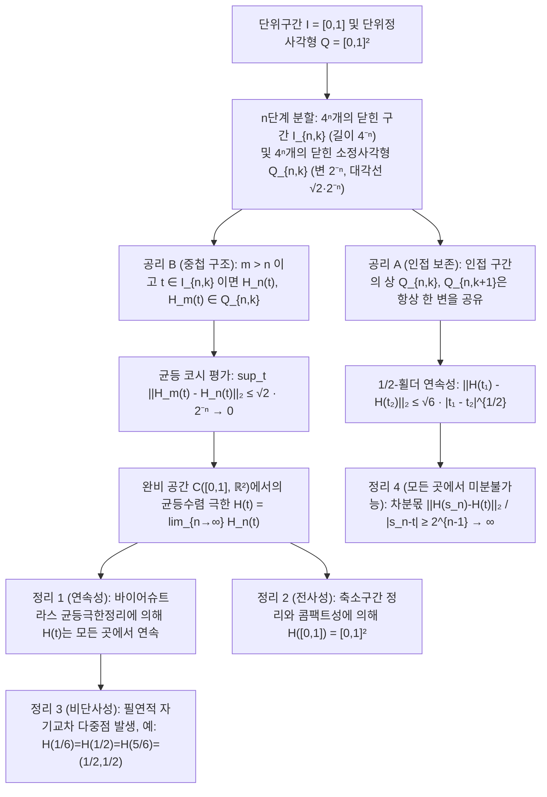

고대 그리스의 수학자 유클리드는 『원론(Elements)』 제1권 첫머리에서 점과 선을 다음과 같이 정의했습니다. "점이란 부분이 없는 것이며, 선이란 폭이 없는 길이($\mu\tilde{\eta}\kappa\omicron\varsigma\ \dot{\alpha}\pi\lambda\alpha\tau\acute{\varepsilon}\varsigma$)이다." 일상적인 직관에 비추어 볼 때, 두께가 완전히 $0$인 1차원 수학적 곡선을 아무리 촘촘히 구부리고 접더라도 2차원 정사각형의 내부 면적을 빈틈없이 채우는 것은 불가능해 보입니다.

그러나 1890년, 이탈리아의 수학자 <strong>주세페 페아노(Giuseppe Peano, 1858–1932)</strong>는 『Mathematische Annalen』에 발표한 단 5쪽짜리 논문에서 1차원 단위구간 $I = [0,1]$에서 2차원 단위정사각형 $Q = [0,1]^2$으로 가는 <strong>연속 전사 사상(Continuous Surjection)</strong> $f: [0,1] \to [0,1]^2$을 구체적으로 구성하여 2000년의 기하학적 직관을 무너뜨렸습니다! 이듬해인 1891년 <strong>다비트 힐베르트(David Hilbert, 1862–1943)</strong>는 기하학적 재귀 분할을 이용한 <strong>힐베르트 곡선(Hilbert Curve)</strong>을 발표했습니다. 더욱 놀라운 사실은 19세기 말 수학자들에게 '병적인 괴물(pathological monster)'로 불렸던 이 곡선이 100년 뒤 현대 컴퓨터 과학에서 <strong>Google Maps(Google S2 기하 라이브러리)</strong>, <strong>다차원 데이터베이스(Hilbert R-Tree)</strong>, <strong>슈퍼컴퓨터 병렬 부하 분산</strong>을 지탱하는 핵심 알고리즘으로 부활했다는 점입니다.

---

## 1. 칸토어의 충격(1877)과 네토의 정리(1879)

1877년 집합론의 창시자 <strong>게오르크 칸토어(Georg Cantor)</strong>는 1차원 선분 $[0,1]$과 2차원 정사각형 $[0,1]^2$의 점들 사이에 <strong>전단사(일대일 대응, Bijection)</strong>가 존재함을 증명하고, 데데킨트(Dedekind)에게 보낸 편지에 수학사상 가장 유명한 문장을 남겼습니다. <strong>"Je le vois, mais je ne le crois pas!" (나는 그것을 보지만, 믿을 수가 없다!)</strong>

칸토어의 핵심 아이디어는 실수의 소수 전개 자릿수(또는 유한소수의 이중 표현 문제를 피하기 위해 $0$이 아닌 숫자로 끝나는 블록 단위)를 번갈아 끼워 넣는 <strong>인터리빙(Interleaving)</strong>이었습니다:

$$x = 0.a_1 a_2 a_3 \dots, \quad y = 0.b_1 b_2 b_3 \dots \quad \Longrightarrow \quad t = \phi(x, y) = 0.a_1 b_1 a_2 b_2 a_3 b_3 \dots$$

$$|[0,1]| = |[0,1]^2| = |[0,1]^n| = |\mathbb{R}| = \mathfrak{c} = 2^{\aleph_0}$$

이로써 1차원 선분과 2차원 평면, 나아가 $n$차원 초입방체가 모두 동일한 <strong>연속체 농도 $\mathfrak{c} = 2^{\aleph_0}$</strong>를 가짐이 증명되었습니다. 그러나 데데킨트는 이 대응이 <strong>모든 곳에서 불연속</strong>임을 지적했고, 1879년 <strong>오이겐 네토(Eugen Netto)</strong>는 <strong>$[0,1]$과 $[0,1]^2$ 사이에 연속인 전단사(위상동형사상)는 절대 존재하지 않는다</strong>고 증명했습니다. 콤팩트 공간 $[0,1]$에서 하우스도르프 공간 $[0,1]^2$으로 가는 연속 전단사는 자동으로 위상동형사상이 되는데, $[0,1]$에서 내점 $1/2$를 제거하면 비연결 공간 $[0,1/2) \cup (1/2,1]$이 되는 반면 $[0,1]^2$에서 한 점을 제거한 공간은 여전히 경로 연결(연결 공간)이어서 모순이 발생하기 때문입니다!

---

## 2. 페아노 곡선(1890): '단사성'을 버리고 '연속 전사'를 얻다!

페아노는 네토의 정리가 금지한 것이 '연속성, 전사성, 단사성' 세 가지를 동시에 만족하는 사상이라는 점에 주목했습니다. <strong>만약 '단사성(자기교차 금지)'만 포기하고 곡선이 같은 점을 여러 번 지나는 것을 허용한다면, 연속이면서 정사각형 전체를 덮는 전사 사상 $f: [0,1] \to [0,1]^2$을 만들 수 있습니다!</strong>

페아노는 3진법 전개 $t = 0.t_1 t_2 t_3 \dots_3$($t_m \in \{0,1,2\}$)와 <strong>보수 반전 연산자 $k(d) = 2 - d$</strong>를 사용하여 순수 산술적 구성을 제시했습니다:

$$t = \sum_{m=1}^{\infty} \frac{t_m}{3^m} \;\; (t_m \in \{0,1,2\}), \qquad k(d) = 2 - d, \qquad k^n(d) = \begin{cases} d & (n \text{ even}) \\ 2 - d & (n \text{ odd}) \end{cases}$$

$$x_n = k^{t_2 + t_4 + \cdots + t_{2n-2}}(t_{2n-1}), \qquad y_n = k^{t_1 + t_3 + \cdots + t_{2n-1}}(t_{2n})$$

$k^n(d)$는 지수 $n$의 홀짝성(패리티)에만 의존하므로, 3진수의 이중 표현 경계점(예: $t = 1/3 = 0.0222\dots_3 = 0.1000\dots_3$)에서 $t_1$이 $0$(짝수)에서 $1$(홀수)로 바뀔 때 연산자 $k$가 작동하여 뒤따르는 모든 $0$을 $2$로 뒤집음으로써 좌우 극한을 완벽히 일치시킵니다.

---

## 3. 힐베르트 곡선(1891)의 기하학적 구성과 4대 해석적 성질의 증명

1891년 힐베르트는 $n$단계에서 $[0,1]$을 $4^n$개의 닫힌 부분구간 $I_{n,k}$(길이 $4^{-n}$)로 나누고, $[0,1]^2$을 한 변이 $2^{-n}$인 $4^n$개의 작은 정사각형 $Q_{n,k}$로 분할하여 <strong>공리 A(인접 구간의 상 $Q_{n,k}$와 $Q_{n,k+1}$은 항상 한 변을 공유함)</strong>와 <strong>공리 B(포함·중첩 구조: $Q_{n,k} = \bigcup_{j=0}^3 Q_{n+1, 4k-j}$)</strong>를 만족하도록 회전·반전시키는 재귀 구성을 도입했습니다.

1. <strong>정리 1 (균등수렴과 연속성)</strong>: 임의의 $m > n \ge 1$과 $t \in I_{n,k}$에 대해 공리 B에 의해 $H_n(t), H_m(t) \in Q_{n,k}$이므로 두 점 사이의 거리는 대각선 길이 $\sqrt{2}\cdot 2^{-n}$ 이하입니다:

$$I_{n,k} = \left[ \frac{k-1}{4^n}, \, \frac{k}{4^n} \right], \qquad \|H_m - H_n\|_\infty = \sup_{t \in [0,1]} \|H_m(t) - H_n(t)\|_2 \le \operatorname{diam}(Q_{n,k}) = \frac{\sqrt{2}}{2^n} \quad (\forall m > n \ge 1)$$

   따라서 다각선 열 $\{H_n\}$은 바나흐 공간 $\mathcal{C}([0,1], \mathbb{R}^2)$에서 코시 열로서 극한 $H(t)$로 균등수렴하며, 바이어슈트라스 균등극한정리에 의해 $H(t)$는 모든 곳에서 연속입니다.
2. <strong>정리 2 (전사성)</strong>: 임의의 점 $p \in [0,1]^2$을 포함하는 중첩 닫힌 소정사각형 열 $Q_{n,k_n} \ni p$에 대응하는 닫힌 구간 열 $I_{n,k_n}$은 길이가 $4^{-n} \to 0$이므로 칸토어 축소구간 정리에 의해 유일한 $t^* \in [0,1]$로 수렴하며 $H(t^*) = p$를 만족합니다:

$$\bigcap_{n=1}^{\infty} I_{n, k_n} = \{t^*\}, \qquad \|H(t^*) - p\|_2 \le \frac{\sqrt{2}}{2^n} \xrightarrow{n \to \infty} 0 \quad \Longrightarrow \quad H([0,1]) = [0,1]^2$$

3. <strong>정리 3 (비단사성과 다중점)</strong>: 정사각형 중심 $(1/2, 1/2)$에서 $H(1/6) = H(1/2) = H(5/6) = (1/2, 1/2)$(3중점)이 발생하며, 격자 꼭짓점에서 최대 4중점이 존재합니다.
4. <strong>정리 4 (무한 호장, $1/2$-횔더 연속성, 모든 곳에서 미분불가능성)</strong>: $n$단계 근사곡선의 길이 $L(H_n) = 2^n - 2^{-n} \to \infty$로 발산합니다. 임의의 $t \in I_{n,k}$에 대해 $Q_{n,k}$의 네 꼭짓점 중 적어도 하나 $v_n = H(s_n)$은 $H(t)$로부터 거리 $2^{-(n+1)}$ 이상 떨어져 있는 반면 $|s_n - t| \le 4^{-n}$이므로, 평균변화율이 $2^{n-1} \to +\infty$로 발산하여 <strong>모든 점 $t \in [0,1]$에서 미분불가능</strong>합니다:

$$L(H_n) = (4^n - 1) 2^{-n} = 2^n - 2^{-n} \to +\infty, \qquad \|H(t_1) - H(t_2)\|_2 \le \sqrt{6}\, |t_1 - t_2|^{1/2}$$

$$\frac{\|H(s_n) - H(t)\|_2}{|s_n - t|} \ge \frac{2^{-(n+1)}}{4^{-n}} = 2^{n-1} \xrightarrow{n \to \infty} +\infty$$

---

## 4. 차원의 위기 해결: 위상 차원 $\dim_T$ 대 하우스도르프 프랙탈 차원 $D_H$

1911년 <strong>브라우어르(Brouwer)</strong>는 국소 호몰로지 군을 이용해 <strong>차원 불변성 정리</strong>($\mathbb{R}^n \cong \mathbb{R}^m \iff n = m$)를 증명했습니다. <strong>르베그 덮개 차원 $\dim_T$</strong>은 열린 덮개의 최소 중첩수 $d+1$로 정의되며($\dim_T([0,1]) = 1 < \dim_T([0,1]^2) = 2$), <strong>하우스도르프 프랙탈 차원 $D_H$</strong>는 자기유사 축소 비율을 측정합니다:

$$H_k(U, U \setminus \{p\}; \mathbb{Z}) \cong \tilde{H}_{k-1}(S^{n-1}; \mathbb{Z}) \cong \begin{cases} \mathbb{Z} & (k = n) \\ 0 & (k \ne n) \end{cases}, \qquad \dim_T([0,1]) = 1 < \dim_T([0,1]^2) = 2$$

$$D_H = \frac{\log N}{\log(1/r)} \quad \Longrightarrow \quad D_H(\text{Peano}) = \frac{\log 9}{\log 3} = 2, \qquad D_H(\text{Hilbert}) = \frac{\log 4}{\log 2} = 2$$

힐베르트 곡선은 무한 번의 접힘을 통해 프랙탈 차원 $D_H = 2$에 도달하고, 자기교차를 통해 상의 위상 차원마저 $\dim_T = 2$로 끌어올린 기하학적 대상입니다.

| 곡선 / 사상 종류 | 연속성 | 단사성 (자기교차 없음) | $[0,1]^2$ 전사성 | 미분가능성 | 상의 위상 차원 $\dim_T$ | 하우스도르프 차원 $D_H$ | 2차원 넓이 $\mu_2$ |
| :--- | :---: | :---: | :---: | :---: | :---: | :---: | :---: |
| <strong>매끄러운 단순 곡선 (선분/호)</strong> | O ($C^\infty$) | O | X | 모든 곳에서 미분가능 | $1$ | $1$ | $0$ |
| <strong>코흐 눈송이 곡선 (Koch)</strong> | O | O | X | 모든 곳에서 미분불가능 | $1$ | $\frac{\log 4}{\log 3} \approx 1.262$ | $0$ |
| <strong>오즈굿 곡선 (Osgood, 1903)</strong> | O | O (단순 조르당 호) | X (내점 없음) | 거의 모든 곳 미분불가능 | $1$ | $2$ | $> 0$ (양의 넓이!) |
| <strong>칸토어 자릿수 교차 사상</strong> | X (불연속) | O (전단사) | O | 미분불가능 | $2$ | $2$ | $1$ |
| <strong>페아노 곡선 (3진법, 1890)</strong> | O | X (다중점 존재) | O | 모든 곳에서 미분불가능 | $2$ | $\frac{\log 9}{\log 3} = 2$ | $1$ |
| <strong>힐베르트 곡선 (2진법, 1891)</strong> | O ($1/2$-횔더) | X (최대 4중점) | O | 모든 곳에서 미분불가능 | $2$ | $\frac{\log 4}{\log 2} = 2$ | $1$ |

---

## 5. 현대 컴퓨터 과학 응용: 다차원 데이터를 1차원 메모리에 담는 마법

컴퓨터 하드웨어 메모리(DRAM 주소, SSD 블록, B+트리 키)는 1차원 선형 구조인 반면, 현실 세계의 공간 데이터는 다차원입니다. 힐베르트 곡선의 $1/2$-횔더 연속성과 사분트리(Quadtree) 중첩성을 이용해 인덱싱하면 최적의 <strong>공간 지역성 보존(Locality Preservation)</strong>을 달성합니다:

$$z = \text{Morton}(x, y) = (y_{n-1} x_{n-1} \dots y_1 x_1 y_0 x_0)_2, \qquad C_{\text{dilation}} = \sup_{t_1 \ne t_2} \frac{\|\gamma(t_1) - \gamma(t_2)\|_2^2}{|t_1 - t_2|} = 6 \;\; (\text{Hilbert})$$

이진 비트를 단순 교차시키는 <strong>모턴 곡선(Z-순서 곡선)</strong>이 경계에서 긴 대각선 점프($C_{\text{dilation}} = \infty$)를 일으키는 것과 달리, 힐베르트 곡선은 인접 스텝 이동 거리가 항상 정확히 $1$($C_{\text{dilation}} = 6$)이어서 2차원 영역 검색 시 B+트리 시크 횟수를 $25\%\text{–}40\%$ 줄여줍니다.
1. <strong>Google S2 Geometry Library (Google Maps / Uber / MongoDB)</strong>: 지구 구면 $S^2$을 외접 정육면체의 6개 면에 투영하고 비선형 면적 보정을 거친 뒤 <strong>30단계 힐베르트 곡선 $H_{30}$</strong>을 적용하여 지구상의 모든 $0.7\,\text{cm} \times 0.7\,\text{cm}$ 영역을 단 하나의 <strong>64비트 정수 `S2CellId`</strong>로 인코딩함으로써 복잡한 2차원 반경 검색을 초고속 1차원 B+트리 범위 스캔으로 해결합니다.
2. <strong>Hilbert R-Tree 및 슈퍼컴퓨터 동적 부하 분산</strong>: 도형 중심점의 힐베르트 값으로 정렬해 R-트리 리프 노드를 패킹(PostGIS, Apache Sedona)하고, 우주론적 $N$-체 시뮬레이션(Gadget-4)과 적응형 격자(AMReX)에서 3차원 힐베르트 곡선을 따라 팔분트리(Octree)를 분할하여 최소 통신 비용으로 부하를 균등 분산합니다.
