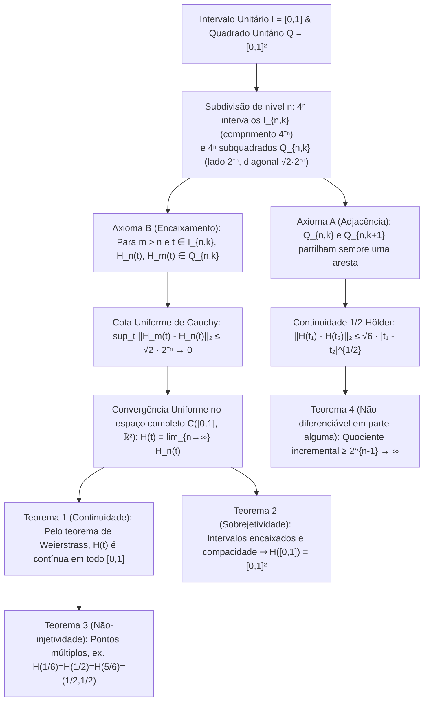

Logo na abertura do Livro I dos *Elementos*, Euclides de Alexandria estabeleceu duas definições fundamentais: «Um ponto é aquilo que não tem partes; uma linha é um comprimento sem largura ($\mu\tilde{\eta}\kappa\omicron\varsigma\ \dot{\alpha}\pi\lambda\alpha\tau\acute{\varepsilon}\varsigma$).» Segundo a nossa intuição geométrica quotidiana, uma curva matemática ideal tem espessura estritamente nula ($\delta = 0$). Durante mais de dois milénios pareceu evidente que um fio unidimensional sem largura jamais poderia preencher completamente o interior de um quadrado bidimensional $[0,1]^2$ sem deixar espaços vazios.

Contudo, em 1890, o matemático italiano <strong>Giuseppe Peano (1858–1932)</strong> derrubou essa certeza de dois mil anos num artigo de apenas cinco páginas nos *Mathematische Annalen*, construindo uma <strong>aplicação contínua e sobrejetiva</strong> $f: [0,1] \to [0,1]^2$ do intervalo unitário sobre o quadrado unitário. Um ano depois (1891), <strong>David Hilbert (1862–1943)</strong> apresentou a sua construção geométrica recursiva: a <strong>curva de Hilbert</strong>. Mais surpreendente ainda: o que no final do século XIX foi encarado como um «monstro patológico» da matemática pura tornou-se um século mais tarde num dos algoritmos essenciais da ciência da computação moderna, alimentando o <strong>Google Maps (biblioteca Google S2)</strong>, bases de dados espaciais (<strong>Hilbert R-Tree</strong>), algoritmos <strong>cache-oblivious</strong> e o balanceamento de carga em <strong>supercomputadores</strong>.

---

## 1. O Choque de Cantor (1877) e o Teorema de Netto (1879)

Em 1877, o fundador da teoria dos conjuntos, <strong>Georg Cantor</strong>, descobriu que existe uma <strong>bijeção (correspondência um-para-um)</strong> entre os pontos do segmento $[0,1]$ e os do quadrado $[0,1]^2$. Espantado com a sua própria demonstração, escreveu a Richard Dedekind a célebre frase: <strong>«Je le vois, mais je ne le crois pas!» (Eu vejo-o, mas não consigo acreditar!)</strong>

A ideia central de Cantor foi <strong>entrelaçar (interleave)</strong> os dígitos decimais (ou blocos indivisíveis terminados num dígito não nulo para eliminar rigorosamente a dupla representação de dízimas finitas como $0{,}5 = 0{,}4999\dots$):

$$x = 0.a_1 a_2 a_3 \dots, \quad y = 0.b_1 b_2 b_3 \dots \quad \Longrightarrow \quad t = \phi(x, y) = 0.a_1 b_1 a_2 b_2 a_3 b_3 \dots$$

$$|[0,1]| = |[0,1]^2| = |[0,1]^n| = |\mathbb{R}| = \mathfrak{c} = 2^{\aleph_0}$$

Isto provou que o segmento $[0,1]$, o quadrado $[0,1]^2$ e o hipercubo $[0,1]^n$ possuem exatamente a mesma <strong>cardinalidade do contínuo $\mathfrak{c} = 2^{\aleph_0}$</strong>. Todavia, Dedekind observou de imediato que tal bijeção é <strong>descontínua em toda a parte</strong>. Em 1879, <strong>Eugen Netto</strong> provou que <strong>não existe nenhuma bijeção contínua (homeomorfismo) entre $[0,1]$ e $[0,1]^2$</strong>: como $[0,1]$ é compacto e $[0,1]^2$ é Hausdorff, qualquer bijeção contínua seria um homeomorfismo; mas ao remover o ponto interior $t_0 = 1/2$, $[0,1]\setminus\{1/2\} = [0,1/2) \cup (1/2,1]$ fica desconexo, enquanto o quadrado perfurado $[0,1]^2 \setminus \{f(1/2)\}$ continua conexo por caminhos — uma contradição!

---

## 2. A Curva de Peano (1890): Abdicar da Injetividade Liberta a Sobrejetividade Contínua!

Peano identificou a brecha lógica no teorema de Netto: apenas é impossível satisfazer simultaneamente continuidade, sobrejetividade e injetividade. <strong>Se abdicarmos da injetividade (permitindo autointerseções ou pontos múltiplos), podemos construir uma sobrejeção contínua $f: [0,1] \to [0,1]^2$!</strong>

Peano utilizou a expansão na base $3$ (ternária) $t = 0{,}t_1 t_2 t_3 \dots_3$ ($t_m \in \{0,1,2\}$) juntamente com o <strong>operador complemento $k(d) = 2 - d$</strong>:

$$t = \sum_{m=1}^{\infty} \frac{t_m}{3^m} \;\; (t_m \in \{0,1,2\}), \qquad k(d) = 2 - d, \qquad k^n(d) = \begin{cases} d & (n \text{ even}) \\ 2 - d & (n \text{ odd}) \end{cases}$$

$$x_n = k^{t_2 + t_4 + \cdots + t_{2n-2}}(t_{2n-1}), \qquad y_n = k^{t_1 + t_3 + \cdots + t_{2n-1}}(t_{2n})$$

Como $k^n(d)$ depende apenas da paridade (par ou ímpar) do expoente $n$, em qualquer fronteira de dupla representação ternária (como $t = 1/3 = 0{,}0222\dots_3 = 0{,}1000\dots_3$), a mudança de $t_1 = 0$ (par) para $t_1 = 1$ (ímpar) aciona $k^1$, invertendo todos os zeros seguintes em dois e colando perfeitamente ambas as representações no mesmo ponto $(1/3, 1)$.

---

## 3. A Recursão Geométrica de Hilbert (1891) e Provas Analíticas Completas

Em 1891, David Hilbert substituiu a subdivisão $3 \times 3$ de Peano por uma recursão binária de <strong>$2 \times 2 = 4$ quadrantes</strong>: no nível $n$, $[0,1]$ é dividido em $4^n$ subintervalos fechados $I_{n,k}$ de comprimento $4^{-n}$ e $[0,1]^2$ em $4^n$ subquadrados $Q_{n,k}$ de lado $2^{-n}$, cumprindo o <strong>Axioma A (Adjacência: $Q_{n,k}$ e $Q_{n,k+1}$ partilham sempre um lado)</strong> e o <strong>Axioma B (Encaixamento: $Q_{n,k} = \bigcup_{j=0}^3 Q_{n+1, 4k-j}$)</strong>.

1. <strong>Teorema 1 (Convergência Uniforme e Continuidade)</strong>: Para $m > n \ge 1$ e qualquer $t \in I_{n,k}$, pelo Axioma B tanto $H_n(t)$ como $H_m(t)$ pertencem ao mesmo subquadrado $Q_{n,k}$ de diâmetro $\sqrt{2}\cdot 2^{-n}$:

$$I_{n,k} = \left[ \frac{k-1}{4^n}, \, \frac{k}{4^n} \right], \qquad \|H_m - H_n\|_\infty = \sup_{t \in [0,1]} \|H_m(t) - H_n(t)\|_2 \le \operatorname{diam}(Q_{n,k}) = \frac{\sqrt{2}}{2^n} \quad (\forall m > n \ge 1)$$

   Logo, $\{H_n\}$ é uniformemente de Cauchy em $\mathcal{C}([0,1], \mathbb{R}^2)$ e o seu limite uniforme $H(t)$ é contínuo em $[0,1]$.
2. <strong>Teorema 2 (Sobrejetividade)</strong>: Para todo $p \in [0,1]^2$, uma sucessão encaixada de subquadrados $Q_{n,k_n} \ni p$ define intervalos fechados encaixados $I_{n,k_n}$ de comprimento $4^{-n} \to 0$ cuja interseção única $t^* \in [0,1]$ satisfaz $H(t^*) = p$:

$$\bigcap_{n=1}^{\infty} I_{n, k_n} = \{t^*\}, \qquad \|H(t^*) - p\|_2 \le \frac{\sqrt{2}}{2^n} \xrightarrow{n \to \infty} 0 \quad \Longrightarrow \quad H([0,1]) = [0,1]^2$$

3. <strong>Teorema 3 (Pontos Múltiplos)</strong>: O centro $(1/2, 1/2)$ é visitado três vezes ($H(1/6) = H(1/2) = H(5/6) = (1/2, 1/2)$), e em vértices diádicos superiores surgem pontos quádruplos.
4. <strong>Teorema 4 (Comprimento Infinito, Continuidade $\frac{1}{2}$-Hölder e Não-Diferenciabilidade em Parte Alguma)</strong>: O comprimento $L(H_n) = 2^n - 2^{-n} \to \infty$ diverge. Para qualquer $t \in I_{n,k}$, pelo menos um vértice $v_n = H(s_n)$ de $Q_{n,k}$ dista $\ge 2^{-(n+1)}$ de $H(t)$ com $|s_n - t| \le 4^{-n}$, pelo que o quociente incremental diverge como $2^{n-1} \to \infty$: <strong>$H(t)$ não é diferenciável em nenhum ponto de $[0,1]$</strong>:

$$L(H_n) = (4^n - 1) 2^{-n} = 2^n - 2^{-n} \to +\infty, \qquad \|H(t_1) - H(t_2)\|_2 \le \sqrt{6}\, |t_1 - t_2|^{1/2}$$

$$\frac{\|H(s_n) - H(t)\|_2}{|s_n - t|} \ge \frac{2^{-(n+1)}}{4^{-n}} = 2^{n-1} \xrightarrow{n \to \infty} +\infty$$

---

## 4. Resolução da Crise da Dimensão: Dimensão Topológica $\dim_T$ vs. Dimensão de Hausdorff $D_H$

Em 1911, <strong>L. E. J. Brouwer</strong> provou a <strong>invariância da dimensão</strong> ($\mathbb{R}^n \cong \mathbb{R}^m \iff n = m$) via homologia local. A <strong>dimensão de recobrimento de Lebesgue $\dim_T$</strong> mede a ordem mínima de sobreposição $d + 1$ de coberturas abertas ($\dim_T([0,1]) = 1$, mas $\dim_T([0,1]^2) = 2$ como as juntas triplas de uma parede de tijolos, explicando topologicamente a inevitabilidade de pontos pelo menos triplos). Já a <strong>dimensão de Hausdorff (fractal) $D_H$</strong> mede a escala autossimilar:

$$H_k(U, U \setminus \{p\}; \mathbb{Z}) \cong \tilde{H}_{k-1}(S^{n-1}; \mathbb{Z}) \cong \begin{cases} \mathbb{Z} & (k = n) \\ 0 & (k \ne n) \end{cases}, \qquad \dim_T([0,1]) = 1 < \dim_T([0,1]^2) = 2$$

$$D_H = \frac{\log N}{\log(1/r)} \quad \Longrightarrow \quad D_H(\text{Peano}) = \frac{\log 9}{\log 3} = 2, \qquad D_H(\text{Hilbert}) = \frac{\log 4}{\log 2} = 2$$

A curva de Hilbert atinge dimensão fractal $D_H = 2$ por dobragem infinita e eleva a dimensão topológica da sua imagem a $\dim_T = 2$ através das autointerseções.

| Tipo de Curva / Aplicação | Contínua | Injetiva (sem autointerseção) | Sobrejetiva em $[0,1]^2$ | Diferenciabilidade | Dim. Topológica $\dim_T(\text{Imagem})$ | Dim. de Hausdorff $D_H$ | Área de Lebesgue $\mu_2$ |
| :--- | :---: | :---: | :---: | :---: | :---: | :---: | :---: |
| <strong>Curva suave simples (segmento/arco)</strong> | Sim ($C^\infty$) | Sim | Não | Diferenciável em todo o lado | $1$ | $1$ | $0$ |
| <strong>Curva de Koch (floco de neve)</strong> | Sim | Sim | Não | Não-diferenciável em parte alguma | $1$ | $\frac{\log 4}{\log 3} \approx 1{,}262$ | $0$ |
| <strong>Curva de Osgood (1903)</strong> | Sim | Sim (arco de Jordan) | Não (interior vazio) | Quase em toda a parte não-dif. | $1$ | $2$ | $> 0$ (área positiva!) |
| <strong>Entrelaçamento de dígitos de Cantor</strong> | Não (descontínua) | Sim (bijeção) | Sim | Não-contínua/diferenciável | $2$ | $2$ | $1$ |
| <strong>Curva de Peano (base 3, 1890)</strong> | Sim | Não (pontos múltiplos) | Sim (preenche o espaço) | Não-diferenciável em parte alguma | $2$ | $\frac{\log 9}{\log 3} = 2$ | $1$ |
| <strong>Curva de Hilbert (base 2, 1891)</strong> | Sim ($\frac{1}{2}$-Hölder) | Não (até pts. quádruplos) | Sim (preenche o espaço) | Não-diferenciável em parte alguma | $2$ | $\frac{\log 4}{\log 2} = 2$ | $1$ |

---

## 5. Aplicações na Ciência da Computação: Indexar o Mundo Multidimensional em Memória 1D

Sendo a memória de hardware (endereços DRAM, blocos SSD, árvores B+) unidimensional enquanto os dados geoespaciais e físicos são multidimensionais, a curva de Hilbert discreta oferece uma <strong>preservação de localidade (Locality Preservation)</strong> ótima graças à sua continuidade $\frac{1}{2}$-Hölder e ao encaixamento em quadtree:

$$z = \text{Morton}(x, y) = (y_{n-1} x_{n-1} \dots y_1 x_1 y_0 x_0)_2, \qquad C_{\text{dilation}} = \sup_{t_1 \ne t_2} \frac{\|\gamma(t_1) - \gamma(t_2)\|_2^2}{|t_1 - t_2|} = 6 \;\; (\text{Hilbert})$$

Ao contrário da <strong>curva de Morton (Z-Order Curve)</strong>, que entrelaça bits sem rotação e sofre grandes saltos diagonais ($C_{\text{dilation}} = \infty$), a curva de Hilbert avança sempre uma distância de Manhattan exatamente igual a $1$ ($C_{\text{dilation}} = 6$), reduzindo em $25\%\text{–}40\%$ a fragmentação de intervalos em consultas espaciais 2D.
1. <strong>Google S2 Geometry Library (Google Maps, Uber, MongoDB)</strong>: Projeta a esfera terrestre $S^2$ nas $6$ faces de um cubo, corrige a distorção de área e aplica uma <strong>curva de Hilbert de nível 30 ($H_{30}$)</strong> em cada face. Cada célula de $0{,}7\,\text{cm} \times 0{,}7\,\text{cm}$ na Terra é codificada num único inteiro de <strong>64 bits (`S2CellId`)</strong>, convertendo pesquisas geográficas 2D em varrimentos 1D ultrarrápidos em árvores B+.
2. <strong>Hilbert R-Tree e Supercomputação (HPC)</strong>: Ordenar polígonos pelo seu índice de Hilbert minimiza a sobreposição de nós no PostGIS e Apache Sedona, enquanto a curva de Hilbert 3D particiona octrees em simulações cosmológicas (Gadget-4, AMReX) para um balanceamento dinâmico de carga ótimo.
