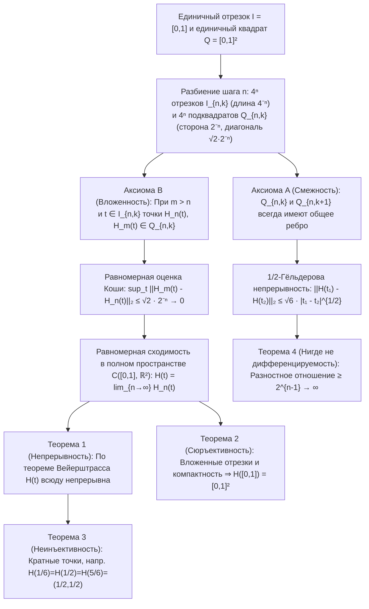

В самом начале Книги I «Начал» Евклид Александрийский дал два основополагающих определения: «Точка есть то, что не имеет частей; линия же — длина без ширины ($\mu\tilde{\eta}\kappa\omicron\varsigma\ \dot{\alpha}\pi\lambda\alpha\tau\acute{\varepsilon}\varsigma$).» Согласно нашей повседневной геометрической интуиции, идеальная математическая кривая имеет строго нулевую толщину ($\delta = 0$). На протяжении более двух тысячелетий казалось самоочевидным, что одномерная нить нулевой ширины никогда не сможет без просветов заполнить внутренность двумерного квадрата $[0,1]^2$.

Однако в 1890 году итальянский математик <strong>Джузеппе Пеано (Giuseppe Peano, 1858–1932)</strong> разрушил эту двухтысячелетнюю уверенность в пятистраничной статье в *Mathematische Annalen*, построив <strong>непрерывное сюръективное отображение</strong> $f: [0,1] \to [0,1]^2$ единичного отрезка на единичный квадрат. Год спустя (1891) <strong>Давид Гильберт (David Hilbert, 1862–1943)</strong> предложил прозрачную геометрическую рекурсию — <strong>кривую Гильберта</strong>. Ещё более удивительно то, что объект, который в конце XIX века называли «патологическим монстром» чистой математики, столетие спустя стал одним из важнейших алгоритмов современной информатики, лежащим в основе <strong>Google Maps (библиотека Google S2)</strong>, пространственных баз данных (<strong>Hilbert R-Tree</strong>), <strong>кэш-независимых (cache-oblivious) алгоритмов</strong> и балансировки нагрузки <strong>суперкомпьютеров</strong>.

---

## 1. Шок Кантора (1877) и теорема Нетто (1879)

В 1877 году создатель теории множеств <strong>Георг Кантор</strong> обнаружил, что между точками одномерного отрезка $[0,1]$ и точками двумерного квадрата $[0,1]^2$ существует <strong>биекция (взаимно однозначное соответствие)</strong>. Потрясённый собственным доказательством, он написал Рихарду Дедекинду знаменитую фразу: <strong>«Je le vois, mais je ne le crois pas!» (Я вижу это, но не верю этому!)</strong>

Идея Кантора состояла в <strong>чередовании (interleaving)</strong> десятичных цифр (или неделимых блоков цифр, оканчивающихся ненулевой цифрой, чтобы строго устранить неоднозначность конечных дробей вида $0{,}5 = 0{,}4999\dots$):

$$x = 0.a_1 a_2 a_3 \dots, \quad y = 0.b_1 b_2 b_3 \dots \quad \Longrightarrow \quad t = \phi(x, y) = 0.a_1 b_1 a_2 b_2 a_3 b_3 \dots$$

$$|[0,1]| = |[0,1]^2| = |[0,1]^n| = |\mathbb{R}| = \mathfrak{c} = 2^{\aleph_0}$$

Тем самым было доказано, что отрезок $[0,1]$, квадрат $[0,1]^2$ и $n$-мерный гиперкуб $[0,1]^n$ имеют одну и ту же <strong>мощность континуума $\mathfrak{c} = 2^{\aleph_0}$</strong>. Однако Дедекинд сразу заметил, что биекция Кантора <strong>всюду разрывна</strong>. В 1879 году <strong>Ойген Нетто</strong> доказал, что <strong>между $[0,1]$ и $[0,1]^2$ не существует непрерывной биекции (гомеоморфизма)</strong>: так как $[0,1]$ компактно, а $[0,1]^2$ хаусдорфово, любая непрерывная биекция была бы гомеоморфизмом; но при удалении внутренней точки $t_0 = 1/2$ множество $[0,1]\setminus\{1/2\} = [0,1/2) \cup (1/2,1]$ становится несвязным, тогда как проколотый квадрат $[0,1]^2 \setminus \{f(1/2)\}$ остаётся линейно связным — противоречие!

---

## 2. Кривая Пеано (1890): отказ от инъективности открывает путь к непрерывной сюръекции!

Пеано увидел логическую лазейку в теореме Нетто: невозможно лишь одновременное выполнение непрерывности, сюръективности и инъективности. <strong>Если отказаться от инъективности (разрешив самопересечения, т. е. кратные точки), то можно построить непрерывную сюръекцию $f: [0,1] \to [0,1]^2$!</strong>

Пеано использовал троичное разложение $t = 0{,}t_1 t_2 t_3 \dots_3$ ($t_m \in \{0,1,2\}$) и <strong>оператор дополнения $k(d) = 2 - d$</strong>:

$$t = \sum_{m=1}^{\infty} \frac{t_m}{3^m} \;\; (t_m \in \{0,1,2\}), \qquad k(d) = 2 - d, \qquad k^n(d) = \begin{cases} d & (n \text{ even}) \\ 2 - d & (n \text{ odd}) \end{cases}$$

$$x_n = k^{t_2 + t_4 + \cdots + t_{2n-2}}(t_{2n-1}), \qquad y_n = k^{t_1 + t_3 + \cdots + t_{2n-1}}(t_{2n})$$

Поскольку $k^n(d)$ зависит только от чётности показателя $n$, в точках неоднозначности троичной записи (например, $t = 1/3 = 0{,}0222\dots_3 = 0{,}1000\dots_3$) смена $t_1 = 0$ (чётное) на $t_1 = 1$ (нечётное) включает оператор $k^1$, который обращает все последующие нули в двойки и идеально склеивает оба предела в точке $(1/3, 1)$!

---

## 3. Геометрическая рекурсия Гильберта (1891) и строгие аналитические доказательства

В 1891 году Давид Гильберт заменил разбиение Пеано $3 \times 3$ двоичной рекурсией на <strong>$2 \times 2 = 4$ квадрантах</strong>: на шаге $n$ отрезок $[0,1]$ делится на $4^n$ замкнутых подотрезков $I_{n,k}$ длины $4^{-n}$, а квадрат $[0,1]^2$ — на $4^n$ малых квадратов $Q_{n,k}$ со стороной $2^{-n}$, удовлетворяющих <strong>Аксиоме A (Смежность: $Q_{n,k}$ и $Q_{n,k+1}$ всегда имеют общую сторону)</strong> и <strong>Аксиоме B (Вложенность: $Q_{n,k} = \bigcup_{j=0}^3 Q_{n+1, 4k-j}$)</strong>.

1. <strong>Теорема 1 (Равномерная сходимость и непрерывность)</strong>: Для любых $m > n \ge 1$ и $t \in I_{n,k}$ по Аксиоме B точки $H_n(t)$ и $H_m(t)$ лежат в одном подквадрате $Q_{n,k}$ диаметра $\sqrt{2}\cdot 2^{-n}$:

$$I_{n,k} = \left[ \frac{k-1}{4^n}, \, \frac{k}{4^n} \right], \qquad \|H_m - H_n\|_\infty = \sup_{t \in [0,1]} \|H_m(t) - H_n(t)\|_2 \le \operatorname{diam}(Q_{n,k}) = \frac{\sqrt{2}}{2^n} \quad (\forall m > n \ge 1)$$

   Следовательно, $\{H_n\}$ — фундаментальная последовательность в банаховом пространстве $\mathcal{C}([0,1], \mathbb{R}^2)$, и её равномерный предел $H(t)$ непрерывен на $[0,1]$.
2. <strong>Теорема 2 (Сюръективность)</strong>: Для любой точки $p \in [0,1]^2$ система вложенных подквадратов $Q_{n,k_n} \ni p$ задаёт систему вложенных отрезков $I_{n,k_n}$ длины $4^{-n} \to 0$ с единственной общей точкой $t^* \in [0,1]$, где $H(t^*) = p$:

$$\bigcap_{n=1}^{\infty} I_{n, k_n} = \{t^*\}, \qquad \|H(t^*) - p\|_2 \le \frac{\sqrt{2}}{2^n} \xrightarrow{n \to \infty} 0 \quad \Longrightarrow \quad H([0,1]) = [0,1]^2$$

3. <strong>Теорема 3 (Кратные точки)</strong>: Центр $(1/2, 1/2)$ проходится трижды ($H(1/6) = H(1/2) = H(5/6) = (1/2, 1/2)$), а в двоично-рациональных узлах сетки возникают четырёхкратные точки.
4. <strong>Теорема 4 (Бесконечная длина, $\frac{1}{2}$-гёльдеровость и нигде не дифференцируемость)</strong>: Длина ломаной $L(H_n) = 2^n - 2^{-n} \to \infty$. Для любого $t \in I_{n,k}$ хотя бы одна вершина $v_n = H(s_n)$ квадрата $Q_{n,k}$ удалена от $H(t)$ минимум на $2^{-(n+1)}$ при $|s_n - t| \le 4^{-n}$, поэтому разностное отношение расходится как $2^{n-1} \to \infty$ — <strong>$H(t)$ не дифференцируема ни в одной точке $t \in [0,1]$</strong>:

$$L(H_n) = (4^n - 1) 2^{-n} = 2^n - 2^{-n} \to +\infty, \qquad \|H(t_1) - H(t_2)\|_2 \le \sqrt{6}\, |t_1 - t_2|^{1/2}$$

$$\frac{\|H(s_n) - H(t)\|_2}{|s_n - t|} \ge \frac{2^{-(n+1)}}{4^{-n}} = 2^{n-1} \xrightarrow{n \to \infty} +\infty$$

---

## 4. Разрешение кризиса размерности: топологическая размерность $\dim_T$ против размерности Хаусдорфа $D_H$

В 1911 году <strong>Л. Э. Я. Брауэр</strong> доказал <strong>теорему об инвариантности размерности</strong> ($\mathbb{R}^n \cong \mathbb{R}^m \iff n = m$) через локальные группы гомологий. <strong>Большая индуктивная / лебегова размерность покрытия $\dim_T$</strong> определяется минимальной кратностью пересечения $d + 1$ открытых покрытий ($\dim_T([0,1]) = 1$, но $\dim_T([0,1]^2) = 2$ подобно тройным стыкам кирпичной кладки, что топологически объясняет неизбежность минимум тройных точек самопересечения!). Напротив, <strong>размерность Хаусдорфа (фрактальная размерность) $D_H$</strong> измеряет масштабное заполнение:

$$H_k(U, U \setminus \{p\}; \mathbb{Z}) \cong \tilde{H}_{k-1}(S^{n-1}; \mathbb{Z}) \cong \begin{cases} \mathbb{Z} & (k = n) \\ 0 & (k \ne n) \end{cases}, \qquad \dim_T([0,1]) = 1 < \dim_T([0,1]^2) = 2$$

$$D_H = \frac{\log N}{\log(1/r)} \quad \Longrightarrow \quad D_H(\text{Peano}) = \frac{\log 9}{\log 3} = 2, \qquad D_H(\text{Hilbert}) = \frac{\log 4}{\log 2} = 2$$

Кривая Гильберта за счёт бесконечного складывания повышает свою фрактальную размерность до $D_H = 2$, а за счёт самопересечений поднимает и топологическую размерность образа до $\dim_T = 2$.

| Тип кривой / отображения | Непрерывность | Инъективность (без самопересечений) | Сюръективность на $[0,1]^2$ | Дифференцируемость | Топологическая разм. $\dim_T(\text{Образ})$ | Разм. Хаусдорфа $D_H$ | 2D мера Лебега $\mu_2$ |
| :--- | :---: | :---: | :---: | :---: | :---: | :---: | :---: |
| <strong>Гладкая простая кривая (отрезок/дуга)</strong> | Да ($C^\infty$) | Да | Нет | Всюду дифференцируема | $1$ | $1$ | $0$ |
| <strong>Кривая Коха (снежинка)</strong> | Да | Да | Нет | Нигде не дифференцируема | $1$ | $\frac{\log 4}{\log 3} \approx 1{,}262$ | $0$ |
| <strong>Кривая Осгуда (1903)</strong> | Да | Да (жорданова дуга) | Нет (пустая внутренность) | Почти всюду не дифф. | $1$ | $2$ | $> 0$ (положительная площадь!) |
| <strong>Чередование цифр Кантора</strong> | Нет (разрывна) | Да (биекция) | Да | Нигде не непр./дифф. | $2$ | $2$ | $1$ |
| <strong>Кривая Пеано (база 3, 1890)</strong> | Да | Нет (кратные точки) | Да (заполняет квадрат) | Нигде не дифференцируема | $2$ | $\frac{\log 9}{\log 3} = 2$ | $1$ |
| <strong>Кривая Гильберта (база 2, 1891)</strong> | Да ($\frac{1}{2}$-Гёльдер) | Нет (до 4-кратных точек) | Да (заполняет квадрат) | Нигде не дифференцируема | $2$ | $\frac{\log 4}{\log 2} = 2$ | $1$ |

---

## 5. Приложения в компьютерных науках: индексация многомерного мира в 1D-памяти

Поскольку компьютерная память (адреса DRAM, блоки SSD, ключи B+-деревьев) одномерна, а геопространственные и физические данные многомерны, дискретная кривая Гильберта обеспечивает оптимальное <strong>сохранение локальности (Locality Preservation)</strong> благодаря $\frac{1}{2}$-гёльдеровости и квадродеревянной вложенности:

$$z = \text{Morton}(x, y) = (y_{n-1} x_{n-1} \dots y_1 x_1 y_0 x_0)_2, \qquad C_{\text{dilation}} = \sup_{t_1 \ne t_2} \frac{\|\gamma(t_1) - \gamma(t_2)\|_2^2}{|t_1 - t_2|} = 6 \;\; (\text{Hilbert})$$

В отличие от <strong>кривой Мортона (Z-кривой)</strong>, которая просто чередует биты координат и совершает длинные диагональные скачки на границах квадрантов ($C_{\text{dilation}} = \infty$), кривая Гильберта на каждом шаге $t \to t+1$ смещается ровно на манхэттенское расстояние $1$ ($C_{\text{dilation}} = 6$), сокращая число кластеров поиска в B+-дереве на $25\%\text{–}40\%$.
1. <strong>Google S2 Geometry Library (Google Maps, Uber, MongoDB)</strong>: Проецирует земную сферу $S^2$ на $6$ граней куба, выравнивает площади ячеек нелинейным преобразованием и покрывает каждую грань <strong>30-уровневой кривой Гильберта $H_{30}$</strong>. Каждый участок Земли размером $0{,}7\,\text{см} \times 0{,}7\,\text{см}$ кодируется одним <strong>64-битным целым числом (`S2CellId`)</strong>, превращая двумерные геозапросы в молниеносное 1D-сканирование диапазонов в B+-деревьях.
2. <strong>Hilbert R-Tree и суперкомпьютерные расчёты (HPC)</strong>: Сортировка полигонов по индексу Гильберта минимизирует перекрытие узлов R-дерева (PostGIS, Apache Sedona), а 3D-кривая Гильберта разрезает октодеревья в космологических симуляциях (Gadget-4, AMReX) для идеальной динамической балансировки нагрузки.
