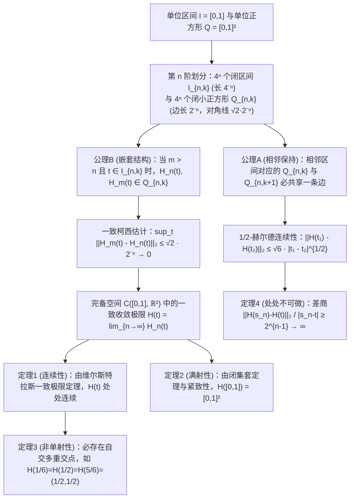

古希腊数学家欧几里得在《几何原本》第一卷开篇定义了点与线：“点是没有部分的东西；线是没有宽度的长度（$\mu\tilde{\eta}\kappa\omicron\varsigma\ \dot{\alpha}\pi\lambda\alpha\tau\acute{\varepsilon}\varsigma$）。”在日常直觉中，一条严格没有宽度（厚度为 $0$）的一维数学曲线，无论怎样弯曲折叠，似乎都绝不可能毫无缝隙地填满一个二维正方形的全部面积。

然而1890年，意大利数学家<strong>朱塞佩·皮亚诺（Giuseppe Peano, 1858–1932）</strong>在《Mathematische Annalen》上发表了仅5页的论文，构造出了从一维单位区间 $I = [0,1]$ 到二维单位正方形 $Q = [0,1]^2$ 的<strong>连续满射（Continuous Surjection）</strong> $f: [0,1] \to [0,1]^2$，彻底颠覆了两千年的几何直觉！次年（1891年），<strong>大卫·希尔伯特（David Hilbert, 1862–1943）</strong>提出了几何递归构造的<strong>希尔伯特曲线（Hilbert Curve）</strong>。更令人惊叹的是，这个曾被19世纪末数学家视为“病态怪物”的纯数学对象，在百年后的今天成为了支撑<strong>Google Maps（Google S2几何库）</strong>、<strong>空间数据库（Hilbert R-Tree）</strong>与<strong>超算并行负载均衡</strong>的核心算法。

---

## 1. 康托尔的震撼（1877）与内托定理（1879）

1877年，集合论创始人<strong>格奥尔格·康托尔（Georg Cantor）</strong>发现一维线段 $[0,1]$ 与二维正方形 $[0,1]^2$ 的点之间存在<strong>双射（一一对应）</strong>，他在给戴德金（Dedekind）的信中惊呼：<strong>“Je le vois, mais je ne le crois pas!”（我看到了它，但我不敢相信它！）</strong>

康托尔的核心思想是将实数小数展开的各位数字（或以含非零尾数的数字块为单位，从而消除有限小数的双重表示缺陷）进行<strong>交错排列（Interleaving）</strong>：

$$x = 0.a_1 a_2 a_3 \dots, \quad y = 0.b_1 b_2 b_3 \dots \quad \Longrightarrow \quad t = \phi(x, y) = 0.a_1 b_1 a_2 b_2 a_3 b_3 \dots$$

$$|[0,1]| = |[0,1]^2| = |[0,1]^n| = |\mathbb{R}| = \mathfrak{c} = 2^{\aleph_0}$$

由此证明一维线段、二维平面与 $n$ 维空间具有完全相同的<strong>连续统势 $\mathfrak{c} = 2^{\aleph_0}$</strong>。然而戴德金指出这种交错映射是<strong>处处不连续</strong>的。1879年，<strong>奥伊根·内托（Eugen Netto）</strong>严格证明：<strong>$[0,1]$ 与 $[0,1]^2$ 之间绝对不存在连续双射（同胚映射）</strong>。因为 $[0,1]$ 是紧致空间、$[0,1]^2$ 是豪斯多夫空间，任何连续双射必为同胚；但从 $[0,1]$ 中挖去内点 $1/2$ 后空间变为不连通的两段 $[0,1/2) \cup (1/2,1]$，而从 $[0,1]^2$ 中挖去一点后仍是道路连通的，产生矛盾！

---

## 2. 皮亚诺曲线（1890）：放弃“单射性”，换取“连续满射”！

皮亚诺敏锐地洞察到：内托定理禁止的是同时满足“连续、满射、单射”的映射；<strong>如果我们放弃“单射性”（允许曲线自交，即多次经过同一点），就能构造出连续满射 $f: [0,1] \to [0,1]^2$！</strong>

皮亚诺利用三进制展开 $t = 0.t_1 t_2 t_3 \dots_3$（$t_m \in \{0,1,2\}$）与<strong>互补反转算子 $k(d) = 2 - d$</strong> 给出了纯算术构造：

$$t = \sum_{m=1}^{\infty} \frac{t_m}{3^m} \;\; (t_m \in \{0,1,2\}), \qquad k(d) = 2 - d, \qquad k^n(d) = \begin{cases} d & (n \text{ even}) \\ 2 - d & (n \text{ odd}) \end{cases}$$

$$x_n = k^{t_2 + t_4 + \cdots + t_{2n-2}}(t_{2n-1}), \qquad y_n = k^{t_1 + t_3 + \cdots + t_{2n-1}}(t_{2n})$$

由于 $k^n(d)$ 仅取决于指数 $n$ 的奇偶性，当三进制数在边界点发生进位（如 $t = 1/3 = 0.0222\dots_3 = 0.1000\dots_3$）时，$t_1$ 从 $0$（偶）变为 $1$（奇），立即触发算子 $k$ 将后续所有的 $0$ 反转为 $2$，从而使左右极限在正方形网格交界处无缝粘合（几何上对应 $3 \times 3$ 九宫格的 S 型牛耕式遍历）。

---

## 3. 希尔伯特曲线（1891）的几何构造与四大分析性质的严格证明

1891年，希尔伯特提出二进制递归构造：在第 $n$ 阶将 $[0,1]$ 等分为 $4^n$ 个闭子区间 $I_{n,k}$（长 $4^{-n}$），并将 $[0,1]^2$ 等分为 $4^n$ 个边长为 $2^{-n}$ 的小正方形 $Q_{n,k}$，通过左下象限主对角线镜像翻转与右下象限副对角线翻转，满足<strong>公理A（相邻区间对应的正方形必共享一条边）</strong>与<strong>公理B（嵌套包含性：$Q_{n,k} = \bigcup_{j=0}^3 Q_{n+1, 4k-j}$）</strong>。

1. <strong>定理1（一致收敛与连续性）</strong>：对任意 $m > n \ge 1$ 及 $t \in I_{n,k}$，由公理B知 $H_n(t)$ 与 $H_m(t)$ 均位于同一边长为 $2^{-n}$ 的小正方形 $Q_{n,k}$ 内，其距离不超过对角线长 $\sqrt{2}\cdot 2^{-n}$：

$$I_{n,k} = \left[ \frac{k-1}{4^n}, \, \frac{k}{4^n} \right], \qquad \|H_m - H_n\|_\infty = \sup_{t \in [0,1]} \|H_m(t) - H_n(t)\|_2 \le \operatorname{diam}(Q_{n,k}) = \frac{\sqrt{2}}{2^n} \quad (\forall m > n \ge 1)$$

   因此折线序列 $\{H_n\}$ 在完备空间 $\mathcal{C}([0,1], \mathbb{R}^2)$ 中一致收敛于极限函数 $H(t)$，由维尔斯特拉斯一致极限定理知 $H(t)$ 在 $[0,1]$ 上处处连续。
2. <strong>定理2（满射性）</strong>：对任意点 $p \in [0,1]^2$，取包含 $p$ 的闭小正方形套 $Q_{1,k_1} \supset Q_{2,k_2} \supset \cdots \ni p$，对应的闭区间套 $I_{n,k_n}$ 长度 $4^{-n} \to 0$，由康托尔闭区间套定理确定唯一点 $t^* \in [0,1]$ 满足 $H(t^*) = p$：

$$\bigcap_{n=1}^{\infty} I_{n, k_n} = \{t^*\}, \qquad \|H(t^*) - p\|_2 \le \frac{\sqrt{2}}{2^n} \xrightarrow{n \to \infty} 0 \quad \Longrightarrow \quad H([0,1]) = [0,1]^2$$

3. <strong>定理3（非单射与多重交点）</strong>：中心点 $(1/2, 1/2)$ 是四个象限的公共顶点，由几何级数可算得 $H(1/6) = H(1/2) = H(5/6) = (1/2, 1/2)$（三重交点），在更高阶网格顶点上还存在四重交点。
4. <strong>定理4（无穷弧长、$1/2$-赫尔德连续与处处不可微）</strong>：第 $n$ 阶折线长 $L(H_n) = 2^n - 2^{-n} \to \infty$。对任意 $t \in I_{n,k}$，$Q_{n,k}$ 的四个顶点中必有一顶点 $v_n = H(s_n)$ 与 $H(t)$ 距离至少为 $2^{-(n+1)}$，而时间差 $|s_n - t| \le 4^{-n}$，故牛顿差商下界按 $2^{n-1} \to +\infty$ 发散，证明<strong>希尔伯特曲线在 $[0,1]$ 上处处不可微</strong>：

$$L(H_n) = (4^n - 1) 2^{-n} = 2^n - 2^{-n} \to +\infty, \qquad \|H(t_1) - H(t_2)\|_2 \le \sqrt{6}\, |t_1 - t_2|^{1/2}$$

$$\frac{\|H(s_n) - H(t)\|_2}{|s_n - t|} \ge \frac{2^{-(n+1)}}{4^{-n}} = 2^{n-1} \xrightarrow{n \to \infty} +\infty$$

---

## 4. 维度危机的解决：拓扑维度 $\dim_T$ 与豪斯多夫分形维度 $D_H$

1911年<strong>布劳威尔（Brouwer）</strong>利用局部同调群证明了<strong>维度不变性定理</strong>（$\mathbb{R}^n \cong \mathbb{R}^m \iff n = m$）。<strong>勒贝格覆盖维度 $\dim_T$</strong> 由开覆盖加细的最小重数 $d + 1$ 定义（一维线段开覆盖最多2重交叠 $\dim_T = 1$；二维正方形如砖墙必有3重交点 $\dim_T = 2$，这也解释了为何空间填充曲线必有至少3重自交点）。而<strong>豪斯多夫分形维度 $D_H$</strong> 则度量自相似缩放填充率：

$$H_k(U, U \setminus \{p\}; \mathbb{Z}) \cong \tilde{H}_{k-1}(S^{n-1}; \mathbb{Z}) \cong \begin{cases} \mathbb{Z} & (k = n) \\ 0 & (k \ne n) \end{cases}, \qquad \dim_T([0,1]) = 1 < \dim_T([0,1]^2) = 2$$

$$D_H = \frac{\log N}{\log(1/r)} \quad \Longrightarrow \quad D_H(\text{Peano}) = \frac{\log 9}{\log 3} = 2, \qquad D_H(\text{Hilbert}) = \frac{\log 4}{\log 2} = 2$$

希尔伯特曲线通过无限折叠使分形维度跃升为 $D_H = 2$，并通过自交使像空间的拓扑维度达到 $\dim_T = 2$。

| 曲线 / 映射类型 | 连续性 | 单射性（无自交） | 对 $[0,1]^2$ 满射性 | 可微性 | 像的拓扑维度 $\dim_T$ | 豪斯多夫维度 $D_H$ | 二维面积 $\mu_2$ |
| :--- | :---: | :---: | :---: | :---: | :---: | :---: | :---: |
| <strong>光滑简单曲线（线段/圆弧）</strong> | 是（$C^\infty$） | 是 | 否 | 处处可微 | $1$ | $1$ | $0$ |
| <strong>科赫雪花曲线（Koch）</strong> | 是 | 是 | 否 | 处处不可微 | $1$ | $\frac{\log 4}{\log 3} \approx 1.262$ | $0$ |
| <strong>奥斯古德曲线（Osgood, 1903）</strong> | 是 | 是（无自交简单弧） | 否（无内点） | 几乎处处不可微 | $1$ | $2$ | $> 0$（正面积！） |
| <strong>康托尔数字交错映射</strong> | 否（处处不连续） | 是（双射） | 是 | 不可微 | $2$ | $2$ | $1$ |
| <strong>皮亚诺曲线（三进制, 1890）</strong> | 是 | 否（有多重点） | 是 | 处处不可微 | $2$ | $\frac{\log 9}{\log 3} = 2$ | $1$ |
| <strong>希尔伯特曲线（二进制, 1891）</strong> | 是（$1/2$-赫尔德） | 否（至多4重点） | 是 | 处处不可微 | $2$ | $\frac{\log 4}{\log 2} = 2$ | $1$ |

---

## 5. 现代计算机科学应用：将多维世界装入一维内存

计算机硬件内存（DRAM地址、SSD逻辑块、B+树索引）是一维线性的，而现实数据（GIS坐标、三维网格、多属性记录）是多维的。利用希尔伯特曲线的 $1/2$-赫尔德连续性与四叉树嵌套性建立索引，能实现最优的<strong>空间局部性保持（Locality Preservation）</strong>：

$$z = \text{Morton}(x, y) = (y_{n-1} x_{n-1} \dots y_1 x_1 y_0 x_0)_2, \qquad C_{\text{dilation}} = \sup_{t_1 \ne t_2} \frac{\|\gamma(t_1) - \gamma(t_2)\|_2^2}{|t_1 - t_2|} = 6 \;\; (\text{Hilbert})$$

相比于直接交错二进制位的<strong>莫顿曲线（Z阶曲线 / Morton Curve）</strong>在边界处的长距离斜跳（$C_{\text{dilation}} = \infty$），希尔伯特曲线每步移动距离恒为 $1$（最坏局部性膨胀系数 $C_{\text{dilation}} = 6$），将二维范围查询的 B+ 树区间分裂数减少 $25\%\text{–}40\%$。
1. <strong>Google S2 几何库（Google Maps / Uber / MongoDB）</strong>：将地球球面投影到外接立方体的6个面上，经非线性面积均匀化修正后，在每个面上构建<strong>30层希尔伯特曲线 $H_{30}$</strong>，将全球每一个 $0.7\,\text{cm} \times 0.7\,\text{cm}$ 的微元编码为一个<strong>64位无符号整数 `S2CellId`</strong>（3位面号 + 60位希尔伯特四叉树路径 + 1位哨兵位），使任意多边形地理围栏检索化归为极少数一维连续整数区间的快速扫描。
2. <strong>Hilbert R-Tree 与 Cache-Oblivious 高性能计算</strong>：按希尔伯特值对空间对象排序后打包 R 树叶节点（PostGIS / Apache Sedona），以及在超算宇宙学 $N$ 体模拟（Gadget-4）与自适应网格（AMReX）中沿三维希尔伯特曲线切分八叉树以实现最优动态负载均衡。
