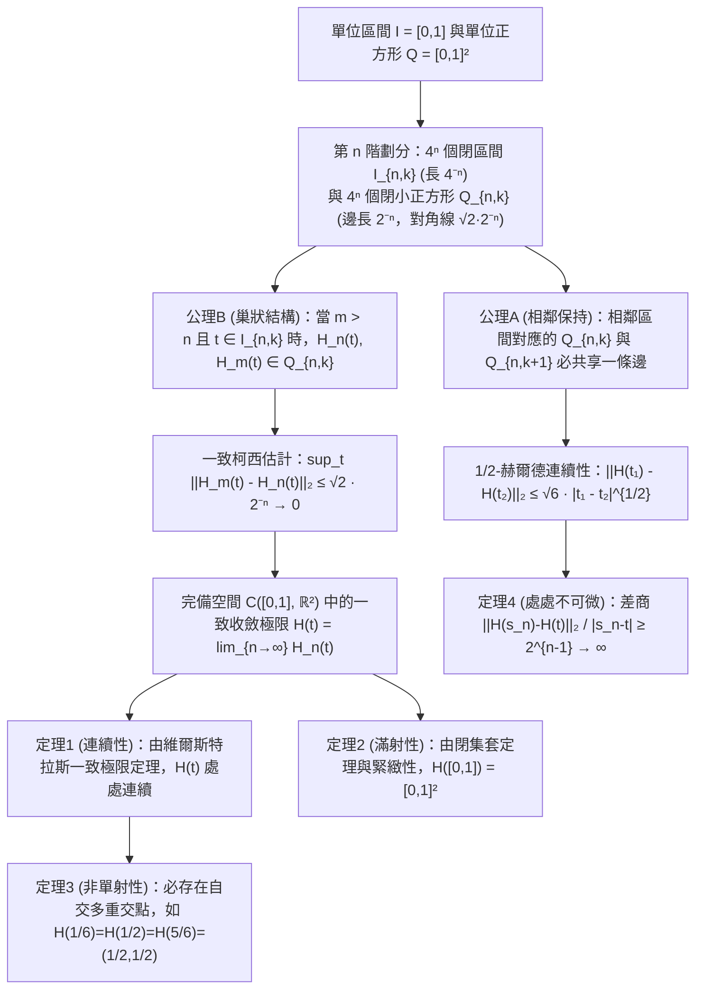

古希臘數學家歐幾里得在《幾何原本》第一卷開篇定義了點與線：「點是沒有部分的東西；線是沒有寬度的長度（$\mu\tilde{\eta}\kappa\omicron\varsigma\ \dot{\alpha}\pi\lambda\alpha\tau\acute{\varepsilon}\varsigma$）。」在日常直覺中，一條嚴格沒有寬度（厚度為 $0$）的一維數學曲線，無論怎樣彎曲折疊，似乎都絕不可能毫無縫隙地填滿一個二維正方形的全部面積。

然而1890年，義大利數學家<strong>朱塞佩·皮亞諾（Giuseppe Peano, 1858–1932）</strong>在《Mathematische Annalen》上發表了僅5頁的論文，構造出了從一維單位區間 $I = [0,1]$ 到二維單位正方形 $Q = [0,1]^2$ 的<strong>連續滿射（Continuous Surjection）</strong> $f: [0,1] \to [0,1]^2$，徹底顛覆了兩千年的幾何直覺！次年（1891年），<strong>大衛·希爾伯特（David Hilbert, 1862–1943）</strong>提出了幾何遞迴構造的<strong>希爾伯特曲線（Hilbert Curve）</strong>。更令人驚嘆的是，這個曾被19世紀末數學家視為「病態怪物」的純數學對象，在百年後的今天成為了支撐<strong>Google Maps（Google S2幾何庫）</strong>、<strong>空間資料庫（Hilbert R-Tree）</strong>與<strong>超算平行負載均衡</strong>的核心演算法。

---

## 1. 康托爾的震撼（1877）與內托定理（1879）

1877年，集合論創始人<strong>格奧爾格·康托爾（Georg Cantor）</strong>發現一維線段 $[0,1]$ 與二維正方形 $[0,1]^2$ 的點之間存在<strong>雙射（一對一對應）</strong>，他在給戴德金（Dedekind）的信中驚呼：<strong>「Je le vois, mais je ne le crois pas!」（我看到了它，但我不敢相信它！）</strong>

康托爾的核心思想是將實數小數展開的各位數字（或以含非零尾數的數字塊為單位，從而消除有限小數的雙重表示缺陷）進行<strong>交錯排列（Interleaving）</strong>：

$$x = 0.a_1 a_2 a_3 \dots, \quad y = 0.b_1 b_2 b_3 \dots \quad \Longrightarrow \quad t = \phi(x, y) = 0.a_1 b_1 a_2 b_2 a_3 b_3 \dots$$

$$|[0,1]| = |[0,1]^2| = |[0,1]^n| = |\mathbb{R}| = \mathfrak{c} = 2^{\aleph_0}$$

由此證明一維線段、二維平面與 $n$ 維空間具有完全相同的<strong>連續統勢 $\mathfrak{c} = 2^{\aleph_0}$</strong>。然而戴德金指出這種交錯映射是<strong>處處不連續</strong>的。1879年，<strong>奧伊根·內托（Eugen Netto）</strong>嚴格證明：<strong>$[0,1]$ 與 $[0,1]^2$ 之間絕對不存在連續雙射（同胚映射）</strong>。因為 $[0,1]$ 是緊緻空間、$[0,1]^2$ 是豪斯多夫空間，任何連續雙射必為同胚；但從 $[0,1]$ 中挖去內點 $1/2$ 後空間變為不連通的兩段 $[0,1/2) \cup (1/2,1]$，而從 $[0,1]^2$ 中挖去一點後仍是道路連通的，產生矛盾！

---

## 2. 皮亞諾曲線（1890）：放棄「單射性」，換取「連續滿射」！

皮亞諾敏銳地洞察到：內托定理禁止的是同時滿足「連續、滿射、單射」的映射；<strong>如果我們放棄「單射性」（允許曲線自交，即多次經過同一點），就能構造出連續滿射 $f: [0,1] \to [0,1]^2$！</strong>

皮亞諾利用三進位展開 $t = 0.t_1 t_2 t_3 \dots_3$（$t_m \in \{0,1,2\}$）與<strong>互補反轉算子 $k(d) = 2 - d$</strong> 給出了純算術構造：

$$t = \sum_{m=1}^{\infty} \frac{t_m}{3^m} \;\; (t_m \in \{0,1,2\}), \qquad k(d) = 2 - d, \qquad k^n(d) = \begin{cases} d & (n \text{ even}) \\ 2 - d & (n \text{ odd}) \end{cases}$$

$$x_n = k^{t_2 + t_4 + \cdots + t_{2n-2}}(t_{2n-1}), \qquad y_n = k^{t_1 + t_3 + \cdots + t_{2n-1}}(t_{2n})$$

由於 $k^n(d)$ 僅取決於指數 $n$ 的奇偶性，當三進位數在邊界點發生進位（如 $t = 1/3 = 0.0222\dots_3 = 0.1000\dots_3$）時，$t_1$ 從 $0$（偶）變為 $1$（奇），立即觸發算子 $k$ 將後續所有的 $0$ 反轉為 $2$，從而使左右極限在正方形網格交界處無縫黏合（幾何上對應 $3 \times 3$ 九宮格的 S 型牛耕式遍歷）。

---

## 3. 希爾伯特曲線（1891）的幾何構造與四大分析性質的嚴格證明

1891年，希爾伯特提出二進位遞迴構造：在第 $n$ 階將 $[0,1]$ 等分為 $4^n$ 個閉子區間 $I_{n,k}$（長 $4^{-n}$），並將 $[0,1]^2$ 等分為 $4^n$ 個邊長為 $2^{-n}$ 的小正方形 $Q_{n,k}$，通過左下象限主對角線鏡像翻轉與右下象限副對角線翻轉，滿足<strong>公理A（相鄰區間對應的正方形必共享一條邊）</strong>與<strong>公理B（巢狀包含性：$Q_{n,k} = \bigcup_{j=0}^3 Q_{n+1, 4k-j}$）</strong>。

1. <strong>定理1（一致收斂與連續性）</strong>：對任意 $m > n \ge 1$ 及 $t \in I_{n,k}$，由公理B知 $H_n(t)$ 與 $H_m(t)$ 均位於同一邊長為 $2^{-n}$ 的小正方形 $Q_{n,k}$ 內，其距離不超過對角線長 $\sqrt{2}\cdot 2^{-n}$：

$$I_{n,k} = \left[ \frac{k-1}{4^n}, \, \frac{k}{4^n} \right], \qquad \|H_m - H_n\|_\infty = \sup_{t \in [0,1]} \|H_m(t) - H_n(t)\|_2 \le \operatorname{diam}(Q_{n,k}) = \frac{\sqrt{2}}{2^n} \quad (\forall m > n \ge 1)$$

   因此折線序列 $\{H_n\}$ 在完備空間 $\mathcal{C}([0,1], \mathbb{R}^2)$ 中一致收斂於極限函數 $H(t)$，由維爾斯特拉斯一致極限定理知 $H(t)$ 在 $[0,1]$ 上處處連續。
2. <strong>定理2（滿射性）</strong>：對任意點 $p \in [0,1]^2$，取包含 $p$ 的閉小正方形套 $Q_{1,k_1} \supset Q_{2,k_2} \supset \cdots \ni p$，對應的閉區間套 $I_{n,k_n}$ 長度 $4^{-n} \to 0$，由康托爾閉區間套定理確定唯一點 $t^* \in [0,1]$ 滿足 $H(t^*) = p$：

$$\bigcap_{n=1}^{\infty} I_{n, k_n} = \{t^*\}, \qquad \|H(t^*) - p\|_2 \le \frac{\sqrt{2}}{2^n} \xrightarrow{n \to \infty} 0 \quad \Longrightarrow \quad H([0,1]) = [0,1]^2$$

3. <strong>定理3（非單射與多重交點）</strong>：中心點 $(1/2, 1/2)$ 是四個象限的公共頂點，由幾何級數可算得 $H(1/6) = H(1/2) = H(5/6) = (1/2, 1/2)$（三重交點），在更高階網格頂點上還存在四重交點。
4. <strong>定理4（無窮弧長、$1/2$-赫爾德連續與處處不可微）</strong>：第 $n$ 階折線長 $L(H_n) = 2^n - 2^{-n} \to \infty$。對任意 $t \in I_{n,k}$，$Q_{n,k}$ 的四個頂點中必有一頂點 $v_n = H(s_n)$ 與 $H(t)$ 距離至少為 $2^{-(n+1)}$，而時間差 $|s_n - t| \le 4^{-n}$，故牛頓差商下界按 $2^{n-1} \to +\infty$ 發散，證明<strong>希爾伯特曲線在 $[0,1]$ 上處處不可微</strong>：

$$L(H_n) = (4^n - 1) 2^{-n} = 2^n - 2^{-n} \to +\infty, \qquad \|H(t_1) - H(t_2)\|_2 \le \sqrt{6}\, |t_1 - t_2|^{1/2}$$

$$\frac{\|H(s_n) - H(t)\|_2}{|s_n - t|} \ge \frac{2^{-(n+1)}}{4^{-n}} = 2^{n-1} \xrightarrow{n \to \infty} +\infty$$

---

## 4. 維度危機的解決：拓撲維度 $\dim_T$ 與豪斯多夫碎形維度 $D_H$

1911年<strong>布勞威爾（Brouwer）</strong>利用局部同調群證明了<strong>維度不變性定理</strong>（$\mathbb{R}^n \cong \mathbb{R}^m \iff n = m$）。<strong>勒貝格覆蓋維度 $\dim_T$</strong> 由開覆蓋加細的最小重數 $d + 1$ 定義（一維線段開覆蓋最多2重交疊 $\dim_T = 1$；二維正方形如磚牆必有3重交點 $\dim_T = 2$，這也解釋了為何空間填充曲線必有至少3重自交點）。而<strong>豪斯多夫碎形維度 $D_H$</strong> 則度量自相似縮放填充率：

$$H_k(U, U \setminus \{p\}; \mathbb{Z}) \cong \tilde{H}_{k-1}(S^{n-1}; \mathbb{Z}) \cong \begin{cases} \mathbb{Z} & (k = n) \\ 0 & (k \ne n) \end{cases}, \qquad \dim_T([0,1]) = 1 < \dim_T([0,1]^2) = 2$$

$$D_H = \frac{\log N}{\log(1/r)} \quad \Longrightarrow \quad D_H(\text{Peano}) = \frac{\log 9}{\log 3} = 2, \qquad D_H(\text{Hilbert}) = \frac{\log 4}{\log 2} = 2$$

希爾伯特曲線通過無限折疊使碎形維度躍升為 $D_H = 2$，並通過自交使像空間的拓撲維度達到 $\dim_T = 2$。

| 曲線 / 映射類型 | 連續性 | 單射性（無自交） | 對 $[0,1]^2$ 滿射性 | 可微性 | 像的拓撲維度 $\dim_T$ | 豪斯多夫維度 $D_H$ | 二維面積 $\mu_2$ |
| :--- | :---: | :---: | :---: | :---: | :---: | :---: | :---: |
| <strong>光滑簡單曲線（線段/圓弧）</strong> | 是（$C^\infty$） | 是 | 否 | 處處可微 | $1$ | $1$ | $0$ |
| <strong>科赫雪花曲線（Koch）</strong> | 是 | 是 | 否 | 處處不可微 | $1$ | $\frac{\log 4}{\log 3} \approx 1.262$ | $0$ |
| <strong>奧斯古德曲線（Osgood, 1903）</strong> | 是 | 是（無自交簡單弧） | 否（無內點） | 幾乎處處不可微 | $1$ | $2$ | $> 0$（正面積！） |
| <strong>康托爾數字交錯映射</strong> | 否（處處不連續） | 是（雙射） | 是 | 不可微 | $2$ | $2$ | $1$ |
| <strong>皮亞諾曲線（三進位, 1890）</strong> | 是 | 否（有多重點） | 是 | 處處不可微 | $2$ | $\frac{\log 9}{\log 3} = 2$ | $1$ |
| <strong>希爾伯特曲線（二進位, 1891）</strong> | 是（$1/2$-赫爾德） | 否（至多4重點） | 是 | 處處不可微 | $2$ | $\frac{\log 4}{\log 2} = 2$ | $1$ |

---

## 5. 現代電腦科學應用：將多維世界裝入一維記憶體

電腦硬體記憶體（DRAM位址、SSD邏輯區塊、B+樹索引）是一維線性的，而現實資料（GIS座標、三維網格、多屬性記錄）是多維的。利用希爾伯特曲線的 $1/2$-赫爾德連續性與四叉樹巢狀性建立索引，能實現最優的<strong>空間局部性保持（Locality Preservation）</strong>：

$$z = \text{Morton}(x, y) = (y_{n-1} x_{n-1} \dots y_1 x_1 y_0 x_0)_2, \qquad C_{\text{dilation}} = \sup_{t_1 \ne t_2} \frac{\|\gamma(t_1) - \gamma(t_2)\|_2^2}{|t_1 - t_2|} = 6 \;\; (\text{Hilbert})$$

相比於直接交錯二進位位元的<strong>莫頓曲線（Z階曲線 / Morton Curve）</strong>在邊界處的長距離斜跳（$C_{\text{dilation}} = \infty$），希爾伯特曲線每步移動距離恆為 $1$（最壞局部性膨脹係數 $C_{\text{dilation}} = 6$），將二維範圍查詢的 B+ 樹區間分裂數減少 $25\%\text{–}40\%$。
1. <strong>Google S2 幾何庫（Google Maps / Uber / MongoDB）</strong>：將地球球面投影到外接立方體的6個面上，經非線性面積均勻化修正後，在每個面上構建<strong>30層希爾伯特曲線 $H_{30}$</strong>，將全球每一個 $0.7\,\text{cm} \times 0.7\,\text{cm}$ 的微元編碼為一個<strong>64位元無符號整數 `S2CellId`</strong>（3位元面號 + 60位元希爾伯特四叉樹路徑 + 1位元哨兵位元），使任意多邊形地理圍欄檢索化歸為極少數一維連續整數區間的快速掃描。
2. <strong>Hilbert R-Tree 與 Cache-Oblivious 高效能運算</strong>：按希爾伯特值對空間物件排序後打包 R 樹葉節點（PostGIS / Apache Sedona），以及在超算宇宙學 $N$ 體模擬（Gadget-4）與自適應網格（AMReX）中沿三維希爾伯特曲線切分八叉樹以實現最優動態負載均衡。
