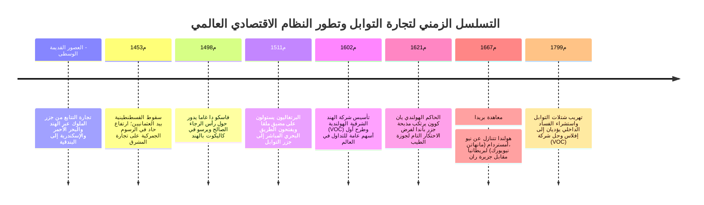
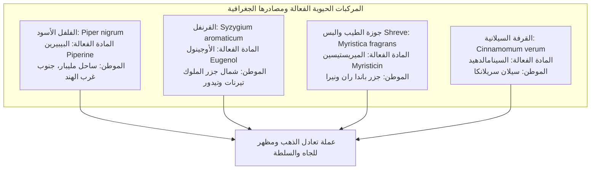
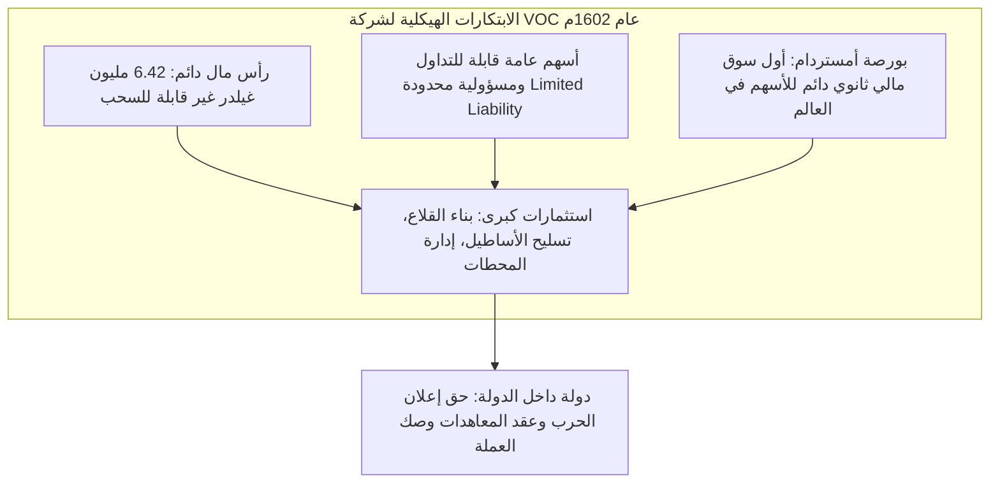

في محلات البقالة والمتاجر الحديثة اليوم، تباع عبوات الفلفل الأسود والقرنفل وجوزة الطيب ببضعة قروش زهيدة. ولكن في القرنين السادس عشر والسابع عشر الميلاديين، كانت هذه البذور والبراعم الزهرية المجففة القادمة من جزر بركانية نائية في أقاصي آسيا **توزن وتباع حرفياً بوزنها ذهباً خالصاً**. وكانت بمثابة الرمز الأسمى للمكانة الأرستقراطية والسلطان السياسي الفاحش في البلاطات الملكية الأوروبية.

لقد دفعت الرغبة العارمة في امتلاك التوابل السفن الشراعية الخشبية إلى خوض غمار محيطات مجهولة محفوفة بالموت، مطلقة عنان "عصر الاستكشافات الجغرافية الكبرى"، وقاطعة طرق القوافل البرية التاريخية كطريق الحرير. ولتوزيع المخاطر المميتة لتلك الرحلات البحرية وجمع رؤوس أموال ضخمة، ابتكر تجار أمستردام العمود الفقري للرأسمالية المؤسسية الحديثة: **أول شركة مساهمة عامة محدودة المسؤولية في تاريخ البشرية، وهي شركة الهند الشرقية الهولندية (VOC)، وأول بورصة دائمة للأوراق المالية في أمستردام**.

---

## 1. الكيمياء الحيوية للتوابل والشغف الأوروبي العارم

لماذا خاطر الأوروبيون بحياتهم وتحدوا الموت بمرض الإسقربوط والغرق وقراصنة البحار من أجل حفنة من البذور النباتية العطرية؟ تكمن الإجابة في الخصائص الدوائية الفائقة لتلك النباتات، وفي المنظومة الطبية والاجتماعية التي سادت أوروبا في ذلك العصر.

### 1.1 الآليات الجزيئية والصيدلانية
- **الفلفل الأسود (البيبيرين $\text{C}_{17}\text{H}_{19}\text{NO}_3$)**: يثير مستقبلات TRPV1 في الغشاء المخاطي للفم، محفزاً إحساساً حارقاً بالحرارة، ويحفز إفراز الإنزيمات الهاضمة، ويمتلك خصائص مضادة للميكروبات واسعة النطاق.
- **القرنفل (الأوجينول $\text{C}_{10}\text{H}_{12}\text{O}_2$)**: يشكل 70–90 % من زيته العطري. يعد مخدراً موضعياً ومضاداً للأكسدة ومطهراً قوياً. وأثناء اجتياح الموت الأسود (الطاعون)، كان القرنفل يوضع في كرات عطرية خاصة لدرء "الميازما" أو الهواء الفاسد.
- **جوزة الطيب (الميريستيسين $\text{C}_{11}\text{H}_{12}\text{O}_3$)**: تمنح نكهة دافئة مسكرة؛ وعند تناولها بجرعات عالية، تتحول في الكبد إلى مركبات ذات تأثيرات عصبية ومهلوسة ومحفزة للجهاز العصبي المركزي.

### 1.2 دحض خرافة "إخفاء رائحة اللحم الفاسد"
تزعم كتب التاريخ المبسطة خطأً أن الأوروبيين كانوا يستهلكون التوابل لإخفاء رائحة اللحوم المتعفنة في غياب التبريد. وقد نسف مؤرخو الاقتصاد الحديث هذه المقولة تماماً:
1. **الاستحالة الاقتصادية**: كان ثمن رطل واحد من جوزة الطيب أو الزعفران في أوروبا العصور الوسطى يشتري قطيعاً كاملاً من الأبقار الحية الطازجة. ولم يكن النبيل القادر على شراء التوابل المستوردة ليرضى بتناول لحم فاسد، فتبديد التوابل الثمينة على طعام تالف هو حماقة اقتصادية.
2. **الاستهلاك التفاخري (*Conspicuous Consumption*)**: كان تقديم الأطباق المصبوغة بالزعفران الذهبي والمغمورة بالقرنفل وجوزة الطيب استعراضاً مسرحياً يبرهن على الثراء الخرافي للمضيف وقدرته على تحريك التجارة العالمية.
3. **نظرية الأخلاط الأربعة لجالينوس**: كان الطب القديم يصنف لحوم الحيوانات على أنها "باردة ورطبة". ومن أجل الحفاظ على التوازن الصحي ومنع الأمراض، كان الأطباء يوجبون طهيها مع توابل "حارة وجافة" لتعديل المزاج الجسدي.

---

## 2. انهيار طرق التبادل التقليدية والهيمنة البحرية البرتغالية

قبل القرن السادس عشر، كانت التوابل تقطع آلاف الأميال عبر أيدي التجار في ملقا وكاليكوت والخليج العربي والبحر الأحمر، لتصل أخيراً إلى جمهورية البندقية بأسعار ترتفع بمقدار **100 إلى 200 ضعف** ثمنها الأصلي في جزر الملوك.

أدى فتح القسطنطينية عام 1453م على يد العثمانيين إلى تصاعد هائل في المكوس والرسوم الجمركية. فبادرت البرتغال برعاية الأمير هنري الملاح إلى استكشاف السواحل الإفريقية للوصول إلى الهند بحراً:
- **1498م**: **فاسكو دا غاما** يلتف حول رأس الرجاء الصالح ويصل إلى كاليكوت بالهند. وحققت شحنة الفلفل التي عاد بها أرباحاً صافية فاقت **60 ضعف التكلفة الإجمالية للحملة البحرية بأكملها**.
- **1511م**: ألفونسو دي ألبوكيرك يحتل ملقا بالقوة العسكرية، مؤسساً *دولة الهند البرتغالية (Estado da Índia)*، وهي شبكة من الحصون المسلحة (غوا، هرمز، ملقا) تفرض شراء تصاريح إبحار إجبارية مسلحة (*كارتاس*) على كل السفن المحلية في المحيط الهندي.

---

## 3. الثورة المالية الكبرى: تأسيس شركة (VOC) عام 1602م

في أواخر القرن السادس عشر، أدى التنافس الشرس بين السفن الهولندية إلى ارتفاع أسعار الشراء في آسيا وانهيار أسعار البيع في أوروبا. وفي عام 1602م، قاد السياسي الهولندي يوهان فان أولدنبارنفلت دمج جميع الشركات في كيان موحد عملاق: **شركة الهند الشرقية الهولندية المتحدة (VOC)**.

ابتكرت شركة VOC القواعد المؤسسية للشركات المساهمة المعاصرة:
- **رأس المال الدائم**: لم تعد الشركة تحل وتوزع أموالها بعد كل رحلة بحرية، بل أصبح رأس المال مستقراً في دفاترها بشكل دائم.
- **المسؤولية المحدودة**: لا يتحمل المساهم أي خسائر تفوق قيمة أسهمه المكتتب بها.
- **سيولة سوق الأسهم**: مكّنت **بورصة أمستردام** المستثمرين من بيع وشراء الأسهم وتحويلها إلى سيولة نقدية في أي وقت دون سحب فلس واحد من خزينة الشركة العاملة.

---

## 4. وحشية الاحتكار: مأساة جزر باندا

لم يكن نموذج شركة VOC قائماً على التجارة الحرة، بل على **الاحتكار الجبري المطلق بقوة المدافع**.

- **مذبحة جزر باندا عام 1621م**: رداً على استمرار سكان جزر باندا في بيع جوزة الطيب للتجار الإنجليز والجاويين، قاد الحاكم العام **يان كوون (Jan Pieterszoon Coen)** أسطولاً حربياً مدعوماً بمرتزقة الساموراي اليابانيين. وأبيد أكثر من 90 % من سكان الجزر الأصليين (قرابة 15,000 إنسان) ذبحاً وتجويعاً وبيعاً في أسواق الرقيق، وحُولت الجزر إلى مزارع سخرة (*Perken*) يديرها موظفو الشركة بالعبيد.
- **حملات هونغي (*Hongitochten*)**: كانت أساطيل الشركة الحربية تجوب الجزر سنوياً لقطع وحرق كل أشجار القرنفل وجوزة الطيب البرية خارج سيطرتها لخلق ندرة مصطنعة ورفع الأسعار في أوروبا.
- **معاهدة بريدا عام 1667م**: في أغرب مقايضة إقليمية في التاريخ، تنازلت هولندا لبريطانيا عن مستعمرتها في أمريكا الشمالية **نيو أمستردام (جزيرة مانهاتن في نيويورك اليوم)**، مقابل احتفاظها بجزيرة **ران** الصغيرة في جزر باندا، لتحقق بذلك احتكاراً عالمياً مطلقاً بنسبة 100 % لإنتاج جوزة الطيب.

---

## 5. الخاتمة والأثر التاريخي في العصر الحديث

غذت أرباح التوابل الخرافية العصر الذهبي الهولندي وأرست دعائم النظام العالمي الرأسمالي الحديث. ورغم انهيار الاحتكار في أواخر القرن الثامن عشر بفضل تهريب المستكشف الفرنسي بيير بوافر لشتلات التوابل وزراعتها في موريشيوس وإفلاس شركة VOC عام 1799م بسبب الفساد والديون، فإن ابتكاراتها المؤسسية — **الشركات المساهمة العامة، أسواق الأوراق المالية، وإدارة سلاسل الإمداد العالمية** — ما تزال تشكل الركائز الأساسية التي تدير الاقتصاد العالمي في القرن الحادي والعشرين.
