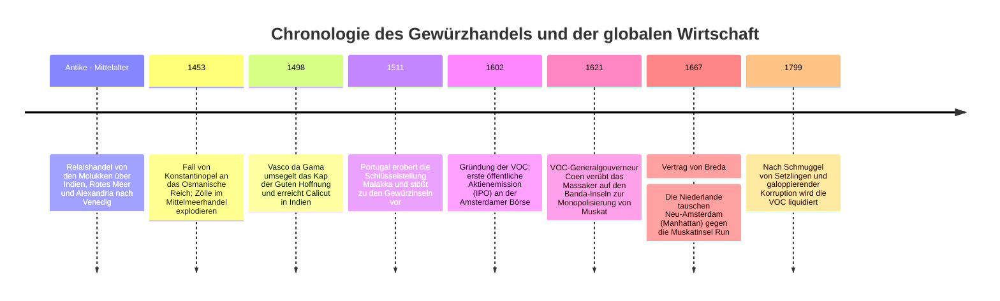
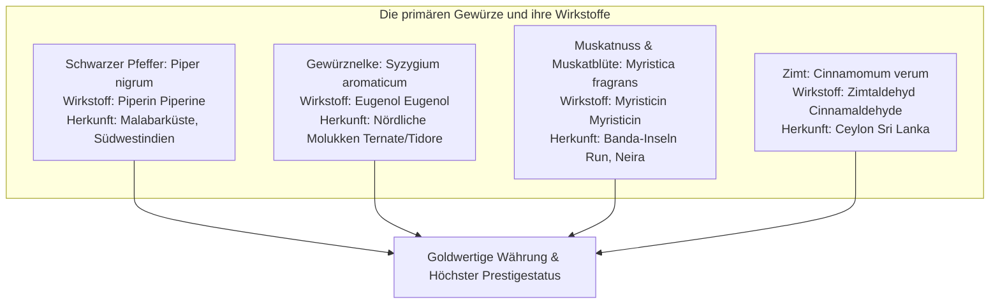
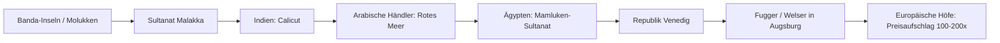
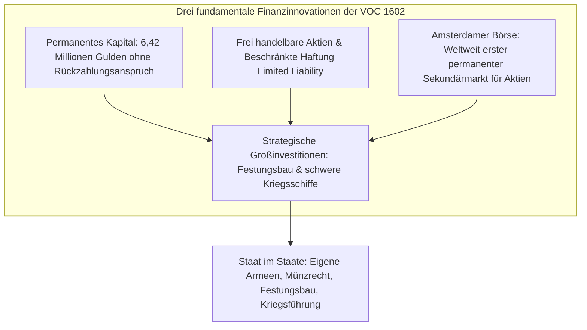
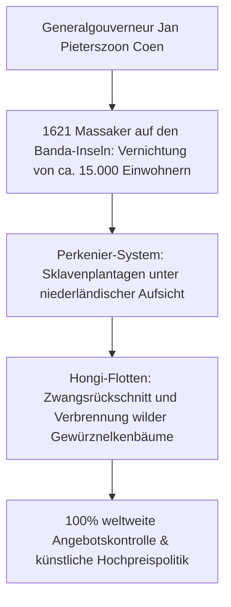

In einem modernen Supermarkt kosten Gläser mit schwarzem Pfeffer, Gewürznelken oder Muskatnuss nur wenige Euro. Im 16. und 17. Jahrhundert jedoch wurden diese getrockneten Pflanzensamen und Knospen buchstäblich **mit purem Gold aufgewogen**. Sie waren das ultimative Statussymbol aristokratischer Macht und fürstlicher Prachtentfaltung an den europäischen Höfen.

Das unstillbare Verlangen nach exotischen Gewürzen trieb europäische Seefahrer über tückische, unbekannte Weltmeere, leitete das Zeitalter der Entdeckungen ein und zerstörte die uralten eurasischen Karawanenwege. Um das existenzielle Risiko von Fernhandelsreisen zu streuen und gigantische Flotten zu finanzieren, erfanden Amsterdamer Kaufleute die institutionelle Grundlage des modernen Finanzkapitalismus: **die erste moderne Aktiengesellschaft der Welt, die Niederländische Ostindien-Kompanie (VOC), und die Amsterdamer Börse**.

---

## 1. Die Biochemie der Gewürze und die europäische Nachfrage

Warum riskierten europäische Seefahrer Schiffbruch, Skorbut und Tod für winzige Pflanzenfragmente von entlegenen Vulkaninseln? Die Antwort liegt in den pharmakologischen Wirkstoffen und den damaligen medizinisch-kulturellen Denkmustern.

### 1.1 Molekulare Wirkungsmechanismen
- **Schwarzer Pfeffer (Piperin $\text{C}_{17}\text{H}_{19}\text{NO}_3$)**: Reizt die TRPV1-Rezeptoren im Mundraum, löst intensive Hitzeempfindungen aus, stimuliert die Magensaftsekretion und besitzt breite antibakterielle Eigenschaften gegen Fäulnisbakterien.
- **Gewürznelken (Eugenol $\text{C}_{10}\text{H}_{12}\text{O}_2$)**: Machen 70–90 % des ätherischen Öls aus. Eugenol ist ein hochwirksames natürliches Antioxidans, Lokalanästhetikum und Antiseptikum. Während der Pestepidemien galt es als unverzichtbarer Schutz vor tödlichen Miasmen.
- **Muskatnuss (Myristicin $\text{C}_{11}\text{H}_{12}\text{O}_3$)**: Verleiht ein süß-würziges Aroma; in hohen Dosen wird es hepatisch in amphetaminähnliche Substanzen verstoffwechselt, die psychoaktiv wirken und Rauschzustände erzeugen können.

### 1.2 Die Widerlegung des Mythos vom „verdorbenen Fleisch“
In vielen populären Geschichtsbüchern hält sich hartnäckig die Behauptung, Gewürze hätten im Mittelalter dazu gedient, den Gestank von faulendem Fleisch zu übertünchen. Die moderne Wirtschafts- und Ernährungsgeschichte hat diesen Mythos längst widerlegt:
1. **Ökonomischer Widersinn**: Ein Pfund Muskat oder Pfeffer kostete im spätmittelalterlichen Europa erheblich mehr als eine ganze Herde lebender Rinder. Ein wohlhabender Adeliger, der sich importierte Gewürze leisten konnte, aß frisches Fleisch aus eigener Zucht. Teure Gewürze an verdorbenes Billigfleisch zu verschwenden, wäre wirtschaftlich absurd gewesen.
2. **Geltungskonsum (Conspicuous Consumption)**: Bei höfischen Banketten demonstrierten Gerichte, die üppig mit Safran goldgelb gefärbt und mit Nelken und Pfeffer gewürzt waren, die schier unbegrenzte Zahlungskraft und weltweite Handelsmacht des Gastgebers.
3. **Die Humoralpathologie (Viersäftelehre)**: Nach der antiken Medizin von Galen galten Fleischsorten als „kalt und feucht“. Um Krankheiten zu verhüten, mussten sie zwingend mit „heißen und trockenen“ Gewürzen kombiniert werden, um das innere physiologische Gleichgewicht der vier Körpersäfte zu wahren.

---

## 2. Der Zusammenbruch des Relaishandels und die portugiesische Seemacht

Vor 1500 durchquerten Gewürze zahllose Zwischenstationen auf Karawanen- und Schifffahrtsrouten:

Die Republik Venedig hielt ein eisernes Importmonopol im östlichen Mittelmeer. Als die osmanischen Türken 1453 Konstantinopel eroberten und die Levante unter ihre Kontrolle brachten, explodierten die Zölle.

Portugal reagierte unter Heinrich dem Seefahrer mit der methodischen Erkundung der afrikanischen Atlantikküste:
- **1498**: **Vasco da Gama** umsegelte das Kap der Guten Hoffnung und landete im indischen Calicut. Der Reingewinn aus der mitgebrachten Pfefferladung überstieg die Gesamtkosten der Expedition um das **Sechzigfache**.
- **1511**: Afonso de Albuquerque eroberte Malakka. Mit befestigten Marinestützpunkten in Goa, Hormus und Malakka etablierte Portugal ein militarisiertes Handelsnetzwerk (*Estado da Índia*) und erzwang über das Lizenzsystem (*Cartaz*) die Abgabe hoher Zölle von allen asiatischen Schiffen.

---

## 3. Die Geburt der Aktiengesellschaft: Die VOC und ihre Finanzinnovationen

Gegen Ende des 16. Jahrhunderts versuchten niederländische Reeder, den Gewürzhandel auf eigene Faust zu organisieren. Der ruinöse Konkurrenzkampf mehrerer Amsterdamer und seeländischer Vorkompagnien führte jedoch zu explodierenden Einkaufspreisen in Asien und fallenden Verkaufspreisen in Europa.

1602 initiierte der niederländische Staatsmann Johan van Oldenbarnevelt die Fusion aller Gesellschaften zur **Vereinigten Ostindischen Kompanie (VOC)**.

Die VOC löste das historische Dilemma zwischen langfristiger Kapitalbindung und kurzfristigem Liquiditätsbedarf:
- Die Anteilseigner konnten ihr Kapital nicht von der Kompanie zurückfordern (**Permanenz des Kapitals**).
- Stattdessen konnten sie ihre Anteile jederzeit an der neu gegründeten **Amsterdamer Börse** frei veräußern (**Börsenliquidität**).
- Die Haftung war strikt auf das investierte Kapital begrenzt (**beschränkte Haftung**).

Mit kaiserlichen Hoheitsrechten ausgestattet, agierte die VOC als souveräner Staat im asiatischen Raum: Sie unterhielt eigene Heere, baute Festungen, schlug eigene Münzen und führte eigenständig Krieg.

---

## 4. Das Muskat-Monopol: Gewalt und Auslöschung auf den Banda-Inseln

Der Kern der VOC-Strategie war das absolute Monopol. Freier Wettbewerb galt als ökonomischer Feind.

- **Das Massaker von 1621**: Da die Bewohner der Banda-Inseln Muskatnuss vertragswidrig an englische und javanische Händler verkauften, landete Generalgouverneur **Jan Pieterszoon Coen** 1621 mit schwer bewaffneten Kriegsschiffen und japanischen Söldnern. Nahezu die gesamte einheimische Bevölkerung (rund 15.000 Menschen) wurde ermordet, versklavt oder verhungerte. Die Inseln wurden in 68 Plantagen (*Perken*) aufgeteilt und mit versklavten Arbeitskräften bewirtschaftet.
- **Hongi-Fahrten (Hongitochten)**: Bewaffnete Flotten patrouillierten jährlich durch die Gewürzinseln, um wilde Muskat- und Nelkenbäume systematisch niederzubrennen und Schmuggel mit der Todesstrafe zu ahnden.
- **Der Vertrag von Breda (1667)**: In einem der folgenschwersten Gebietstausche der Weltgeschichte überließen die Niederlande den Engländern das nordamerikanische **Neu-Amsterdam (das heutige Manhattan)** – im Gegenzug für die winzige Muskatinsel **Run**, wodurch die VOC das weltweite Muskatmonopol vollendete.

---

## 5. Das Erbe des Gewürzhandels in der Moderne

Das durch den Gewürzhandel akkumulierte Kapital bildete das Fundament des Goldenen Zeitalters der Niederlande. Im späten 18. Jahrhundert brach das Monopol zusammen, als französische und britische Agenten Setzlinge nach Mauritius und Grenada schmuggelten und der europäische Geschmack zu Kaffee, Tee und Zucker überging.

Obwohl die VOC 1799 bankrottging, prägen ihre institutionellen Schöpfungen – **die Aktiengesellschaft, die Wertpapierbörse und globale Lieferketten** – die moderne Weltwirtschaft bis heute.
