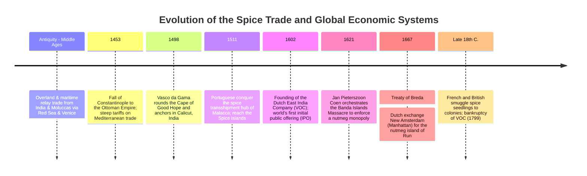
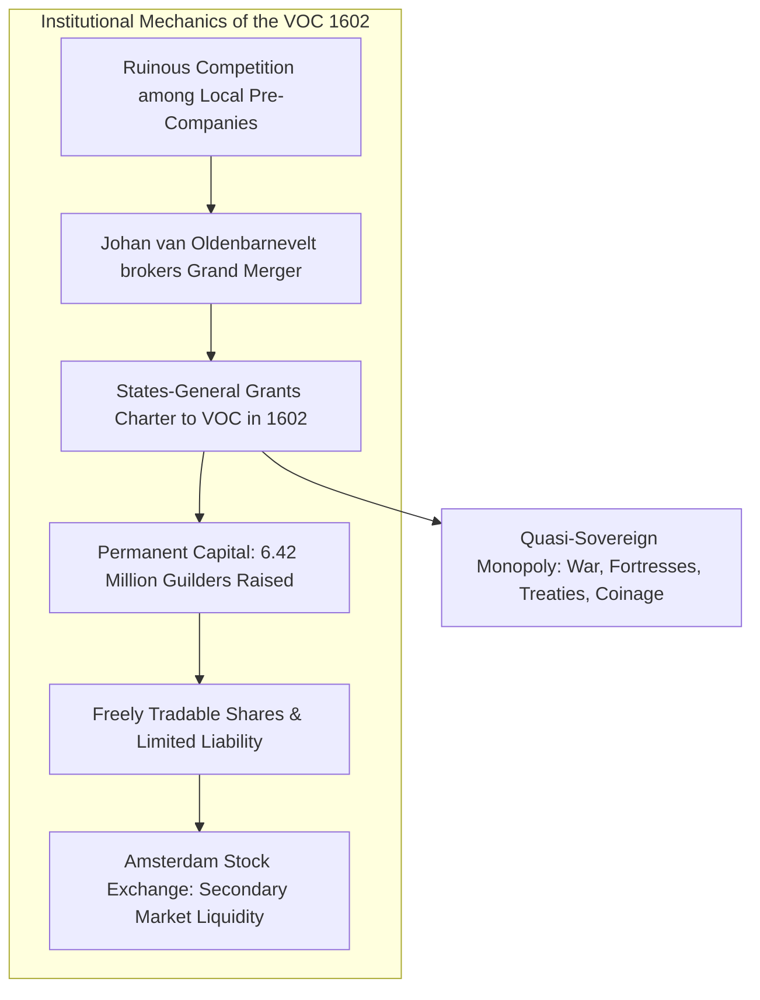
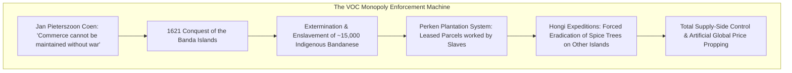
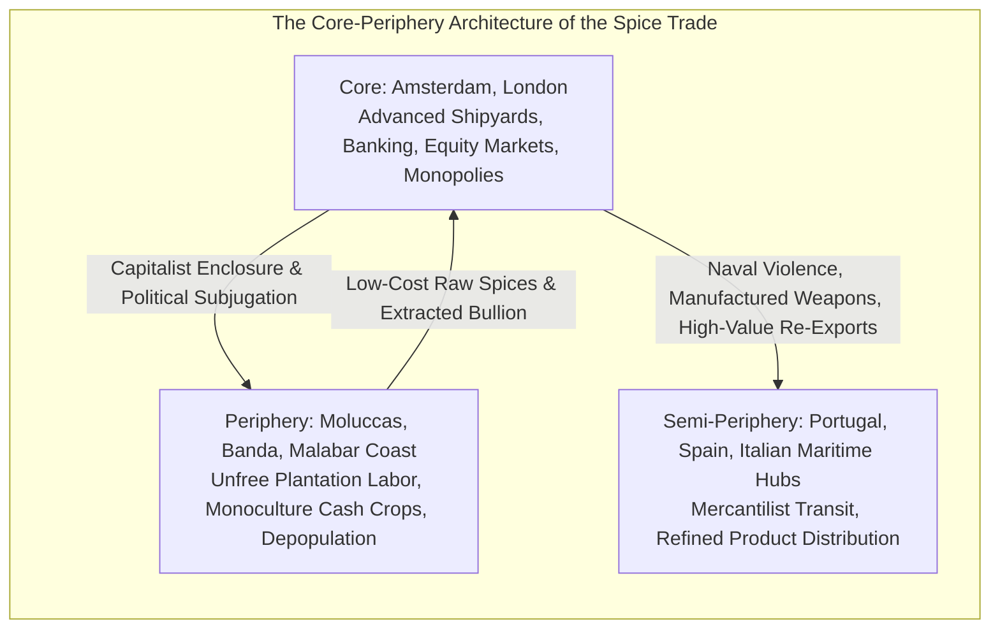

In a modern grocery store, small glass jars of black pepper, cloves, and nutmeg sit quietly on shelves, priced at just a few dollars. Yet during the sixteenth and seventeenth centuries, these dried seeds, fruits, and flower buds were **literally worth their weight in gold**. They served as the ultimate status symbol of aristocratic opulence and aristocratic power in European high society.

The insatiable European desire for exotic spices pushed wooden sailing ships into treacherous, uncharted oceans, redrew the cartography of the globe, ignited the Age of Discovery, and shattered medieval overland trade routes. To pool capital, disperse existential seafaring hazards, and finance long-range multi-year naval campaigns, merchants in Amsterdam invented the institutional bedrock of modern capitalism: **the world's first publicly traded joint-stock corporation (the Dutch East India Company, or VOC) and the permanent stock exchange**.

This treatise explores the profound convergence of botanical chemistry, Middle Eastern geopolitics, Iberian oceanic expeditions, high-finance institutional design, the ruthless militarized monopolization of the Moluccas, and the lasting legacy of the spice trade on modern corporate governance and global supply chains.



---

## 1. Botanical Biochemistry and the European Passion for Spices

Why were Renaissance Europeans willing to gamble fortunes and risk scurvy, shipwrecks, and piracy to obtain tiny plant fragments from remote volcanic archipelagos on the opposite side of the globe? The answer lies at the intersection of molecular pharmacology and the cultural and medical paradigms of the pre-modern world.

```mermaid
flowchart TD
    subgraph Primary Spices: Active Chemical Agents and Origins
        Pepper[Black Pepper: Piper nigrum<br/>Active: Piperine<br/>Origin: Malabar Coast, Southwest India]
        Clove[Clove: Syzygium aromaticum<br/>Active: Eugenol<br/>Origin: Northern Moluccas (Ternate, Tidore)]
        Nutmeg[Nutmeg & Mace: Myristica fragrans<br/>Active: Myristicin<br/>Origin: Banda Islands (Run, Neira, Ai)]
        Cinnamon[Ceylon Cinnamon: Cinnamomum verum<br/>Active: Cinnamaldehyde<br/>Origin: Ceylon (Sri Lanka)]
    end
    Pepper --> Value[Parity with Precious Metals & Aristocratic Prestige]
    Clove --> Value
    Nutmeg --> Value
    Cinnamon --> Value
```

### 1.1 Molecular Architecture and Pharmacological Mechanisms
The chemical compounds that made these plants formidable evolutionary survivors in tropical ecosystems simultaneously made them irresistibly potent to human sensory biology.

#### (1) Black Pepper (*Piper nigrum*)
- **Primary Bioactive Compound**: **Piperine ($\text{C}_{17}\text{H}_{19}\text{NO}_3$)**, an alkaloid possessing a conjugated diene system linked to a piperidine ring.
- **Biochemical Mode of Action**: Piperine binds to and stimulates the transient receptor potential vanilloid 1 (TRPV1) ion channels situated on sensory nerve endings in the oral cavity. This interaction triggers an influx of calcium ions, sending sensations of sharp heat and piquancy to the brain. Systemically, piperine stimulates gastric acid and pancreatic digestive enzyme secretion while exhibiting potent broad-spectrum antibacterial activity against food-borne pathogens.

#### (2) Cloves (*Syzygium aromaticum*)
- **Primary Bioactive Compound**: **Eugenol ($\text{C}_{10}\text{H}_{12}\text{O}_2$)**, an allyl-chain-substituted guaiacol making up 70% to 90% of the volatile essential oil extracted from unopened flower buds.
- **Biochemical Mode of Action**: Eugenol is a powerful natural antioxidant, antimicrobial, and local anesthetic. By inhibiting prostaglandin synthesis and down-regulating cyclooxygenase-2 (COX-2), it acts as an analgesic. In pre-modern Europe, cloves were indispensable for treating toothaches, embalming corpses, and combating atmospheric miasmas during pestilence outbreaks.

#### (3) Nutmeg and Mace (*Myristica fragrans*)
- **Botanical Structure**: The nutmeg fruit yields two distinct spices: the hard inner seed (nutmeg) and the crimson, lacy aril surrounding it (mace).
- **Primary Bioactive Compound**: **Myristicin ($\text{C}_{11}\text{H}_{12}\text{O}_3$)** and elemicin.
- **Biochemical Mode of Action**: Beyond its sweet, warm culinary aroma, myristicin is a psychoactive allylbenzene derivative. In high doses, human hepatic metabolism converts myristicin into amphetamine-like metabolites, inducing central nervous system stimulation, auditory and visual hallucinations, tachycardia, and prolonged sedation.

### 1.2 Debunking the "Rotten Meat" Myth: The Real Drivers of Demand
A pervasive historical myth—frequently repeated in popular culture and outdated textbooks—claims that medieval Europeans consumed vast amounts of spices to disguise the putrid taste and foul stench of spoiled, unrefrigerated meat. Modern economic and culinary historiography (pioneered by scholars such as Jean-Louis Flandrin and Paul Freedman) has thoroughly dismantled this fallacy:

1. **Economic Incoherence**: In fourteenth- and fifteenth-century Europe, a single pound of nutmeg or saffron cost significantly more than an entire herd of healthy cattle or sheep. A wealthy lord capable of purchasing imported Asian spices could easily afford freshly slaughtered livestock from his own estate. Spoiling expensive seasonings on rotten meat was economically absurd.
2. **Conspicuous Consumption and Aristocratic Status**: Feasts were theatrical arenas of political legitimacy. Dousing roasted game in brilliant yellow saffron, pungent pepper, and exotic cloves demonstrated that the host possessed the astronomical wealth necessary to commandeer intercontinental commercial networks.
3. **Humoral Medicine and the Galenic Paradigm**: Medieval European medical science was governed by the Greco-Roman humoral theory formalized by Hippocrates and Galen. Bodily health required a dynamic equilibrium among four vital humors: blood, phlegm, yellow bile, and black bile. Meats such as pork and beef were categorized as inherently "cold and moist," which was believed to induce sluggish digestion and disease. Spices, classified as intensely "hot and dry," were deemed therapeutically essential to counteract the unwholesome chill of meat and maintain physiological balance.
4. **The Terror of the Black Death and Miasma Theory**: Following the cataclysmic Black Death of 1347–1351, which wiped out over a third of Europe's population, epidemic contagion was attributed to *miasma*—toxic, pestilential air. Wealthy burghers wore perforated silver orbs called *pomanders* packed with cloves, nutmeg, and ambergris close to their nostrils to ward off plague vapors. The demand for aromatic botanicals became a matter of existential survival.

---

## 2. The Geopolitical Impasse: From Silk Roads to the Cape of Good Hope

Prior to the sixteenth century, no single merchant or vessel traveled the entire distance between the Spice Islands of Indonesia and the dining halls of London or Paris. Instead, spices passed through an intricate relay network stretching across thousands of miles of ocean and desert.

```mermaid
flowchart LR
    Moluccas[Moluccas & Banda Islands] --> Malacca[Sultanate of Malacca]
    Malacca --> Calicut[Calicut, Malabar Coast]
    Calicut --> RedSea[Arab / Persian Merchants in Red Sea & Persian Gulf]
    RedSea --> Alexandria[Cairo & Alexandria, Mamluk Sultanate]
    Alexandria --> Venice[Venetian Republic Merchant Galleys]
    Venice --> Augsburg[Augsburg Fugger & Welser Banking Houses]
    Augsburg --> EuropeanMarkets[Western European Consumers]
```



### 2.1 The Venetian Monopoly and Cascading Tariffs
At each node of this commercial relay, merchants, sultanates, port authorities, and desert caravan masters levied customs duties, transshipment fees, and profit markups:
- If a sack of cloves was harvested in the Moluccas at a baseline production cost index of **1**, it was marked up to **3–5** upon reaching Malacca.
- Transshipped across the Indian Ocean to Calicut or Hormuz, its price climbed to **15–20**.
- After caravan transit across the Arabian sands to the Nile and downriver to Alexandria, the Mamluk Sultan imposed exorbitant tariffs, pushing the index to **50**.
- Finally, the **Republic of Venice**, which possessed an exclusive treaty monopoly over Alexandrian trade, shipped the spice across the Mediterranean, selling it to transalpine German merchant-bankers at an index exceeding **100 to 200**.

Venice grew immensely wealthy on this monopolistic chokehold, funding magnificent marble palazzos along the Grand Canal while draining the kingdoms of Western Europe of physical silver bullion.

### 2.2 1453: The Ottoman Catalyst
In May 1453, Sultan Mehmed II breached the ancient Theodosian Walls of Constantinople, extinguishing the Byzantine Empire. Over subsequent decades, the ascendant Ottoman Empire expanded into Syria, Egypt, and the Levant, subjugating the Mamluks by 1517. While the Ottomans did not entirely ban European trade, they imposed strict controls, extracted higher tariffs, and demonstrated an unpredictable military posture.

For the monarchs of the Atlantic seaboard—chiefly Portugal and Spain—the conclusion was undeniable: the traditional Mediterranean-Levantine gateway was terminally insecure. Whoever could pioneer a direct, all-water maritime path to the Indian subcontinent would bankrupt Venice, bypass Islamic middlemen, and capture the greatest commercial prize in human history.

### 2.3 The Portuguese Thalassocracy: Da Gama and Albuquerque
Spearheaded by Prince Henry the Navigator (1394–1460), Portugal systematically methodized navigation, astronomical calculation, cartography, and caravels capable of tacking against prevailing headwinds (*volta do mar*):
- **1488**: Bartolomeu Dias rounded the storm-tossed southernmost promontory of Africa, dubbing it the Cape of Good Hope.
- **1498**: **Vasco da Gama** completed the transoceanic voyage, anchoring at Calicut on India's Malabar Coast. Although local Hindu rulers and Muslim traders were unimpressed by his modest European trade goods, the return cargo of black pepper generated a profit exceeding **6,000% (sixty times the total expedition budget)**.
- **1511**: Afonso de Albuquerque, the architect of Portugal's Indian Ocean empire, stormed the strategic chokepoint of Malacca with eighteen warships. Within months, Portuguese navigators reached the Moluccan islands of Ternate and Tidore.

Rather than colonizing vast inland territorial tracts, Portugal established a maritime network of fortified naval garrisons—the **Estado da Índia**—anchored at Goa, Hormuz, Malacca, and Cochin. Enforcing the *cartaz* system (mandatory armed navigation passports issued to native trading vessels), Portugal effectively militarized the Indian Ocean trade routes.

---

## 3. The Financial Engineering of Modern Capitalism: The VOC

By the late sixteenth century, the Portuguese Crown's spice monopoly was faltering under the weight of naval overextension, bureaucratic corruption, shipwreck losses, and the union of the Portuguese and Spanish crowns under Philip II. In 1595, a Dutch expedition commanded by Cornelis de Houtman reached Bantam on the island of Java. Despite losing half his crew to disease and violence, Houtman returned to Amsterdam in 1597 with a modest shipment of pepper, proving that the Portuguese monopoly was vulnerable.

Feverish commercial excitement swept the Dutch Republic. Merchant syndicates in Amsterdam, Zeeland, and Rotterdam launched competing expeditions (*voorcompagnieën*). However, this uncoordinated private frenzy quickly produced destructive results: Dutch fleets bid against one another in Indonesian ports, driving local spice purchase prices up, while flooding the European market upon their simultaneous return, causing domestic sales prices to crash.



### 3.1 The 1602 Charter: Three Paradigm Shifts in High Finance
Recognizing that ruinous internal price competition would allow the Portuguese and the newly formed English East India Company (chartered in 1600) to dominate Asia, Grand Pensionary **Johan van Oldenbarnevelt** engineered a mandatory consolidation. On March 20, 1602, the States-General granted a charter creating the **United East India Company (Vereenigde Oostindische Compagnie: VOC)**.

The VOC introduced three institutional innovations that laid the foundation for modern corporate finance:

#### (1) Permanent Institutional Capital
Pre-modern partnerships dissolved after every voyage. Investors pooled cash, purchased ships and cargo, and when the fleet returned two to three years later, the enterprise was liquidated, distributing principal and profits. However, intercontinental dominance in Asia required colossal, long-term capital investments that yielded no short-term returns: constructing stone fortresses, maintaining deep-draft warships, and funding permanent overseas factories.
The VOC was structured with a **permanent capital base of 6.42 million guilders**. Investors could not arbitrarily withdraw their equity from the company's treasury; the capital remained permanently locked in the corporation's balance sheet, allowing decades-long strategic planning.

#### (2) Universal Public Share Subscriptions and Limited Liability
Unlike earlier elite merchant cartels, anyone in the Dutch Republic could subscribe to VOC shares. Wealthy patricians, humble domestic servants, foreign merchants, and artisans bought equity. Crucially, investors enjoyed **limited liability**: an individual shareholder could never lose more than the exact capital initially invested, shielding personal fortunes from corporate bankruptcy.

#### (3) Secondary Market Liquidity: The Amsterdam Stock Exchange
Because shareholders were barred from demanding capital redemptions from the company, a liquid mechanism was required to enable investors to convert shares back into cash. In response, the **Amsterdam Stock Exchange (*Beurs van Berlage*)** was established as the world's first permanent, formal equity exchange.
Investors could freely buy and sell VOC stock to third parties at prevailing market prices. This decoupled the life of the enterprise from the mortality or financial exigencies of its individual owners, achieving the holy grail of corporate finance: **unwavering institutional stability coupled with dynamic investor liquidity**.

### 3.2 A Corporate Leviathan: The Sovereign State Within a State
The charter granted by the Dutch Republic endowed the VOC's executive directorate—the **Heeren XVII (Gentlemen Seventeen)**—with unprecedented quasi-sovereign powers east of the Cape of Good Hope:
- **Jus Belli (Right of War and Peace)**: The legal authority to declare war on Asian rulers or European rivals and negotiate binding peace treaties.
- **Military Command**: The power to recruit, maintain, and deploy private standing armies and naval fleets.
- **Territorial Colonization**: The right to seize land, erect stone fortifications, and administer civil and criminal justice over subject populations.
- **Monetary Sovereignty**: The authority to mint its own gold, silver, and copper coinage for circulation throughout Asia.

The VOC was not merely a commercial trading enterprise; it was a heavily armed, autonomous corporate-state operating across thousands of miles of ocean with virtually no day-to-day oversight from the Dutch government.

---

## 4. The Monopolistic Crucible: Violence in the Moluccas and Banda

The economic imperative of the VOC was absolute monopoly. Free trade was viewed as an existential threat: if independent European merchants or local Asian seamen were permitted to trade, market supply would expand, prices in Amsterdam would plummet, and high operating profit margins would disappear. To secure absolute control over nutmeg and cloves, the VOC deployed industrial-scale violence.



### 4.1 Jan Pieterszoon Coen and the 1621 Banda Massacre
The architect of Dutch commercial hegemony was **Jan Pieterszoon Coen**, appointed Governor-General in 1618. Coen formulated the VOC's core operating ethos in an infamous 1614 dispatch: *"Your Honors ought to know by experience that trade in Asia must be driven and maintained under the protection and favor of Your Honors' own weapons, and that the weapons must be paid for by the trade, so that one cannot be maintained without the other."*

The volcanic Banda archipelago was the world's sole producer of nutmeg and mace. The native Bandanese community (*Orang Kaya*, or village headmen) had signed trade agreements granting the VOC an exclusive purchasing monopoly. However, because the Dutch paid in worthless European woolen cloth and trinkets rather than essential rice, sago, and manufactured goods, the Bandanese regularly smuggled nutmeg to English and Javanese merchants.

In early 1621, Coen arrived at Banda Neira with a fleet of nineteen ships, hundreds of European soldiers, and Japanese *ronin* mercenaries:
- Over subsequent weeks, Coen's forces carried out a systematic campaign of terror. Approximately forty-four prominent village elders were tortured, beheaded, and dismembered.
- Out of an estimated native population of roughly 15,000 Bandanese, over **90% were systematically murdered, starved in mountain hideouts, or rounded up and sold into chattel slavery**. Fewer than one thousand survivors remained on the islands.
- Coen confiscated the depopulated islands, carved the land into sixty-eight plantation parcels (*perken*), and leased them to retired VOC employees (*perkeniers*). The nutmeg groves were repopulated with thousands of enslaved laborers imported from Africa, Madagascar, India, and Java.

### 4.2 Hongi Raids and Artificial Scarcity
Having secured the total physical control of nutmeg, the VOC turned its attention to cloves in the Ambon and Lease archipelagos. To prevent competition and eliminate illicit supply:
- **Hongitochten (Hongi Expeditions)**: The VOC organized annual flotillas of armed indigenous war canoes (*kora-kora*) commanded by Dutch officers. These fleets patrolled the surrounding archipelagos, forcibly landing on islands outside VOC jurisdiction to cut down, strip of bark, and burn every wild or independently cultivated clove and nutmeg tree. Anyone caught smuggling or cultivating unauthorized spices was summarily executed.
- **Strategic Destruction in Amsterdam**: When domestic spice harvests yielded excess supply that threatened to drive prices downward on the European exchange, the VOC burned vast warehouses of cinnamon, nutmeg, and cloves along the docks of Amsterdam or dumped tons of spices into the North Sea, maintaining sky-high cartel prices through deliberate, artificial scarcity.

### 4.3 The Amboyna Massacre (1623) and the Treaty of Breda (1667)
In 1623, simmering tensions between English and Dutch merchants in the Moluccas exploded during the **Amboyna Massacre**. Dutch authorities arrested, subjected to water torture, and executed ten English East India Company merchants, nine Japanese mercenaries, and a Portuguese sailor on charges of conspiring to capture Fort Victoria. The outrage crippled diplomatic relations between London and the Hague and compelled the English East India Company to abandon the Indonesian spice trade entirely, refocusing its strategic ambitions on the Indian subcontinent's textiles and tea.

Decades later, at the conclusion of the Second Anglo-Dutch War in 1667, the two naval powers signed the **Treaty of Breda**. In an astonishing historical swap:
- The Dutch retained control of the tiny, remote nutmeg atoll of **Run Island** in the Banda archipelago, thereby achieving a 100% global monopoly over the world's nutmeg and mace supply.
- In exchange, the Dutch formally ceded their North American colony of **New Amsterdam—the island of Manhattan and the Hudson River valley**—to the British crown. To seventeenth-century Dutch accountants, an island of valuable nutmeg trees was infinitely more lucrative than a cold, muddy fur-trading outpost in North America.

---

## 5. The World-System and the Macroeconomic Legacy of Spices

The spice trade served as the engine that propelled the transition from regional feudalism to a cohesive, hierarchical capitalist world-economy. Through the theoretical lens of sociologist Immanuel Wallerstein's *Modern World-System*, the spice trade generated a structural division of international labor characterized by three interdependent zones:



### 5.1 The Dutch Golden Age and Amsterdam Financial Hegemony
The river of wealth that flowed from the spice trade underpinned the seventeenth-century Dutch Golden Age (*Gouden Eeuw*):
- **Cultural Renaissance**: Spice wealth financed public civic architecture and commissioned masterpieces from painters like Rembrandt van Rijn, Johannes Vermeer, and Frans Hals.
- **Monetary Centralization**: In 1609, the **Bank of Amsterdam (*Amsterdamsche Wisselbank*)** was established. Its standardized bank money (*bank florin*), backed by massive bullion reserves, became the undisputed reserve currency of international European trade.
- **Financial Derivative Engineering**: The Amsterdam bourse pioneered sophisticated modern financial instruments: call and put options, short selling, forward contracts, and margin trading were all developed to speculate on VOC fleet arrival times and spice yields.

### 5.2 The Inevitable Collapse of the Spice Monopolies
By the mid-eighteenth century, the VOC's monopolistic dominance eroded under the weight of economic obsolescence and operational decay:
1. **Ecological Espionage and Agronomic Dispersal**: In 1770, French colonial administrator Pierre Poivre conducted daring covert raids into the Moluccas, successfully smuggling live clove and nutmeg seedlings. France propagated these plants in Mauritius, Réunion, and the Seychelles. Soon after, the British transplanted spice groves across Penang, Singapore, and the Caribbean (Grenada). The localized ecological monopoly was broken forever.
2. **Structural Shifts in Consumer Demand**: During the Enlightenment, European consumer tastes underwent a profound transition. The culinary appetite for heavy, spice-laden sauces waned in favor of fresh herbs and butter-based French cuisine. Meanwhile, popular mass consumption shifted decisively toward new stimulant commodities: **cane sugar, coffee, tea, tobacco, and cocoa**, alongside lightweight Indian **cotton calicos**. Spices ceased to be the dominant profit engine of intercontinental commerce.
3. **Internal Rot and the Fall of the VOC**: Bloated by bureaucratic corruption, private insider trading by company officials, and unsustainable military expenditures required to enforce monopolies, the VOC accumulated catastrophic debts. The company became colloquially known as *Vergaan Onder Corruptie* (Perished Under Corruption).
4. **Nationalization and Dissolution (1799)**: Bankrupted by the Fourth Anglo-Dutch War and the French Revolutionary invasion of the Netherlands, the VOC was formally dissolved on December 31, 1799. Its remaining territorial possessions and debts were absorbed by the Batavian Republic, forming the foundation of the Dutch East Indies (modern Indonesia).

---

## 6. Structural Parallels in the Twenty-First Century

The story of the spice trade is far more than an artifact of maritime antiquarianism. The economic dynamics, corporate stratagems, and geopolitical friction that characterized the seventeenth-century spice trade find precise structural analogs in the high-stakes global industries of the twenty-first century:

| Early Modern Spice Trade Dynamics (1600–1750) | Twenty-First Century Structural Counterpart |
| :--- | :--- |
| **Geographic hyper-concentration of nutmeg & cloves (Banda/Moluccas)** | Hyper-concentration of leading-edge semiconductor lithography (ASML in the Netherlands) and advanced sub-3nm fabrication (TSMC in Taiwan). |
| **Pioneering of permanent capital, public shares, and limited liability (VOC 1602)** | Modern technology capitalization via Silicon Valley venture capital syndicates, initial public offerings (IPOs), and the NASDAQ. |
| **Hongi raids, supply destruction, and armed price-fixing cartels** | OPEC+ petroleum production quotas, the historic De Beers diamond cartel, and industrial antitrust violations. |
| **Amboyna massacre and violent maritime proxy skirmishes** | Technological decoupling, export controls, and national security sanctions in the US-China semiconductor dispute. |
| **Consumer shift from spices to sugar, coffee, and cotton** | The energy transition from fossil hydrocarbons to renewable grids, and hardware migration from traditional computing to AI accelerators. |
| **Insider corruption and governance collapse of the VOC** | Modern corporate governance failures, auditing scandals (Enron, Wirecard), and institutional agency dilemmas. |

### Conclusion
When we examine a single peppercorn or grate a fragrant seed of nutmeg, we hold the tangible catalyst that set the modern world in motion. The search for these aromatic molecules prompted humanity to map the oceans, laid the brutal foundations of modern colonialism, and invented the corporate and financial machinery that governs the global economy today. The sailing ships have vanished from the waters of the Banda Sea, but the corporate DNA forged in the furnace of the spice trade remains the foundational architecture of the modern capitalist world.
