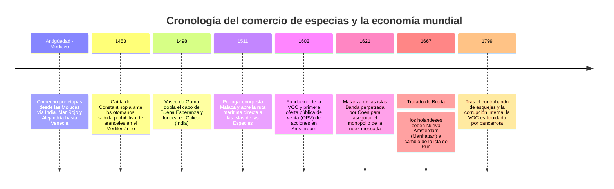
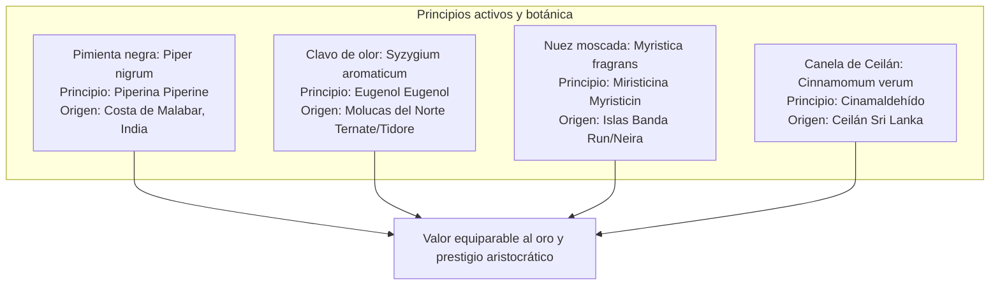
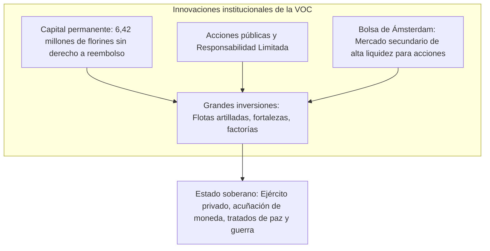

En cualquier tienda moderna, un frasco de pimienta negra, clavo o nuez moscada cuesta apenas unas monedas. Sin embargo, en los siglos XVI y XVII, estos pequeños frutos y botones florales deshidratados **se cambiaban literalmente por su mismo peso en oro**. Constituían el máximo emblema de prestigio, poderío y suntuosidad en los banquetes de la aristocracia europea.

El anhelo por controlar estas aromáticas sustancias impulsó a intrépidos navegantes a surcar mares procelosos, dando inicio a la Era de los Descubrimientos y desmantelando las milenarias rutas terrestres euroasiáticas. Para financiar armadas colosales y diluir los mortales riesgos del océano, los comerciantes de Ámsterdam forjaron el andamiaje institucional del capitalismo moderno: **la primera sociedad anónima cotizada del mundo, la Compañía Holandesa de las Indias Orientales (VOC), y la Bolsa de Valores de Ámsterdam**.

---

## 1. La bioquímica de las especias y la obsesión europea

¿Por qué se jugaban la vida los europeos por unos sacos de semillas remotas? La respuesta radica en la extraordinaria potencia farmacológica de sus metabolitos secundarios y en las concepciones médicas y cortesanas de la época.

### 1.1 Farmacología molecular
- **Pimienta negra (Piperina $\text{C}_{17}\text{H}_{19}\text{NO}_3$)**: Activa los termorreceptores TRPV1 en la lengua, desatando un picor intenso, incrementa la pepsina y los jugos gástricos, y actúa como potente bactericida.
- **Clavo de olor (Eugenol $\text{C}_{10}\text{H}_{12}\text{O}_2$)**: Compone el 70–90 % de su aceite esencial. Es un formidable antiséptico, anestésico y antioxidante. Durante la peste negra, se quemaba o se llevaba en pomadas para disipar los "miasmas" pestilentes.
- **Nuez moscada (Miristicina $\text{C}_{11}\text{H}_{12}\text{O}_3$)**: De fragancia cálida y dulce; en dosis elevadas se metaboliza en el hígado dando lugar a compuestos con efectos psicoactivos y alucinógenos.

### 1.2 La falsedad del mito de la "carne en mal estado"
La creencia popular afirma erróneamente que las especias se usaban para tapar el hedor de la carne podrida. La investigación histórica ha demostrado que esto es un disparate:
1. **Contradicción económica**: Una pizca de nuez moscada costaba más que varias cabezas de ganado bovino u ovino fresco. Quien podía pagar especias asiáticas comía ganado recién sacrificado en sus feudos.
2. **Consumo conspicuo**: Teñir los banquetes de amarillo con azafrán y aromatizarlos con clavo y nuez moscada era la exhibición teatral por excelencia del poder dinástico de la nobleza.
3. **Teoría de los cuatro humores de Galeno**: La medicina clásica enseñaba que la carne era "fría y húmeda". Para evitar desórdenes digestivos y mantener el equilibrio humoral, era médicamente indispensable cocinarla con especias "cálidas y secas".

---

## 2. La fractura geopolítica y el imperio marítimo portugués

Hasta finales del siglo XV, las especias pasaban de mano en mano a través de intermediarios árabes y egipcios hasta llegar a la República de Venecia, con un sobrecoste final de hasta el **20.000 %**. Con la toma de Constantinopla por el Imperio otomano en 1453, el comercio tradicional se volvió excesivamente gravoso e inestable.

Portugal, mediante las expediciones atlánticas impulsadas por Enrique el Navegante, buscó la vía marítima directa:
- **1498**: **Vasco da Gama** llega a Calicut navegando alrededor de África. La venta del cargamento de pimienta generó una rentabilidad neta de **60 veces el coste de toda la armada**.
- **1511**: Afonso de Albuquerque toma Malaca por la fuerza, levantando el *Estado da Índia*: una cadena de ciudadelas armadas (Goa, Ormuz, Malaca) que exigía a todos los barcos locales el pago de salvoconductos armados (*cartazes*).

---

## 3. La creación de la VOC (1602): La cuna de las finanzas corporativas

Para evitar la destructiva guerra de precios entre mercaderes holandeses, el estadista Johan van Oldenbarnevelt unificó a las distintas empresas en la **Compañía de las Indias Orientales (VOC)** en 1602.

La VOC diseñó la arquitectura básica de las empresas modernas:
- **Capitalización permanente**: El capital social no se disolvía al acabar cada expedición.
- **Responsabilidad limitada**: Los accionistas no respondían de las deudas societarias con su patrimonio personal.
- **Negociabilidad bursátil**: La **Bolsa de Ámsterdam** garantizaba que los inversores pudieran transformar sus acciones en dinero efectivo cuando quisieran, sin drenar la tesorería de la compañía.

Dotada de poderes cuasiestatales, la VOC contaba con ejército propio, acuñaba moneda y declaraba la guerra en ultramar sin consultar a las autoridades metropolitanas.

---

## 4. La crueldad del monopolio: El genocidio de las islas Banda

El modelo comercial de la VOC no se basaba en el libre comercio, sino en el **monopolio armado implacable**.

- **La matanza de Banda de 1621**: Al negarse los nativos a cumplir con los contratos de exclusividad y vender nuez moscada a comerciantes ingleses, el gobernador general **Jan Pieterszoon Coen** desembarcó con una fuerza armada y mercenarios samuráis japoneses. Asesinó o vendió como esclavos a casi el 90 % de los 15.000 habitantes originarios, reorganizando las islas en parcelas (*perken*) trabajadas por mano de obra esclava.
- **Expediciones Hongi (*Hongitochten*)**: Escuadras navales talaban e incendiaban periódicamente los árboles de clavo silvestres en islas no controladas para evitar fugas de producción. Si en Europa sobraba mercancía, la VOC quemaba almacenes enteros de especias en Ámsterdam para sostener artificialmente los precios.
- **El Tratado de Breda (1667)**: Holanda entregó a Gran Bretaña su colonia norteamericana de **Nueva Ámsterdam (la actual isla de Manhattan en Nueva York)** a cambio del diminuto islote de **Run** en las islas Banda, logrando así el control absoluto y exclusivo de la nuez moscada a nivel mundial.

---

## 5. El legado imperecedero del comercio de especias

La acumulación de capital procedente de las especias financió el Siglo de Oro de los Países Bajos y alumbró el moderno sistema-mundo capitalista. Aunque el monopolio cayó a finales del siglo XVIII debido a la introducción clandestina de esquejes en colonias francesas y británicas y a la decadencia de la propia VOC (disuelta en 1799), sus inventos corporativos —**la sociedad anónima, la bolsa de valores y la gestión de cadenas logísticas internacionales**— siguen rigiendo la economía del siglo XXI.
