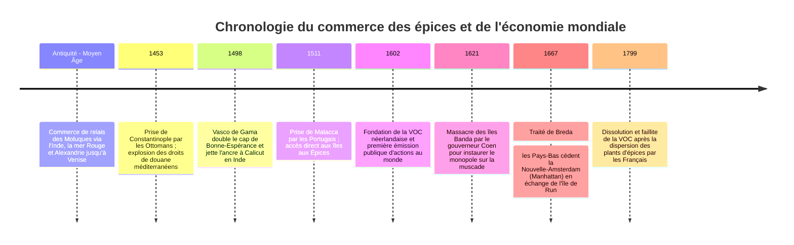
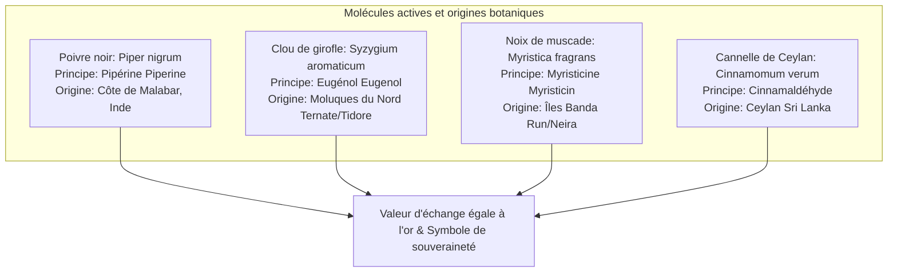
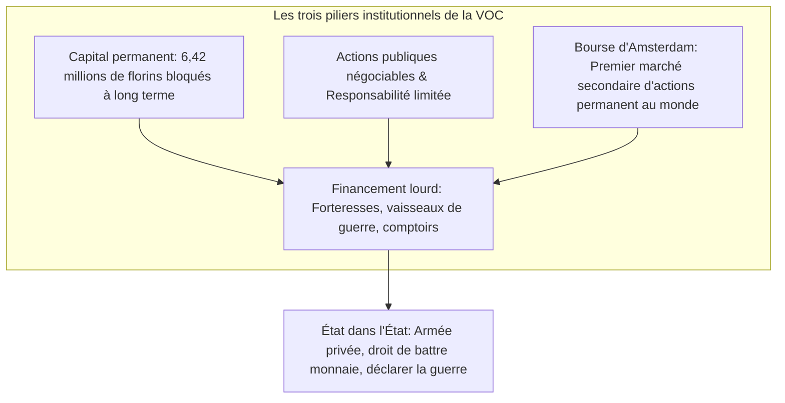

Dans les rayons des supermarchés d'aujourd'hui, le poivre noir, la muscade et les clous de girofle sont des denrées banales et bon marché. Pourtant, aux XVIe et XVIIe siècles, ces graines et boutons floraux séchés **valaient littéralement leur pesant d'or**. Ils constituaient le symbole par excellence du prestige aristocratique et du pouvoir princier au sein des cours européennes.

La soif insatiable d'épices poussa les navires en bois européens à braver des océans inexplorés, inaugurant l'ère des Grandes Découvertes et bouleversant les routes terrestres médiévales. Pour mutualiser les capitaux et conjurer les risques mortels des expéditions maritimes, les marchands d'Amsterdam créèrent le socle du capitalisme moderne : **la première société par actions cotée au monde, la Compagnie néerlandaise des Indes orientales (VOC), et la Bourse d'Amsterdam**.

---

## 1. La biochimie des épices et la demande frénétique européenne

Pourquoi les Européens risquaient-ils le scorbut, le naufrage et la piraterie pour quelques sacs de baies séchées ? La raison tient à l'efficacité pharmacologique de leurs molécules et aux doctrines médicales de l'époque.

### 1.1 Mécanismes moléculaires
- **Poivre noir (Pipérine $\text{C}_{17}\text{H}_{19}\text{NO}_3$)** : Stimule les récepteurs thermiques TRPV1 de la bouche, provoque une sensation intense de piquant, active la sécrétion des sucs gastriques et possède de puissantes propriétés antimicrobiennes.
- **Clou de girofle (Eugénol $\text{C}_{10}\text{H}_{12}\text{O}_2$)** : Représente 70 à 90 % de l'huile essentielle. C'est un anesthésique local, antiseptique et antioxydant majeur. Lors des épidémies de peste, il était porté dans des pommanders pour neutraliser les miasmes morbides.
- **Noix de muscade (Myristicine $\text{C}_{11}\text{H}_{12}\text{O}_3$)** : Arôme suave et chaud ; à fortes doses, ses métabolites hépatiques induisent des effets psychoactifs stimulants et hallucinogènes.

### 1.2 Démystification : Les épices ne servaient pas à masquer la viande avariée
Une idée reçue très répandue prétend que les épices masquaient le goût putride des viandes corrompues faute de réfrigération. Les historiens modernes ont anéanti ce mythe :
1. **Non-sens économique** : Une livre de poivre ou de muscade coûtait plus cher qu'un troupeau entier de moutons ou de bovins sur pied. Un noble capable d'acheter des épices d'Orient consommait de la viande fraîchement abattue dans ses domaines. Gâcher des épices inestimables sur de la viande pourrie était un non-sens absolu.
2. **Consommation ostentatoire** : Servir des plats saturés d'épices exotiques et teints en jaune d'or par le safran était une démonstration théâtrale de suprématie financière et de prestige politique.
3. **Théorie humorale de Galien** : Les viandes étaient jugées « froides et humides » dans la médecine médiévale. Les épices, réputées « chaudes et sèches », étaient médicalement indispensables pour rééquilibrer les quatre humeurs corporelles et faciliter la digestion.

---

## 2. La rupture géopolitique et la thalassocratie portugaise

Avant 1500, le commerce des épices était un long relais commercial dominé en Méditerranée par Venise, alliée aux Mamelouks d'Égypte. La chute de Constantinople en 1453 sous les coups de l'Empire ottoman entraîna une flambée des taxes.

Le Portugal, sous l'impulsion d'Henri le Navigateur, chercha une voie maritime directe via l'Atlantique :
- **1498** : **Vasco de Gama** atteint Calicut en Inde via le cap de Bonne-Espérance. La cargaison d'épices rapportée à Lisbonne dégage un profit net équivalant à **60 fois le coût total de l'expédition**.
- **1511** : Afonso de Albuquerque s'empare de Malacca. Les Portugais mettent en place l'*Estado da Índia*, un réseau de forteresses côtières (Goa, Ormuz, Malacca) et imposent un laissez-passer payant armé (*cartaz*) à tous les navires marchands de l'océan Indien.

---

## 3. La révolution financière de la VOC (1602)

À la fin du XVIe siècle, la concurrence fratricide entre marchands hollandais fit flamber les prix d'achat en Indonésie et chuter les prix de vente en Europe. En 1602, le grand-pensionnaire Johan van Oldenbarnevelt imposa la fusion de toutes les compagnies pour créer la **Compagnie des Indes orientales (VOC)**.

La VOC révolutionna l'économie mondiale :
- **Capital permanent** : Contrairement aux associations temporaires dissoutes après chaque voyage, le capital restait définitivement acquis à l'entreprise.
- **Responsabilité limitée** : Les investisseurs ne risquaient que leur mise initiale.
- **Liquidité boursière** : Grâce à la création de la **Bourse d'Amsterdam**, les actionnaires pouvaient céder leurs titres sur un marché secondaire sans déstabiliser la trésorerie de l'entreprise.

---

## 4. La violence du monopole : Le martyre des îles Banda

L'impératif absolu de la VOC était le monopole sans partage.

- **Le massacre des îles Banda (1621)** : Constatant que les chefs locaux (*Orang Kaya*) vendaient clandestinement de la muscade aux Anglais, le gouverneur général **Jan Pieterszoon Coen** débarqua avec des troupes coloniales et des mercenaires samouraïs japonais. Plus de 90 % de la population locale (environ 15 000 habitants) fut massacrée ou déportée en esclavage. L'archipel fut transformé en plantations (*perken*) serviles exploitées par des esclaves d'Afrique et d'Asie.
- **Les expéditions Hongi (*Hongitochten*)** : Des flottilles armées détruisaient systématiquement tous les girofliers et muscadiers sauvages des îles voisines pour interdire toute concurrence. À Amsterdam, la compagnie n'hésitait pas à brûler des monceaux d'épices pour maintenir des prix artificiellement élevés.
- **Le traité de Breda (1667)** : Les Provinces-Unies cédèrent à l'Angleterre la colonie de **la Nouvelle-Amsterdam (l'île de Manhattan à New York)** en échange du contrôle exclusif du minuscule atoll de **Run** dans l'archipel de Banda, parachevant le monopole planétaire absolu sur la muscade.

---

## 5. L'héritage moderne : Du XVIIe siècle à la mondialisation

L'or des épices finança le Siècle d'or néerlandais. Au XVIIIe siècle, l'agronome français Pierre Poivre réussit à dérober des plants vivants pour les acclimater à l'île Maurice, brisant le verrou géographique. Simultanément, la consommation européenne délaissa les épices au profit du sucre, du thé, du café et des cotonnades indiennes.

Bien que la VOC ait fait faillite en 1799, gangrenée par la corruption interne, ses inventions institutionnelles – **la société anonyme par actions, la bourse des valeurs mobilières et la gestion globale des chaînes d'approvisionnement** – constituent encore aujourd'hui l'infrastructure fondamentale du capitalisme contemporain.
