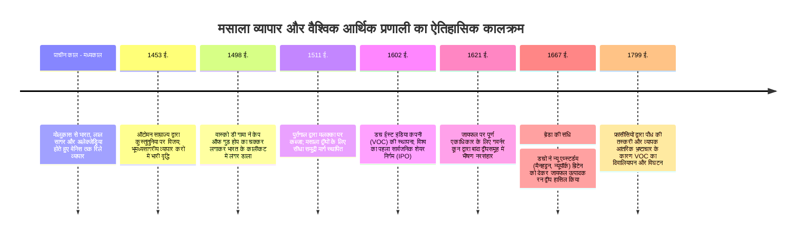

आज किसी भी आधुनिक किराना स्टोर में काली मिर्च, लौंग और जायफल की छोटी शीशियां बहुत मामूली दामों में मिल जाती हैं। लेकिन 16वीं और 17वीं शताब्दी में सुदूर उष्णकटिबंधीय ज्वालामुखीय द्वीपों से आने वाले ये सूखे बीज और कलियां **सचमुच अपने वजन के बराबर सोने के भाव बिकते थे**। वे यूरोपीय राजदरबारों में असीमित धन-दौलत, प्रतिष्ठा और राजनीतिक वर्चस्व का सर्वोच्च प्रतीक थे।

मसालों की बेकाबू चाहत ने यूरोपीय लकड़ी के जहाजों को अनपेक्षित और जानलेवा महासागरों में धकेला, जिससे 'खोज का युग' (Age of Discovery) शुरू हुआ और प्राचीन यूरेशियाई व्यापारिक मार्ग ध्वस्त हो गए। लंबी समुद्री यात्राओं के भारी जोखिमों को साझा करने और विशाल पूंजी जुटाने के लिए एम्स्टर्डम के व्यापारियों ने आधुनिक पूंजीवाद की सबसे युगांतरकारी संस्था का आविष्कार किया: **विश्व की पहली सार्वजनिक रूप से सूचीबद्ध संयुक्त पूंजी कंपनी, डच ईस्ट इंडिया कंपनी (VOC), और एम्स्टर्डम स्टॉक एक्सचेंज**।



---

## 1. मसालों की जैव रसायन और यूरोपीय समाज की दीवानगी

यूरोपीय नाविक केवल कुछ सूखे बीजों के लिए स्कर्वी रोग, समुद्री तूफानों और जलदस्युओं का सामना करते हुए अपनी जान जोखिम में क्यों डालते थे? इसका उत्तर इन पादप रसायनों के औषधीय गुणों और तत्कालीन चिकित्सा पद्धतियों में निहित है।

```mermaid
flowchart TD
    subgraph प्रमुख मसाले और उनके सक्रिय रासायनिक घटक
        Pepper[काली मिर्च: Piper nigrum<br/>सक्रिय घटक: पाइपरिन Piperine<br/>उत्पत्ति: मालाबार तट, दक्षिण-पश्चिम भारत]
        Clove[लौंग: Syzygium aromaticum<br/>सक्रिय घटक: यूजेनॉल Eugenol<br/>उत्पत्ति: उत्तरी मोलुकास तरनाते/तिदोरे]
        Nutmeg[जायफल और जावित्री: Myristica fragrans<br/>सक्रिय घटक: मिरिस्टिसिन Myristicin<br/>उत्पत्ति: बांदा द्वीप रन/नेरा]
        Cinnamon[दालचीनी: Cinnamomum verum<br/>सक्रिय घटक: सिनामाल्डिहाइड<br/>उत्पत्ति: सीलोन श्रीलंका]
    end
    Pepper --> Value[सोने के समतुल्य मुद्रा और अभिजात प्रतिष्ठा]
    Clove --> Value
    Nutmeg --> Value
    Cinnamon --> Value
```

### 1.1 आणविक क्रियाविधि और औषध विज्ञान
- **काली मिर्च (पाइपरिन $\text{C}_{17}\text{H}_{19}\text{NO}_3$)**: जीभ के TRPV1 रिसेप्टर्स को उत्तेजित कर तीखापन पैदा करता है, पाचन एंजाइमों के स्राव को बढ़ाता है और भोजन को सड़ने से रोकने के लिए शक्तिशाली जीवाणुरोधी गुण प्रदर्शित करता है।
- **लौंग (यूजेनॉल $\text{C}_{10}\text{H}_{12}\text{O}_2$)**: वाष्पशील तेल का 70–90 % हिस्सा यूजेनॉल होता है। यह एक अद्भुत प्राकृतिक एंटीसेप्टिक, स्थानीय एनेस्थेटिक और एंटीऑक्सीडेंट है। प्लेग महामारी के समय इसे वायु शोधक के रूप में अनिवार्य माना जाता था।
- **जायफल (मिरिस्टिसिन $\text{C}_{11}\text{H}_{12}\text{O}_3$)**: मीठी-तीखी सुगंध देता है; उच्च खुराक में यह यकृत में ऐसे यौगिकों में बदल जाता है जो केंद्रीय तंत्रिका तंत्र पर मतिभ्रमकारी और उत्तेजक प्रभाव डालते हैं।

### 1.2 'सड़े मांस की बदबू छिपाने' के मिथक का खंडन
लोकप्रिय इतिहास में अक्सर यह भ्रामक दावा किया जाता है कि फ्रिज के अभाव में सड़े हुए मांस की दुर्गंध छिपाने के लिए मसालों का उपयोग होता था। आधुनिक आर्थिक इतिहासकारों ने इस तथ्यहीन दावे को पूरी तरह खारिज कर दिया है:
1. **आर्थिक विरोधाभास**: मध्यकालीन यूरोप में मुट्ठी भर जायफल या केसर की कीमत जीवित स्वस्थ गायों या भेड़ों के झुंड से अधिक होती थी। जो सामंत आयातित मसाले खरीदने में सक्षम था, वह अपनी जागीर से ताजा कटा मांस खाता था। सड़े मांस पर अनमोल मसाले बर्बाद करना आर्थिक दृष्टि से मूर्खतापूर्ण था।
2. **दिखावटी उपभोग (*Conspicuous Consumption*)**: शाही दावतों में व्यंजनों को केसर से सुनहरा रंगना और लौंग-जायफल की सुगंध बिखेरना सामंत की अपार वैश्विक धन-सम्पदा का सार्वजनिक प्रदर्शन था।
3. **गैलन का चार शारीरिक द्रवों (Humors) का सिद्धांत**: प्राचीन चिकित्सा पद्धति के अनुसार मांस 'शीत और आर्द्र' माना जाता था। शारीरिक संतुलन बनाए रखने और रोगों से बचने के लिए इसे 'उष्ण और शुष्क' मसालों के साथ पकाना चिकित्सकीय रूप से अनिवार्य समझा जाता था।

---

## 2. पारंपरिक मध्यस्थ व्यापार का पतन और पुर्तगाली समुद्री प्रभुत्व

16वीं सदी से पहले मसाले मोलुकास से विभिन्न मध्यस्थों, भारतीय बंदरगाहों, लाल सागर और मिस्र से होते हुए वेनिस पहुंचते थे, जिससे यूरोप में इनका मूल्य मूल लागत से **100 से 200 गुना अधिक** हो जाता था। 1453 में ऑटोमन साम्राज्य द्वारा कुस्तुंतुनिया पर अधिकार के बाद व्यापारिक कर अत्यधिक बढ़ गए।

पुर्तगाल ने अटलांटिक महासागर के माध्यम से सीधा समुद्री मार्ग खोजने का बीड़ा उठाया:
- **1498 ई.**: **वास्को डी गामा** अफ्रीका का चक्कर लगाकर भारत के कालीकट पहुंचे। उनके द्वारा लाई गई काली मिर्च की बिक्री से पूरी समुद्री यात्रा के कुल खर्च की तुलना में **60 गुना अधिक शुद्ध लाभ** प्राप्त हुआ।
- **1511 ई.**: अल्फांसो डी अल्बुकर्क ने मलक्का पर सैन्य अधिकार कर लिया और गोवा, होर्मुज तथा मलक्का में किलों का जाल बिछाकर *एस्तदो दा इंडिया* की स्थापना की, तथा सभी जहाजों पर जबरन हथियारबंद पारपत्र (*Cartaz*) शुल्क लागू कर दिया।

---

## 3. वित्तीय क्रांति: डच ईस्ट इंडिया कंपनी (VOC) की स्थापना (1602)

16वीं सदी के अंत में डच व्यापारियों के आपसी संघर्ष के कारण एशिया में खरीद मूल्य बढ़ गए और यूरोप में बिक्री मूल्य गिर गए। 1602 में राजनेता जोहान वैन ओल्डनबार्नेवेल्ट ने सभी कंपनियों का विलय करके **यूनाइटेड ईस्ट इंडिया कंपनी (VOC)** की नींव रखी।

```mermaid
flowchart TD
    subgraph VOC के 1602 के तीन ऐतिहासिक संस्थागत नवाचार
        A[स्थायी पूंजी: 64.2 लाख गिल्डर की पूंजी जिसे वापस नहीं लिया जा सकता था] --> Scale[दीर्घकालिक निवेश: भारी युद्धपोत, पत्थर के किले, स्थायी व्यापारिक चौकियां]
        B[सार्वजनिक रूप से हस्तांतरणीय शेयर और सीमित दायित्व Limited Liability] --> Scale
        C[एम्स्टर्डम स्टॉक एक्सचेंज: शेयरों की खरीद-फरोख्त के लिए विश्व का पहला द्वितीयक बाजार] --> Scale
    end
    Scale --> State[राज्य के भीतर राज्य: युद्ध छेड़ने, संधियां करने और मुद्रा ढालने का संप्रभु अधिकार]
```

VOC ने आधुनिक कॉरपोरेट संरचना का निर्माण किया:
- **स्थायी पूंजी**: पूंजी कंपनी के पास स्थायी रूप से जमा रहती थी, जिससे प्रत्येक यात्रा के बाद कंपनी को भंग करने की आवश्यकता समाप्त हो गई।
- **सीमित दायित्व (Limited Liability)**: शेयरधारकों का जोखिम केवल उनके द्वारा निवेशित पूंजी तक ही सीमित था।
- **शेयर बाजार की तरलता**: **एम्स्टर्डम स्टॉक एक्सचेंज** के गठन ने निवेशकों को कंपनी से धन निकाले बिना अपने शेयर दूसरों को बेचने की पूर्ण स्वतंत्रता प्रदान की।

---

## 4. एकाधिकार की क्रूरता: बांदा द्वीपों का खूनी नरसंहार

VOC का व्यापार मॉडल मुक्त व्यापार पर नहीं, बल्कि **तोपों के बल पर थोपे गए पूर्ण एकाधिकार** पर आधारित था।

- **1621 का बांदा नरसंहार**: बांदा द्वीपवासियों द्वारा डचों के एकाधिकार को नकारते हुए अंग्रेजी व जावाई व्यापारियों को जायफल बेचने पर क्रुद्ध होकर गवर्नर-जनरल **जान पीटर्सज़ून कून** ने युद्धपोतों और जापानी सामुराई सैनिकों के साथ आक्रमण किया। लगभग 15,000 स्थानीय निवासियों में से 90% से अधिक को बेरहमी से कत्ल कर दिया गया या गुलाम बना लिया गया। द्वीपों को 68 बागानों (*Perken*) में बांटकर गुलामों से मजदूरी कराई गई।
- **होंगी अभियान (*Hongitochten*)**: डच नौसैनिक बेड़े हर साल पड़ोसी द्वीपों पर गश्त करते थे और अनधिकृत लौंग और जायफल के पेड़ों को पूरी तरह काट कर जला देते थे ताकि वैश्विक बाजार में कृत्रिम कमी बनाकर कीमतें ऊंची रखी जा सकें।
- **ब्रेडा की संधि (1667)**: डचों ने उत्तरी अमेरिका में अपनी कॉलोनी **न्यू एम्स्टर्डम (वर्तमान मैनहट्टन, न्यूयॉर्क)** अंग्रेजों को सौंप दी और बदले में बांदा द्वीपसमूह का छोटा सा **रन द्वीप** हासिल कर लिया, जिससे जायफल पर उनका 100% वैश्विक एकाधिकार पूरा हो गया।

---

## 5. आधुनिक युग के लिए ऐतिहासिक सबक

मसालों की बेहिसाब दौलत ने हॉलैंड के 'स्वर्ण युग' को जन्म दिया और आधुनिक वैश्विक पूंजीवादी व्यवस्था की नींव रखी। यद्यपि 18वीं सदी के अंत में फ्रांसीसी खोजकर्ता पियरे पोइवर द्वारा पौधों की तस्करी, चाय-कॉफी-चीनी की मांग में वृद्धि और आंतरिक भ्रष्टाचार के कारण 1799 में VOC दिवालिया हो गई, लेकिन उसके द्वारा स्थापित संस्थागत तंत्र—**संयुक्त पूंजी कंपनी, शेयर बाजार और वैश्विक आपूर्ति श्रृंखलाएं**—आज 21वीं सदी की वैश्विक अर्थव्यवस्था की आधारशिला बने हुए हैं।
