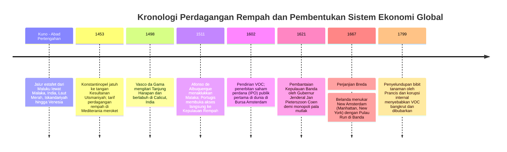
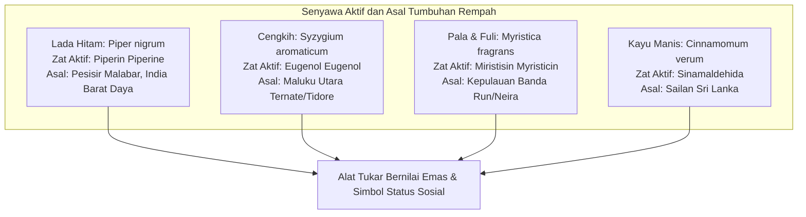
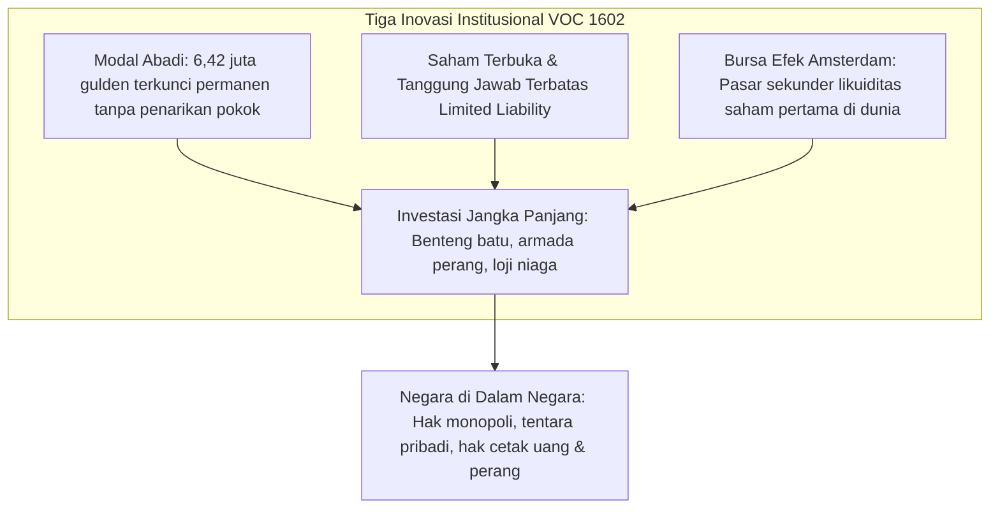

Di pasar swalayan modern hari ini, lada hitam, cengkih, dan pala dapat dibeli dengan harga sangat terjangkau. Namun pada abad ke-16 dan ke-17, biji dan kuncup bunga tanaman kering asal Kepulauan Maluku ini **benar-benar bernilai setara dengan berat emas murni**. Rempah-rempah menjadi simbol puncak kemewahan, prestise aristokrat, dan instrumen kekuasaan politik di istana-istana megah Eropa.

Hasrat yang tak terpuaskan terhadap rempah-rempah mendorong armada kapal layar kayu Eropa mengarungi samudra antah-berantah yang mematikan, melahirkan Era Penjelajahan Samudra (*Age of Discovery*), dan meruntuhkan jalur kafilah Jalur Sutra kuno. Untuk mengumpulkan modal raksasa dan menyebarkan risiko maut pelayaran samudra, para saudagar Amsterdam menciptakan fondasi institusional kapitalisme korporasi modern: **perusahaan saham gabungan terbuka pertama di dunia, Vereenigde Oostindische Compagnie (VOC), dan Bursa Efek Amsterdam**.

---

## 1. Biokimiawi Rempah dan Obsesi Eropa

Mengapa bangsa Eropa rela bertaruh nyawa menghadapi penyakit skorbut, karam kapal, dan pertempuran berdarah demi segenggam rempah dari pulau vulkanik di ujung timur Nusantara? Jawabannya terletak pada farmakologi molekuler unik serta paradigma medis zaman pramodern.

### 1.1 Mekanisme Molekuler Farmakologi
- **Lada Hitam (Piperin $\text{C}_{17}\text{H}_{19}\text{NO}_3$)**: Mengaktifkan reseptor TRPV1 pada ujung saraf lidah untuk menghasilkan rasa pedas membakar, memicu sekresi enzim pencernaan lambung, serta memiliki daya antibakteri spektrum luas.
- **Cengkih (Eugenol $\text{C}_{10}\text{H}_{12}\text{O}_2$)**: Menyusun 70–90 % minyak atsiri kuncup bunga. Berfungsi sebagai antioksidan alami, anestesi lokal, dan antiseptik kuat. Pada masa wabah pes maut hitam (*Black Death*), cengkih digunakan dalam wadah aromaterapi (*pomander*) untuk menangkal racun udara (*miasma*).
- **Pala dan Fuli (Miristisin $\text{C}_{11}\text{H}_{12}\text{O}_3$)**: Memberikan aroma rempah manis yang hangat; dalam dosis tinggi, metabolisme hati mengubah miristisin menjadi senyawa yang memiliki efek psikoaktif dan halusinogenik pada sistem saraf pusat.

### 1.2 Membongkar Mitos "Menyamarkan Daging Busuk"
Buku-buku sejarah populer kerap mengulang mitos bahwa orang Eropa membutuhkan rempah-rempah untuk menyamarkan bau busuk daging basi akibat tiadanya lemari pendingin. Riset sejarah ekonomi mutakhir telah membantah mutlak anggapan ini:
1. **Ketidakmasukan Akal Ekonomi**: Di Eropa abad pertengahan, harga sepound pala atau safron jauh lebih mahal daripada satu kawanan ternak sapi atau domba hidup yang sehat. Bangsawan kaya yang mampu membeli rempah impor tentu selalu menyantap daging segar dari peternakan pribadinya. Menaburkan rempah berharga selangit di atas daging basi adalah tindakan yang sepenuhnya konyol secara finansial.
2. **Konsumsi Pamer (*Conspicuous Consumption*)**: Menyajikan hidangan pesta yang dilumuri safron keemasan dan ditaburi cengkih pala melimpah adalah unjuk kekuatan aristokratis untuk memamerkan jangkauan kekayaan interkontinental sang tuan rumah.
3. **Teori Empat Cairan Tubuh Galen**: Dalam ilmu kedokteran klasik, daging hewan dianggap bersifat "dingin dan lembap". Untuk menjaga keseimbangan cairan tubuh dan mencegah penyakit, daging wajib diolah dengan rempah-rempah yang berkarakter "panas dan kering".

---

## 2. Runtuhnya Jalur Estafet dan Imperialisme Maritim Portugis

Sebelum abad ke-16, rempah-rempah harus berpindah tangan melalui puluhan pedagang perantara di Malaka, India, Laut Merah, hingga tiba di Republik Venesia. Setiap mata rantai mengenakan bea cukai dan marjin keuntungan, sehingga harga di pasar Eropa melonjak **100 hingga 200 kali lipat** dari harga panen di Maluku.

Jatuhnya Konstantinopel ke tangan Kesultanan Utsmaniyah pada tahun 1453 membuat tarif perdagangan di Mediterania timur kian membubung tinggi. Portugal, yang dipelopori Pangeran Henrique Sang Navigator, bergerak merintis rute laut langsung melalui Samudra Atlantik:
- **1498**: **Vasco da Gama** menaklukkan perairan Samudra Hindia dan mendarat di Calicut, India. Hasil penjualan muatan lada yang dibawanya menghasilkan keuntungan bersih **60 kali lipat dari seluruh biaya ekspedisi armada**.
- **1511**: Afonso de Albuquerque menyerbu dan merebut pelabuhan strategis Kesultanan Malaka. Portugis mendirikan jaringan benteng bersenjata (*Estado da Índia*) di Goa, Hormuz, dan Malaka, serta memaksakan surat izin berlayar berbayar (*cartaz*) kepada kapal-kapal pribumi.

---

## 3. Rekayasa Finansial Bersejarah: Kelahiran VOC (1602)

Pada pengujung abad ke-16, persaingan sengit antarsaudagar Belanda menyebabkan harga beli rempah di pelabuhan Banten melambung dan harga jual di Eropa merosot. Negarawan Johan van Oldenbarnevelt memprakarsai penggabungan seluruh sindikat dagang ke dalam satu entitas raksasa: **Vereenigde Oostindische Compagnie (VOC)** pada tahun 1602.

VOC memperkenalkan inovasi yang menjadi cetak biru perusahaan modern:
- **Modal Permanen**: Modal investor dikunci dalam pembukuan korporasi, membebaskan operasional armada dari keharusan likuidasi per pelayaran tunggal.
- **Tanggung Jawab Terbatas**: Pemegang saham hanya menanggung risiko sebesar modal disetor.
- **Likuiditas Pasar Saham**: Didirikannya **Bursa Efek Amsterdam** memungkinkan investor menjual saham kepemilikan mereka kapan saja tanpa mengurangi kas modal kerja VOC.

Melalui hak oktroi (*octrooi*) dari Parlemen Belanda, VOC bertindak sebagai negara berdaulat di Asia: memiliki tentara reguler, mendirikan benteng kota Batavia, mencetak mata uang sendiri, dan mendeklarasikan perang.

---

## 4. Kebrutalan Monopoli: Tragedi Kemanusiaan di Kepulauan Banda

Doktrin ekonomi VOC bukanlah perdagangan bebas, melainkan **monopoli mutlak yang ditegakkan dengan moncong meriam**.

- **Pembantaian Banda 1621**: Mengetahui para tetua adat (*Orang Kaya*) Banda menyelundupkan pala kepada pedagang Inggris dan Jawa demi mendapatkan beras dan kain, Gubernur Jenderal **Jan Pieterszoon Coen** memimpin armada perang dan serdadu bayaran ronin Jepang. Sekitar 90 % dari 15.000 penduduk asli Banda dibantai secara kejam, dibiarkan kelaparan di pegunungan, atau dijual ke pasar budak. Kepulauan Banda kemudian disulap menjadi perkebunan (*perken*) yang dikelola mantan pegawai kompeni (*perkenier*) dengan ribuan budak belian.
- **Ekspedisi Hongi (*Hongitochten*)**: Armada perahu kora-kora bersenjata berpatroli secara berkala mengelilingi perairan Maluku untuk menebang dan membakar habis pohon cengkih dan pala liar di pulau-pulau non-VOC demi menjaga kelangkaan pasokan global buatan (*artificial scarcity*).
- **Perjanjian Breda (1667)**: Dalam pertukaran teritorial paling ironis dalam sejarah dunia, Belanda merelakan koloninya di Amerika Utara, **New Amsterdam (kini Pulau Manhattan di New York)**, kepada Inggris demi mendapatkan kepemilikan tunggal atas pulau karang kecil penghasil pala, **Pulau Run** di Kepulauan Banda.

---

## 5. Warisan Abadi: Dari Monopoli Rempah Menuju Kapitalisme Modern

Kekayaan rempah-rempah Maluku mendanai Masa Keemasan Belanda (*Gouden Eeuw*) dan mempercepat integrasi sistem dunia modern berpusat di Eropa. Meskipun hegemoni VOC akhirnya runtuh pada akhir abad ke-18 akibat penyelundupan bibit pala ke Mauritius oleh penjelajah Prancis Pierre Poivre dan pembubaran VOC pada tahun 1799 akibat gurita korupsi, warisan institusionalnya — **perseroan terbatas terbuka, bursa efek, dan manajemen rantai pasok global** — tetap menjadi mesin penggerak perekonomian dunia di abad ke-21.
