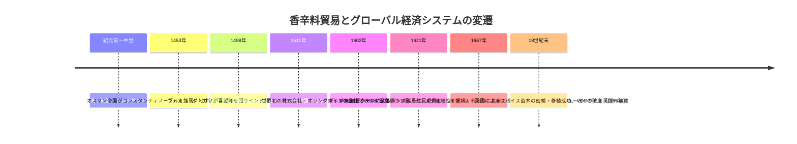
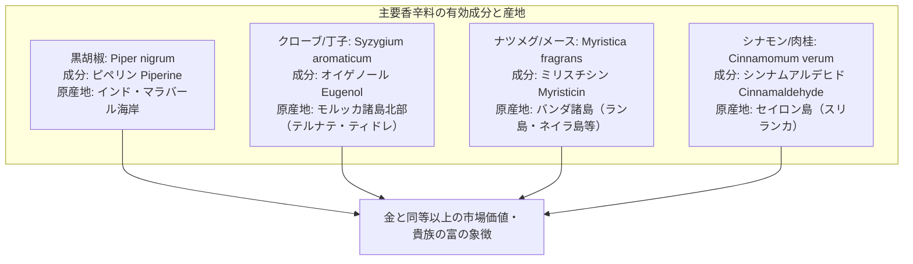
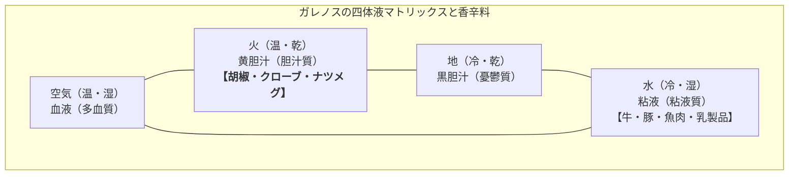
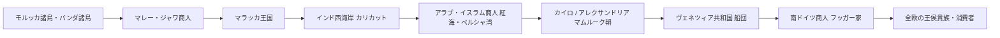
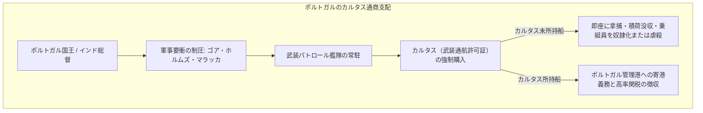
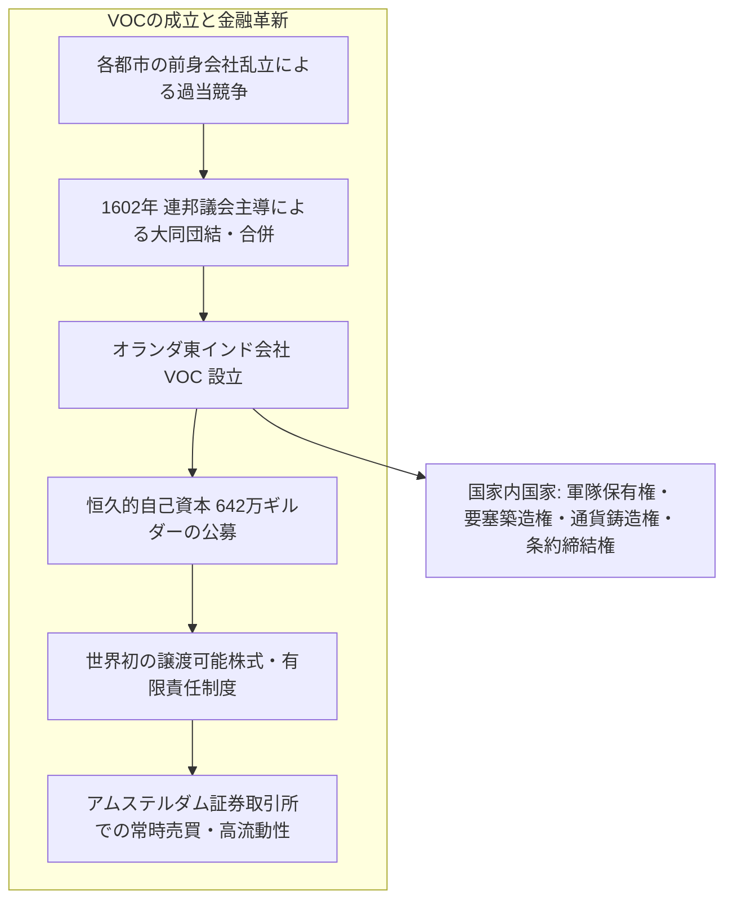
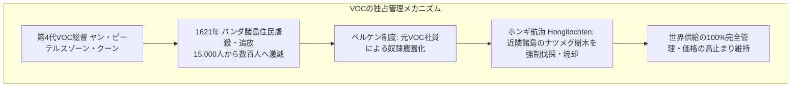
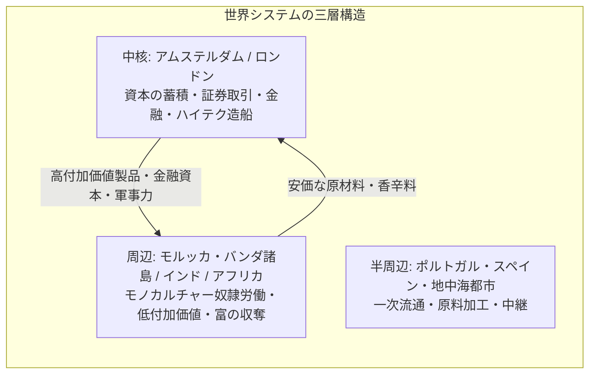

現代のスーパーマーケットに行けば、黒胡椒やナツメグ、クローブなどのスパイスは数百円の小瓶に入って棚に並んでいます。しかし、16世紀から17世紀にかけて、これらの乾燥した植物の種子や花蕾は**「金と同重量で取引される」**ほどの超高価格を誇り、王侯貴族が富と権力を誇示するための究極のステータスシンボルでした。

香辛料への渇望は、ヨーロッパの船乗りたちを危険に満ちた未知の海洋へと駆り立て、地球規模の航路を開拓させ（大航海時代）、伝統的な中世の交易路を根底から破壊しました。そしてその過程で、リスクを分散し莫大な遠洋航海資金を調達するために生み出されたのが、**世界初の近代株式会社「オランダ東インド会社（VOC）」とアムステルダム証券取引所**でした。

本稿では、胡椒・ナツメグ・クローブの生化学的特性から、中世の地中海・紅海交易路の地政学、ポルトガルによる喜望峰回りの海洋帝国建設、オランダ東インド会社の資本主義的金融システム、バンダ諸島における過酷な独占支配、そして現代のグローバル・サプライチェーンやコーポレートガバナンスへと続く歴史的連続性を、包括的かつ多角的に解剖します。



---

## 1. 香辛料の植物学・生化学と中世ヨーロッパにおける狂乱の需要

なぜ中世から近世のヨーロッパ人は、これほどまでに香辛料に魅了され、命を賭してまで地球の裏側の孤島を目指したのでしょうか。その背景には、植物化学的な薬理特性と、当時の文化・医学的パラダイムが密接に絡み合っていました。



### 1.1 主要スパイスの化学構造と作用機序
ヨーロッパで特に珍重された三大スパイスの生化学的特性は以下の通りです。

#### (1) 黒胡椒（Black Pepper / *Piper nigrum*）
- **主要活性成分**: アルカロイドの一種である**ピペリン（Piperine, $\text{C}_{17}\text{H}_{19}\text{NO}_3$）**。
- **作用機序**: 口腔内の感覚神経末端に存在するバニロイド受容体（TRPV1）を刺激し、鋭い辛味と熱感を脳に伝達します。胃液や消化酵素の分泌を強力に促進し、消化を助けるとともに、グラム陰性菌・陽性菌に対する強い抗菌作用を発揮します。

#### (2) クローブ / 丁子（Clove / *Syzygium aromaticum*）
- **主要活性成分**: フェニルプロパノイド類の**オイゲノール（Eugenol, $\text{C}_{10}\text{H}_{12}\text{O}_2$）**が精油成分の70〜90%を占めます。
- **作用機序**: 強力な抗酸化作用、抗炎症作用、局所麻酔作用を持ちます。中世・近世ヨーロッパでは歯痛の鎮痛薬、防腐剤、そしてペストなどの感染症予防薬（芳香による瘴気予防）として極めて重要な医薬品と見なされました。

#### (3) ナツメグ（Nutmeg）とメース（Mace / *Myristica fragrans*）
- **植物的特徴**: ナツメグの木の実の中心にある黒い種子がナツメグ、その外側を網目状に覆う仮種皮（種衣）を乾燥させたものがメースです。
- **主要活性成分**: **ミリスチシン（Myristicin, $\text{C}_{11}\text{H}_{12}\text{O}_3$）**およびエレミシン（Elemicin）。
- **作用機序**: 甘く芳醇でスパイシーな芳香を持ち、微量では消化促進や健胃薬として働きます。過剰摂取すると中枢神経系に作用して幻覚や陶酔感を引き起こす神経薬理特性を有しています。

### 1.2 「腐った肉の臭い消し」という通説の誤りと歴史的真実
歴史教科書や俗説では、「中世ヨーロッパでは冷蔵庫がなかったため、腐敗した肉の悪臭を消すためにスパイスが使われた」と説明されることが多々あります。しかし、近年の歴史研究（特に食文化史家ジャン＝ルイ・フランドランらの研究）によって、この説は完全に否定されています。

1. **経済的矛盾**: 当時、羊や牛などの新鮮な生肉を買うコストよりも、スプーン1杯の黒胡椒やナツメグを買うコストのほうが遥かに高価でした。裕福な貴族層が、わざわざ腐った安肉を隠すために、肉の何倍も高価なスパイスを振りかけることは経済合理性に反します。
2. **社会的ステータスシンボルとしての消費**: 中世の貴族の宴会では、料理がテーブルに運ばれた際、黄金のように黄色く輝くサフランや、惜しみなく振りかけられたクローブ・ナツメグの強烈な香りが漂うこと自体が、主人の圧倒的な富と権力を誇示する儀礼でした。
3. **四体液説（フモール説）に基づく中世医学**: 古代ギリシャのヒポクラテス・ガレノスに由来する中世医学では、人間の健康は「血液・粘液・黄胆汁・黒胆汁」の4つの体液のバランスによって保たれると信じられていました。牛肉や豚肉などの肉類は「冷・湿」の性質を持つとされたため、これらを中和して健康を維持するには、「熱・乾」の性質を持つスパイス（特に胡椒やナツメグ）を大量に組み合わせて調理することが医学的に必須であると信じられていたのです。
4. **ペスト（黒死病）への恐怖と芳香医療**: 14世紀にヨーロッパの人口の3分の1を奪ったペストの流行期、感染源は悪臭を放つ空気（瘴気＝ミアズマ）であると考えられていました。スパイスを詰めた小袋（ポマンダー）を首から下げたり、部屋でクローブを燻製のように焚くことで、疫病から逃れられると信じられ、医療需要が爆発的に高まりました。

---


### 1.3 中世の薬局方と四体液説のマトリックス：香辛料処方箋の科学史
中世ヨーロッパにおいて、医学と料理の境界線は現代ほど明確ではありませんでした。すべての病気は体内の4つの体液（血液、粘液、黄胆汁、黒胆汁）のバランス失調に起因すると考えられており、香辛料はその強力な「熱性」と「乾性」ゆえに、病を退ける至高の医薬品として薬局方に収載されていました。



| 体液分類 | 基本性質 | 対応する自然元素 | 人間の気質 | 食品の性質 | バランス調整のための香辛料処方 |
| :--- | :--- | :--- | :--- | :--- | :--- |
| **血液** | 温・湿 | 空気 (Air) | 多血質 (Sanguine) | 小麦、甘味 | シナモン、カルダモンによる適度な賦活 |
| **黄胆汁** | 温・乾 | 火 (Fire) | 胆汁質 (Choleric) | スパイス類そのもの | 過剰摂取は怒りや発熱を招くと警戒 |
| **黒胆汁** | 冷・乾 | 地 (Earth) | 憂鬱質 (Melancholic) | 豆類、根菜 | 生姜や長胡椒による消化機能の回復 |
| **粘液** | 冷・湿 | 水 (Water) | 粘液質 (Phlegmatic) | 水牛肉、豚肉、魚 | **黒胡椒・クローブの大量投入で湿と冷を殺菌・中和** |

また、中世の王侯貴族の間で愛飲された「ヒポクラス（Hypocras）」は、赤ワインに大量のシナモン、生姜、クローブ、ナツメグ、そして砂糖を漬け込んだ薬用温酒でした。これは単なる嗜好品ではなく、冬期の厳しい寒気と湿気から生命を守るための必須強壮薬と信じられていました。さらに、ペストが蔓延した14世紀以降、医師たちは「ペストマスク」と呼ばれる鳥のくちばし状の仮面にクローブや樟脳、乾草などの香料を詰め、悪性の空気（ミアズマ）を直接吸い込まないように防護していました。

### 1.4 中世・近世における香辛料の価格構造と庶民の賃金水準
香辛料がどれほどの超高額で取引されていたのかを理解するために、14世紀から15世紀のロンドンおよびフランクフルトにおける庶民の賃金とスパイス価格の比較データを以下に示します。

| 品目 | 数量単位 | 当時の市場価格（銀換算／貨幣） | 一般職人・労働者の日当との比較 |
| :--- | :--- | :--- | :--- |
| **黒胡椒** | 1ポンド（約450g） | 約2シリング（銀約12g相当） | 熟練大工の日当（約4〜6ペンス）の**4〜6日分** |
| **クローブ** | 1ポンド（約450g） | 約10〜12シリング | 熟練大工の日当の**約20〜25日分（約1ヶ月分の全給与）** |
| **ナツメグ** | 1ポンド（約450g） | 約15〜20シリング | 一般職人の**約1〜2ヶ月分の生活費** |
| **牛（生体一頭）** | 1頭 | 約10〜15シリング | ナツメグ1ポンド弱と同額 |
| **豚（生体一頭）** | 1頭 | 約3〜4シリング | クローブ1ポンドで豚3頭が買えた |

このように、わずか握り拳ひとつ分のクローブやナツメグが、家畜の牛や豚数頭、あるいは労働者が1ヶ月間血汗を流して得る総賃金に匹敵したのです。香辛料をふんだんに使った料理を供することは、現代で言えば高級外車やダイヤモンドをゲストに配るようなものであり、領主や都市貴族（パトリツィ）にとって最高の権威誇示となった理由がここにあります。


---

## 2. 伝統的中継貿易の崩壊と大航海時代の幕開け

15世紀以前、香辛料がヨーロッパの食卓に届くまでには、数多くの商人や国家の手を経由する極めて非効率で高コストな中継貿易網が存在していました。



### 2.1 幾重にも積み重なる関税と中間マージン
モルッカ諸島で現地住民が収穫したナツメグやクローブは、上記のように無数の商人によって転売され、関税が課されるたびに価格が跳ね上がりました。
- モルッカ諸島での現地調達価格を「1」とすると、マラッカで約「3〜5」、インド西海岸で「10〜15」、エジプトのアレクサンドリアで「30〜50」、そしてヴェネツィアを経由してロンドンやパリ、フランクフルトの市場に到達する頃には**「100〜200倍以上」**に膨れ上がっていました。
- 地中海の覇者であった**ヴェネツィア共和国**は、エジプトのマムルーク朝と強固な同盟を結び、地中海における香辛料の輸入を完全に独占して巨万の富を築いていました。

### 2.2 1453年コンスタンティノープル陥落と地政学的危機
1453年、オスマン帝国がビザンツ帝国の首都コンスタンティノープルを攻略し、東地中海および黒海交易路を完全に制圧しました。オスマン帝国は香辛料キャラバンに対して高額な関税を課したため、西ヨーロッパ諸国にとって東方への陸路・内海ルートはますます高コストで脆弱なものとなりました。

「イスラム勢力やヴェネツィアの中継マージンを排除し、自国の船で香辛料の原産地に直接到達できれば、天文学的な利益が手に入る」——この確信が、イベリア半島の周縁国家であったポルトガルとスペインを、外洋探検へと駆り立てる最大の動機となったのです。

### 2.3 ポルトガルの海洋進出とカブラル、ダ・ガマ
ポルトガルのエンリケ航海王子（1394–1460）は、アフリカ西海岸の探検を組織化し、キャラベル船の開発や航海術の改良を推進しました。
- **1488年**: バルトロメウ・ディアスがアフリカ南端の「喜望峰（Cabo da Boa Esperança）」に到達。大西洋とインド洋が繋がっていることが実証されました。
- **1498年**: **ヴァスコ・ダ・ガマ**が喜望峰を回るルートを確立し、インド南西海岸のカリカット（コーリコード）に到達。ダ・ガマが持ち帰った香辛料の売却益は、遠征にかかった総費用の**60倍以上**に達したと記録されています。
- **1511年**: アフォンソ・デ・アルブケルケ率いるポルトガル艦隊が、東南アジア最大の香辛料集散地であったマラッカ王国を武力占領。ポルトガルはさらに東方のモルッカ諸島へと船を進め、テルナテ島やティドレ島に商館を設置しました。

ポルトガルは広大な領土を征服するのではなく、海の要衝（ゴア、ホルムズ、マラッカ、マカオ）に要塞と商館を築き、海上交通路を武装艦隊で制圧する**「交易ポスト帝国（Estado da Índia）」**を建設しました。

---


### 2.4 ポルトガルの武力通商システム：カルタス制度とディーウ沖海戦
喜望峰ルートを開拓したポルトガルは、平和的な商取引を行う気は毛頭ありませんでした。アジアの海には、数百年以上にわたってイスラム商人、ヒンドゥー商人、マレー商人、中国人（ジャンク船）が関税を支払いながら平和的に共存していた自由貿易圏が存在していましたが、ポルトガルはこれに**純粋な軍事暴力による独占と強奪**を持ち込みました。



- **ディーウ沖海戦（1509年）**: ポルトガルによる紅海ルートの遮断に激怒したエジプトのマムルーク朝とグジャラート・スルターン朝は、ヴェネツィア共和国の技術支援を受けて連合艦隊を結成し、インド西海岸のディーウ沖でポルトガル艦隊と激突しました。フランシスコ・デ・アルメイダ率いるポルトガル艦隊は、圧倒的な艦載砲の破壊力と堅牢なキャラック船の装甲によって連合艦隊を殲滅。この海戦によって、インド洋の制海権は完全にポルトガルへ移行しました。
- **カルタス（Cartaz）制度**: ポルトガルはインド洋を航行するすべての先住・外部船舶に対し、有料の航行許可証（カルタス）の購入を義務付けました。カルタスを持たずに航行する船は「海賊船」とみなされ、無警告で撃沈されるか積荷を奪われました。さらにカルタスを持つ船であっても、香辛料や武器、馬匹の積載は禁じられ、ポルトガルが支配するゴアやマラッカに立ち寄って高額な関税を納めることが強制されたのです。

### 2.5 地球の分割：トルデシリャス条約（1494）とサラゴサ条約（1529）
コロンブスがスペインの旗を掲げて新大陸に到達し（1492年）、ヴァスコ・ダ・ガマが喜望峰を回ってインドに達すると、先発の海洋二大強国であるポルトガルとスペインの間で、未発見の世界をめぐる熾烈な利害衝突が発生しました。

ローマ教皇アレクサンデル6世の仲介により締結された**トルデシリャス条約（1494年）**は、カーボベルデ諸島の西約1,770kmの子午線を境界とし、**その東側（アフリカ・インド・アジア）をポルトガル領、西側（アメリカ大陸）をスペイン領**と定めました。
しかし、1519〜1522年にフェルディナンド・マゼラン船団が南米南端を回って太平洋を横断し、モルッカ諸島に西回りで到達したことで、地球の反対側における境界線をどこに引くかという新たな問題が浮上しました。

そこで1529年に締結されたのが**サラゴサ条約**です。モルッカ諸島の東約17度（東経142度付近）に境界線を設定し、スペインはモルッカ諸島への領有権主張を取り下げる代わりに、ポルトガルから35万ドゥカートの補償金を受け取りました。これにより、ポルトガルは香料諸島における排他的独占権を国際条約上（ヨーロッパ世界において）確定させたのです。


---

## 3. 世界初の株式会社：オランダ東インド会社（VOC）の誕生と金融工学

16世紀末、ポルトガルとスペインの同君連合（フェリペ2世）と対立したネーデルラント連邦共和国（オランダ）は、リスボンからの香辛料供給を断たれました。これに対し、オランダの商人たちは自ら香辛料諸島へ直接艦隊を派遣することを決意します。

1595年、コルネリス・デ・ハウトマン率いる第1次オランダ遠征艦隊がバタヴィア（現ジャカルタ）へ航海し、壊滅的な犠牲者を出しながらも胡椒を持ち帰って莫大な利益を上げました。これに刺激されたアムステルダム、ゼーラント、ロッテルダムなどの各都市で、雨後の筍のように航海ごとの独立会社（前身会社＝Voorcompagnieën）が乱立し、香辛料の現地買い付け価格が高騰、オランダ国内での販売価格が暴落する激しい過当競争が発生しました。



### 3.1 1602年 VOCの設立：資本の恒久化と有限責任
過当競争による共倒れを防ぎ、ポルトガルや台頭するイギリス東インド会社（EIC、1600年設立）に対抗するため、オランダの最高権力者オルデンバルネフェルトの強力な政治的調停により、1602年に全会社が統合され、**オランダ東インド会社（Vereenigde Oostindische Compagnie: VOC）**が誕生しました。

VOCは、それまでの人類のビジネスモデルを根本から変革する**3つの決定的金融イノベーション**を備えていました：

#### (1) 資本の恒久的固定（Permanent Capital）
従来の航海会社は「1航海ごとに船団が出発し、無事に帰港したら積荷を売却して元本と利益をすべて出資者に分配し、会社を解散する」という単発型パートナーシップでした。しかし、アジアとの往復には2〜3年を要し、要塞の維持や現地商館の運営、軍艦の建造には長期的な固定資本が必要でした。
VOCは、出資者に対して元本を払い戻さない**恒久的な資本金（約642万ギルダー）**を導入しました。会社は解散することなく、半永久的に事業を継続できる基盤を獲得したのです。

#### (2) 世界初の公募株式と有限責任制（Limited Liability）
VOCの資本金は、大富豪だけでなく、アムステルダムの一般市民、召使い、職人、外国人投資家など、あらゆる階層から公募されました。投資家は出資額以上の債務を負わない「有限責任」が保証されたため、リスクが限定され、社会全体の休眠資本が大量に流入しました。

#### (3) アムステルダム証券取引所における流動性
元本が払い戻されないとすれば、投資家は現金が必要になった際に困窮します。そこでアムステルダムに**世界初の常設証券取引所（Amsterdam Stock Exchange）**が開設され、VOCの株式（出資証明書）が自由に転売・取引できるようになりました。
投資家はいつでも市場で株式を現金化でき、他方でVOC本体の事業資金は何ら毀損されないという、**「資本の固定性」と「投資の流動性」の両立**が世界で初めて達成されたのです。

### 3.2 特許状による「国家内国家」としての主権
オランダ連邦議会（ヘーレンXVII）からVOCに付与された特許状は、単なる貿易独占権にとどまらず、事実上の国家主権を委譲するものでした。
- **好戦権と講和権**: アジア海域において他国と戦争を行い、平和条約を締結する権利。
- **軍隊の保有**: 独自の陸海軍を編成・指揮する権利。
- **要塞・要衝の建設**: 現地を占領し、要塞を築いて統治する権利。
- **通貨の鋳造**: 独自のアジア流通通貨を鋳造・発行する権利。

これによりVOCは、商業組織でありながら国家そのものとしてアジアに進出し、圧倒的な軍事力を背景に香辛料の排他的独占を進めていきました。

---


### 3.3 イサーク・ル・メールと世界初の「ベア・レイド（空売り騒動）」
アムステルダム証券取引所におけるVOC株の取引開始は、資本主義の新たな光を生み出すと同時に、その影である「金融投機と市場操作」をも即座に生み出しました。その最初の象徴的事件が、元VOC役員**イサーク・ル・メール（Isaac Le Maire）**による世界初の組織的空売り攻撃です。

1. **創業者の離反**: アントウェルペン出身の大商人ル・メールは、VOC設立時の筆頭出資者の一人であり取締役を務めていましたが、経理の不正やクーンら幹部との路線対立によってVOCから追放され、「今後一切の東インド貿易を行わない」という誓約書を書かされた上で会社を去りました。
2. **秘密結社の結成と空売り（Windhandel）**: VOCへの復讐に燃えるル・メールは、1609年、裕福な商人たちを集めて秘密シンジケートを結成。手元に株を持たないまま、将来の特定の期日に現在の価格でVOC株を引き渡す約束を取り付ける契約を結びました。これがいわゆる**「空売り（Short Selling / Windhandel＝風の取引）」**です。
3. **風説の流布と株価暴落工作**: ル・メール一派は、VOC艦隊がアジア海域で沈没した、現地要塞が包囲されて陥落寸前である、といった偽の悪材料や風説をアムステルダム市内に意図的に流布しました。パニックに陥った一般株主が売りを出してVOCの株価が急落すれば、ル・メールは安値で市場から株を買い戻して契約を履行し、莫大な差額利益を手に入れることができる計算でした。
4. **国家による介入と空売り禁止令**: 株価の急落はVOCの資金調達基盤を揺るがし、オランダ国家の安全保障を直撃しました。激怒した連邦議会とVOC首脳陣は、1610年、世界初となる**「有価証券の裸売り（現物を持たない空売り）禁止令」**を発布。ル・メールのシンジケートは摘発され、彼は破滅に追い込まれました。

この事件は、株式会社と金融市場が誕生した瞬間から、情報戦、インサイダー取引、空売り、そして市場規制という現代の証券市場と全く同じ力学が作動していたことを鮮烈に物語っています。


---

## 4. モルッカ諸島・バンダ諸島の悲劇：ナツメグ・クローブの暴力と独占

VOCの成功の裏側には、原産地の現地社会を徹底的に破壊し、人為的な供給管理を行う極めて冷酷な暴力性が横たわっていました。その象徴が、世界で唯一ナツメグとメースが自生していた**バンダ諸島**での出来事です。



### 4.1 ヤン・ピーテルスゾーン・クーンと1621年バンダ虐殺
第4代総督**ヤン・ピーテルスゾーン・クーン（Jan Pieterszoon Coen）**は、「商売は武力なしには成り立たず、武力は商売なしには維持できない」という冷徹な帝国主義的信念の持ち主でした。

バンダ諸島の島民（オラン・カヤと呼ばれる長老層）は、VOCとの独占契約を結ばされながらも、生活に必要な食糧や布地を運んでくるイギリス商人やジャワ商人にナツメグを密売していました。
これに激怒したクーンは、1621年、自ら軍艦13隻と正規兵・日本の傭兵を含む部隊を率いてバンダ諸島を武力制圧しました：
- 約15,000人いたとされる先住民族の大部分が虐殺されるか、奴隷として国外に売り飛ばされ、餓死しました。生き残ったのはわずか数百人程度でした。
- クーンは島々の土地を没収し、68の区画（ペルケン）に分割して元VOC社員（ペルケニール）に貸与。アフリカやジャワから連れてきた奴隷を使役してナツメグを強制栽培させるプランテーション植民地へと再編しました。

### 4.2 ホンギ航海（Hongitochten）と人為的供給制限
VOCはナツメグとクローブの国際価格を高値で維持するため、市場経済の需要と供給の法則を暴力によって歪めました。
- **ホンギ航海（Hongi-vloten）**: 武装したオランダのガレー船団が定期的にモルッカ諸島周辺を巡回し、VOCの許可なく栽培されているクローブやナツメグの木を根こそぎ伐採・焼き払いました。原産地以外での栽培や密輸を試みた現地住民は即座に死刑に処されました。
- **倉庫での焼却処分**: ヨーロッパに香辛料が過剰に輸入されて価格が下落しそうになると、アムステルダムの倉庫で山積みのナツメグやシナモンを意図的に海に投棄するか焼き払い、人為的な品不足を作り出して独占利潤（モノポリー・レント）を維持し続けました。

### 4.3 アンボイナ事件（1623）とラン島・マンハッタンの交換
東南アジアの香辛料利権をめぐるオランダとイギリスの衝突は、1623年の**アンボイナ事件（Amboyna massacre）**で頂点に達しました。モルッカ諸島のアンボイナ島で、イギリス東インド会社の商館員や日本人傭兵がVOCに対する反乱を企てたとして拷問され、処刑された事件です。
これによりイギリスは東南アジアの香辛料諸島からの撤退を余儀なくされ、インド本土への進出（綿織物や紅茶）へと戦略をシフトしていくことになります。

さらに1667年、第2次英蘭戦争の講和条約である**ブレダ条約**において、歴史上最も皮肉な領土交換が行われました：
- オランダは、イギリスが占領していたバンダ諸島唯一の英領**ラン島（Run Island、ナツメグの重要産地）**の領有権を獲得し、ナツメグの完全独占を達成しました。
- その引き換えとして、オランダは北米大陸でイギリスに占領されていた**ニューアムステルダム（現在のニューヨーク・マンハッタン島）**をイギリスに譲渡したのです。
当時のオランダ人にとって、極小のナツメグの島ラン島は、未開の寒村に過ぎなかったマンハッタン島よりも遥かに価値ある宝の島でした。

---

## 5. 近代世界システムと国際資本主義への深遠な影響

香辛料貿易は、単なる食材の売買を超えて、近代資本主義とグローバリゼーションの基本構造を決定づけました。社会学者イマニュエル・ウォーラーステインが提唱した「近代世界システム論」の視点からも、香辛料貿易は中核（Core）と周辺（Periphery）の非対称な従属関係を創出した原点と位置づけられます。



### 5.1 オランダ黄金時代とアムステルダム金融市場
VOCがもたらした莫大な香辛料の富は、オランダ本国に前代未聞の繁栄をもたらしました（オランダ黄金時代）：
- レンブラントやフェルメールといった市民絵画文化の開花。
- アムステルダム振替銀行（Wisselbank, 1609年設立）による国際決済通貨（銀行ギルダー）の確立と、欧州金融センターとしての台頭。
- 現代のヘッジファンドやデリバティブ取引の原型となる、**先物取引やオプション取引**がアムステルダム証券取引所で世界で初めて活発に行われました。

### 5.2 独占の崩壊と18世紀末の終焉
しかし、人為的な暴力による独占体制は永遠には続きませんでした：
1. **密輸と苗木の移植**: 1770年、フランスの農学者ピエール・ポワブル（Pierre Poivre）が命がけでモルッカ諸島からクローブとナツメグの苗木を密輸し、フランス領モーリシャスやレユニオン島、セーシェル諸島での栽培に成功。さらにイギリスもペナン島やシンガポール、西インド諸島（グレナダなど）へ移植を広げ、VOCの独占供給網は完全に崩壊しました。
2. **消費者の嗜好の変化**: 18世紀に入ると、ヨーロッパ人の嗜好は香辛料から、**砂糖、コーヒー、紅茶、タバコ、チョコレート（カカオ）**といった嗜好品、そして**綿織物（キャラコ）**へと劇的にシフトしました。スパイスの相対的価値は暴落していきました。
3. **VOCの放漫経営と腐敗**: 巨大化したVOCは官僚主義化し、現地社員による私貿易の横行や汚職が蔓延。莫大な軍事費と要塞維持費が収益を圧迫し、VOCの頭文字は「Vergaan Onder Corruptie（腐敗により沈没）」と揶揄されるようになりました。
4. **1799年の国有化・解散**: 第4次英蘭戦争の敗北とフランス革命戦争の混乱の中、莫大な負債を抱えたVOCは1799年12月31日をもって正式に解散し、その資産と負債はオランダバタヴィア共和国政府に引き継がれました。

---


### 5.3 アジア域内貿易（Intra-Asian Trade）と出島オランダ商館の金融的役割
多くの人々は、「VOCはヨーロッパから船に銀を積んでアジアへ行き、香辛料を買ってヨーロッパへ戻る」という単純な往復貿易を行っていたと考えがちです。しかし実際には、ヨーロッパ本国から毎回大量の銀貨を送り出すことは、オランダ国内の貴金属枯渇を招くため持続不可能でした。

そこでVOCが築き上げたのが、**「アジア域内貿易（Intra-Asian Trade）」による自己金融システム**です。アジア各地の物産を地域間で転売し、その利益によって香辛料を実質コストゼロで調達する驚異的な循環構造でした。

```mermaid
flowchart TD
    subgraph VOCのアジア域内三角・四角貿易網
        Japan[日本: 徳川幕府・長崎出島<br/>銀・銅・樟脳の輸出] -->|銀・銅| ChinaTrade[中国・台湾・ベトナム<br/>生糸・絹織物・陶磁器]
        ChinaTrade -->|絹織物・生糸| IndiaTrade[インド: コロマンデル・ベンガル<br/>綿織物・更紗]
        IndiaTrade -->|更紗・綿布| SpiceIslands[モルッカ・バンダ諸島<br/>香辛料の物々交換調達]
        SpiceIslands -->|ナツメグ・クローブ| Europe[ヨーロッパ市場<br/>莫大な純利益の回収]
        Japan -->|銅| IndiaTrade
    end
```

- **日本の銀と銅（出島貿易）**: 1630年代、徳川幕府が鎖国令を発令した際、オランダはキリスト教布教を行わない誓約と実利主義によって、平戸、のちに長崎の**出島**での独占貿易権を獲得しました。当時、日本（石見銀山など）は世界有数の銀産出国でした。VOCは日本へ生糸や織物を持ち込んで銀を安く買い叩き、その日本銀を使ってインドで綿織物を買い、その綿布をモルッカ諸島へ運んで香辛料と交換したのです。
- **生糸と更紗の交換**: さらに幕府が銀の輸出を制限（寛文・貞享の令）すると、VOCは日本産の**「棹銅（棒状の銅）」**を大量に輸出し、インドで通貨鋳造用原材料として高値で売却しました。
- このように、VOCのアジア事業は、アジア内部の商業ネットワークから吸い上げた巨額の利益で完全に自活しており、ヨーロッパ本国からの資本流出なしに香辛料独占を拡大できる最強の金融エンジンとなっていたのです。


---

## 6. 現代ビジネスとグローバル社会への教訓

香辛料貿易の歴史は、400年以上前の過去の物語ではなく、現代のハイテク産業やグローバル経済が直面している構造的課題と完全に一致しています。

| 歴史的事象（香辛料貿易・VOC） | 現代の対応事例・アナロジー |
| :--- | :--- |
| **ナツメグ・クローブの特定地域極限偏在** | 半導体先端微細プロセス（TSMC/台湾）、先端リソグラフィ（ASML）、EVバッテリー用レアアース・リチウム鉱山 |
| **世界初の公募株式と有限責任制（1602年VOC）** | シリコンバレーのベンチャーキャピタル、NASDAQ市場、公開企業（Public Company）制度 |
| **ホンギ航海による供給制限と価格カルテル** | OPECプラスによる原油減産協調、ダイヤモンドのデビアス社による供給管理、反トラスト法違反 |
| **香辛料から砂糖・綿織物・紅茶への需要シフト** | 技術パラダイムシフト（化石燃料から再生可能エネルギー、PCからスマートフォン・生成AIへの主役交代） |
| **VOCの私貿易横行とガバナンス不全** | 現代企業の内部統制（Internal Control）、コンプライアンス、ESG経営の必要性 |

### 結論
黒胡椒の小粒や乾燥したナツメグの実は、かつて地球の境界線を書き換え、海を渡る帆船の航跡によって東西の文明を結びつけました。その過程で誕生した「株式会社」「証券取引所」「有限責任」という金融工学のフレームワークは、香辛料が日常のありふれた調味料となった今もなお、21世紀のグローバル資本主義を動かす最も強力なOSとして生き続けているのです。
